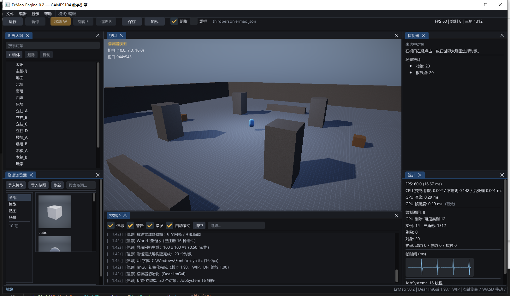
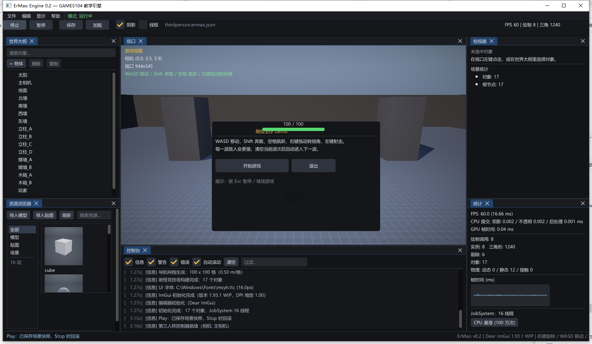

# ErMao Engine（二毛引擎）v0.8

## 🧭 Git 与版本管理

- 稳定分支 `main`；里程碑标签 `v0.2.0 ~ v0.8.0`（`git tag -n`）
- 提交规范、分支模型、钩子、CI 见 [Git 工作流](docs/11-Git工作流.md)
- 接远程仓库：`pwsh -File tools\git-remote.ps1 -Url <仓库地址> -Push`
- 本地钩子：`git config core.hooksPath .githooks`（拦截构建产物 + 文档引用检查）

## ✍️ 博客系列规划

学习成果要整理成博客：`docs/blog/00-系列规划.md`（10 篇 / 41 章，含每篇细纲、配图、实验与自检），
发布前按 `docs/blog/审稿清单.md` 过 6 道关——**作者自己读不懂就不发**。

## 📖 学习文档（双击即开）

不要一篇篇翻 Markdown 了——根目录的 **`ErMao-学习文档.html`** 是单文件离线文档站：

- 左侧章节树：入门 / 工程 / 24 讲 GAMES104 讲义，点一下就跳；
- 顶部搜索：输入"阴影""蒙皮""GPU 剔除"直接定位（`/` 聚焦）；
- 每章顶部有 **本章结构图**，每讲另配 **数据流原理图**，关键章节配运行截图；
- 图片点击放大、代码块一键复制、`←`/`→` 翻章、深色/浅色切换、记住上次读到哪。

重新生成（改了 Markdown 之后）：

```bat
python tools\build_docs_site.py
```

脚本会把 37 篇文档、全部截图/原理图、CSS/JS 一起内嵌进一个 HTML（约 22 MB），
拷到任何地方双击都能看。


> Windows / C++17 / D3D11 / **Dear ImGui** 的 GAMES104 教学引擎。
> 分层干净、能一条命令跑起来、编辑器五脏俱全，关卡与玩法**代码优先**。
> v0.3 起自带一个能玩的**刷怪生存 Demo**（碰撞、3D 头顶血条、游戏菜单）。


## 30 秒跑起来

```bat
build.bat
build\bin\ErMao.exe            :: 打开编辑器（默认加载刷怪竞技场）
```

- 编辑器里按 **F5**（或工具栏"运行"）→ 弹出游戏菜单 → `开始游戏`
- 直接看演示：`build\bin\ErMao.exe --demo`
- 打包：菜单 `文件 → 打包 → 打包 Windows`

## 操作

| 场景 | 操作 |
|---|---|
| 视口 | 右键拖动 + WASD/QE 移动相机 · 左键拾取 · **W/E/R 位移/旋转/缩放 Gizmo** · F 聚焦 |
| 运行模式 | WASD 移动 · Shift 奔跑 · 空格跳跃 · 右键拖动转视角 · **左键射击** · Esc 暂停 |
| 编辑器 | Ctrl+S/O/N 保存/打开/新建 · Ctrl+D 复制 · Delete 删除 · F2 线框 · F4 阴影 · F11 隐藏 UI · F12 截图 |

## v0.8 做了什么（2026-11-01 凌晨）

- **AI 优先接口**：`--script commands.json --json-out report.json`，无头完成
  「建场景 → 加组件/改字段（反射） → 导资产 → 存盘 → 截图 → 打包」；`--validate` 输出结构化校验
- 命令集：`scene.*` / `object.*` / `component.add|set|get` / `assets.import|list` / `level.build` /
  `camera.set` / `screenshot` / `package.game` / `validate`
- 示例：`agent/examples/*.json`（建场景、接 DCC 资产、一键出游戏包）；指南 `docs/10-AI开发指南.md`
- 设计立场：**不做蓝图/节点图**；逻辑 = C++ 组件 + JSON 数据，编辑器只是命令的一个前端

## v0.7 做了什么（2026-11-01 凌晨）

- **音频**：XAudio2 + WAV/PCM 子系统（`platform/Audio`），2D/3D 幸存者接入开枪/命中/拾取/升级/死亡音效，暂停菜单可调音量与静音；
  素材来自 OpenGameArt CC0（`assets/audio`，见 `docs/assets-credits.md`），`--audio-test` 可单独验证
- **数学参考资料**：每讲讲义末尾新增「数学依据与参考资料」，列出用到的原理、数学形式与出处；
  总表 `docs/lectures/参考资料.md`（RTR4 / PBRT / GAMES101 / GAMES104 / 论文）
- **Vulkan 后端（阶段一）**：`--vulkan-test` 跑通 instance → device → Win32 surface → swapchain → render pass → pipeline → SPIR-V 三角形 → present → 截图；
  D3D11 仍是主路径，后续按 RHI 抽象逐步迁 pass（见 `L26`）

## v0.6 做了什么（2026-10-31 深夜）

- **3D 幸存者**：`--demo3d`；XZ 平面移动、第三人称俯视跟随、外部 OBJ 角色/亡灵/墓碑、粒子特效、波次与升级
- **外部资源链路**：`AssetManager::GetMeshAsset` 懒加载 OBJ（`models/kenney/*.obj`），`World` 自动识别"路径式"网格/贴图
- **特效**：粒子支持贴图 + 加法混合（Kenney Particle Pack 火焰/火花/星光），火把/命中/拾取都有特效
- **发布**：2D 与 3D **两个游戏包**都能打出可运行的 Windows exe；Linux 各出一份源码包
- **素材**：Kenney Blocky Characters / Graveyard Kit / Particle Pack（CC0），登记在 `docs/assets-credits.md`

## v0.5 做了什么（2026-10-31 晚）

- **2D 渲染**：正交相机 `Camera2D` + 精灵批处理 `SpritePass` + `Sprite.hlsl`；像素风点采样、序列帧 UV、按 layer 排序
- **2D 游戏**：类《吸血鬼幸存者》的「二毛幸存者」——WASD 移动、自动射箭、兽人波次、经验宝石、升级、主菜单/暂停/失败
- **游戏包发布**（重点）：`文件 → 打包 → 打包游戏：二毛幸存者（Windows）` 产出可直接运行的 `ErMaoSurvivors.exe`；
  Linux 产出同一款游戏的**源码包**（引擎只有 D3D11 后端，README 写明补齐步骤，不假装有 Linux 二进制）
- **编辑器**：Gizmo 三件套（W 位移 / E 旋转 / R 缩放）；相机改为右键+WASD，给 Gizmo 让路
- **素材**：用户提供的 Soldier/Orc 角色包 + Kenney Tiny Dungeon（CC0，`assets/sprites/`，附许可，登记在 `docs/assets-credits.md`）
- 包装细节：`game.cfg` 决定默认关卡与是否进编辑器；`--demo2d` 一键演示

## v0.4 做了什么（2026-10-31）

- **骨骼蒙皮**（第 8 讲）：骨架/逆绑定矩阵/关键帧采样/姿势混合/LBS shader；`--level skinning` 四个角色不同相位与混合权重
- **粒子系统**（第 12 讲）：SoA + 累加器发射 + swap-remove + billboard；竞技场两处火把 + 传送门
- **行为树**（第 17 讲）：Sequence/Selector/Cooldown/Running；敌人巡逻/追击/攻击/低血逃跑
- **讲义**：`docs/lectures/` 第 0 课 + 22 讲 + 术语表 + 学习指南；每条原理都给数学依据与代码位置
- **GPU Driven**（第 22 讲）：compute 视锥剔除 + 间接绘制；`--level cull` 6400 实例压测，可见数与 CPU 一致
- **工程**：文档引用检查（`build.bat` 自动跑）、GPU 计时拆成"渲染成本/帧跨度"两个口径、`--noeditor` 也走离屏 RT 统一口径

## v0.3 做了什么

### 1. 刷怪生存 Demo（代码优先）
- `game/WaveArena.cpp`：52×52 竞技场、围墙、立柱、矮墙、木箱、场地灯
- `game/WaveGame.cpp`：`Health / Combat / Projectile / Enemy` 四个玩法组件 + `WaveGame` 波次导演
- 玩法：左键射击 → 球-球命中 → 敌人掉血；敌人近身攻击；清波进下一波；死亡结算
- 碰撞：角色/敌人 vs 静态几何（球-AABB，带竖直区间）、投射物 vs 敌人（球-球）

### 2. 3D UI 与游戏菜单
- **头顶血条**：世界坐标投影到屏幕，ImGui 前景层绘制；带遮挡检测、距离缩放、受击白闪、玩家血量数字
- **菜单**：主菜单 / 暂停（Esc）/ 失败结算，全部 ImGui
- **HUD**：生命条、波次、得分、准星、操作提示

### 3. 编辑器补齐
- **资源浏览器**（Unity 风格）：左侧分类、右侧缩略图网格；模型缩略图是**真的把网格渲染到 128² RT**；双击放入场景/赋贴图/加载场景
- **位移 Gizmo**：X/Y/Z 三轴拖拽（屏幕投影 + 世界/像素换算）
- **F 聚焦**：按包围盒把编辑器相机对准选中物体

### 4. 打包
- `文件 → 打包 → 打包 Windows`：生成 `dist/ErMao-Windows/`（exe + shaders + assets + run.bat），**已验证可独立运行**
- `文件 → 打包 → 打包 Linux（源码包）`：引擎只有 D3D11 后端，导出的是源码 + 构建脚本 + `README-LINUX.md`（写明补 Vulkan/OpenGL 的步骤），不假装有 Linux 二进制

### 5. 修复
- 第三人称鼠标 **X 轴反向**（yaw 符号），并加"反转 Y 轴"选项；按住空格不再连跳
- 审核 R4–R8 的收尾项：消息钩子只观察不消费、`WantCaptureKeyboard`、`imgui.ini` 落在 exe 旁、字体路径取自 `GetWindowsDirectoryW`、ImGui 独立 target、GPU 查询状态机、`Editor::Shutdown`、PIE 逻辑去重、PIE 后玩家指针悬垂、平台边缘侧滑等（逐条见 `docs/07`）

## 截图

| 编辑器（资源浏览器 + Gizmo） | 游戏菜单 |
|---|---|
|  |  |

## 文档

| 文档 | 内容 |
|---|---|
| [方案文档](docs/00-ErMao引擎方案文档.md) | 架构、选型、模块设计、里程碑 |
| [GAMES104 课程映射](docs/01-GAMES104-课程映射.md) | 22 讲 × 代码 × 演示 × 完成度 |
| [分章讲解](docs/02-分章讲解.md) | 原理 → 实现 → 验证 → 差距 |
| [构建与运行](docs/03-构建与运行.md) | 环境、CLI、排错、代码导读 |
| [UI 与 ImGui 编辑器](docs/04-UI与ImGui编辑器.md) | 集成、面板、离屏视口、资源导入 |
| [第三人称关卡](docs/05-第三人称关卡.md) | 关卡构建、控制器数学、弹簧臂 |
| [审核修复记录](docs/06-审核修复记录.md) | R1–R3 逐条回应 |
| [v0.3 新功能](docs/07-v0.3-新功能.md) | Demo、血条、资源浏览器、Gizmo、打包、R4–R8 修复 |
| **[GAMES104 讲义](docs/lectures/README.md)** | 22 讲逐讲：数学依据 + 代码位置 + 可复现实验 + 自测题 |
| [学习指南](docs/08-学习指南.md) | 七天路线、读代码方法、提问模板、边界说明 |

## 目录

```
engine/src/
  core/       数学、JSON、日志、计时、文件（UTF-8）、JobSystem
  platform/   Win32 窗口、输入（边沿检测）、文件对话框
  rhi/        D3D11 设备、缓冲、纹理、RT、运行时 Shader、截图
  renderer/   相机、网格、实例化、阴影、天空、后处理、调试线、离屏视口、缩略图
  scene/      World / GameObject / Component / 反射 / 序列化 / 射线查询
  asset/      AssetManager（注册表 + 导入）、OBJ 加载
  physics/    简化刚体（世界坐标、球/盒碰撞、休眠）
  ai/         导航栅格、A*、感知与状态机
  game/       第三人称关卡、刷怪竞技场、控制器、WaveGame
  editor/     ImGuiLayer、编辑器面板、Gizmo
  runtime/    Engine 主循环、Packager（Windows/Linux 包）
third_party/imgui/ Dear ImGui（docking，仅保留编译必需文件）
```

## 自动化

```bat
ErMao.exe --test-serialize --frames 3      :: 场景 JSON 往返（字节级）
ErMao.exe --smoke --frames 200             :: 脚本化移动/跳跃
ErMao.exe --import engine\assets\models\crystal.obj --frames 3
ErMao.exe --demo --frames 420 --screenshot demo.png
ErMao.exe --package windows --frames 2
```

## 已知缺口

骨骼蒙皮、粒子、行为树、网络、GI、GPU Driven；编辑器没有旋转/缩放 Gizmo、撤销栈；
Linux 运行时需要先补 Vulkan/OpenGL 后端。逐条状态见课程映射与审核修复记录。
