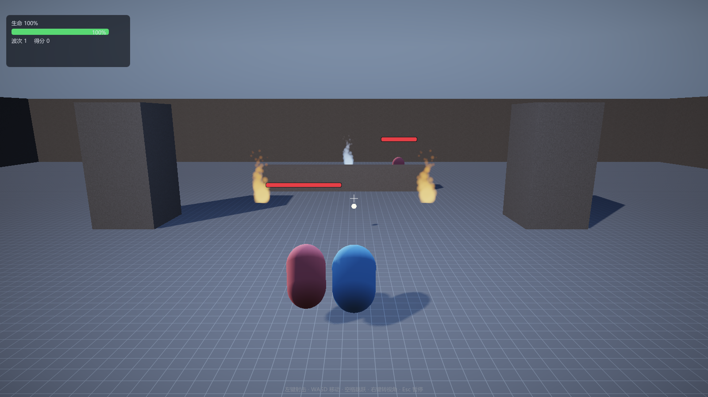

# ErMao Engine（二毛引擎）v0.8.7

> Windows / C++17 / D3D11 / **Dear ImGui** 的 GAMES104 教学引擎。
> 分层干净、一条命令跑起来、编辑器完整；关卡与玩法**代码优先**，带可玩的 2D/3D 幸存者 Demo。
>
> 讲义面向：**会写 C++、用过 UE 做玩法/蓝图，但没有从零实现过引擎各模块的读者**。
> 不要求图形学/物理/动画/音频基础；每讲从可观察现象和最简实现开始，再进入源码与数学。



## 30 秒跑起来

```bat
setup.bat                        :: 第一次：检查依赖 + 构建 + 冒烟
run.bat                          :: 发布版：打开编辑器，不弹控制台、不写日志
run.bat dev                      :: 开发版：Debug + 控制台日志（排错用）
```

- 编辑器里按 **F5**（或工具栏“运行”）直接开局；关卡菜单只有 **2D / 3D 幸存者 Demo** 两个；
- 直接看演示：`run.bat --demo2d` / `run.bat --demo3d`（发布版），或加 `dev`；
- 联机：主机 `run.bat dev --net-host 7777`，另一台机器 `run.bat dev --net-join <主机IP>:7777`（默认 2D，加 `--demo3d` 开 3D）；
- 编辑器视角：**透视 / 正视图 / 俯视图**（V 切换），设置面板可调 **镜头速度**；
- 打包：菜单 `文件 → 打包`。

环境要求、CLI 参数、CLion/VS 配置与排错见 **[构建与运行](文档/版本文档/构建与运行.md)**。

## 操作

| 场景 | 操作 |
|---|---|
| 视口 | 透视：右键拖动 + WASD/QE 移动相机 · 正/俯视：右键拖动平移 + 滚轮缩放 · 左键拾取 · **W/E/R 位移/旋转/缩放 Gizmo** · F 聚焦 · V 切换视角（仅 3D；2D 固定正视图） |
| 运行模式 | WASD 移动 · Shift 奔跑 · 空格跳跃 · 右键拖动转视角 · 左键射击 · Esc 暂停 |
| 编辑器 | Ctrl+S/O/N 保存/打开/新建 · **Ctrl+Z 撤销 / Ctrl+Y 重做** · Ctrl+D 复制 · Delete 删除 · F2 线框 · F4 阴影 · F11 隐藏 UI · F12 截图 |

## 现在能做什么（v0.8.7）

- **渲染**：D3D11 前向管线，Shadow → Sky → Opaque → Skinned → Particle → Debug → Post；
  PBR/阴影/后处理、GPU Driven 剔除（`--level cull`）、2D 精灵批处理；
- **场景**：GameObject/Component、反射驱动 Inspector、JSON 存读、Play-In-Editor 快照回滚；
- **编辑器**：ImGui Dock、世界大纲/检视器/资源浏览器/控制台/统计/设置、拾取、Gizmo、模型贴图导入；
- **玩法**：2D / 3D 幸存者两个 Demo 关卡（碰撞、血条、菜单、音效）；2D 幸存者进入先选职业（游侠/剑士/法师立绘，只转向不播行走动画），第 1 层为四步操作教学（移动/拾取灵气/习得法术/强化，未完成操作会暂停刷怪与计时），之后 20 层每层随机抽取通关条件（存活/击杀/精英/拾取经验/武学总等级），层间结算并恢复生命；界面按 `xianxia-design` 参考改为暖宣纸 + 青玉 + 朱砂配色（主菜单/出战准备/HUD/暂停/设置/结算/技能图鉴），角色与技能按身体高度居中/绘制；职业决定基础技能、击杀逐个掉落新技能（手动拾取、最多 5 个）、按已拥有技能掉落强化、技能序列帧特效、10 个技能（雷霆/回旋刃/霜环/毒雾/火球/陨石/黑洞/棱镜光束/毒爆等）、小地图与随机抽奖 buff 宝箱、6 种递增怪物、带碰撞的大地图；第三人称/竞技场/蒙皮/GPU 剔除保留为内部示例；
- **网络**：引擎级 UDP 同步（ENet 1.3.18）——主机权威、20Hz 快照、反射字段增量、客户端预测/插值，2D/3D 幸存者共用同一套接口；`--net-host` / `--net-join` / `--net-test`，详见 [网络同步](文档/版本文档/网络同步.md)；
- **系统**：骨骼蒙皮与动画混合、教学级物理、导航 A* + 行为树、XAudio2 音频；
- **工具**：`--script` AI 无头接口（建场景/改组件/导资产/截图/打包）、Windows 游戏包、Linux 源码包；
- **Web / 微信**：`web/` 提供 Emscripten + WebGL 1.0 的 2D 幸存者运行时（H5 页面、隐藏摇杆的全屏触控移动、移动端缩放），以及 `wx-transformer` 小游戏打包脚本；复用同一份 C++ 玩法与 ImGui UI，详见 [web/README.md](web/README.md)；
- **Vulkan**：阶段一三角形 + 截图，用来演示 RHI 抽象方向。

版本历史、每个版本做了什么、还缺什么：**[版本记录](文档/版本文档/版本记录.md)**（明细在 `CHANGELOG.md`）。

## 文档

全部文档只有三类入口，先看大纲：**[文档/README.md](文档/README.md)**。

| 入口 | 内容 |
|---|---|
| **[代码总纲](文档/代码总纲/00-代码总纲.md)** | `main` → 全部次级函数的调用堆栈，7 张时序图，函数索引与速查表 |
| **[版本文档](文档/版本文档/版本记录.md)** | [版本记录](文档/版本文档/版本记录.md)、[构建与运行](文档/版本文档/构建与运行.md)、[发布与工程](文档/版本文档/发布与工程.md)、[修复记录](文档/版本文档/修复记录.md) |
| **[教学文档](文档/教学文档/README.md)** | [教学大纲](文档/教学文档/README.md)、[引擎架构](文档/教学文档/引擎架构.md)、[课程映射](文档/教学文档/课程映射.md)、[分章讲解](文档/教学文档/分章讲解.md)、[学习指南](文档/教学文档/学习指南.md)、[编辑器与关卡](文档/教学文档/编辑器与关卡.md)、[AI 开发指南](文档/教学文档/AI开发指南.md) |
| **[GAMES104 讲义](文档/教学文档/讲义/README.md)** | 26 篇讲义（L00–L26）：现象 → 最简实现 → 失败场景 → 正式方案 → 源码 → 可验算例子 → 进阶数学与实验 |

## 从哪开始读

- 没写过渲染器：先读 [第 0 课](文档/教学文档/讲义/L00-从黑屏到第一个三角形.md)；
- 想理解“一帧怎样更新”：读 [第 1 讲：引擎架构与主循环](文档/教学文档/讲义/L01-引擎架构与主循环.md)；
- 术语不熟：查 [术语表](文档/教学文档/讲义/术语表.md)；
- 参考资料：见 [参考资料](文档/教学文档/讲义/参考资料.md)。

## 目录

```
engine/src/
  core/       数学、JSON、日志、计时、文件（UTF-8）、JobSystem
  platform/   Win32 窗口、输入边沿、音频、文件对话框
  rhi/        D3D11 设备、缓冲、纹理、RT、运行时 Shader、截图、Vulkan 实验后端
  renderer/   相机、网格、实例化、阴影、天空、后处理、调试线、离屏视口、缩略图
  scene/      World / GameObject / Component / 反射 / 序列化 / 射线查询
  asset/      AssetManager（注册表 + 导入）、OBJ 加载
  animation/  骨骼、关键帧采样、混合、蒙皮矩阵
  physics/    简化刚体（世界坐标、球/盒碰撞、休眠）
  ai/         导航栅格、A*、感知与状态机、行为树
  game/       代码关卡、第三人称控制器、WaveGame、幸存者、粒子
  editor/     ImGuiLayer、编辑器面板、Gizmo、PIE
  runtime/    Engine 主循环、AgentScript、Packager
third_party/imgui/  Dear ImGui（docking，仅保留编译必需文件）
```

## 自动化

```bat
ErMao.exe --test-serialize --frames 3      :: 场景 JSON 往返（字节级）
ErMao.exe --test-undo --noeditor           :: 编辑器撤销/重做自检
ErMao.exe --smoke --frames 200             :: 脚本化移动/跳跃
ErMao.exe --import engine\assets\models\crystal.obj --frames 3
ErMao.exe --demo --frames 420 --screenshot demo.png
ErMao.exe --level survivors --noeditor --play --ui-preview pause --frames 90 --screenshot ui-pause.png
ErMao.exe --package-game windows --frames 2
```

## 已知缺口

- **Linux 没有二进制**：只有 Win32 + D3D11，发布的是源码包；
- **Vulkan 只到阶段一**：三角形 + 截图，渲染 Pass 未迁；
- **网络是轻量预测校正，不是 rollback**：没有回滚重放、延迟补偿和专用服务器，客户端技能特效/伤害数字仍未复制；**GI 只有半球环境光近似**（L21），没有探针/SSGI；
- **编辑器没有撤销栈**；
- **测试以自检命令为主**：序列化/冒烟/导入/打包/文档引用，数学与 JSON 单元测试待补。
- **Web/微信是第一阶段**：只迁 2D 幸存者；音频仍静音，3D/编辑器未迁；微信真机预览需要小游戏 AppID 和开发者工具。

逐条状态与后续计划见 [版本记录](文档/版本文档/版本记录.md)。

## 许可与素材

- 代码：见根目录 `LICENSE`；
- 第三方素材（Kenney / OpenGameArt / 用户角色包）来源与许可见 [发布与工程 §8](文档/版本文档/发布与工程.md#8-素材来源与许可)；
- Dear ImGui：MIT（`third_party/imgui/LICENSE.txt`）。
