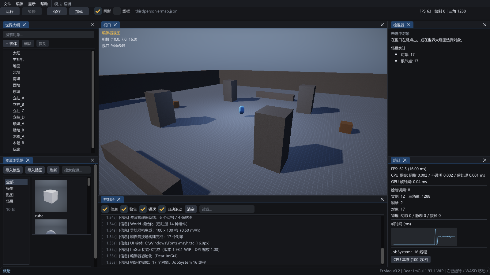

# UI 与 ImGui 编辑器（v0.2）

> 背景：v0.1 的自研即时模式 UI 只有 600 行，控件少、没有 Dock、中文依赖 GDI 图集。
> 审核报告也指出"自研 UI 是最大风险项"。v0.2 直接接入 **Dear ImGui 1.93.1（docking 分支）**，
> 把预算从"造控件"挪回"引擎功能"。



## 1. 集成方式

```
third_party/imgui/            # 官方源码（docking 分支），随仓库一起分发
engine/src/editor/
  ImGuiLayer.h/.cpp           # 上下文、Win32/DX11 后端、消息转发、字体与主题
  EditorUI.h/.cpp             # 编辑器：菜单/工具栏/Dock/七大面板
```

- CMake 把 `imgui.cpp / imgui_draw.cpp / imgui_tables.cpp / imgui_widgets.cpp / imgui_demo.cpp`
  和两个后端编译进 `ErMaoEngine`，不引入额外二进制依赖。
- **消息优先级**：`Window` 暴露 `onRawMessage` 回调，`ImGuiLayer::WndProc` 先于窗口逻辑消费消息
  （ImGui 的 Win32 后端需要看到 `WM_CHAR/WM_INPUT/WM_SETCURSOR` 等原始消息）。
- **字体**：优先加载 `C:/Windows/Fonts/msyh.ttc`（微软雅黑），带
  `GetGlyphRangesChineseSimplifiedCommon()`，中文界面直接可用；缺失时回退 Segoe UI / 默认字体。
- **主题**：暗色 + 琥珀色强调，`ScaleAllSizes(DPI)` 跟随系统缩放。

## 2. 布局：Dock 而不是"贴纸"

`ImGui::DockSpace` + `ImGui::DockBuilder` 生成一套默认布局（只在 `imgui.ini` 不存在时构建一次）：

```
┌───────────────────────────────────────────────────────────────┐
│ 菜单栏：文件 / 编辑 / 显示 / 帮助            模式: 编辑        │
├───────────────────────────────────────────────────────────────┤
│ 工具栏：运行 暂停 保存 加载 | 阴影 线框 | 场景名 | FPS/绘制    │
├──────────────┬──────────────────────────────┬─────────────────┤
│ 世界大纲      │                              │ 检视器           │
│              │           视口                │                 │
├──────────────┤      （离屏 RT + ImGui 图像）  ├─────────────────┤
│ 资源浏览器    │                              │ 统计 / 设置      │
├──────────────┴──────────────────────────────┴─────────────────┤
│ 控制台                                                         │
├───────────────────────────────────────────────────────────────┤
│ 状态栏：操作反馈 / 版本信息                                     │
└───────────────────────────────────────────────────────────────┘
```

用户拖动分隔条、重排面板都会被 ImGui 自动保存到 `imgui.ini`。

## 3. 视口：真正的离屏渲染

v0.1 是"3D 铺满窗口 + UI 覆盖"。v0.2 改成引擎里的标准做法：

1. `Renderer::RenderToViewport(camera, scene, time, w, h, wireframe)` 把场景渲染到
   `RGBA8` 的离屏 RT（内部先渲染 HDR 场景，再跑 Post 输出到该 RT）；
2. 编辑器取 `renderer.ViewportTexture()`，用 `ImGui::Image` 贴进视口面板；
3. 视口尺寸每帧回传给相机设置 `aspect`，所以拖动窗口/面板不会变形；
4. 鼠标拾取把 ImGui 的屏幕坐标换算成视口局部坐标，再走 `World::Raycast`。

好处：视口可以任意大小、任意位置，可以被面板遮挡；将来做多视口（游戏视角/关卡总览）只是多一个 RT。

## 4. 七大面板

| 面板 | 能力 |
|---|---|
| **视口** | 离屏渲染、右键拖动环视、WASD/QE 飞行、左键拾取、HUD（相机/视口尺寸/操作提示） |
| **世界大纲** | 层级树（父子缩进）、搜索过滤、创建（立方体/球/圆柱/圆环/空物体/点光/相机）、删除、复制、右键菜单（复制/删除/移到原点） |
| **检视器** | 名字编辑、启用开关、Transform（位置/旋转/缩放）、组件折叠面板、反射字段控件、添加/移除组件 |
| **资源浏览器** | 资产表格（名称/类型/面数或来源）、搜索、导入模型、导入贴图、刷新、双击网格放入场景、双击贴图赋给选中对象、双击场景加载 |
| **控制台** | 分级过滤（信息/警告/错误）、文本过滤、自动滚动、清空、颜色区分 |
| **统计** | FPS/帧时间、CPU 提交耗时、**GPU 时间戳**、绘制/实例/三角/剔除、对象数、物理统计、帧时间曲线、JobSystem 基准 |
| **设置** | 曝光/阴影/线框/调试视图、太阳与半球环境光、重力与迭代次数、导航网格重建 |

## 5. 反射驱动检视器

检视器不写死任何组件：遍历 `TypeInfo::fields`，按 `FieldType` 映射控件：

| FieldType | 控件 |
|---|---|
| Bool | `Checkbox` |
| Int | `DragInt`（`shape` 特殊处理成"球体/盒体"下拉） |
| Float | `DragFloat`（带 min/max） |
| Vec3 | `DragFloat3` |
| Color / Vec4 | `ColorEdit4` |
| String | `InputText`（回车提交） |
| MeshAsset | 内置网格 + 已导入网格的下拉 |
| TextureAsset | 内置贴图 + 已导入贴图的下拉（含"无"） |

新增一个组件只需要写 `Describe()`，UI 和 JSON 同时获得支持——这是 v0.1 就定下的设计，v0.2 只是换了渲染层。

## 6. 资源导入链路

```
用户点"导入模型" → Win32 打开对话框（GetOpenFileNameW，UTF-8 路径）
  → AssetManager::ImportMesh
      → 复制到 exe 旁 assets/models/<文件名>
      → ObjLoader 解析（v/vn/vt/f、负索引、多 group）
      → Mesh 上传 GPU
      → 注册到资产表（名称/路径/顶点/索引）
  → 自动在相机前方实例化一个对象
```

贴图同理（WIC 解码 png/jpg/bmp）。`--import <path>` 是无界面的导入自检：

```
[INFO] 导入模型成功: models/crystal.obj（6 顶点 / 8 三角形）
[INFO] [自检] 导入成功：D:\...\engine\assets\models\crystal.obj（6 顶点 / 8 三角形）
```

## 7. 自动化与可验证性

引擎保留并扩展了 CLI：

| 参数 | 作用 |
|---|---|
| `--frames N` | 跑 N 帧退出 |
| `--screenshot p` | 第 N 帧截图（在 Present 之前读后备缓冲） |
| `--play` / `--noeditor` | 直接进游戏 / 关掉编辑器 |
| `--level thirdperson\|demo` | 选关卡 |
| `--test-serialize` | 场景 JSON 往返自检（字节级比较） |
| `--smoke` | 脚本化输入：向前走 + 跳，日志打印玩家位置 |
| `--import path` | 模型导入自检 |

这些开关让"UI 交互失效"这类问题不会再被掩盖：`--smoke` 直接验证角色位移，`--import` 直接验证资源链路。

---

## 8. v0.3：资源浏览器与编辑操作

### 8.1 资源浏览器（Unity 风格）

v0.2 的资产面板是一个窄表格，只能看到名字；v0.3 重做成"分类 + 缩略图网格"：

- 左侧分类：全部 / 模型 / 贴图 / 场景；
- 右侧：每个资产 104×104 缩略图 + 文件名，`ImGui::BeginTable` 自适应列数；
- **模型缩略图是真实渲染**：`Renderer::GetMeshThumbnail` 用网格包围球算相机距离，
  把网格渲染到 128² RT（天空 + 阴影 + PBR），按 meshId 缓存，只渲染一次；
- 贴图直接显示 SRV；场景用占位块；
- 单击选中（底部显示顶点/索引/路径），双击执行默认动作（放入场景 / 赋材质 / 加载场景）。

### 8.2 位移 Gizmo 与 F 聚焦

- Gizmo：选中物体后在视口绘制三轴（屏幕空间投影），命中测试用"点到线段距离 < 10px"；
  拖拽时把鼠标位移投影到轴的屏幕方向，再乘 `axisLength / 屏幕长度` 得到世界位移；
- F 聚焦：`FocusSelected` 用物体的世界 AABB 求中心与半径，按 FOV 计算相机距离，
  沿当前朝向后移，保持朝向不变。

两者都是纯编辑器侧实现（不污染场景/渲染层），坐标换算集中在 `DrawGizmo` 一个函数里。
