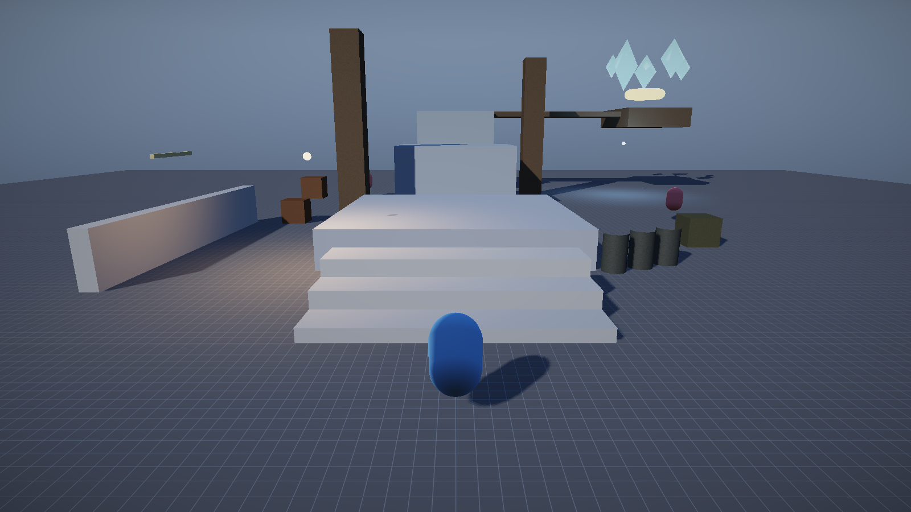

# 第三人称关卡与角色控制（代码优先）

> 用户的开发方式是 **代码优先**：编辑器只负责"看得见、改得动"，关卡与玩法都写成 C++。
> 本文说明这套关卡怎么组织、第三人称控制器怎么工作、以及如何验证它真的在跑。



## 1. 关卡就是一个函数

`engine/src/game/Levels.h`：

```cpp
namespace erm::game {
void BuildThirdPersonLevel(World& world); // 第三人称演示关卡
void BuildDemoScene(World& world);        // 早期基础场景
}
```

`Engine::Init` 直接调用：

```cpp
m_world.Init(&m_assets);
game::BuildThirdPersonLevel(m_world);
```

**启动时永远用 C++ 构建关卡**，不会去读旧的 `.ermao.json`。存档只通过编辑器的
"加载"显式读取——这样改代码立刻生效，不会被上次保存的场景盖住（v0.1 踩过这个坑）。

### 1.1 关卡里的构建工具

`ThirdPersonLevel.cpp` 里只有三个小函数，关卡代码读起来像配置：

```cpp
SpawnStaticBox(world, "平台A", {0,0.6f,1}, {8,1.2f,8}, {0.40f,0.44f,0.52f,1});
SpawnLamp(world, "路灯_0", {-4,3.2f,5}, {1,0.62f,0.3f,1}, 7.0f, 9.0f);
SpawnAi(world, "巡逻者_0", {-8,1,-8}, 4.0f);
```

- `SpawnMesh`：名字 + 网格 + 位置 + 缩放 + 颜色 + 贴图/UV/粗糙度；
- `SpawnStaticBox`：在网格基础上加静态 `RigidBodyComponent`（同时供导航栅格与物理使用）；
- `SpawnLamp` / `SpawnAi` / `SpawnCrystals`：组合出灯光、AI、外部 OBJ 装饰。

### 1.2 关卡内容

| 区域 | 物件 | 玩法作用 |
|---|---|---|
| 起点 | 三级台阶 | 缓冲/教学，告诉玩家"可以跳" |
| 主平台链 | A(1.2m) → B(3.2m) → C(5.2m) | 两段 2m 间隙，需要跑跳 |
| 侧廊 | 空中长廊 + 终点台 + 旋转光环 | 目标点，给出"到达"的视觉反馈 |
| 障碍 | 两根立柱 + 矮墙 + 木箱堆 | 演示相机弹簧臂、导航绕行 |
| 装饰 | 5 颗外部 OBJ 水晶、风车（关键帧动画） | 验证资源链路与动画系统 |
| AI | 3 个巡逻者 | 感知 + A* 追击 |
| 灯光 | 2 盏路灯（点光） | 夜间氛围 + 点光衰减 |

## 2. 第三人称控制器

`engine/src/game/ThirdPersonController.h/.cpp`，一个组件搞定"移动 + 跳跃 + 相机"。

### 2.1 移动：相机相对

```cpp
const Quat yawRotation = Quat::FromEuler(ToRadians(yawDegrees), 0, 0);
const Vec3 cameraForward = yawRotation.RotateVector({0,0,-1});
const Vec3 cameraRight   = yawRotation.RotateVector({1,0,0});

Vec3 wish = W*cameraForward - S*cameraForward + D*cameraRight - A*cameraRight;
wish = Normalize(wish);

velocity.x = wish.x * (running ? runSpeed : moveSpeed);
velocity.z = wish.z * (...);
```

角色朝向单独用最短角插值转向移动方向，避免"按 S 时角色倒着跑"的观感。

### 2.2 竖直方向：重力 + 跳跃 + 地面检测

```cpp
if (grounded && jumpPressed) { m_verticalVelocity = jumpSpeed; grounded = false; }
m_verticalVelocity += gravity * dt;      // gravity = -22
position.y += m_verticalVelocity * dt;

// 向下打一条射线，命中面就是脚下地面
Ray groundRay{position + Vec3(0, 0.15f, 0), Vec3(0,-1,0)};
if (world->Raycast(groundRay, height*0.5f + 0.35f, hit) && hit.object != m_owner) {
    if (position.y <= hit.point.y + height*0.5f + 0.05f) { snap; grounded = true; }
}
```

用**射线**而不是物理刚体做角色，是教学引擎里最稳的选择：不会和箱子堆叠打架，
上台阶/站平台只要"脚底有面"就行。

### 2.3 水平碰撞：球 vs AABB 推离

```cpp
for (每个带 MeshRenderer 的物体) {
    AABB box = 世界包围盒;
    Vec3 closest = clamp(center, box.min, box.max);
    if (距离 < radius) {
        position += normalize(center - closest) * (radius - 距离);
        清掉速度沿法线的分量;   // 防止贴墙抖动
    }
}
```

只在 XZ 上推离，Y 交给地面射线——这样"走上斜坡/台阶"不会被水平碰撞挡住。

### 2.4 相机：轨道 + 弹簧臂

相机不是角色的子节点，而是每帧被控制器摆放：

```cpp
Quat rot = Quat::FromEuler(yaw, pitch, 0);
Vec3 forward = rot.RotateVector({0,0,-1});
Vec3 head = playerPos + Vec3(0, cameraHeight, 0);

float distance = cameraDistance;
Ray arm{head, -forward};
if (world->Raycast(arm, distance + 0.3f, hit) && hit.object != player)
    distance = max(cameraMinDistance, hit.distance - 0.35f); // 撞墙拉近

cameraObject->SetPosition(head - forward * distance);
cameraObject->SetRotation(rot);
```

- 右键拖动：`yaw += dx * sensitivity; pitch -= dy * sensitivity`，俯仰夹在 ±35°/-55°；
- 滚轮：缩放 `cameraDistance`（2~9m）；
- 弹簧臂：射线撞到立柱/墙就把相机拉近，避免"镜头穿墙"。

## 3. 输入与 UI 的分工

| 场景 | 输入来源 |
|---|---|
| 编辑模式 | ImGui 视口：右键拖动 + WASD/QE |
| 运行模式 | 引擎 `Input`（WASD/Shift/Space/右键），但**只有视口被 hover 时**才交给角色 |

```cpp
ThirdPersonController::SetInputEnabled(playing && (!editor || editor.ViewportHovered()));
```

这样在 Inspector 里拖数值时角色不会乱跑。

## 4. 验证方式（无人工干预）

```bat
build\bin\ErMao.exe --smoke --frames 200
```

`--smoke` 会绕过键盘，直接给控制器一段"向前走 + 第 60 帧起跳"的脚本输入，并打印位置：

```
[冒烟] 帧 30 玩家位置 (0.00, 0.95, 12.00)
[冒烟] 帧 60 玩家位置 (0.00, 0.95, 9.70)
[冒烟] 帧 120 玩家位置 (0.00, 0.95, 5.10)
[冒烟] 帧 180 玩家位置 (0.00, 0.95, 5.10)
```

- 90 帧走了 6.9m ≈ 4.6 m/s × 1.5s ✔（移动速度正确）
- Y 一直是 0.95（身高 1.9 的一半）✔（贴地、没有掉下去）
- 第 60 帧起跳后回到地面 ✔（重力与地面检测闭环）

## 5. 如何扩展

- **加一段新关卡**：在 `BuildThirdPersonLevel` 里继续 `SpawnStaticBox/ SpawnMesh`，或新写一个
  `BuildXxxLevel(World&)` 并在 `Engine::Init` 里按 `--level` 选择。
- **换角色模型**：把玩家对象的 `MeshRenderer.mesh` 指向导入的 OBJ/GLTF（目前支持 OBJ），
  控制器只依赖胶囊半径与身高，不依赖网格。
- **接动画**：`ThirdPersonController` 已经有 `grounded` 与速度，可直接驱动 Animator 的
  idle/walk/run 切换（v0.3 计划）。
