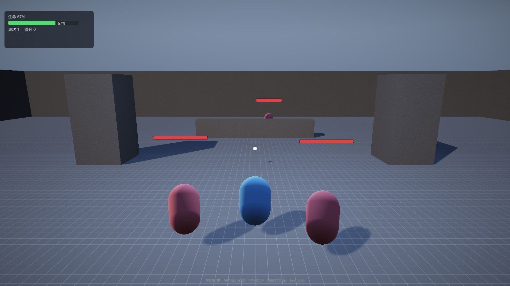
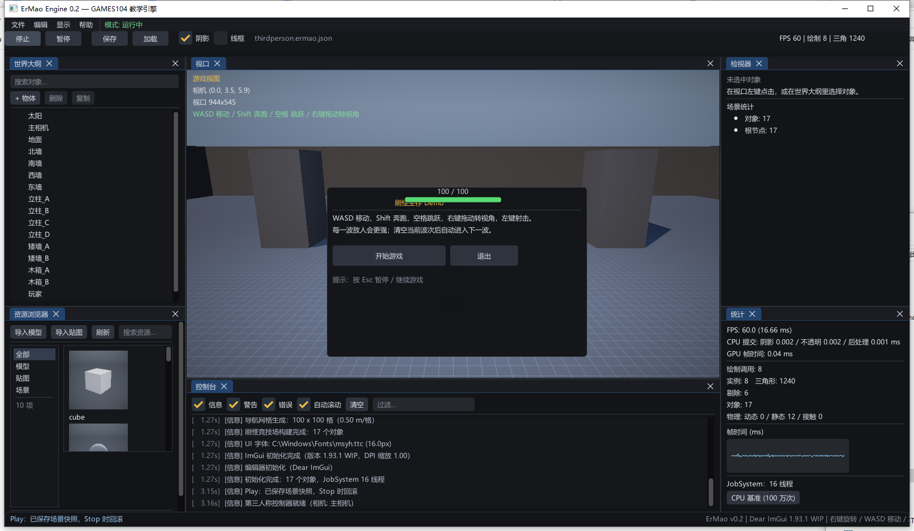
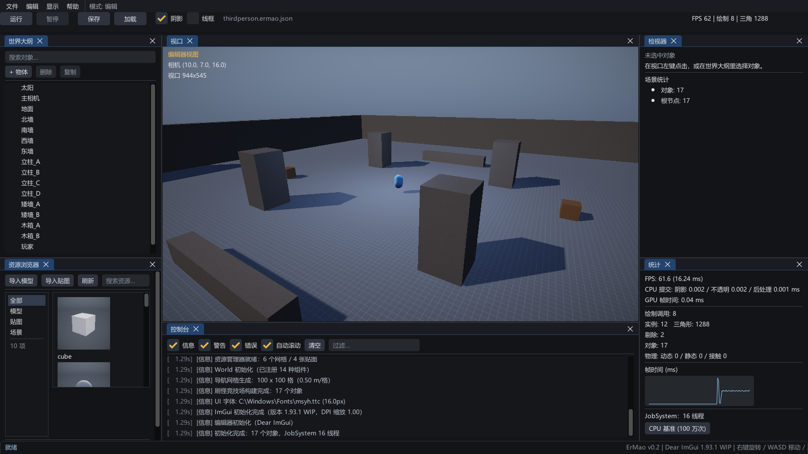
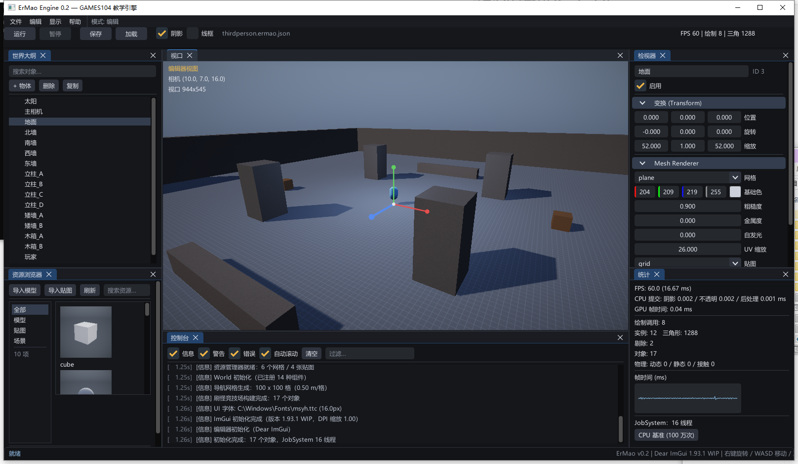

# v0.3：刷怪 Demo、资源浏览器、Gizmo 与打包

> 本版目标（用户需求）：ImGui 编辑器补齐"五脏俱全"的基本能力 + 一个能玩的 Demo。
> 全部功能都有 CLI 或截图验证，不依赖"我点了下没问题"。

## 1. 刷怪生存 Demo（`--demo` 或编辑器里 F5）



### 1.1 玩法循环

| 模块 | 组件 | 行为 |
|---|---|---|
| 玩家 | `ThirdPersonController` + `HealthComponent` + `CombatComponent` | WASD 移动、空格跳跃、右键轨道相机、**左键射击**（发射投射物） |
| 敌人 | `EnemyComponent` + `HealthComponent` | 朝玩家移动、进入 1.6m 后近战、被击中掉血 |
| 投射物 | `ProjectileComponent` | 直线飞行、球-球命中判定、2.5s 后自动销毁 |
| 波次 | `WaveGame` | 第 N 波生成 2+N 个敌人，清空后 2.5s 进入下一波，敌人血量/速度随波次增长 |
| 结算 | `WaveGame::State` | `Menu → Playing → Paused/GameOver`，死亡后显示得分并可重开 |

关卡 `game/WaveArena.cpp` 同样是**代码优先**：52×52 竞技场 + 四面高墙 + 4 根立柱 +
矮墙 + 木箱 + 场地灯 + 玩家，敌人由波次系统动态生成。

### 1.2 碰撞系统

- **角色/敌人 vs 静态几何**：球-AABB 推离（XZ 平面），带竖直区间判断，避免站上平台边缘被侧推；
- **投射物 vs 敌人**：球-球；
- **敌人 vs 玩家**：距离判定（进入 attackRange 后攻击，冷却 0.9s）；
- 静态几何来自 `World::CollectMeshAABBs`，没有独立的 collision layer（单机 Demo 够用）。

### 1.3 3D UI：头顶血条

世界坐标 → 屏幕投影（`Camera::WorldToScreen`），再用 ImGui 前景层画血条：

```
敌人头顶 ── 投影 ──▶ 屏幕位置 ──▶ 底框 + 填充 + 受击白闪
                    └─ 遮挡检测：相机到血条的射线被几何挡住就不画
```

- 玩家血条额外显示 `67 / 100` 数值；
- 血条宽度随距离缩放（44~170px），保证远近都可读；
- 菜单/暂停时不绘制（避免盖住菜单）。

### 1.4 游戏菜单

| 界面 | 内容 |
|---|---|
| 主菜单 | 标题、操作说明、`开始游戏` / `退出` |
| 暂停菜单（Esc） | `继续` / `重新开始` / `返回主菜单` / `退出程序` |
| 失败界面 | 坚持波次、得分、`重新开始` / `返回主菜单` |
| 游戏内 HUD | 生命条、波次、得分、准星、底部操作提示 |



### 1.5 验证

```bat
build\bin\ErMao.exe --demo --frames 420 --screenshot demo.png
:: 日志：[刷怪] 第 1 波：3 个敌人
```

`--demo` = 竞技场 + 无编辑器 + 自动开火；适合无人值守截图与回归。

## 2. 资源浏览器（Unity 风格）



- **左侧分类**：全部 / 模型 / 贴图 / 场景；
- **右侧网格**：每个资产一张缩略图 + 文件名；
  - 模型：`Renderer::GetMeshThumbnail` 用固定相机把网格渲染到 128² RT（带天空和光照），按 meshId 缓存；
  - 贴图：直接显示 WIC 解码后的像素；
  - 场景：占位按钮（点击加载）；
- **交互**：单击选中（详情面板显示顶点/索引/路径），双击模型放入场景、双击贴图赋给选中物体、双击场景加载；
- **导入**：`导入模型` / `导入贴图` 走 Win32 对话框，自动复制到 `assets/models|textures` 并注册。

## 3. 编辑器位移与聚焦



- **位移 Gizmo**：选中物体后在视口画 X/Y/Z 三轴，鼠标按下轴开始拖拽；
  屏幕空间投影轴方向 → 世界位移 = 鼠标位移在轴上的投影 × 世界/像素比例；
- **F 聚焦**：按 `F` 把编辑器相机移到选中物体的包围盒中心前方，距离按包围球半径和 FOV 计算。

两者都在 `editor/EditorUI.cpp` 的 `DrawGizmo` / `FocusSelected`，不依赖第三方 gizmo 库。

## 4. 打包（文件 → 打包）

| 菜单项 | 产物 | 说明 |
|---|---|---|
| 打包 Windows | `dist/ErMao-Windows/`：`ErMao.exe` + `shaders/` + `assets/` + `run.bat` + `README.txt` | **可直接运行**，已验证打包后的 exe 能启动并渲染 |
| 打包 Linux（源码包） | `dist/ErMao-Linux-Source/`：`engine/` + `third_party/` + `CMakeLists.txt` + `build.sh` + `README-LINUX.md` | 引擎目前只有 **D3D11 后端**，无法直接产出 Linux 可执行文件；导出的是源码包，README 写清了补 Vulkan/OpenGL 后端的 5 步 |

CLI 自检：

```bat
build\bin\ErMao.exe --package windows --frames 2
build\bin\ErMao.exe --package linux --frames 2
```

## 5. 第三人称鼠标反向修复

`ThirdPersonController` 里 yaw 的符号写反了：

```cpp
// 之前：yawDegrees += delta.x * sensitivity;  → 鼠标右移视角左转
yawDegrees -= delta.x * mouseSensitivity;
pitchDegrees += (invertY ? 1.0f : -1.0f) * delta.y * mouseSensitivity;
```

顺带把跳跃从 `IsKeyDown` 改成 `IsKeyPressed`（按住空格不再连跳），并在检视器里加了
`反转 Y 轴` 开关。

## 6. 本轮同时处理的审核问题（R4–R8）

| 编号 | 问题 | 处理 |
|---|---|---|
| P2-16 | 窗口消息钩子"先到先得"，ImGui 返回 1 会跳过窗口逻辑 | 改成**只观察不消费**，窗口逻辑始终执行 |
| P2-17 | 引擎热键没看 `WantCaptureKeyboard` | F11/F12/Esc 前检查 |
| P2-18 | 文档"零第三方依赖"自相矛盾 | 改为"系统库 + vendored Dear ImGui"，并注明上游 commit |
| P2-19 | 编辑器相机拖拽没看 `WantCaptureMouse` | 依赖视口 `IsItemHovered`，同时避免在输入框里拖 |
| P2-20 | `m_player` 在 PIE Stop 后悬垂 | 每帧按名字重查 |
| P3-35 | ImGui 关闭时窗口仍持有回调 | 引擎关闭顺序：先清回调再 Shutdown |
| P3-36 | `imgui.ini` 落在 CWD | 改到 exe 旁边 |
| P3-37 | 字体路径硬编码 `C:/Windows` | 用 `GetWindowsDirectoryW` 拼接 |
| P3-39 | ImGui 源码混进引擎 target | 独立 `imgui` STATIC target，PRIVATE 链接 |
| P3-40 | GPU 查询 Begin/End 可能不成对 | 增加 `m_queryActiveThisFrame` 状态位 |
| P3-41 | `m_editor = Editor{}` 重置 | 增加 `Editor::Shutdown()` |
| P3-42 | `shadowFocus` 两处写 | 只由 `World::BuildRenderScene` 决定 |
| P3-44 | Play/Stop 逻辑复制三份 | 抽 `EnterPlayMode/ExitPlayMode` |
| P3-46 | 按住空格连续起跳 | 改 `IsKeyPressed` + 模拟输入也走边沿 |
| P3-48 | 平台边缘侧滑 / 装饰物挡人 | 竖直区间判断 + 只做 XZ 推离 |
| third_party | 4.3MB 里混着 examples/misc | 只保留 24 个编译必需文件 + `ERMAO_UPSTREAM.txt` |

仍未处理（诚实清单）：采样器缓存退出不释放、`dynamic_cast` 组件查询、A* 每帧分配、
JobSystem 每次调用起线程、Gizmo 的旋转/缩放模式、撤销栈。

---

## 7. 追加：序列化稳定性与碰撞回归（2026-10-31 凌晨）

### 7.1 场景 JSON 现在可以字节级往返

`--test-serialize` 在 v0.3 初版出现"字节相等=否"。定位到两个原因：

1. **数字格式**：原来用 `%.6g` 写 float，解析回来再写会差 1 ULP。改成 C++17
   `std::to_chars` 的最短往返表示（float 路径），解析用 `strtof`（正确舍入到 float）。
2. **四元数归一化**：`GameObject::SetRotation` 每次都 `.Normalized()`，
   而"已归一化的四元数再归一化"仍会漂 1 ULP，于是每次"加载→保存"都会变。
   改成只在偏差 > 1e-4 时归一化。

现在输出：

```
[自检] 序列化往返: 17 -> 17 个对象，再次往返稳定=是，首次字节一致=是
```

（自检同时断言"再往返一次完全一致"，比单次相等更强。）

### 7.2 碰撞：台阶不能走上去的回归

为修 P3-48 给水平推离加了"竖直区间判断 + 台阶抬升"，结果第三人称关卡的台阶
（0.3/0.7/1.1m）出现了"走到台阶前卡住/被反复推回"。冒烟测试从 `z=5.59` 退化成 `z≈10.3`。

结论：台阶本来就该由**地面射线**处理，水平推离只负责墙面。最终恢复 v0.2 的
"closest point + 仅 XZ 推离"实现，冒烟恢复 `z=5.59 / y=0.95`。
P3-48 的"边缘侧滑"保留为已知问题（需要 collision layer 才能彻底解决）。

### 7.3 血条与 HUD 的落点

- 血条：世界坐标 → 屏幕投影（`Camera::WorldToScreen`），带遮挡射线、距离缩放、受击白闪；
- 玩家不再重复画头顶血条（HUD 已有），避免屏幕中央两条血条叠在一起；
- HUD 贴**视口**左上角而不是屏幕左上角，不再盖住世界大纲面板。
