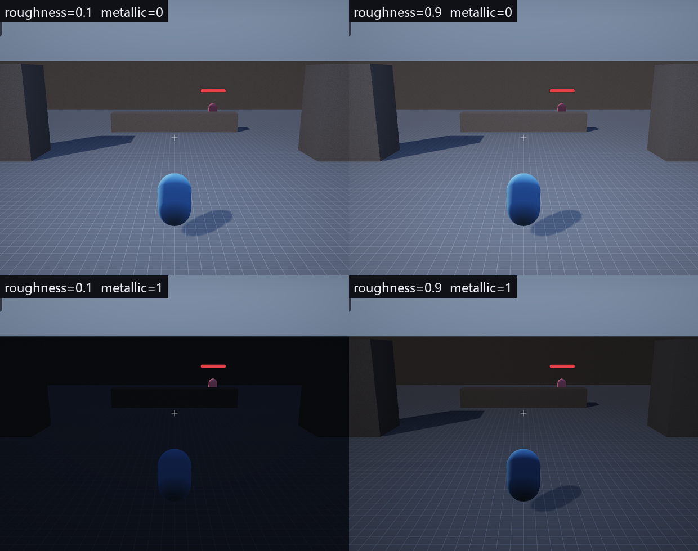

# 第 5 讲：光照、BRDF 与能量守恒【进阶】

> 对应 GAMES104 第 5 讲（光照、材质与着色器）。
> 代码：`engine/shaders/PBR.hlsl`、`scene/Components.h`（材质字段）、`renderer/Renderer.cpp`（常量缓冲）。
> 目标：从辐射度量学出发推出 Cook-Torrance，并逐项对上代码里的每个函数。

---

## 0. 概念卡

| 项 | 内容 |
|---|---|
| 问题 | 一个像素该有多亮？材质参数（粗糙度/金属度）怎么进公式？ |
| 一句话直觉 | 光从方向 L 来，按表面微结构决定有多少反射到眼睛。 |
| 数学 | `L_o = f_r · L_i · (N·L)`；`f_r = kd/π + D·G·F/(4 N·L N·V)`。 |
| 代码 | `shaders/PBR.hlsl`：`DistributionGGX / GeometrySchlick / FresnelSchlick`。 |
| 实验 | 检视器拖 roughness/metallic；`--roughness/--metallic` 出 4 宫格图。 |
| 差距 | 无 IBL、无法线贴图、无多散射 GGX。 |

## 1. 辐射度量学（只保留需要的三个量）

| 量 | 符号 | 单位 | 直觉 |
|---|---|---|---|
| 辐照度 irradiance | `E` | W/m² | 单位面积接收的功率 |
| 辐亮度 radiance | `L` | W/(m²·sr) | 单位面积、单位立体角、沿某方向的功率 |
| 立体角 | `ω` | sr | 球面上的"面积" |

对方向光（平行光），入射辐照度与入射角的关系：

```
E = L_i · cos θ = L_i · (N · L)
```

`N·L` 就是 Lambert 余弦项——它不是"经验公式"，而是投影面积的自然结果。

---

## 2. 渲染方程与 BRDF

出射辐亮度：

```
L_o(p, ω_o) = ∫_Ω f_r(p, ω_i, ω_o) · L_i(p, ω_i) · (N·ω_i) dω_i
```

`f_r` 是 BRDF，量纲 `1/sr`。对单个方向光，积分退化成一项：

```
L_o = f_r · L_i · (N·L)
```

光照计算就是"算 `f_r`"，剩下都是乘法。

---

## 3. 漫反射：为什么除以 π

Lambert 假设各个方向的出射辐亮度相同：`L_o = f_d · L_i · (N·L)`。
若表面反照率是 `albedo`（0~1，入射能量中被反射的比例），能量守恒要求：

```
∫_Ω L_o cosθ_o dω_o = albedo · E_i = albedo · L_i · (N·L)
```

左边把常数 `f_d · L_i · (N·L)` 提出，剩下 `∫ cosθ_o dω_o = π`，于是：

```
f_d · L_i · (N·L) · π = albedo · L_i · (N·L)
=> f_d = albedo / π
```

代码：

```hlsl
float3 kd = (1.0 - F) * (1.0 - metallic);
return (kd * baseColor / PI + specular) * radiance * NdotL;
```

`/π` 和 `*NdotL` 都在这一行里，缺一不可。

---

## 4. 镜面反射：Cook-Torrance 微表面模型

把微观表面看成大量朝向不同的完美镜面，BRDF：

```
f_s = D(h) · G(l,v) · F(v,h) / (4 · (N·L) · (N·V))
```

三个函数各有明确物理含义：

### 4.1 法线分布 D（GGX / Trowbridge-Reitz）

```
α = roughness²
D(h) = α² / (π · ((N·H)²(α²-1) + 1)²)
```

- `N·H = 1`（半程向量与法线一致）时最大；
- `roughness → 0` 时 D 趋近于 δ 函数（镜面）；
- 用 `α = roughness²` 是为了让美术调参更线性（感知上的粗糙度）。

### 4.2 几何项 G（Smith + Schlick 近似）

```
k = (roughness + 1)² / 8
G1(x) = (N·x) / ((N·x)(1-k) + k)
G = G1(l) · G1(v)
```

表示"微表面互相遮挡"的比例：掠射角时 `N·x` 小，G 小，镜面高光不会在边缘炸开。

### 4.3 菲涅尔 F（Schlick 近似）

```
F = F0 + (1 - F0) · (1 - V·H)^5
F0 = lerp(0.04, albedo, metallic)
```

- 绝缘体 `F0 ≈ 0.04`（4% 反射率），金属 `F0 = albedo`；
- `V·H → 0`（掠射）时 F → 1，所以边缘总有反射，这是菲涅尔效应。

### 4.4 能量守恒

金属没有漫反射，绝缘体的镜面反射会"抢走"一部分漫反射能量：

```
kd = (1 - F) · (1 - metallic)
```

这一步不是可选的美术效果，而是能量守恒的近似实现。

---

## 5. 点光源与衰减

点光源的辐照度按距离平方衰减，但游戏里通常用**有范围的平滑衰减**避免除零：

```hlsl
float atten = saturate(1.0 - dist / range);
atten *= atten;                     // 二次衰减，到 range 处为 0
float3 radiance = lightColor * intensity * atten;
```

物理上正确的 `1/d²` 在 `d → 0` 时会爆炸，而且没有"关灯"边界；
`saturate(1-d/r)²` 是工程折中：C¹ 连续、有限、可打包。

---

## 6. 环境光：最廉价的 GI

```hlsl
float hemi = N.y * 0.5 + 0.5;       // 法线朝上=1，朝下=0
float3 ambient = lerp(ambientDown, ambientUp, hemi) * ambientIntensity;
color += ambient * baseColor;
```

这是"半球环境光"，等价于假设天空是一个亮度为 `ambientUp`、地面是 `ambientDown` 的均匀环境。
它不含遮蔽（没有 AO），也没有方向性，所以物体暗部会略微发灰——第 21 讲会讲真正的探针。

---

## 7. 代码逐项对照

| 公式 | 代码 |
|---|---|
| `f_d = albedo/π` | `PBR.hlsl: ShadePoint` 里 `kd * baseColor / PI` |
| GGX D | `DistributionGGX(NdotH, roughness)` |
| Smith G | `GeometrySchlick(NdotV, roughness) * GeometrySchlick(NdotL, roughness)` |
| Schlick F | `FresnelSchlick(VdotH, f0)` |
| 能量守恒 | `kd = (1-F)*(1-metallic)` |
| 点光衰减 | `atten = saturate(1-d/range)²` |
| 环境光 | `lerp(ambientDown, ambientUp, N.y*0.5+0.5)` |

材质数据来源：`MeshRenderer::albedo / roughness / metallic`，经实例数据传到 shader。

---

## 8. 实验

```bat
build\bin\ErMao.exe --frames 60
```

1. 选中一个物体，在检视器里把 `roughness` 从 0.1 拖到 1.0：高光从"小亮点"变成"大而柔"；
2. 把 `metallic` 从 0 拖到 1：漫反射消失、反射颜色变成 albedo；
3. 调 `World::ambientIntensity` 与太阳强度，观察暗部变化。



上图由 `--roughness / --metallic` 命令行覆盖生成（同一场景、同一光照）：
- 左上 vs 右上：粗糙度从 0.1 到 0.9，高光从"集中"变"散开"；
- 左下（metallic=1）：金属没有漫反射，**没有 IBL 时会发黑**——这正说明第 21 讲的环境光照不是可选项；
- 右下：粗糙金属，反射模糊但仍有方向性。

---

## 9. 常见错误

| 错误 | 后果 |
|---|---|
| 忘记 `/π` | 整体过亮约 3.14 倍 |
| 忘记 `N·L` | 背光面也亮 |
| 贴图当线性色用（或反之） | 颜色发灰/过饱和；本工程 albedo 是线性色，贴图是 `_SRGB` 由硬件转线性 |
| 法线没归一化 | 高光出现暗斑 |
| 点光用 `1/d²` 不夹范围 | 近处爆白、远处噪点 |

---

## 10. 自测题

1. 证明 Lambert 的 `f_d = albedo/π`（用半球积分）。
2. `roughness = 0` 时 GGX 的极限是什么？代码里为什么 clamp 到 0.04？
3. `metallic = 1` 时 `kd` 是多少？为什么？
4. 法线矩阵为什么不能用模型矩阵直接变换法线（举一个 2D 反例）。

---

## 练习（故意改坏）

1. 把 `baseColor / PI` 的 `/PI` 删掉：**预期**整体亮约 3 倍、过曝。
2. 把 `kd = (1-F)*(1-metallic)` 改成 `kd = 1`：**预期**金属也有漫反射，能量不守恒（变亮）。
3. 把 `DistributionGGX` 的 `a = roughness*roughness` 改成 `a = roughness`：**预期**高光形状变化（更"尖"或更"散"），对照上面的 4 宫格图。

## 数学依据与参考资料

> 目的：不要求背下推导，但要知道这一讲**用的是什么数学工具**、去哪里查。

| 用到的原理 | 数学形式 / 名称 | 参考 |
|---|---|---|
| Cook-Torrance BRDF | f = kd·c/π + D·G·F / (4·(N·L)(N·V)) | [COOK]；[PBRT] |
| GGX 法线分布 | D = α² / (π·((N·H)²(α²−1)+1)²) | [KARIS]；[PBRT] |
| Smith 几何项 + Schlick 菲涅尔 | G_smith；F = F0 + (1−F0)(1−V·H)^5 | [SMITH]；[SCHLICK] |
| 色调映射与 gamma | ACES 拟合曲线；c^(1/2.2) | [ACES]；[TONE] |
