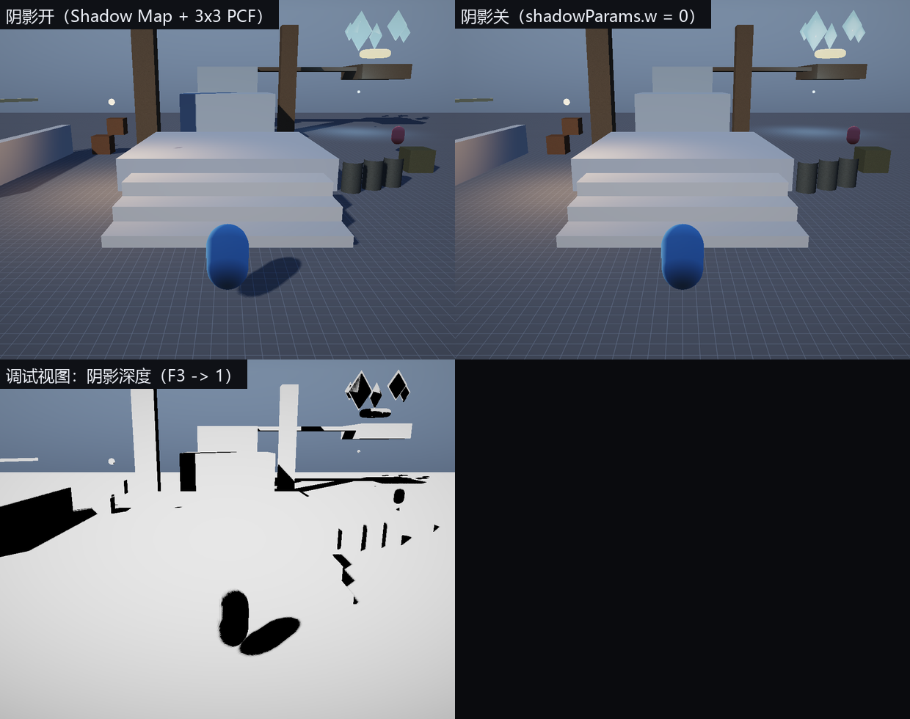

# 第 6 讲：阴影映射与程序化天空

> 对应 GAMES104 第 6 讲（自然景观渲染）。
> 代码：`shaders/Shadow.hlsl`、`shaders/Sky.hlsl`、`renderer/Renderer.cpp` 的 `ShadowPass/ComputeLightMatrix/SnapShadowFocus`。
> 目标：把"阴影为什么会糊、会抖、会漏光"讲成采样与矩阵的问题。

---

## 1. 阴影映射（Shadow Map）的原理

Pass 1：从**光源**视角渲染场景，只写深度 → 深度图 `D(u,v)`。
Pass 2：从相机视角渲染，把每个像素的世界坐标变换到光源裁剪空间，比较：

```
shadow = (depth_from_light(p) - bias <= D(uv)) ? 1 : 0
```

`depth_from_light(p)` 是着色点相对光源的深度；`D(uv)` 是光源视角下最近的遮挡物深度。
前者更大 → 被挡住 → 阴影。

### 1.1 平行光的视图/投影矩阵

平行光没有"位置"，只有方向 `L`。取一个焦点 `focus`（通常是相机前方一段距离）：

```
lightPos = focus + L * distance
lightView = LookAt(lightPos, focus, up)
lightProj = Orthographic(-R, R, -R, R, near, far)     // R = 阴影覆盖半径
lightVP = lightProj * lightView
```

用正交投影而不是透视：平行光的光线平行，正交投影才能保证"同样大小的物体在阴影图里同样大"。

代码：`Renderer::ComputeLightMatrix(sunDir, focus, radius)`。

### 1.2 Texel 对齐：消除"阴影游动"

相机移动时 `focus` 连续变化，阴影图每个 texel 对应的世界区域也在连续滑动，
导致阴影边缘"爬行"。修法：把 `focus` 量化到 texel 网格。

一个 texel 在光源空间的世界尺寸：

```
texelWorld = 2R / shadowMapSize
```

把 `focus` 投影到光源的 XZ 平面，除以 `texelWorld` 取整，再乘回去：

```cpp
focus.x = std::floor(focus.x / texel) * texel;
focus.z = std::floor(focus.z / texel) * texel;   // 在光源空间里做
```

代码：`Renderer::SnapShadowFocus`。

### 1.3 深度偏移（bias）

阴影贴图有离散误差，直接比较会出现"条纹（shadow acne）"。两种偏移：

- **常数/斜率偏移**：`depth_compare = depth - bias`，斜对着光的表面误差大，所以 bias ∝ tan(θ)；
- **法线偏移**：把采样点沿法线推 `N * offset`，更稳定（本工程用这个）。

```hlsl
float4 lightClip = mul(gLightViewProj, float4(worldPos + N * gShadowParams.y, 1.0));
...
lit += (ndc.z - bias <= d) ? 1.0 : 0.0;
```

`bias` 太大 → 阴影与物体分离（peter-panning）；太小 → 条纹。本工程 `bias = 0.0025`。

### 1.4 PCF（百分比靠近过滤）

单次比较边缘是硬锯齿。对周围 3×3 个 texel 各比较一次再平均：

```hlsl
for (int y = -1; y <= 1; ++y)
  for (int x = -1; x <= 1; ++x)
      lit += (ndc.z - bias <= gShadowMap.SampleLevel(..., uv + float2(x,y)*texel, 0).r);
return lit / 9.0;
```

代价：9 次采样。工业界会用泊松盘、PCSS（按遮挡距离调整核大小）。

---

## 2. 程序化天空

不加载天空盒纹理，直接按视线方向算颜色：

```hlsl
float up = saturate(dir.y * 0.5 + 0.5);
float3 zenith  = ambientUp * 0.55;
float3 horizon = float3(0.55, 0.62, 0.72) * 0.55;
float3 col = lerp(horizon, zenith, pow(up, 0.65));
// 太阳盘 + 光晕
float sun = pow(saturate(dot(dir, sunDir)), 512);
col += sunColor * sun * intensity;
```

- `pow(up, 0.65)` 让地平线附近过渡更自然（大气散射的廉价近似）；
- 天空是一个**全屏三角形**（`SV_VertexID` 生成，不需要顶点缓冲），深度设为最远（`SetDepthNone`），
  在 Opaque 之前画，相当于"清屏 + 背景"。

为什么先画天空：不透明物体覆盖它，省一次全屏 clear；而且天空不写深度，不影响后续。

---



左：阴影开；右：阴影关（`--noshadows`）；左下：调试视图直接显示阴影贴图深度。

## 3. 实验

```bat
build\bin\ErMao.exe --frames 60
```

1. 工具栏关掉"阴影"：物体失去投影，`shadowParams.w = 0` 时 shader 直接返回 1；
2. 相机左右移动：注意柱子阴影边缘**不爬行**（texel 对齐生效）；
3. 按 F3 切到调试视图 1（阴影深度）：整屏显示阴影图的采样结果。

---

## 4. 常见错误

| 错误 | 现象 |
|---|---|
| 用透视投影做平行光阴影 | 远处阴影被放大/扭曲 |
| focus 不量化 | 阴影随相机"游动" |
| bias 太小/太大 | 条纹 / 阴影脱离物体 |
| 阴影图分辨率太低 | 边缘块状（本工程 2048²） |
| 天空写深度 | 物体被天空遮挡 |

---

## 5. 自测题

1. 平行光为什么用正交投影？如果用透视投影，同一个箱子在阴影图里的尺寸会怎样变化？
2. 推导 texel 世界尺寸 `2R / size`，并说明为什么量化要在光源空间做。
3. PCF 的 3×3 平均等价于什么滤波器？它能让阴影边缘"半影"变宽吗？
4. 法线偏移为什么比常数偏移更不容易出现 peter-panning？

---

## 练习（故意改坏）

1. 把 `SnapShadowFocus` 的 floor 去掉：**预期**相机移动时阴影边缘"爬行"。
2. 把 `bias` 从 0.0025 改成 0.02：**预期**阴影与物体分离（peter-panning）。
3. 把 PCF 的 3×3 改成 1 次采样：**预期**阴影边缘变成硬锯齿。
