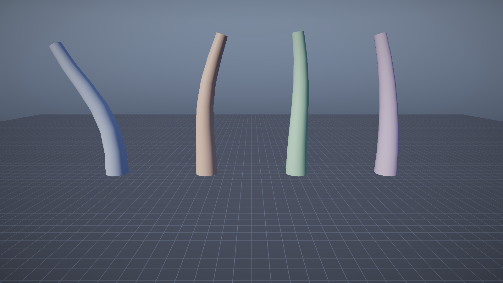

# 第 8 讲：骨骼、绑定姿势与线性混合蒙皮【进阶】

> 对应 GAMES104 第 8 讲（动画基础）。
> 代码：`animation/Skeleton.h/.cpp`、`renderer/SkinnedMesh.*`、`shaders/Skinned.hlsl`、`game/SkinningDemo.cpp`。
> 目标：从"骨骼是一组变换"出发，推出 `S_i = P_i · B_i^{-1}`，并说清楚它的产物、误差与替代方案。

---

## 0. 概念卡

| 项 | 内容 |
|---|---|
| 问题 | 网格怎么跟着骨骼弯曲，而不是整体刚性移动？ |
| 一句话直觉 | 每个顶点被几根骨头"拉扯"，按权重取平均。 |
| 数学 | `S_i = P_i·B_i^{-1}`，`p' = Σ w_i S_i p`，`Σ w_i = 1`。 |
| 代码 | `animation/Skeleton.*`、`shaders/Skinned.hlsl`、`game/SkinningDemo.cpp`。 |
| 实验 | `--level skinning --play`，4 个角色不同 blend 的弯折。 |
| 差距 | 无 DQS、无 GPU 骨骼纹理、无 IK。 |

## 1. 问题

角色网格是一个整体，但人要弯胳膊、转头。**蒙皮**解决的是：

> 给每个顶点若干个"骨骼索引 + 权重"，让顶点跟着骨骼动，而不是整体刚性变换。

数据：

```
 绑定姿势（T-pose）              动画姿势（当前帧）
 ┌────────────────┐             ┌────────────────┐
 │  B_0  B_1  B_2 │             │  P_0  P_1  P_2 │
 └───────┬────────┘             └───────┬────────┘
         │ 求逆                          │
         ▼                               ▼
    B_i^{-1}  ──────────►  S_i = P_i · B_i^{-1}  ──────►  p' = Σ w_i · S_i · p
    （逆绑定矩阵）              （蒙皮矩阵）                    （线性混合蒙皮）
```

- **骨架（Skeleton）**：一组骨骼的树，每根骨骼有 `parent` 与**绑定姿势**（bind pose）；
- **蒙皮网格（SkinnedMesh）**：每个顶点带最多 4 个 `(boneIndex, weight)`，`Σw = 1`；
- **动画片段（Clip）**：每根骨骼在时间轴上的局部 TRS 关键帧。

---

## 2. 数学

### 2.1 绑定姿势与逆绑定矩阵

网格建模时（T-pose），骨骼在世界空间的位置组成绑定姿势 `B_i`（4×4）。

顶点 `p`（模型空间）在骨骼 `i` 的局部坐标系里是：

```
p_local_i = B_i^{-1} · p
```

`B_i^{-1}` 就是**逆绑定矩阵**，只跟绑定姿势有关，生成一次即可。

### 2.2 动画姿势与蒙皮矩阵

动画播放后，骨骼 `i` 的世界矩阵变成 `P_i`。把顶点放回去：

```
p' = P_i · (B_i^{-1} · p) = (P_i · B_i^{-1}) · p
```

定义**蒙皮矩阵**：

```
S_i = P_i · B_i^{-1}
```

直觉：`B_i^{-1}` 把顶点"搬进骨骼的局部空间"，`P_i` 再把它按当前姿势"搬回世界"。

### 2.3 线性混合蒙皮（LBS）

一个顶点常被多根骨骼影响（关节处），按权重线性组合：

```
p' = Σ_j w_j · S_j · p        （Σ_j w_j = 1）
```

- 权重不归一化会缩放模型：如果 `Σw = 1.2`，顶点会被放大 20%；
- 本工程在 shader 里强制归一化（`weightSum`），避免美术导出误差。

### 2.4 法线

法线也要蒙皮。严格做法是用 `S_j` 的逆转置；教学实现直接线性组合：

```
n' = normalize( Σ_j w_j · (S_j 的 3×3) · n )
```

在只有旋转+均匀缩放的骨骼下与逆转置等价；非均匀缩放时会有轻微误差。

### 2.5 已知缺陷：candy-wrapper 与体积丢失

LBS 对矩阵做线性平均，会产生两个经典问题：

1. **糖纸效应**：骨骼绕自身轴扭转 180° 时，中间顶点被"拧细"；
2. **体积丢失**：肘部/膝盖弯曲内侧塌陷。

工业替代：**对偶四元数蒙皮（DQS）**——把 `S_i` 分解为旋转+平移的对偶四元数，
在四元数空间做归一化线性插值（nlerp），能消除糖纸效应。本工程未实现，作为差距记录。

---

## 3. 代码

### 3.1 骨架

```cpp
struct Bone {
    std::string name;
    int         parent = -1;
    Mat4        inverseBind;   // B_i^{-1}
    BoneTransform bindLocal;   // 绑定姿势下的局部 TRS
};
```

生成流程（`Skeleton::FinalizeBindPose`）：

```cpp
// 1) 按 parent 链累乘，得到每根骨骼的绑定姿势世界矩阵
world[i] = parent < 0 ? local : world[parent] * local;
// 2) 求逆，存进 inverseBind
bones[i].inverseBind = world[i].Inverse();
```

### 3.2 每帧：采样 → 混合 → 蒙皮矩阵

`SkinnedCharacterComponent::OnUpdate`：

```cpp
clipA.Sample(m_timeA + phase, skeleton, m_poseA);   // 关键帧 -> 局部 TRS
clipB.Sample(m_timeB + phase, skeleton, m_poseB);
BlendPoses(m_poseA, m_poseB, blend, m_pose);        // lerp + slerp
skeleton.ComputeWorld(m_pose, m_worldMatrices);     // 局部 -> 世界
skeleton.ComputeSkinning(m_worldMatrices, m_bones); // S_i = P_i * B_i^{-1}
```

### 3.3 着色器

```hlsl
float4x4 skin = (float4x4)0;
skin += gBones[input.boneIndices.x] * (input.boneWeights.x / weightSum);
... // 4 根骨骼
float4 skinnedPos = mul(skin, float4(input.position, 1.0));
float3 skinnedNrm = mul((float3x3)skin, input.normal);
float4 worldPos  = mul(gWorld, float4(skinnedPos.xyz, 1.0));
```

- `gBones` 在 b2（64 根骨骼上限，4096 字节）；
- 每个角色一份常量（b3）：世界矩阵 + 材质；
- 顶点布局 64 字节：position(12) normal(12) uv(8) indices(16) weights(16)。

### 3.4 顶点权重怎么来

`SkinningDemo.cpp` 里程序化生成一根 6 段管子：

```cpp
// 顶点高度 y，段长 0.5
b = floor(y / 0.5);
t = y/0.5 - b;
if (t < 0.5) { other = b-1; w = 0.5 * (1 - t/0.5); }   // 靠近下端关节
else         { other = b+1; w = 0.5 * ((t-0.5)/0.5); } // 靠近上端关节
// 顶点 = (1-w)*b + w*other，关节处正好 50/50
```

这样关节两侧的顶点被两根骨骼各拉一半，弯折才平滑；如果硬分配（每个顶点 100% 一根骨骼），
接缝处会撕开。

---

## 4. 实验

```bat
:: 4 个角色：blend 从 0（纯 wave）到 1（纯 sway），相位错开
build\bin\ErMao.exe --level skinning --play --noeditor --frames 120 --screenshot skinning.png
```



观察：
- A（最左）几乎纯 `wave`：上段向侧面倒；
- D（最右）几乎纯 `sway`：整体前后微摆；
- 中间两个是 cross-fade 的中间态。

在编辑器里选中角色，改 `blend` 的滑条可以实时看到姿态连续变化——
这验证了"姿势混合"发生在 **矩阵之前**（对 TRS 做 slerp），而不是对最终矩阵做 lerp。

---

## 5. 复杂度

- 每个蒙皮顶点：4 次矩阵乘 + 加权求和；
- 每个角色每帧：`骨骼数 × (采样 + 世界矩阵 + 蒙皮矩阵)`，6 根骨骼可忽略；
- GPU 端：骨骼矩阵走常量缓冲，每角色一次 draw call（未做 GPU 蒙皮/骨骼纹理）。

工业做法（GPU skinning）：把骨骼矩阵放进 `StructuredBuffer`，用 `SV_InstanceID` 索引，
一个 draw call 画全部角色；顶点在 VS 里乘蒙皮矩阵。本工程是"每角色一次 draw + 常量缓冲"，
在教学规模下完全够用。

---

## 6. 常见错误

| 错误 | 现象 |
|---|---|
| 逆绑定矩阵算错（用了绑定姿势的局部矩阵） | 模型整个炸开 |
| 权重不归一化 | 模型放大或缩小 |
| 骨骼顺序不是拓扑序 | 世界矩阵算错（父在子之后） |
| 只对矩阵做 lerp 混合 | 姿态塌陷/缩放失真 |
| 忘了把 `gWorld` 乘上去 | 角色永远在世界原点 |

---

## 7. 自测题

1. 推导 `S_i = P_i · B_i^{-1}`，说明两个矩阵各自的几何意义。
2. 若某顶点权重为 `(0.6, 0.4)`，两根骨骼绕同一轴分别转 0° 和 90°，LBS 后的顶点在哪？
   与"先算 36° 再转"的刚体结果相比差多少？
3. 为什么关节处的顶点要 50/50 混合，而不是 100% 给父骨骼？
4. DQS 相比 LBS 解决了什么问题？代价是什么？

---

## 练习（故意改坏）

1. 把 shader 里的 `weightSum` 归一化删掉：**预期**模型被放大/缩小（权重和 ≠ 1）。
2. 把 `q.bones[b].inverseBind` 换成单位矩阵：**预期**骨骼动画变成"整体平移"，模型炸开。
3. 把 `AssignWeights` 改成"每个顶点 100% 归属当前骨骼"：**预期**关节处出现明显裂缝（刚性分段）。
