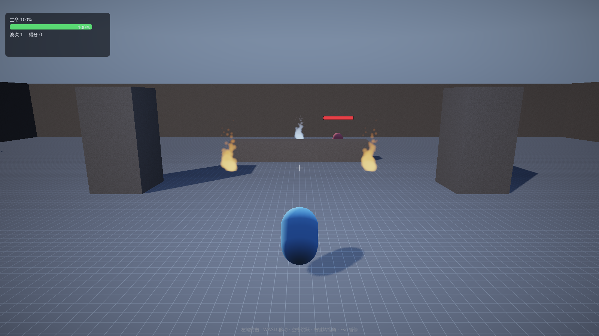

# 第 12 讲：粒子系统【进阶】

> 对应 GAMES104 第 12 讲（特效系统）。
> 代码：`game/ParticleEmitter.h/.cpp`、`renderer/Renderer.cpp` 的 `ParticlePass`、`shaders/Particle.hlsl`。
> 状态：**已实现**（CPU 模拟 + billboard 渲染），DEMO 里有两处火把与一个传送门。



---

## 1. 要解决的三个问题

1. **发射**：什么时候产生新粒子、产生多少；
2. **模拟**：粒子怎么动、怎么死；
3. **渲染**：无数小光点怎么高效画出来。

---

## 2. 数学

### 2.1 发射：泊松过程的离散化

真实世界的粒子发射是泊松过程：单位时间 `λ` 个事件。工程上用**累加器**近似：

```
acc += λ · dt
n = floor(acc)
acc -= n
```

为什么不用"每帧固定 n 个"：帧率一变，发射率就变（60fps 每帧 1 个 = 60/秒，30fps 就变 30/秒）。
累加器让**发射率与帧率无关**，误差 ≤ 1 个粒子。

### 2.2 模拟：半隐式欧拉 + 阻力

```
v += gravity · dt
v *= (1 - drag · dt)
p += v · dt
life -= dt
```

- 第 10 讲讲过：先更新速度再用新速度更新位置（半隐式），比显式欧拉稳；
- 阻力用 `(1 - drag·dt)` 是一阶近似，`dt` 较大时会过冲（`drag·dt > 1` 会反向），
  工业实现用 `v *= exp(-drag·dt)`。

### 2.3 回收：swap-remove

数组里删除元素是 O(n)（后面全部前移）。粒子每帧都有死亡，所以用"把最后一个元素搬到空位"：

```
a[i] = a[last]; a.pop_back();
```

这样删除是 O(1)，代价是**粒子顺序会变**（对渲染无影响，对排序有影响）。

### 2.4 渲染：billboard 的几何

粒子总面向相机。取相机右/上向量 `R, U`，粒子中心 `c`、尺寸 `s`：

```
p0 = c - R·s - U·s     uv(0,0)
p1 = c + R·s - U·s     uv(1,0)
p2 = c + R·s + U·s     uv(1,1)
p3 = c - R·s + U·s     uv(0,1)
```

两个三角形，顶点由 CPU 每帧生成（教学规模 384 颗粒子 = 2304 顶点，可忽略）。

### 2.5 像素：无纹理的圆形

```hlsl
float2 d = uv * 2 - 1;
float r2 = dot(d, d);
if (r2 > 1) discard;                       // 圆外丢弃
float alpha = color.a * pow(1 - r2, 1.5);  // 中心亮、边缘透明
```

`(1 - r²)^1.5` 是高斯核的廉价替代：中心 1、边缘 0、C¹ 连续，不需要采样纹理。

---

## 3. 代码

### 3.1 组件（玩法层）

```cpp
class ParticleEmitterComponent : public Component {
    float rate = 45.0f;          // 每秒发射
    float lifetime = 1.3f;
    Vec3  initialVelocity, gravity;
    Vec4  colorStart, colorEnd;
    float sizeStart, sizeEnd;
    // SoA 存粒子
    std::vector<Vec3>  m_positions, m_velocities;
    std::vector<float> m_life, m_maxLife;
};
```

`OnUpdate`：发射 → 积分 → swap-remove 回收。

`Collect`：把粒子转成 `ParticleRender{position, size, color}`，颜色/大小按 `1 - life/maxLife` 插值。

### 3.2 渲染（渲染层）

```cpp
void Renderer::ParticlePass(ID3D11DeviceContext* ctx) {
    // 1) 用相机 right/up 生成 billboard 四边形
    // 2) 动态顶点缓冲上传
    // 3) 深度测试开、写关；Alpha 混合；不剔除
}
```

- 深度**测试开、写关**：粒子之间不互相遮挡，但会被墙挡住；
- 半透明必须排序才能完全正确，本工程没排序（粒子颜色差异小，问题不明显）——这是已知取舍。

### 3.3 分层

`RenderScene.particles` 是唯一接口：玩法层只填数据，渲染层只管画。
新增"爆炸/烟雾"只需要换颜色和速度，不用碰渲染器。

---

## 4. 实验

```bat
build\bin\ErMao.exe --level arena --play --noeditor --frames 150 --screenshot particles.png
```

1. 两处橙色火把 + 一个蓝色传送门；
2. 编辑器里选中"火把_A"，改 `rate`（发射率）、`spread`（速度抖动）、`colorStart`，实时生效；
3. 把 `gravity` 改成负值（向下），粒子会像瀑布。

---

## 5. 练习（故意改坏）

1. 把发射的 `floor` 改成 `ceil`：**预期**发射率变高，粒子数超预期。
2. 把 `swap-remove` 改成 `erase`：**预期**画面不变，但粒子多时 CPU 时间上升（O(n²)）。
3. 把 `r2 > 1.0` 的 discard 删掉：**预期**粒子变成方块（四边形全部可见）。
4. 把深度测试从"测试开/写关"改成"测试关"：**预期**粒子会透过墙显示。

---

## 6. 与工业引擎的差距

| 项 | 本工程 | 工业 |
|---|---|---|
| 模拟位置 | CPU | GPU compute（百万级） |
| 排序 | 无 | 按深度排序 / OIT |
| 曲线 | 线性插值 | 曲线资产（颜色/大小随时间） |
| 子发射器 | 无 | 命中/死亡触发子特效 |
| 光照 | 无 | 受光/自发光/软粒子（深度淡出） |
