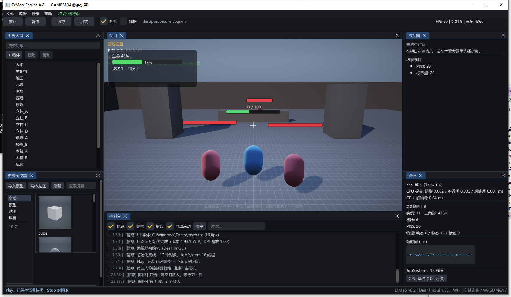

# 第 15 讲：Gameplay 框架——组件、固定步长与第三人称控制【必读】

> 对应 GAMES104 第 15 讲（Gameplay 的积木）。
> 代码：`game/ThirdPersonController.*`、`game/WaveGame.*`、`scene/Component.h`。
> 目标：把"角色能走、能跳、相机不穿墙"拆成可推导的几何与数值问题。

---

## 0. 概念卡

| 项 | 内容 |
|---|---|
| 问题 | 输入怎么变成角色的移动与相机？为什么相机不穿墙？ |
| 一句话直觉 | 相机朝向决定"前/右"，角色按它走；相机被射线拽近。 |
| 数学 | `forward=(-sin yaw,0,-cos yaw)`；球-AABB 最近点推离；弹簧臂射线。 |
| 代码 | `game/ThirdPersonController.cpp`。 |
| 实验 | `--smoke` 三行坐标；F5 进游戏手动走跳。 |
| 差距 | 无动画状态机接入、无斜坡法线处理。 |

## 1. 组件的组织方式

本工程**没有继承式 GameObject**，只有组合：

```
GameObject
  ├─ Transform（内建）
  ├─ MeshRenderer        （渲染数据）
  ├─ RigidBodyComponent  （物理形状）
  ├─ ThirdPersonController（输入 -> 位移 -> 相机）
  └─ HealthComponent     （玩法数值）
```

`World::Update(dt)` 遍历所有组件的 `OnUpdate(dt)`；`World::FixedUpdate(h)` 遍历 `OnFixedUpdate(h)`（第 1 讲讲过两者区别）。

**为什么这样分**：

- 渲染只吃 `RenderScene`（第 4 讲），不认识 `GameObject`；
- 玩法组件只改 Transform，不直接碰 GPU；
- 新增玩法 = 新增组件 + 注册反射，不改引擎核心。

---

## 2. 相机相对移动

输入是 WASD（屏幕方向），但角色要沿"相机朝向"移动。设相机偏航 `yaw`：

```
cameraForward = R_y(yaw) · (0, 0, -1) = (-sin yaw, 0, -cos yaw)
cameraRight   = R_y(yaw) · (1, 0, 0)  = ( cos yaw, 0, -sin yaw)
wish = normalize(W·forward - S·forward + D·right - A·right)
```

只取 `yaw`（不含 pitch）：这样抬头看天时按 W 仍然在地面走，而不是往天上飞。

**v0.2 的一个真实 bug**：`yaw += dx * sensitivity` 让"鼠标右移 → 视角左转"。
数学上：`yaw` 增大时 `forward.x = -sin(yaw)` 变负，视线向左偏。修正为 `yaw -= dx`。
这类符号错误在 3D 里极常见，**推导方向永远比反复试参数快**。

---

## 3. 竖直方向：重力 + 跳跃 + 地面检测

角色不是刚体（第 10 讲），而是**运动学控制器**：

```cpp
if (grounded && jumpPressed) { v_y = jumpSpeed; grounded = false; }
v_y += gravity * dt;
pos += (velocity.x, v_y, velocity.z) * dt;
```

跳跃要的是**边沿**（按下瞬间），不是电平（按住）：

```cpp
jumpPressed = Input::IsKeyPressed(VK_SPACE);   // 边沿，不是 IsKeyDown
```

否则按住空格会每帧满足条件，落地的下一帧立刻再跳（"无限连跳"）。

### 3.1 地面：向下射线

```cpp
Ray ray{ position + (0, 0.15f, 0), (0,-1,0) };
if (world.Raycast(ray, height*0.5f + 0.35f, hit)) {
    const float targetY = hit.point.y + height*0.5f;
    if (position.y <= targetY + 0.05f) {
        position.y = targetY;             // 吸附
        v_y = 0; grounded = true;
    }
}
```

- 射线长度 = 半身高 + 0.35m（容差），保证台阶/斜坡不会"悬空"；
- 只吸附"正在下落且已经很近"的情况（`<= targetY + 0.05`），否则会把人从空中吸到地上。

**为什么用射线而不是碰撞回调**：射线查询是"问一次世界"，不依赖物理引擎的回调顺序，
教学场景里最稳。

---

## 4. 水平碰撞：胶囊 vs AABB

把角色看成半径 `r` 的圆柱（XZ 平面），对每个静态 AABB 求最近点：

```
cx = clamp(x, box.min.x, box.max.x)
cz = clamp(z, box.min.z, box.max.z)
d  = sqrt((x-cx)² + (z-cz)²)
if (d < r)  沿 (x-cx, z-cz)/d 推出 (r - d)
```

只做 XZ、不做竖直：

- 竖直方向交给地面射线，避免"站上平台被顶面推走"；
- 这是 v0.2 审核 P3-48 的教训：把 Y 也算进最近点时，站在平台边缘会被侧向推出。

## 4.1 速度投影

推出后还要去掉速度沿法线的分量，否则会"贴着墙持续加力"：

```
v_n = v · n
if (v_n < 0) v -= n * v_n
```

---

## 5. 相机：弹簧臂

第三人称相机不是角色的子节点，而是每帧摆放：

```
head = playerPos + (0, cameraHeight, 0)
forward = R_y(yaw)·R_x(pitch) · (0,0,-1)
distance = cameraDistance
if (射线 head → -forward 命中墙) distance = min(distance, hitDistance - 0.35)
camera.position = head - forward * distance
camera.rotation = R_y(yaw)·R_x(pitch)
```

- `pitch` 夹在 `[-55°, +35°]`，防止翻转；
- 射线检测让相机在贴墙时自动拉近，避免穿模（"spring arm"）。

---

## 6. 固定步长

控制器位移在 `OnFixedUpdate(h)` 里积分，相机在 `OnUpdate(dt)` 里更新：

- 物理/位移不受帧率影响（第 1 讲的稳定性）；
- 相机每帧跟随，保证视觉平滑；
- 鼠标输入在 `OnUpdate` 里处理：鼠标增量是"每帧"的量，放进固定步长会一帧转多次。

---



## 7. 实验

```bat
:: 脚本化输入：第 30~120 帧向前走，第 60 帧起跳
build\bin\ErMao.exe --smoke --frames 200 --level thirdperson
:: [冒烟] 帧 30 玩家位置 (0.00, 0.95, 12.50)
:: [冒烟] 帧 60 玩家位置 (0.00, 0.95, 10.20)
:: [冒烟] 帧 120 玩家位置 (0.00, 0.95, 5.59)
```

三行数据分别验证：起跑、上台阶（y 不变是因为台阶由射线吸附）、到达平台边缘停住。

---

## 8. 常见错误

| 错误 | 现象 |
|---|---|
| yaw 符号反 | 鼠标左右反 |
| 跳跃用 `IsKeyDown` | 按住空格连跳 |
| 地面射线太短 | 下台阶时悬空抖动 |
| 相机不做射线 | 贴墙穿模 |
| 位移用可变步长 | 高低帧率手感不同 |

---

## 9. 自测题

1. 推导 `R_y(yaw)·(0,0,-1)` 的展开式，验证 `yaw += dx` 会让视线左偏。
2. 地面射线长度为什么是"半身高 + 0.35"而不是"半身高"？
3. 弹簧臂为什么要在 `hitDistance` 上再减 0.35？
4. 如果把水平推离改成"含 Y 的最近点"，站在平台边缘会发生什么？

---

## 练习（故意改坏）

1. 把 `yaw -=` 改回 `yaw +=`：**预期**鼠标左右反（v0.2 的真实 bug）。
2. 把跳跃的 `IsKeyPressed` 改成 `IsKeyDown`：**预期**按住空格连续起跳。
3. 把地面射线的长度从 `height*0.5+0.35` 改成 `height*0.5`：**预期**下台阶时悬空/抖动。
