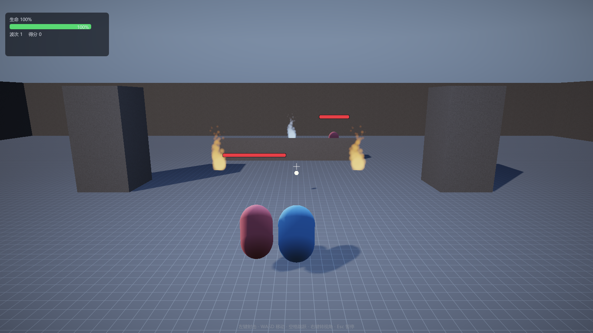

# 第 17 讲：行为树

> 对应 GAMES104 第 17 讲（进阶 AI）。
> 代码：`ai/BehaviorTree.h/.cpp`、`game/WaveGame.cpp` 的 `EnemyComponent::BuildTree`。
> 状态：**已实现**——刷怪 Demo 的敌人已经改用行为树（低血逃跑 / 追击攻击 / 巡逻）。

---

## 1. 为什么需要行为树

状态机在状态少时最直观，但敌人行为一多（巡逻/警戒/追击/攻击/逃跑/掩护/呼叫支援）：

- 状态数 n → 转移最多 n²；
- 加一个状态要和所有相关状态定义转移；
- 优先级散落在转移条件里，难以复用与调试。

行为树把行为组织成一棵**每次从根 tick 的树**，返回三态：

| 状态 | 含义 |
|---|---|
| Success | 这一帧完成了 |
| Failure | 这一帧失败（交给父节点决定下一步） |
| Running | 还没做完，下一帧继续（父节点记住位置） |

---

## 2. 数学与语义

### 2.1 组合节点

```
Sequence(S1, S2, ..., Sn)：
  依次 tick，任一 Failure → Failure；任一 Running → Running（记住下标）；
  全部 Success → Success

Selector(S1, ..., Sn)：
  依次 tick，任一 Success → Success；任一 Running → Running（记住下标）；
  全部 Failure → Failure
```

对偶性：把 Success/Failure 互换，Selector 就是 Sequence——这是实现时最容易验证的性质。

### 2.2 Running 的"记忆"

假设 Sequence 有 3 个子节点，第 2 个返回 Running。下一帧**不能从第 1 个重新开始**，
否则会重复执行已完成的行为（例如重复播放"走过去"）。所以组合节点要保存 `m_runningChild`：

```cpp
for (size_t i = m_runningChild; i < children.size(); ++i) { ... }
```

子节点返回 Success/Failure 时把 `m_runningChild` 复位为 0（下一次从根重新评估）。

### 2.3 冷却（Cooldown）

很多行为需要"每隔 N 秒才有机会触发"，例如"低血量逃跑"不能一直逃：

```
if (now < nextAllowed) return Failure;
status = child.Tick();
if (status != Running) nextAllowed = now + interval;
```

`now` 来自 `BTContext::time`（行为树自己累计），不依赖帧率。

### 2.4 复杂度

每帧最多访问 O(节点数) 个节点（Running 会提前返回，实际更少）。
对比状态机：O(1) 状态切换，但转移逻辑复杂、难复用。行为树的优势在**可组合**与**可读**。

---

## 3. 本工程的树

```
Selector [Root]
├─ Sequence [FleeWhenLow]
│    ├─ Condition: 血量 < 30%
│    └─ Cooldown 6s
│         └─ Action: Flee（背对玩家跑 2s，Running）
├─ Sequence [CombatSequence]
│    ├─ Condition: CanSeePlayer（距离 + 导航网格视线）
│    └─ Selector [AttackOrChase]
│         ├─ Sequence [AttackSequence]
│         │    ├─ Condition: 距离 ≤ attackRange
│         │    └─ Action: Attack（冷却 0.9s，造成伤害）
│         └─ Action: Chase（朝玩家移动，Running）
└─ Action: Patrol（随机点散步，Running）
```

对应代码：

```cpp
m_tree.SetRoot(Selector(NodeList(
    std::move(fleeWhenLow),
    std::move(seeAndFight),
    std::move(patrol)), "Root"));
```

`NodeList(...)` 是可变参数辅助函数：`std::initializer_list` 的元素是 const，
不能移动 `unique_ptr`，所以不能直接写 `Selector({std::move(a), std::move(b)})`。

---

## 4. 代码

### 4.1 节点接口

```cpp
struct BTContext { void* user; float dt; float time; };
class BTNode {
    virtual BTStatus Tick(BTContext&) = 0;
    virtual const char* Name() const = 0;   // 调试/可视化用
};
```

- `BTContext::user` 让叶子能拿到具体对象（这里是 `EnemyComponent*`），
  行为树本身不依赖游戏类型；
- `Name()` 为将来的"行为树调试面板"留接口。

### 4.2 叶子

```cpp
bt::Condition([this](BTContext&) { return CanSeePlayer(); }, "CanSeePlayer");
bt::Action([this](BTContext& ctx) -> BTStatus { return MoveToward(...); }, "Chase");
```

叶子的返回值决定父节点的走向：Condition 只返回 Success/Failure，Action 可以返回 Running。

---

## 5. 实验

```bat
build\bin\ErMao.exe --level arena --play
```

1. 敌人默认巡逻（慢速随机移动）；
2. 玩家靠近/进入视野 → 追击 → 进入 1.6m 内攻击（玩家掉血）；
3. 用左键把某个敌人打到 30% 以下 → 它会背对玩家逃跑 2 秒，然后（冷却 6s）再回来。



---

## 6. 练习（故意改坏）

1. 把 `SequenceNode` 的 `m_runningChild` 去掉（每帧从 0 开始）：**预期**追击时会"抖动"
   （每帧重新开始移动，方向被反复重置）。
2. 把 `Cooldown` 的 `nextAllowed` 更新删掉：**预期**低血量敌人一直逃跑、不再攻击。
3. 把 `Selector` 的遍历顺序反过来（从后往前）：**预期**敌人只巡逻、不打架（巡逻总是 Running）。

---

## 7. 与工业引擎的差距

| 项 | 本工程 | 工业 |
|---|---|---|
| 编辑方式 | 代码构建 | 可视化编辑器 + 资产 |
| 黑板 | `BTContext.user` | 类型化 Blackboard + 作用域 |
| 并行节点 | 无 | Parallel / 时间片调度 |
| 调试 | Name() | 运行时高亮当前节点 |
| 与 GOAP/效用 AI 结合 | 无 | 混合架构 |
