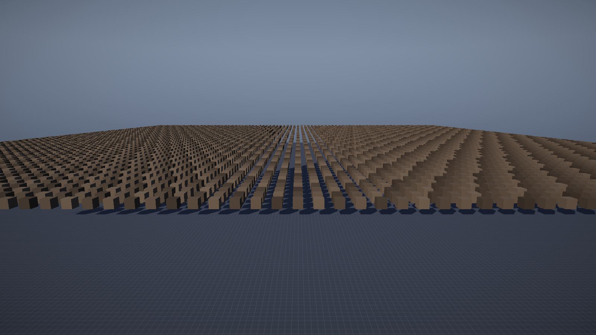

# 第 22 讲：GPU Driven 与间接绘制【进阶·已实现】

> 对应 GAMES104 第 22 讲（GPU Driven / Nanite）。
> 代码：`shaders/Cull.hlsl`、`Renderer::CreateGpuCullResources/GpuCulledDraw/ReadbackGpuCullStats`、
> `game/CullTestLevel.cpp`。
> 状态：**已实现最小闭环**——compute 视锥剔除 + 间接绘制，压测关卡 6400 个立方体一个批次。



---

## 0. 概念卡

| 项 | 内容 |
|---|---|
| 问题 | 上万个物体每帧在 CPU 上剔除/排序/提交太慢，能不能让 GPU 决定画什么？ |
| 一句话直觉 | CPU 只管上传，GPU 用上千线程做剔除，画多少由 GPU 写在间接参数里。 |
| 数学 | 视锥 6 平面 + AABB p-vertex 测试；`InterlockedAdd` 原子计数。 |
| 代码 | `Cull.hlsl`、`Renderer::GpuCulledDraw`、`CullTestLevel.cpp`。 |
| 实验 | `--level cull` 对比 `--no-gpu-cull`：可见实例都是 5683。 |
| 差距 | 无 Hi-Z 遮挡、无 LOD、无 meshlet/虚拟几何。 |

---

## 1. 为什么要把剔除搬到 GPU

CPU 路径（第 4 讲）每帧要做：

```
遍历 N 个物体 → 变换世界 AABB → 6 平面测试 → 排序分批 → 上传实例 → 逐批 Draw
```

N = 6400 时，光是"变换 + 测试"就是几十万次浮点运算，还要占用主线程。
GPU Driven 的核心思想：**同样的测试，让 GPU 用成千上万个线程并行做，CPU 只发一次 dispatch + 一次 draw**。

---

## 2. 最小闭环的数据流

```
 CPU                                   GPU
 ┌────────────────────┐
 │ 实例数据 (144B/个) │──上传──▶ StructuredBuffer (SRV, t0)
 └────────────────────┘                │
                                       ▼
                        ┌──────────────────────────────┐
                        │ Cull.hlsl：每线程一个实例     │
                        │ 1) 8 角点 × 世界矩阵 → AABB   │
                        │ 2) 6 个平面做 p-vertex 测试   │
                        │ 3) 可见：写入压缩缓冲 (UAV)   │
                        │    InterlockedAdd(args+4,1)   │
                        └──────────────┬───────────────┘
                                       │
                       ┌───────────────┴───────────────┐
                       ▼                               ▼
              压缩实例缓冲 (UAV)                 间接参数 (UAV)
                       │                               │
                       └──────────┬────────────────────┘
                                  ▼
                 DrawIndexedInstancedIndirect(args)
```

CPU 侧只剩：上传实例 + 设置常量 + dispatch + 一次间接 draw。

---

## 3. 数学：视锥测试

### 3.1 平面方程

视锥的 6 个平面来自 `viewProj`（Gribb-Hartmann，见第 4 讲）：

```
dot(n, p) + d ≥ 0   表示 p 在平面内侧
```

### 3.2 AABB 的 p-vertex 测试

对每个平面，取"沿法线最远"的角点：

```
p = (n.x ≥ 0 ? max.x : min.x,
     n.y ≥ 0 ? max.y : min.y,
     n.z ≥ 0 ? max.z : min.z)
```

若 `dot(n, p) + d < 0`，整个盒子在平面外侧 → 剔除。
这是**保守**测试：可能漏剔除（盒子被判为相交），但绝不会错误剔除。

### 3.3 为什么先变换 8 个角点

物体有旋转时，世界 AABB 必须由 8 个角点变换后重新求包围盒（第 11 讲）。
GPU 上每个实例做 8 次矩阵乘（4 次 FMA 每次），6400 个实例 = 5 万次矩阵乘，
在 3090 上是微秒级。

---

## 4. 代码

### 4.1 资源

```cpp
// 源实例（SRV）
srcDesc.MiscFlags = D3D11_RESOURCE_MISC_BUFFER_STRUCTURED;
srcDesc.StructureByteStride = sizeof(InstanceVertex);   // 144
// 压缩实例（UAV）
compactDesc.BindFlags = D3D11_BIND_UNORDERED_ACCESS;
// 间接参数（UAV + DRAWINDIRECT_ARGS）
argsDesc.MiscFlags = D3D11_RESOURCE_MISC_DRAWINDIRECT_ARGS;
argsDesc.ByteWidth = sizeof(UINT) * 5;   // {IndexCount, InstanceCount, StartIndex, BaseVertex, StartInstance}
```

**踩过的坑（真实）**：D3D11 不允许把 `D3D11_BIND_UNORDERED_ACCESS` 与
`D3D11_BIND_VERTEX_BUFFER` 放在同一个 buffer 上（创建返回 `E_INVALIDARG` 0x80070057）。
所以压缩缓冲只能做 UAV，绘制前再用 `CopySubresourceRegion` 拷到一个普通 VB。
教程里常写"UAV 直接当 VB 用"，在 D3D11 上不成立；D3D12 的 resource states 才可以。

### 4.2 compute shader

```hlsl
[numthreads(64, 1, 1)]
void CSMain(uint3 id : SV_DispatchThreadID) {
    if (id.x >= gInstanceCount) return;
    const Instance inst = gSource[gSourceOffset + id.x];
    const float4x4 world = float4x4(inst.c0, inst.c1, inst.c2, inst.c3);

    float3 mn, mx;              // 用 gLocalMin/gLocalMax 变换 8 角点
    ...
    [unroll] for (int i = 0; i < 6; ++i) {
        const float3 n = gPlanes[i].xyz;
        const float3 p = float3(n.x >= 0 ? mx.x : mn.x, ...);
        if (dot(n, p) + gPlanes[i].w < 0.0) return;
    }

    uint slot = 0;
    gArgs.InterlockedAdd(4, 1, slot);   // InstanceCount++
    gCompact[slot] = inst;
}
```

**矩阵约定坑**：实例数据里的 `c0..c3` 是按"列拼成行向量"使用的（第 4 讲），
所以这里必须是 `mul(float4(corner,1), world)`（行向量左乘），而不是 `mul(world, v)`。
写反的后果：物体被变换到错误位置，剔除结果全错——第一次实现时就踩到了。

### 4.3 绘制

```cpp
ctx->DrawIndexedInstancedIndirect(m_gpuArgs[slot].Get(), 0);
```

参数里的 `InstanceCount` 由 GPU 写，CPU 完全不参与。

### 4.4 统计回读

每 30 帧把 args 缓冲拷到 staging 并 Map，累加 `InstanceCount` 显示"GPU 可见实例"。
每帧回读会强制 CPU/GPU 同步，所以要节流。

---

## 5. 实验

```bat
:: GPU 剔除（默认开启）
build\bin\ErMao.exe --level cull --play --noeditor --frames 90
:: 自动截图完成：... | 实例 6401 | GPU可见 5683

:: 关闭 GPU 剔除（走 CPU 视锥剔除）
build\bin\ErMao.exe --level cull --play --noeditor --no-gpu-cull --frames 90
:: 自动截图完成：... | 实例 5683
```

两边都得到 **5683** 个可见实例——说明 GPU 剔除与 CPU 剔除结果一致（这是最重要的正确性验证）。
CPU 提交的实例数是 6401（全部），GPU 只画 5683。

编辑器"统计"面板会显示：

```
绘制调用: 7
GPU 剔除: 可见实例 5683
```

把相机转向天空方向，可见实例会掉到个位数——这就是剔除在起作用。

---

## 6. 练习（故意改坏）

1. 把剔除平面的法线取反：**预期**所有物体被剔除（黑屏）或全部保留，取决于测试方向。
2. 间接参数里的 `InstanceCount` 写死成常数：**预期**GPU 剔除"看起来生效"但实际画错数量。
3. 可见列表与实例数据的索引映射错一位：**预期**物体位置/材质错乱——这是 GPU Driven 最常见的 bug。
4. 把 `mul(float4(corner,1), world)` 改成 `mul(world, float4(corner,1))`：**预期**剔除结果与 CPU 不一致
   （矩阵约定反了），这个坑在实现时踩过一次。

---

## 7. 与工业引擎的差距

| 项 | 本工程 | 工业 |
|---|---|---|
| 剔除内容 | 视锥 | 视锥 + Hi-Z 遮挡 + LOD 选择 |
| 绘制 | 每批次一次间接 draw | 单次 multidraw / meshlet |
| 几何 | 顶点缓冲 | 虚拟几何（cluster + 软件光栅） |
| 材质 | 状态切换 | bindless 纹理 + 材质表 |
| 数据回读 | 每 30 帧 Map | GPU 端统计 + 异步查询 |

但**数据流是对的**：CPU 只上传、GPU 决定画什么、间接参数由 GPU 写。
Nanite 是在这条链路上继续加"几何压缩 + LOD + 软件光栅"，方向一致。

---

## 8. 自测题

1. 为什么 p-vertex 测试是保守的？举一个"实际不可见但被判为相交"的例子。
2. `InterlockedAdd` 在 args 的偏移 4 上自增，对应哪个字段？
3. 如果忘记把 `InstanceCount` 清零，下一帧会发生什么？
4. 为什么压缩缓冲要按批次复用？多个批次同时 dispatch 会怎样？

## 数学依据与参考资料

> 目的：不要求背下推导，但要知道这一讲**用的是什么数学工具**、去哪里查。

| 用到的原理 | 数学形式 / 名称 | 参考 |
|---|---|---|
| 视锥剔除 | 6 平面 p-vertex 测试 | [RTR4]；[CULL] |
| GPU 间接绘制 | DrawIndexedInstancedIndirect + 参数缓冲 | [CULL] |
| 并行压缩 | InterlockedAdd 追加到压缩列表 | [CULL] |
