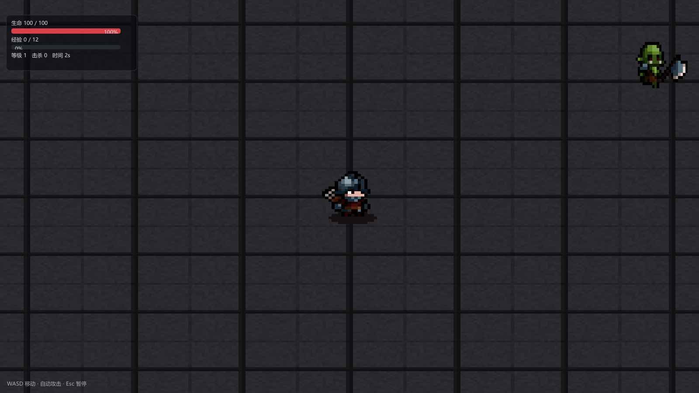

# 第 23 讲：2D 渲染与像素风游戏【进阶·已实现】

> 对应 GAMES104 第 4/7 讲的 2D 变体，外加一个可玩的 2D Demo。
> 代码：`shaders/Sprite.hlsl`、`Renderer::SpritePass`、`renderer/Camera.h`（`Camera2D`）、
> `scene/Components.h`（`SpriteRendererComponent` / `SpriteAnimatorComponent`）、
> `game/Survivors.*`、`game/CullTestLevel.cpp` 是 3D 对照。
> 状态：**已实现**——`--demo2d` 或 `文件 → 打包 → 打包游戏（Windows）` 可直接玩。



---

## 0. 概念卡

| 项 | 内容 |
|---|---|
| 问题 | 2D 游戏怎么在 3D 引擎里画？和 3D 管线差在哪？ |
| 一句话直觉 | 把相机换成正交投影，把"三角形网格"换成"带纹理的矩形"。 |
| 数学 | 正交矩阵；世界 XY → NDC；UV 子矩形取序列帧；按纹理合批。 |
| 代码 | `Camera2D`、`SpritePass`、`SpriteRendererComponent`、`Survivors`。 |
| 实验 | `--demo2d`；打包后的 `ErMaoSurvivors.exe`。 |
| 差距 | 无 Tilemap 编辑器、无骨骼 2D、无光照 2D。 |

---

## 1. 2D 与 3D 管线的差异

| 环节 | 3D | 2D |
|---|---|---|
| 投影 | 透视 `Perspective` | 正交 `Orthographic` |
| 几何 | 网格 + 索引 | 两个三角形（quad） |
| 深度 | 深度缓冲 | 绘制顺序（layer） |
| 光照 | PBR + 阴影 | 通常无（顶点色/贴图） |
| 采样 | 各向异性 + mipmap | **点采样**、无 mipmap（像素风） |
| 合批 | 实例化 | 同纹理合并 |

2D 的"深度"不是 z，而是**绘制顺序**：先画地面（layer -10），再画角色（1/5），
最后画 UI（ImGui）。这也是 `SpriteRendererComponent::layer` 的意义。

---

## 2. 正交投影

透视投影是"近大远小"；2D 要"远近一样大"，所以用正交矩阵：

```
left   = center.x - halfWidth
right  = center.x + halfWidth
bottom = center.y - halfHeight
top    = center.y + halfHeight
```

`Mat4::Orthographic(l, r, b, t, near, far)` 把 `[l,r]×[b,t]` 映射到 NDC `[-1,1]²`：

```
x_ndc = 2(x - l)/(r - l) - 1
y_ndc = 2(y - b)/(t - b) - 1
```

代码里 `halfWidth = halfHeight * aspect`，所以改窗口不会拉伸画面。

**数值例子**：窗口 1600×900，`halfHeight = 6.4`，`aspect = 1.78` →
`halfWidth = 11.4`。世界点 `(0,0)` → NDC `(0,0)`；点 `(11.4, 6.4)` → 右上角。

### 2.1 相机跟随

```cpp
camera2D.position = playerPosition;   // 玩家居中
// 关卡边界处夹住，避免看到地图外
camera2D.position.x = Clamp(x, -20, 20);
```

平滑跟随可以用 `lerp(camera, target, 1 - exp(-k·dt))`（帧率无关的指数平滑），本工程为了像素稳定没有做插值。

---

## 3. 精灵（Sprite）

### 3.1 一个精灵 = 一个 quad

```
p0 = center + (-w/2, -h/2)   uv(0,1)  ← 注意 v 方向
p1 = center + ( w/2, -h/2)   uv(1,1)
p2 = center + ( w/2,  h/2)   uv(1,0)
p3 = center + (-w/2,  h/2)   uv(0,0)
```

**v 方向**：纹理坐标原点在左上角，而我们的世界 y 向上，所以贴图底部对应 `v=1`。
写反的典型现象是"角色倒立"。

### 3.2 序列帧

一张横向排列的贴图（如 `soldier_walk.png` 800×100 = 8 帧 × 100px）：

```
frameWidth = 1 / columns
u0 = frame * frameWidth + frameWidth * frameMin.x
u1 = frame * frameWidth + frameWidth * frameMax.x
v0 = frameMin.y, v1 = frameMax.y
```

`frameMin/frameMax` 用来裁掉透明留白——素材包里的 100×100 帧实际角色只占 17×22 像素，
不裁的话角色在屏幕上只有 1/5 大小。

### 3.3 合批

每个精灵一次 draw 太浪费（地面 1680 块 = 1680 次 draw）。做法：

```
按纹理把连续的精灵合并成一段顶点，切换纹理时才 flush 一次 draw
```

地面全是同一张程序化石砖纹理 → **1 次 draw**；角色/敌人/箭/宝石各一张 → 总共 5 次。
这也是为什么 `SpriteDraw` 要排序：同 layer 内先按纹理聚在一起，合批效率最高。

### 3.4 像素风采样

```cpp
Texture::BindSampler(ctx, 0, D3D11_FILTER_MIN_MAG_MIP_POINT, D3D11_TEXTURE_ADDRESS_CLAMP);
```

- 点采样：放大时保留硬边像素，不会被线性过滤糊掉；
- 纹理创建时 mipmap 关闭（本工程 `CreateFromFile` 仍生成 mip，但采样器不用 mip）；
- 想要真正"像素完美"，还需要让世界单位与屏幕像素对齐（本工程是 1 单位 ≈ 70~90 像素，未做严格对齐）。

---

## 4. 游戏玩法（幸存者）

- **玩家**：WASD 移动（2D XY），自动朝最近的敌人射箭（0.75s 冷却，升级后更快）；
- **敌人**：从屏幕外环形刷新，朝玩家移动，接触造成伤害；随游戏时间变强；
- **宝石**：敌人死亡掉落，靠近自动吸附，拾取加经验；
- **升级**：经验满 → 等级 +1，攻击力 +4、攻击间隔 ×0.9、最大生命 +8；
- **HUD/菜单**：生命、经验、等级、击杀、时间；主菜单/暂停/失败。

状态机：

```
Menu --开始--> Playing --Esc--> Paused
                 |  \--血量<=0--> GameOver --重新开始--> Playing
                 └--返回主菜单--> Menu
```

---

## 5. 代码地图

| 功能 | 位置 |
|---|---|
| 正交相机 | `renderer/Camera.h` `Camera2D::ViewProjection` |
| 精灵数据收集 | `scene/World.cpp` `BuildRenderScene`（按 layer 排序） |
| 精灵绘制 | `renderer/Renderer.cpp` `SpritePass`（按纹理合批） |
| 精灵着色器 | `shaders/Sprite.hlsl` |
| 精灵组件 | `scene/Components.h` `SpriteRendererComponent` / `SpriteAnimatorComponent` |
| 玩法 | `game/Survivors.cpp`（玩家/敌人/箭/宝石/导演/关卡） |
| 2D 渲染入口 | `Renderer::RenderInternal` 的 `scene.is2D` 分支 |

---

## 6. 实验

```bat
:: 2D 演示（自动开局、无编辑器）
build\bin\ErMao.exe --demo2d --frames 600 --screenshot survivors.png

:: 编辑器里看 2D
build\bin\ErMao.exe --level survivors
```

打包后的游戏（Windows）：

```bat
dist\ErMaoSurvivors-Windows\ErMaoSurvivors.exe
```

---

## 7. 失败模式（踩过的坑）

| 现象 | 原因 | 排查 |
|---|---|---|
| 角色倒立 | UV 的 v 方向反了 | 检查 quad 的 v0/v1 |
| 角色只有很小一点 | 没裁掉帧内透明留白 | 用 `frameMin/frameMax` |
| 地面是彩色格子 | 用了带图案的 tile | 换纯色/程序化贴图 |
| 2D 场景一片黑 | `scene.is2D` 没设置 / 相机位置错 | 看日志与 `Camera2D` |
| 精灵顺序错 | layer 相同但插入顺序不同 | 用 `stable_sort` + 显式 layer |
| 像素被糊 | 用了线性采样或 mipmap | 换成 `D3D11_FILTER_MIN_MAG_MIP_POINT` |

---

## 8. 练习（故意改坏）

1. 把 `Sprite.hlsl` 的 `o.clip = mul(gViewProj, ...)` 改成透视投影：**预期**精灵近大远小、位置漂移。
2. 把 `SpritePass` 的合批去掉（每个精灵一次 draw）：**预期**画面不变，`绘制调用` 从 5 变成 1700+。
3. 把采样器改成线性过滤：**预期**像素边缘变糊。
4. 把玩家的 `frameMin/frameMax` 恢复成 0..1：**预期**角色缩小成一个小点。

---

## 9. 与工业 2D 引擎的差距

| 项 | 本工程 | 工业（Unity/Godot） |
|---|---|---|
| 地图 | 代码铺格子 | Tilemap 编辑器 + 自动图集 |
| 动画 | 序列帧 | Spine/DragonBones 骨骼动画 |
| 光照 | 无 | 2D 法线 + 光照贴图 |
| 物理 | 手写距离/圆碰撞 | Box2D |
| 相机 | 跟随 + 夹界 | 平滑跟随、边界约束、缩放 |

## 数学依据与参考资料

> 目的：不要求背下推导，但要知道这一讲**用的是什么数学工具**、去哪里查。

| 用到的原理 | 数学形式 / 名称 | 参考 |
|---|---|---|
| 正交投影 | x_ndc = 2(x−l)/(r−l) − 1 | [RTR4]；[GAMES101] |
| 精灵批处理 | 按纹理分组，减少状态切换 | [SPRITE] |
| 序列帧 UV | u ∈ [i/N, (i+1)/N] | [RTR4] |
