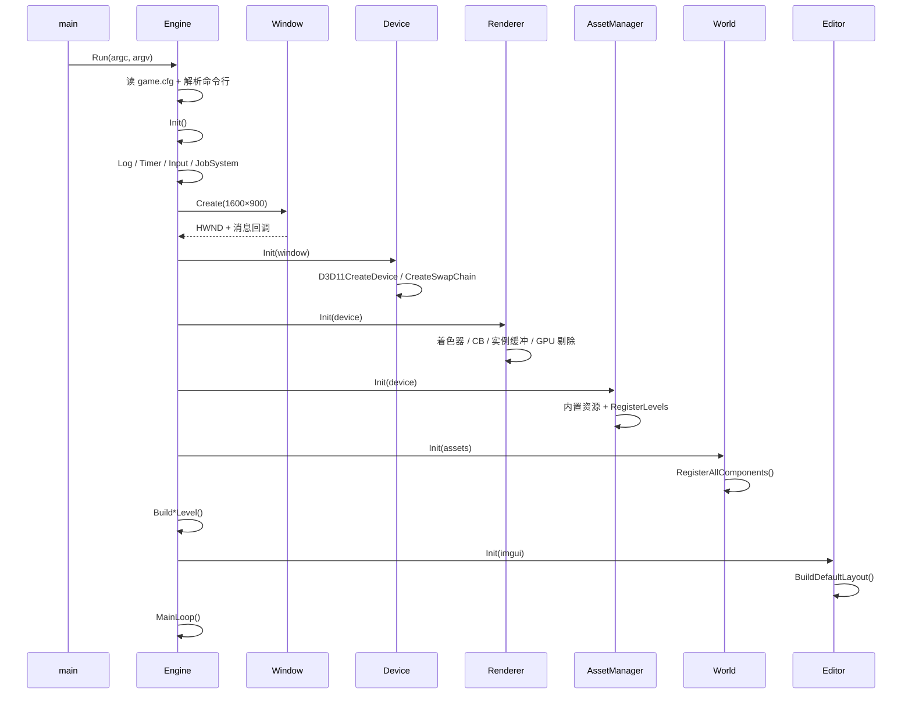
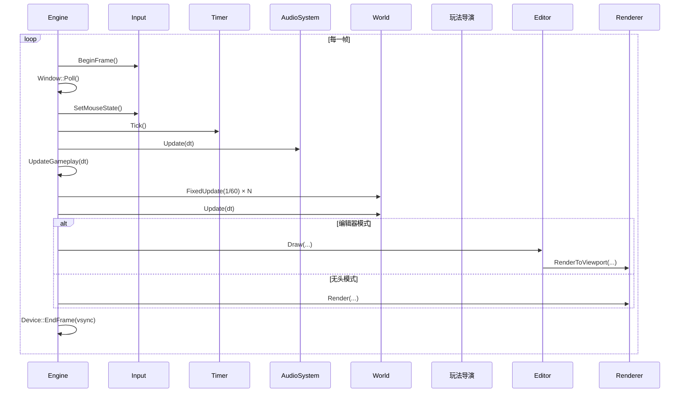
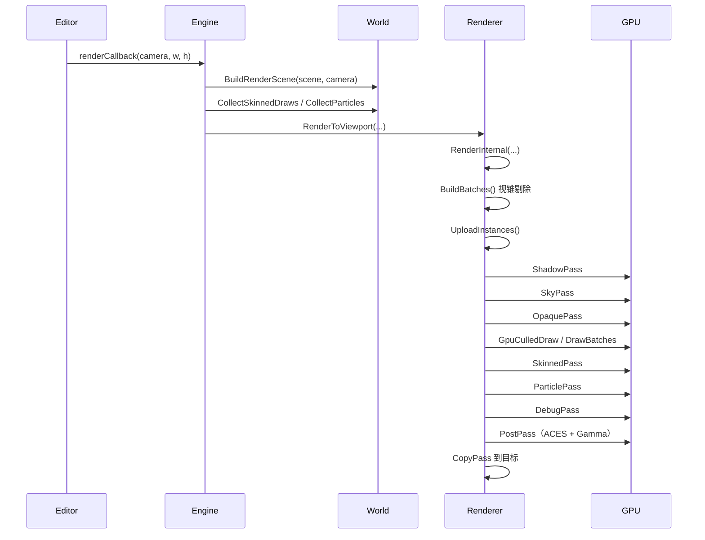
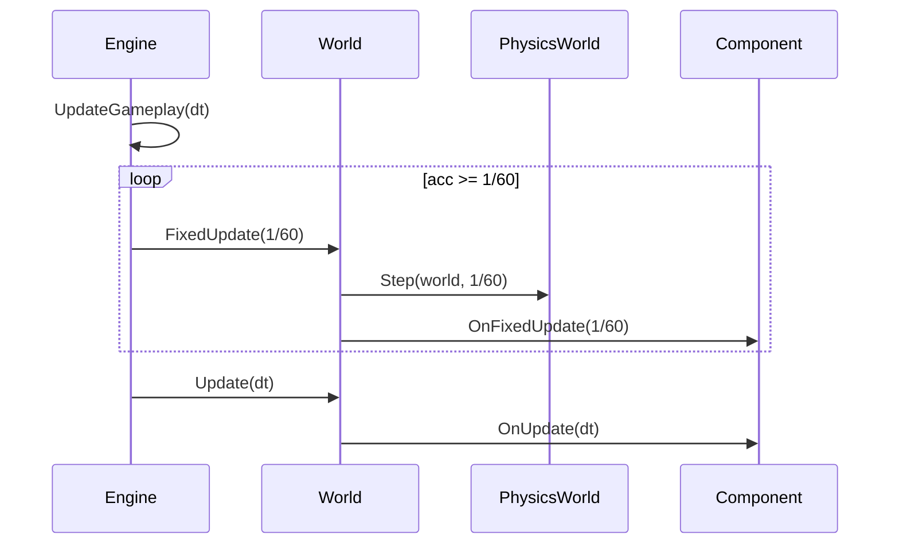
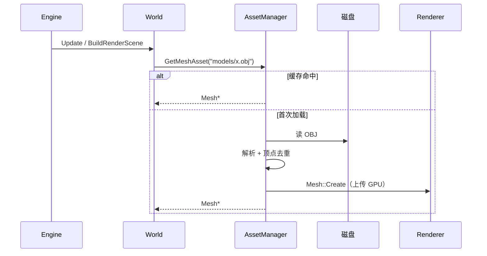
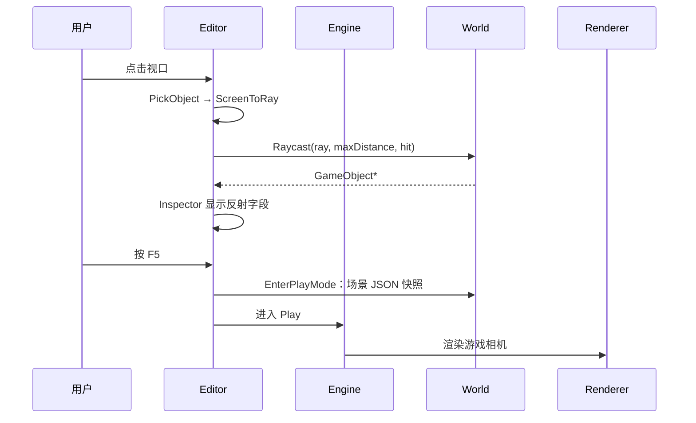
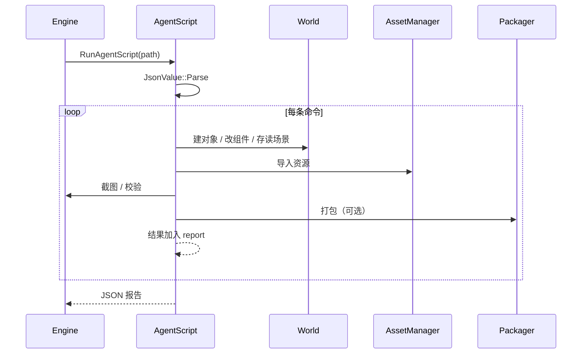

# ErMao 代码总纲

> 这份文档只回答一件事：**代码从 `main` 怎么走到每一个功能**。
>
> - 每一节先给**调用堆栈**（函数树），再给**时序图**（谁先谁后），最后一句“改这里”。
> - 算法推导、公式、实验不在这里展开，统一指向 [讲义](../教学文档/讲义/README.md) 的对应讲。
> - 文件路径都相对仓库根；引用由 `tools/docs-check.ps1` 校验存在性。

**记法**

| 记号 | 含义 |
|---|---|
| `A → B` | 直接函数调用 |
| `A ⇒ B` | 回调、虚函数、函数对象（运行时才确定） |
| `[L04]` | 对应讲义第 04 讲 |
| `build/` | 构建产物，不入库 |

**怎么读**

1. 先读 §1 建立分层，再读 §2、§3 抓住“启动 + 每帧”两条主线；
2. 想改渲染跳 §4，想改玩法跳 §5，想改资源/存档跳 §6，想改编辑器跳 §7，想接 AI 跳 §8；
3. 需要查具体函数时看 §10 函数索引，需要“从哪下手”看 §11 速查表。

---

## §1 全局：五层 + 两个循环

### 1.1 分层与依赖方向

```
┌─────────────────────────────────────────────────────────────┐
│ runtime/      WinMain → main → Engine::Run → Init / MainLoop / Shutdown│
│               AgentScript（--script）、Packager（打包）        │
├─────────────────────────────────────────────────────────────┤
│ editor/       ImGuiLayer、EditorUI（面板、拾取、Gizmo、PIE）  │
├─────────────────────────────────────────────────────────────┤
│ game/         关卡 Build*Level、第三人称、刷怪、幸存者、粒子   │
├─────────────────────────────────────────────────────────────┤
│ animation/ physics/ ai/    骨骼蒙皮、刚体、导航/行为树         │
├─────────────────────────────────────────────────────────────┤
│ scene/        World / GameObject / Component / 反射 / 序列化  │
├─────────────────────────────────────────────────────────────┤
│ asset/        AssetManager、OBJ 加载                          │
├─────────────────────────────────────────────────────────────┤
│ renderer/     Camera、批次、Shadow/Sky/Opaque/Skin/Particle/Post│
├─────────────────────────────────────────────────────────────┤
│ rhi/          D3D11 Device/Buffer/Texture/Shader/RT/截图      │
├─────────────────────────────────────────────────────────────┤
│ core/ platform/  数学、JSON、日志、计时、JobSystem、Win32 窗口 │
└─────────────────────────────────────────────────────────────┘
        依赖只能自上而下；下层不认识上层
```

`engine/src/` 各目录的职责：

| 目录 | 职责 | 关键文件 |
|---|---|---|
| `core/` | 数学、JSON、日志、计时、文件、线程池 | `Json.cpp` `JobSystem.cpp` `FileSystem.cpp` |
| `platform/` | Win32 窗口、输入边沿、音频、文件对话框 | `Window.cpp` `Input.cpp` `Audio.cpp` |
| `rhi/` | D3D11 薄封装、截图、Vulkan 实验后端 | `Device.cpp` `Texture.cpp` `VulkanBackend.cpp` |
| `renderer/` | 相机、网格、批处理、各 Pass、调试线 | `Renderer.cpp` `Camera.cpp` `Mesh.cpp` |
| `scene/` | `World` / `GameObject` / `Component`、反射、JSON 场景、射线 | `World.cpp` `Components.cpp` `Reflection` |
| `asset/` | 资源缓存与注册表、OBJ 解析、外部导入 | `AssetManager.cpp` `ObjLoader.cpp` |
| `animation/` | 骨骼、关键帧采样、混合、蒙皮矩阵 | `Skeleton.cpp` `Animation.cpp` |
| `physics/` | 半隐式欧拉、球/盒碰撞、射线求交 | `PhysicsWorldSim.cpp` |
| `ai/` | 导航栅格 + A*、感知、行为树 | `NavGrid.cpp` `Agents.cpp` `BehaviorTree.cpp` |
| `game/` | 代码关卡、控制器、玩法组件、粒子 | `ThirdPersonLevel.cpp` `WaveArena.cpp` `Survivors.cpp` |
| `editor/` | Dock 布局、七大面板、Gizmo、PIE | `EditorUI.cpp` `ImGuiLayer.cpp` |
| `runtime/` | 入口、主循环、AI 命令、打包 | `main.cpp` `Engine.cpp` `AgentScript.cpp` `Packager.cpp` |

### 1.2 两个循环

- **帧循环**：`Engine::MainLoop`，每帧固定 5 步：输入 → 计时/音频 → 玩法 → 渲染 → Present（§3）。
- **事件循环**：`Window::Poll` 把 Win32 消息分发给 `Window::HandleMessage`，再经 `events.onKey/onMouseButton` 灌进 `Input`（§3.1）。ImGui 通过 `onRawMessage` 先看消息（只观察，不消费）。

### 1.3 一条主线的六个阶段

```
WinMain → main → Engine::Run → Engine::Init → Engine::MainLoop → Engine::Shutdown
                          │                │
                          ├─ 建窗口/设备/渲染器/资源/World
                          ├─ Build*Level 建关卡
                          ├─ ImGui + Editor
                          └─ --script / --package / --vulkan-test 分支

MainLoop 每帧：
  Input::BeginFrame → Window::Poll → Timer::Tick → AudioSystem::Update
  → UpdateGameplay（World::FixedUpdate ×N + World::Update）
  → Editor::Draw（编辑器） 或 Renderer::Render（无头）
  → Device::EndFrame（Present）
```

---

## §2 启动：`WinMain/main → Engine::Init`

### 2.1 调用堆栈

```
WinMain → main(argc, argv)                        runtime/main.cpp（GUI 子系统）
├── SetProcessDpiAwarenessContext（高 DPI）
├── SetConsoleOutputCP(UTF-8)（控制台构建）
└── Engine::Run(argc, argv)                       runtime/Engine.cpp
    ├── --dev：EnsureDevConsole + Log::SetConsoleEcho
    ├── --log / --nolog：日志文件开关
    ├── 读 exe 旁的 game.cfg（level / editor / play）
    ├── 解析命令行（--level / --script / --frames / ...，§11.1）
    ├── Engine::Init()
    │   ├── Log::Init → Timer::Init → Input::BeginFrame → JobSystem::Init
    │   ├── CoInitializeEx（WIC 解码需要）
    │   ├── Window::Create → WndProcStatic ⇒ Window::HandleMessage
    │   ├── Device::Init → D3D11CreateDevice / CreateSwapChain
    │   ├── AudioSystem::Get().Init → XAudio2Create / CreateMasteringVoice
    │   ├── Renderer::Init → CreateShaders / CreateConstantBuffers /
    │   │                    CreateInstanceBuffer / CreateGpuCullResources /
    │   │                    CreateTimingQueries
    │   ├── AssetManager::Init → 内置网格/贴图 + RegisterLevels
    │   ├── World::Init → RegisterAllComponents + RegisterAgentComponents
    │   ├── Build*Level（§2.3）
    │   ├── 可选自检：--test-serialize / --import / --package / --script / --validate
    │   ├── ImGuiLayer::Init → Editor::Init
    │   ├── Editor::SetLevelLoader / SetSceneLoadedCallback
    │   └── --startPlay 时 Editor::Play
    ├── Engine::MainLoop（§3）
    └── Engine::Shutdown（§2.5）
```

### 2.2 初始化顺序（失败即返回）

| # | 调用 | 产出 / 失败后果 |
|---|---|---|
| 1 | `Log::Init` / `Log::SetConsoleEcho` / `Timer::Init` / `JobSystem::Init` | 日志、计时、线程池；`ErMao.log` 落在 exe 旁（发布版默认不写） |
| 2 | `CoInitializeEx` | WIC（PNG/JPEG 解码）可用 |
| 3 | `Window::Create(1600×900)` | Win32 窗口 + 消息回调；失败 `Init` 返回 false |
| 4 | `Device::Init` | D3D11 设备、交换链、后备缓冲；失败返回 false |
| 5 | `AudioSystem::Init` | XAudio2 主混音声部；没有声卡也能继续 |
| 6 | `Renderer::Init` | 着色器、常量缓冲、实例缓冲、GPU 剔除、计时查询 |
| 7 | `AssetManager::Init` | 内置 `cube/sphere/plane/...` + 贴图 + 关卡注册 |
| 8 | `World::Init` | `RegisterAllComponents`（反射工厂，[L14]） |
| 9 | 关卡构建 | 按 `--level` 分派，§2.3 |
| 10 | `ImGuiLayer::Init` / `Editor::Init` | 编辑器 UI、Dock 布局 |
| 11 | 回调注册 | `m_levelLoader` / `sceneLoaded` |

> `--vulkan-test` 在窗口创建后、设备初始化前直接跑 `VulkanDemo` 并退出；`--package` / `--script` 在初始化末尾执行后把 `m_running` 置 false，主循环只跑一帧或直接跳过。

### 2.3 关卡构建分派

```
Engine::Init / Engine::LoadLevel
└── 按 kind 分派
    ├── survivors3d → BuildSurvivors3DLevel     game/Survivors3D.cpp      [L24]
    ├── survivors   → BuildSurvivorsLevel       game/Survivors.cpp        [L23]
    ├── arena       → game::BuildWaveArena      game/WaveArena.cpp        [L17]
    ├── thirdperson → game::BuildThirdPersonLevel game/ThirdPersonLevel.cpp [L15]
    ├── skinning    → game::BuildSkinningLevel  game/SkinningDemo.cpp     [L08]
    ├── cull        → game::BuildCullTestLevel  game/CullTestLevel.cpp    [L22]
    ├── demo        → game::BuildDemoScene      game/ThirdPersonLevel.cpp
    └── empty       → 空世界（AI 脚本从零建场景）
```

编辑器里切关卡走同一条：

```
Editor::DrawMenuBar →「关卡」菜单 → m_levelLoader(id) ⇒ Engine::LoadLevel
└── World::Clear → Build*Level → World::SetLevelKind(kind)
```

读档后恢复 2D/3D：`World::LoadFromFile → Editor::LoadSceneAsset` 触发
`sceneLoaded(kind) ⇒ Engine::ApplyLevelMode`，只切模式，不再重建关卡。

### 2.4 启动时序



### 2.5 关闭：与初始化逆序

```
Engine::Run
└── Engine::Shutdown
    ├── AudioSystem::Shutdown
    ├── Editor::Shutdown → ImGuiLayer::Shutdown
    ├── World::Shutdown（Clear + PhysicsWorld 释放）
    ├── AssetManager::Shutdown（注册表/网格/贴图）
    ├── Renderer::Shutdown（Pass 资源、查询对象、RenderStates）
    ├── Device::Shutdown → Window::Destroy
    ├── JobSystem::Shutdown
    ├── CoUninitialize
    └── Log::Shutdown（写日志尾）
```

> 顺序不能反：渲染器依赖设备，World 依赖资源；先关上层再关下层。

---

## §3 每帧：`Engine::MainLoop`

### 3.1 调用堆栈

```
Engine::MainLoop
├── Input::BeginFrame()                       清上一帧的边沿
├── Window::Poll()                            消息循环；失败 → 退出
│   └── WndProcStatic ⇒ Window::HandleMessage
│       ├── events.onKey / onMouseButton ⇒ Input
│       └── events.onRawMessage ⇒ ImGuiLayer::WndProc（只观察）
├── Input::SetMouseState / ConsumeMouseDelta / ConsumeWheel
├── Timer::Tick()                             更新 delta / 总时间
├── AudioSystem::Update(dt)                   回收播放完的 voice
├── 窗口尺寸变化 → Device::Resize / Renderer::SetWindowSize / Camera::SetViewport
├── Engine::UpdateGameplay(dt)                §3.2
├── 热键：F11 编辑器开关 / F12 截图 / Esc 退出
├── 玩法导演（每帧，§5.2）
│   ├── WaveGame::Update
│   ├── SurvivorsDirector::Update
│   └── Survivors3DDirector::Update
├── 编辑器模式：ImGuiLayer::BeginFrame → Editor::Draw（§7）
│   └── 视口回调 ⇒ Engine::RenderViewportScene（§4）
├── 无头模式：World::BuildRenderScene + Renderer::Render（§4）
├── ++m_frameIndex
│   ├── 自动退出：--frames N 到点 → 可选 CaptureScreenshot
│   └── Device::EndFrame(vsync)                Present
```

### 3.2 玩法更新：固定步长 + 可变步长

```
Engine::UpdateGameplay(dt)
├── 编辑器模式下：Editor::IsPlaying / IsPaused 决定是否更新
├── 固定步长累加器（1/60 s，最多 5 子步，[L01]）
│   └── while (acc >= h && steps < 4)
│       ├── World::FixedUpdate(h)
│       │   ├── PhysicsWorld::Step(world, h)   physics/PhysicsWorldSim.cpp [L10]
│       │   └── GameObject::FixedUpdate ⇒ Component::OnFixedUpdate
│       └── acc -= h
├── 防死亡螺旋：跑满 5 步就丢弃积压时间
└── World::Update(dt)
    └── GameObject::Update(dt)
        ├── 首帧：GameObject::Start ⇒ Component::OnStart
        └── ⇒ Component::OnUpdate（业务逻辑都在这）
```

### 3.3 时序图



### 3.4 编辑器 vs 无头

| | 编辑器模式（默认） | 无头（`--noeditor` / `--demo*`） |
|---|---|---|
| UI | ImGui Dock + 七大面板 | 无编辑器，只叠 HUD/血条 |
| 渲染入口 | `renderCallback ⇒ RenderViewportScene` | `Engine::MainLoop` 直接调 `Renderer::Render` |
| 相机 | 编辑器相机 + 可选游戏相机 | 游戏相机 / 2D 相机跟随 |
| 输入 | 只在视口悬停时给玩法 | 全部给玩法 |
| 截图 | 菜单或 F12 | `--screenshot` 到点自动存 |

---

## §4 渲染：两条入口，一条管线

### 4.1 入口

```
编辑器：
Editor::Draw → DrawViewport(..., renderCallback)
└── renderCallback(camera, w, h)          ⇒ Engine::RenderViewportScene
    ├── 3D 幸存者跟随相机 / 2D 正交相机
    ├── World::BuildRenderScene(scene, camera)
    ├── game::CollectSkinnedDraws / CollectParticles
    └── Renderer::RenderToViewport → RenderInternal（编辑器视口）

无头：
Engine::MainLoop
├── World::BuildRenderScene
├── CollectSkinnedDraws / CollectParticles
└── Renderer::Render → RenderInternal → CopyPass（后备缓冲）
```

> 两条入口最终都进 `Renderer::RenderInternal`，所以“改渲染顺序”只需要改这一处。

### 4.2 `RenderInternal` 的 Pass 顺序

```
Renderer::RenderInternal(camera, scene, time, wireframe, outRtv, w, h)
├── 2D 路径（scene.is2D）
│   └── SpritePass（正交相机 + 按贴图合批，[L23]）
├── 3D 路径
│   ├── 填 PerFrameCB / PointLightsCB（视投影、光源矩阵、阴影参数）
│   ├── UpdateGpuTiming(true)
│   ├── BuildBatches(camera, scene, !GpuCullEnabled)   视锥剔除 / 分批
│   ├── UploadInstances
│   ├── ShadowPass → 光源视锥深度图（2048²，[L06]）
│   ├── EnsureSceneTarget → HDR RGBA16F
│   ├── SkyPass（全屏三角形程序化天空）
│   ├── OpaquePass
│   │   ├── DrawBatches（CPU 批次）
│   │   └── GpuCulledDraw（compute 剔除 + DrawIndexedIndirect，[L22]）
│   ├── SkinnedPass（骨骼调色板 + LBS，[L08]）
│   ├── ParticlePass（billboard + 加法混合，[L12]）
│   ├── DebugPass（线框 / 法线 / 包围盒）
│   └── PostPass → Bloom + ACES + Gamma（[L07]）
└── CopyPass（Render 时才拷到后备缓冲）
```

| Pass | 一句话 | 细节 |
|---|---|---|
| Shadow | 光源视角渲深度，PCF 软化 | [L06](../教学文档/讲义/L06-阴影与天空.md) |
| Sky | 全屏三角形画天空 | [L06](../教学文档/讲义/L06-阴影与天空.md) |
| Opaque | 实例化 + PBR 着色 | [L05](../教学文档/讲义/L05-光照与BRDF.md) |
| GpuCulledDraw | GPU 剔除后间接绘制 | [L22](../教学文档/讲义/L22-GPU%20Driven.md) |
| Skinned | 骨骼调色板 + 线性混合蒙皮 | [L08](../教学文档/讲义/L08-骨骼与蒙皮.md) |
| Particle | 按贴图分组、加法混合 | [L12](../教学文档/讲义/L12-粒子与特效.md) |
| Post | HDR → ACES → Gamma | [L07](../教学文档/讲义/L07-后处理与色彩.md) |

### 4.3 渲染时序



### 4.4 三种“批量”不要混

| 名称 | 在哪 | 解决什么 |
|---|---|---|
| `BuildBatches` | `Renderer.cpp` | CPU 按材质/网格分组 + 视锥剔除 |
| `GpuCulledDraw` | `Renderer.cpp` | compute 剔除实例，生成间接绘制参数 |
| `DrawBatches` | `Renderer.cpp` | 真正提交 `DrawIndexedInstanced` |

---

## §5 玩法与物理

### 5.1 组件生命周期（虚函数都在 `scene/Component.h`）

```
World::Update
└── GameObject::Update
    ├── 首帧：Start ⇒ Component::OnStart
    └── ⇒ Component::OnUpdate(dt)

World::FixedUpdate
├── PhysicsWorld::Step(world, h)
└── GameObject::FixedUpdate ⇒ Component::OnFixedUpdate(h)

World::DestroyObject
├── 标记 pendingDestroy
└── ProcessPendingDestruction ⇒ Component::OnDestroy
```

> `OnUpdate` 里不要做物理积分；物理只在 `FixedUpdate` 里走，保证不同帧率手感一致。

### 5.2 玩法导演（每帧）

| 导演 | 关卡 | 每帧做什么 |
|---|---|---|
| `WaveGame::Update` | `arena`（刷怪竞技场） | 刷波、计分、胜负、HUD |
| `SurvivorsDirector::Update` | `survivors`（2D 幸存者） | 刷怪、经验、升级、菜单状态；20 层关卡与第 1 层教学（`BeginStage` / `StageGoalReached` / `AdvanceStage`） |
| `Survivors3DDirector::Update` | `survivors3d`（3D 幸存者） | 同上，XZ 平面 + 跟随相机 |

组件更新表：

| 组件 | 文件 | 职责 |
|---|---|---|
| `ThirdPersonController` | `game/ThirdPersonController.cpp` | WASD 移动 + 相机跟随 + 跳跃 |
| `SurvivorsPlayerComponent` | `game/Survivors.cpp` | 移动、索敌、发射 |
| `SurvivorsEnemyComponent` | `game/Survivors.cpp` | 追击、接触伤害、掉落 |
| `SurvivorsProjectileComponent` | `game/Survivors.cpp` | 位移、命中、销毁 |
| `SurvivorsGemComponent` | `game/Survivors.cpp` | 吸附、拾取、加经验 |
| `Survivors3D*` | `game/Survivors3D.cpp` | 同上（XZ 平面 + 3D 模型） |
| `EnemyComponent` | `game/WaveGame.cpp` | 行为树驱动（[L17]） |
| `ParticleEmitterComponent` | `game/ParticleEmitter.cpp` | 发射/积分/回收（[L12]） |
| `SkinnedCharacterComponent` | `game/SkinnedCharacter.cpp` | 采样动画、写骨骼调色板（[L08]） |

### 5.3 物理

```
PhysicsWorld::Step(world, dt)
├── Integrate（半隐式欧拉：v += g·dt；p += v·dt）
├── Solve
│   ├── ResolveGround（球/盒 vs 地面）
│   ├── ResolveStaticBoxes（vs 静态盒）
│   └── ResolveSpherePairs（动态球两两）
└── 休眠判定
```

射线查询走 `World::Raycast`（`scene/WorldQuery.cpp`），编辑器拾取与 AI 视线共用。

### 5.4 一次固定的玩法更新



---

## §6 资源与序列化

### 6.1 加载

```
AssetManager::GetTextureAsset("sprites/x.png")
└── Texture::CreateFromFile
    ├── WIC 解码
    └── CreateTexture2D + SRV                      rhi/Texture.cpp

AssetManager::GetMeshAsset("models/x.obj")
└── LoadObjMesh → 解析 / 顶点去重 → Mesh::Create   asset/ObjLoader.cpp [L24]

AssetManager::GetMesh("cube") / GetTexture("grid")
└── CreatePrimitive / CreateProceduralTexture（程序化，无外部文件）
```

### 6.2 外部导入（编辑器与 `--import`）

```
Editor::ImportModel / ImportTexture
└── AssetManager::ImportMesh / ImportTexture
    ├── 复制文件到 exe 旁 assets/{models,textures}
    ├── 加载并 Register
    └── 资源浏览器刷新
```

### 6.3 场景保存 / 读取

```
World::SaveToFile(path)
└── World::ToJson
    └── Component::Describe ⇒ SerializeField（反射，[L14]） → JsonValue::Dump

World::LoadFromFile(path)
├── JsonValue::Parse
├── World::FromJson
│   └── Reflection::Find(type)->factory(object) → 反序列化字段
└── Editor::LoadSceneAsset ⇒ Engine::ApplyLevelMode(world.LevelKind())  恢复 2D/3D
```

### 6.4 资源加载时序



---

## §7 编辑器：ImGui 只是外壳

### 7.1 面板结构

```
Editor::Draw
├── DrawDockspace
│   ├── DrawMenuBar（文件/编辑/关卡/视图/帮助）
│   └── DrawToolbar
├── DrawViewport（离屏视口 + 拾取 + Gizmo）
├── DrawOutliner（世界大纲）
├── DrawInspector（反射驱动字段）
├── DrawAssets（资源浏览器，双击：模型 → SpawnMeshObject / 场景 → LoadSceneAsset）
├── DrawConsole
├── DrawStats
├── DrawSettings
├── DrawStatusBar
└── HandleShortcuts（Ctrl+S/O/N、Ctrl+D、Delete、F2/F4、F11/F12）
```

### 7.2 视口回调

```
Editor::DrawViewport(world, renderer, camera, renderCallback)
├── 计算视口尺寸 / 悬浮
├── renderCallback(camera, w, h)     ⇒ Engine::RenderViewportScene
├── 左键：PickObject → Camera::ScreenToRay → World::Raycast
└── 绘制 Gizmo：DrawGizmo → 轴命中 → SetPosition / SetRotation / SetScale
```

### 7.3 Play-In-Editor

```
Editor::Play
└── EnterPlayMode(world)
    └── 保存场景 JSON 快照 → 记录相机/选中 → 运行

Editor::Stop
└── ExitPlayMode(world)
    └── 从快照重建场景 → 恢复相机/选中 → 验证序列化往返
```

### 7.4 编辑器交互时序



---

## §8 AI 脚本：`--script` 的调用链

### 8.1 入口

```
Engine::Run
└── Engine::Init（--script）
    └── Engine::RunAgentScript(path, out)        runtime/AgentScript.cpp
        ├── JsonValue::Parse → commands[]
        └── for each：Engine::ExecuteAgentCommand(cmd)
            ├── scene.new / scene.save / scene.load / scene.query
            ├── object.create / object.destroy / object.set
            ├── component.add / component.set / component.get
            ├── assets.import / assets.list / level.build / camera.set
            ├── screenshot ⇒ RenderAgentScreenshot ⇒ Engine::CaptureScreenshot
            ├── package.game ⇒ Packager::PackageGameWindows / LinuxSource
            └── validate ⇒ ValidateWorld
```

每条命令返回 JSON 结果，`--json-out` 汇总写盘；`--validate` 只跑校验不建场景。

### 8.2 时序



> 命令清单与提示词模板见 [AI 开发指南](../教学文档/AI开发指南.md)。

---

## §9 音频 / Vulkan / 打包

### 9.1 音频

```
PlaySfx("shoot", volume) ⇒ AudioSystem::Play
├── Load → ParseWav（PCM，[L25]）
├── CreateSourceVoice → SubmitSourceBuffer
└── MainLoop → AudioSystem::Update → 回收播完的 voice
```

### 9.2 Vulkan（实验，`--vulkan-test`）

```
Engine::Init → VulkanDemo::Init
├── CreateInstance → CreateSurface(hwnd)
├── PickDevice → CreateDevice → CreateSwapchain
└── Run → RenderPass / Pipeline → 120 帧 → 回读截图    rhi/VulkanBackend.cpp [L26]
```

> D3D11 是主路径；Vulkan 只跑通“三角形 + 截图”，用来演示 RHI 抽象往哪走。

### 9.3 打包

```
Editor 菜单 / --package / --package-game
└── Packager::PackageGameWindows(name, level)
    ├── 复制 ErMao.exe → <name>.exe
    ├── CopyTree(shaders / assets)
    └── 写 game.cfg / run.bat / README

Packager::PackageWindows        引擎包（编辑器 + 资源）
Packager::PackageLinuxSource    Linux 源码包（无二进制，明确说明）
```

---

## §10 函数索引（按层）

> “次级函数”指从 `main` 可达的、除入口与主循环之外的函数。下表按层列出**主要函数**及其调用者；私有辅助函数随所属模块一并列出。

### 10.1 core / platform

| 函数 | 调用者 | 作用 |
|---|---|---|
| `Log::Init / Shutdown / LogInfo / LogError / SetConsoleEcho` | `Engine` | 日志、控制台开关与着色 |
| `Timer::Init / Tick / Delta / Now` | `Engine`、`Renderer` | 帧时间与计时 |
| `JobSystem::Init / ParallelFor / Shutdown` | `Engine`、`World::BuildRenderScene` | 线程池并行 |
| `JsonValue::Parse / Dump` | 场景、AI、配置 | JSON |
| `FileSystem::ReadTextFile / Join / ExecutableDir / WritableAssetDir` | `Engine`、`AssetManager` | 路径与文件 |
| `Window::Create / Poll / HandleMessage / Destroy` | `Engine` | Win32 窗口 |
| `Input::BeginFrame / OnKey / OnMouseButton / SetMouseState / IsKeyPressed` | `Engine`、编辑器 | 输入边沿 |
| `AudioSystem::Init / Play / Update / Shutdown` | `Engine`、玩法 | XAudio2 |
| `OpenFileDialog / SaveFileDialog` | 编辑器导入/保存 | 系统对话框 |

### 10.2 rhi

| 函数 | 调用者 | 作用 |
|---|---|---|
| `Device::Init / Resize / BeginFrame / EndFrame / Shutdown` | `Engine`、`Renderer` | 设备、交换链、Present |
| `Buffer::Create / Update / BindVSPS` | `Renderer` | 顶点/索引/常量缓冲 |
| `Texture::CreateFromFile / Create` | `AssetManager` | WIC 解码与上传 |
| `Shader::Create / Bind` | `Renderer` | 运行时编译 HLSL |
| `RenderTarget::Create / Bind / Clear` | `Renderer`、`ImGuiLayer` | RT |
| `SaveBackbufferToPng` | `Engine::CaptureScreenshot` | 截图 |
| `VulkanDemo::Init / Run` | `Engine::Init` | Vulkan 实验 |

### 10.3 renderer

| 函数 | 调用者 | 作用 |
|---|---|---|
| `Renderer::Init / Shutdown` | `Engine` | 着色器、CB、剔除、查询 |
| `Renderer::Render` | `Engine::MainLoop` | 无头渲染 → 离屏 → 后备缓冲 |
| `Renderer::RenderToViewport` | `Engine::RenderViewportScene` | 编辑器视口渲染 |
| `Renderer::RenderInternal` | 上面两个 | Pass 调度 |
| `Renderer::BuildBatches` | `RenderInternal` | 分批 + 视锥剔除 |
| `Renderer::UploadInstances` | `RenderInternal` | 实例缓冲上传 |
| `Renderer::ShadowPass / SkyPass / OpaquePass / SkinnedPass / ParticlePass / DebugPass / PostPass` | `RenderInternal` | 各 Pass |
| `Renderer::GpuCulledDraw` | `OpaquePass` | compute 剔除 + 间接绘制 |
| `Renderer::SpritePass` | `RenderInternal`（2D） | 精灵批处理 |
| `Renderer::CopyPass` | `Render` | 视口 → 后备缓冲 |
| `Renderer::GetMeshThumbnail / GetTextureThumbnail` | 编辑器资源浏览器 | 网格/贴图缩略图 |
| `Camera::ViewProjection / ScreenToRay / SetViewport` | 渲染、编辑器 | 相机数学 |
| `DebugDraw::Line / Box / Begin` | 玩法/编辑器 | 调试线 |

### 10.4 scene

| 函数 | 调用者 | 作用 |
|---|---|---|
| `World::Init / Shutdown` | `Engine` | 反射注册、物理世界 |
| `World::CreateGameObject / DestroyObject / ProcessPendingDestruction` | 关卡/编辑器/AI | 对象生命周期 |
| `World::Update / FixedUpdate` | `Engine::UpdateGameplay` | 组件更新 |
| `World::BuildRenderScene` | `Engine` | 收集渲染项/灯光/相机 |
| `World::ToJson / FromJson / SaveToFile / LoadFromFile` | 编辑器/AI | 场景序列化 |
| `World::Raycast` | 编辑器拾取 / AI | 射线查询 |
| `World::RebuildNavigation` | 关卡/AI | 导航栅格重建 |
| `GameObject::AddComponent / GetComponent / ForEach / SetParent` | 关卡/编辑器 | 对象与组件 |
| `GameObject::Update / FixedUpdate / Start` | `World` | 生命周期 |
| `Component::OnStart / OnUpdate / OnFixedUpdate / OnDestroy / Describe` | `GameObject`/反射 | 组件接口 |
| `Reflection::Register / Find / All` | `World::Init`、AI 命令 | 反射工厂 |
| `SerializeField` | `Component::Describe` | 字段序列化 |

### 10.5 asset / animation / physics / ai

| 函数 | 调用者 | 作用 |
|---|---|---|
| `AssetManager::Init / Shutdown` | `Engine` | 内置资源、关卡注册 |
| `AssetManager::GetMesh / GetTexture / GetMeshAsset / GetTextureAsset` | `World`、玩法 | 缓存加载 |
| `AssetManager::ImportMesh / ImportTexture` | 编辑器、`--import` | 外部资源导入 |
| `AssetManager::RegisterLevels / Refresh` | 初始化、资源浏览器 | 资产表 |
| `LoadObjMesh` | `GetMeshAsset` | OBJ 解析 |
| `Skeleton::AddBone / FinalizeBindPose / ComputeWorld / ComputeSkinning` | 蒙皮角色 | 骨架与调色板 |
| `BoneTrack::Sample / SkeletonClip::Sample / BlendPoses` | 动画状态 | 采样与混合 |
| `PhysicsWorld::Step / RaySphere` | `World::FixedUpdate`、AI | 物理与射线 |
| `NavGrid::Build / FindPath / HasLineOfSight` | AI 智能体 | 导航 |
| `NavAgentComponent::OnUpdate / RequestPath / CanSeePlayer` | `World::Update` | 巡逻/追击 |
| `BehaviorTree::Tick` | `EnemyComponent` | 行为树 |

### 10.6 game

| 函数 | 调用者 | 作用 |
|---|---|---|
| `game::BuildThirdPersonLevel` | `Engine::Init/LoadLevel` | 第三人称关卡 |
| `game::BuildWaveArena` / `BuildDemoScene` | 同上 | 刷怪竞技场 |
| `BuildSurvivorsLevel` | 同上 | 2D 幸存者 |
| `BuildSurvivors3DLevel` | 同上 | 3D 幸存者 |
| `game::BuildSkinningLevel` | 同上 | 蒙皮演示 |
| `game::BuildCullTestLevel` | 同上 | GPU 剔除压测 |
| `ThirdPersonController::OnUpdate / SetInputEnabled / SetSimulatedInput` | `World` / `--smoke` | 角色控制 |
| `WaveGame::Update / DrawUI / DrawHealthBars / Reset` | `Engine::MainLoop` | 竞技场导演 |
| `SurvivorsDirector::Update / DrawUI / Reset` | `Engine::MainLoop` | 2D 导演 |
| `Survivors3DDirector::Update / DrawUI / Reset` | `Engine::MainLoop` | 3D 导演 |
| `ParticleEmitterComponent::OnUpdate` | `World` | 粒子发射/回收 |
| `SkinnedCharacterComponent::OnUpdate` | `World` | 动画采样与调色板 |

### 10.7 editor / runtime

| 函数 | 调用者 | 作用 |
|---|---|---|
| `ImGuiLayer::Init / BeginFrame / EndFrame / WndProc` | `Engine`、`Editor` | ImGui 集成 |
| `Editor::Init / Draw / Shutdown` | `Engine` | 编辑器入口 |
| `Editor::DrawDockspace / DrawMenuBar / DrawToolbar` | `Editor::Draw` | 外壳 |
| `Editor::DrawViewport / DrawOutliner / DrawInspector / DrawAssets / DrawConsole / DrawStats / DrawSettings / DrawStatusBar` | `Editor::Draw` | 面板 |
| `Editor::PickObject / DrawGizmo / FocusSelected / HandleShortcuts` | 视口/快捷键 | 交互 |
| `Editor::Play / Stop / EnterPlayMode / ExitPlayMode` | 菜单/快捷键 | PIE 快照 |
| `Editor::SaveScene / LoadScene / NewScene / ImportModel / ImportTexture` | 菜单 | 场景与导入 |
| `Engine::RunAgentScript / ExecuteAgentCommand / ValidateWorld` | `Engine::Init`/AI | 无头接口 |
| `Engine::CaptureScreenshot` | 热键/自动截图/AI | 截图 |
| `Engine::LoadLevel / ApplyLevelMode` | 编辑器/AI | 关卡切换 |
| `Packager::PackageWindows / PackageLinuxSource / PackageGameWindows / PackageGameLinuxSource` | 编辑器/`--package` | 打包 |

---

## §11 速查表

### 11.1 命令行参数

| 参数 | 作用 |
|---|---|
| `--level <kind>` | `thirdperson` / `arena` / `survivors` / `survivors3d` / `skinning` / `cull` / `demo` / `empty` |
| `--play` | 启动即进 Play |
| `--noeditor` | 不画编辑器 |
| `--dev` | 开发版：挂接/新建控制台并输出日志（同时写 `ErMao.log`） |
| `--log` | 只写 `ErMao.log`，不弹控制台 |
| `--nolog` | 不写日志文件 |
| `--frames N` | 跑 N 帧退出 |
| `--screenshot path.png` | 第 N 帧截图 |
| `--demo` / `--demo2d` / `--demo3d` | 一键演示（无编辑器 + 自动开局） |
| `--script commands.json` | AI 命令脚本 |
| `--json-out report.json` | 命令结果 |
| `--validate` | 结构化校验 |
| `--package windows\|linux` | 引擎包自检 |
| `--package-game windows\|linux` | 游戏包自检 |
| `--vulkan-test` / `--audio-test` | Vulkan / 音频自检 |
| `--test-serialize` / `--smoke` / `--import <path>` | 序列化 / 移动 / 导入自检 |
| `--debugview N` / `--roughness R` / `--metallic M` / `--noshadows` / `--no-gpu-cull` | 教学对比开关 |

### 11.2 “我想改 X，从哪进？”

| 想做的事 | 入口 | 关键链 |
|---|---|---|
| 改主循环 | `Engine::MainLoop` | Input → UpdateGameplay → Draw/Render → Present |
| 加组件 | `Components.h` + `RegisterAllComponents` | `ER_COMPONENT` → `Describe`（Inspector/序列化自动生效） |
| 加关卡 | `Engine::LoadLevel` + `levels.json` | `Build*Level` → World |
| 改渲染顺序 | `Renderer::RenderInternal` | Shadow → Sky → Opaque → Particles → Debug → Post |
| 改 PBR / 阴影 | `shaders/PBR.hlsl` / `Shadow.hlsl` | 只改着色器（[L05] / [L06]） |
| 加资源类型 | `AssetManager::Get*Asset` | 解码 → 缓存 → Register |
| 改编辑器面板 | `Editor::Draw*` | 在 `DrawDockspace` 里加窗口 |
| 加音效 | `PlaySfx("name")` | `AudioSystem::Play` |
| 加 AI 命令 | `Engine::ExecuteAgentCommand` | 新 `cmd` 分支 + JSON 结果 |
| 打包 | `Packager::PackageGameWindows` | exe + assets + game.cfg |
| 改输入 | `Input` / `Window::HandleMessage` | 按下/抬起边沿 → `Input::OnKey` |

---

## §12 自己追栈 & 算法入口

### 12.1 追栈方法

1. `ErMao.exe --frames 1 --noeditor`：先看初始化顺序与日志；
2. 断点顺序：`main` → `Engine::Run` → `MainLoop` → `Editor::DrawViewport` → `RenderInternal` → `World::Update`；
3. 回调在栈里显示为 `lambda`（`RenderViewportScene`），看 `this` 或调用点；
4. 虚函数断点会命中所有组件，用 `this` 的实际类型过滤；
5. `JobSystem` 的 worker 不在主线程栈里，切线程窗口；
6. GPU 剔除的可见数有约 30 帧 readback 延迟，以日志为准（[L22]）。

### 12.2 算法细节去哪看

| 主题 | 讲义 |
|---|---|
| 固定步长 / 主循环 | [L01](../教学文档/讲义/L01-引擎架构与主循环.md) |
| 分层与依赖 | [L02](../教学文档/讲义/L02-分层与依赖方向.md) |
| 变换与四元数 | [L03](../教学文档/讲义/L03-游戏世界与变换.md) |
| 渲染管线 | [L04](../教学文档/讲义/L04-渲染管线与坐标空间.md) |
| PBR / BRDF | [L05](../教学文档/讲义/L05-光照与BRDF.md) |
| 阴影与天空 | [L06](../教学文档/讲义/L06-阴影与天空.md) |
| 后处理与色彩 | [L07](../教学文档/讲义/L07-后处理与色彩.md) |
| 骨骼与蒙皮 | [L08](../教学文档/讲义/L08-骨骼与蒙皮.md) |
| 动画混合 | [L09](../教学文档/讲义/L09-动画混合.md) |
| 物理 | [L10](../教学文档/讲义/L10-物理基础.md) |
| 碰撞与查询 | [L11](../教学文档/讲义/L11-碰撞与查询.md) |
| 粒子与特效 | [L12](../教学文档/讲义/L12-粒子与特效.md) |
| 编辑器 / 拾取 / Gizmo | [L13](../教学文档/讲义/L13-编辑器与工具链.md) |
| 序列化与反射 | [L14](../教学文档/讲义/L14-序列化与反射.md) |
| Gameplay 框架 | [L15](../教学文档/讲义/L15-Gameplay框架.md) |
| AI 与寻路 | [L16](../教学文档/讲义/L16-AI与寻路.md) |
| 行为树 | [L17](../教学文档/讲义/L17-行为树.md) |
| 数据布局 / JobSystem | [L20](../教学文档/讲义/L20-数据布局与JobSystem.md) |
| GPU Driven | [L22](../教学文档/讲义/L22-GPU%20Driven.md) |
| 2D 渲染 | [L23](../教学文档/讲义/L23-2D渲染与像素游戏.md) |
| 3D / 外部 OBJ | [L24](../教学文档/讲义/L24-3D幸存者与外部模型.md) |
| 音频 | [L25](../教学文档/讲义/L25-音频PCM与混音.md) |
| Vulkan | [L26](../教学文档/讲义/L26-Vulkan后端阶段一.md) |

> 本文引用的源码路径由 `tools/docs-check.ps1` 在提交前与 CI 中校验。
