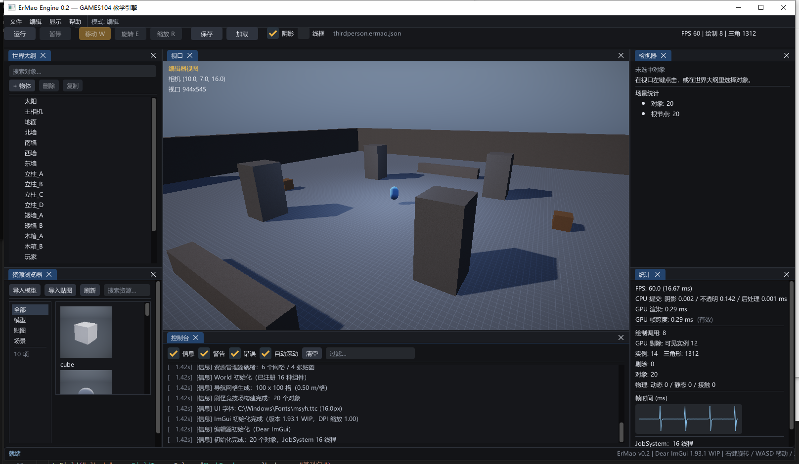
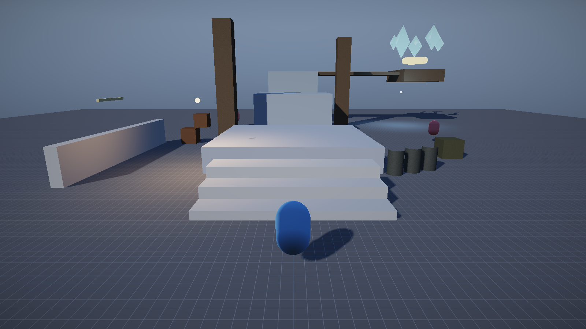

# 编辑器与关卡实战

> 这一篇讲两块“引擎之外、但决定好不好用”的东西：**ImGui 编辑器**和**代码优先的关卡**。
> 原理与推导在讲义 [L13 编辑器](讲义/L13-编辑器与工具链.md) / [L15 Gameplay](讲义/L15-Gameplay框架.md)；
> 调用链在 [代码总纲 §7](../代码总纲/00-代码总纲.md)。



---

# 第一部分：ImGui 编辑器

## 1. 为什么用 Dear ImGui

v0.1 自研的即时模式 UI 只有约 600 行：控件少、没有 Dock、中文依赖 GDI 图集，是最大的风险项。
v0.2 起直接接入 **Dear ImGui 1.93.1（docking 分支）**，把预算从“造控件”挪回引擎功能。

```
third_party/imgui/            # 官方源码（docking），随仓库分发
engine/src/editor/
  ImGuiLayer.cpp              # 上下文、Win32/DX11 后端、消息转发、字体与主题
  EditorUI.cpp                # 菜单/工具栏/Dock/七大面板/Gizmo/PIE
```

- CMake 把 ImGui 核心 + Win32/DX11 后端编进 `ErMaoEngine`，无额外二进制依赖；
- **消息优先级**：`Window` 暴露 `onRawMessage`，`ImGuiLayer::WndProc` 先看原始消息
  （`WM_CHAR/WM_INPUT/WM_SETCURSOR` 等），编辑器快捷键不会和玩法输入打架；
- **字体**：优先 `C:/Windows/Fonts/msyh.ttc` + `GetGlyphRangesChineseSimplifiedCommon()`，
  缺失时回退 Segoe UI；
- **主题**：暗色 + 琥珀强调，`ScaleAllSizes(DPI)` 跟随系统缩放。

## 2. 布局：Dock，不是“贴纸”

`ImGui::DockSpace` + `DockBuilder` 生成默认布局（只在 `imgui.ini` 不存在时构建一次）：

```
┌───────────────────────────────────────────────────────────────┐
│ 菜单栏：文件 / 编辑 / 关卡 / 显示 / 帮助        模式: 编辑     │
├───────────────────────────────────────────────────────────────┤
│ 工具栏：运行 暂停 | 移动/旋转/缩放 | 视角 | 保存 加载 | 阴影 线框 | FPS │
├──────────────┬──────────────────────────────┬─────────────────┤
│ 世界大纲      │                              │ 检视器           │
│              │           视口                │                 │
├──────────────┤      （离屏 RT + ImGui 图像）  ├─────────────────┤
│ 资源浏览器    │                              │ 统计 / 设置      │
├──────────────┴──────────────────────────────┴─────────────────┤
│ 控制台                                                         │
├───────────────────────────────────────────────────────────────┤
│ 状态栏：操作反馈 / 版本信息                                     │
└───────────────────────────────────────────────────────────────┘
```

拖动分隔条、重排面板由 ImGui 自动保存到 exe 旁的 `imgui.ini`。

## 3. 视口：真正的离屏渲染

```
Renderer::RenderToViewport(camera, scene, time, w, h, wireframe)
└── RenderInternal → 离屏 RT（HDR 场景 + Post）

Editor::DrawViewport
├── 取 renderer.ViewportTexture()，用 ImGui::Image 贴进视口
├── 每帧把视口尺寸回传给相机 aspect（拖动不变形）
└── 鼠标坐标 → 视口局部 → World::Raycast（拾取）
```

好处：视口可任意大小/位置、可被面板遮挡；将来做多视口只是多一个 RT。

## 4. 面板一览

| 面板 | 能力 |
|---|---|
| **视口** | 离屏渲染、右键环视、WASD/QE 飞行、左键拾取、Gizmo、HUD |
| **世界大纲** | 层级树、搜索、创建（立方体/球/圆柱/圆环/空物体/点光/相机）、删除、复制 |
| **检视器** | 名字/启用、Transform、组件折叠面板、反射字段、增删组件 |
| **资源浏览器** | 分类 + 缩略图网格、搜索、导入模型/贴图、双击放入场景/赋材质/加载场景 |
| **控制台** | 分级过滤、文本过滤、自动滚动、清空、颜色区分 |
| **统计** | FPS/帧时间、CPU 提交、GPU 时间戳、绘制/实例/三角/剔除、物理统计、帧时间曲线 |
| **设置** | 镜头速度、正/俯/透视视角、曝光/阴影/线框/调试视图、太阳与半球光、重力/迭代、导航网格重建 |

## 5. 反射驱动检视器

检视器不写死任何组件：遍历 `TypeInfo::fields`，按 `FieldType` 映射控件。

| FieldType | 控件 |
|---|---|
| Bool | `Checkbox` |
| Int | `DragInt`（`shape` 特殊处理成“球体/盒体”下拉） |
| Float | `DragFloat`（带 min/max） |
| Vec3 | `DragFloat3` |
| Color / Vec4 | `ColorEdit4` |
| String | `InputText` |
| MeshAsset / TextureAsset | 内置 + 已导入资源下拉 |

新增组件只写 `Describe()`，Inspector 与 JSON 序列化同时获得支持。

## 6. 资源导入链路

```
导入模型 / 导入贴图（Win32 对话框，UTF-8 路径）
└── AssetManager::ImportMesh / ImportTexture
    ├── 复制到 exe 旁 assets/{models,textures}/<文件名>
    ├── OBJ 解析（v/vn/vt/f、负索引、多 group）/ WIC 解码
    ├── 上传 GPU
    ├── 注册到资产表（名称/路径/顶点/索引）
    └── 自动在相机前实例化（模型）
```

`--import <path>` 是无界面导入自检：

```
[INFO] 导入模型成功: models/crystal.obj（6 顶点 / 8 三角形）
```

## 7. 资源浏览器与编辑操作（v0.3+）

- **缩略图**：`Renderer::CaptureThumbnail` 用包围球算相机距离，把网格渲染到 128² RT，
  按 meshId 缓存，只渲染一次；
- **Gizmo**：选中后画三轴（屏幕空间投影），命中测试用“点到线段距离 < 10px”；
  拖拽把鼠标位移投影到轴方向，再乘 `axisLength / 屏幕长度` 得到世界位移；
- **F 聚焦**：`FocusSelected` 用世界 AABB 求中心与半径，按 FOV 算距离，保持朝向；
- **Play-In-Editor**：`EnterPlayMode` 存场景 JSON 快照，`ExitPlayMode` 从快照重建，
  同时验证序列化往返。

## 8. 自动化与可验证性

| 参数 | 作用 |
|---|---|
| `--frames N` / `--screenshot p` | 跑 N 帧退出 / 第 N 帧截图 |
| `--play` / `--noeditor` | 直接进游戏 / 关掉编辑器 |
| `--test-serialize` | 场景 JSON 往返（字节级） |
| `--smoke` | 脚本化输入：向前走 + 跳，日志打印玩家位置 |
| `--import path` | 模型导入自检 |

“UI 交互失效”不会再被掩盖：`--smoke` 直接验证角色位移，`--import` 直接验证资源链路。

---

# 第二部分：代码优先的关卡

> 当前编辑器「关卡」菜单只保留 **2D 幸存者 / 3D 幸存者** 两个 Demo（`levels.json` 与资源浏览器同步）。
> 下面的第三人称关卡代码仍保留在 `ThirdPersonLevel.cpp`，作为内部示例与文档素材，不再出现在菜单里。



## 9. 关卡就是一个函数

```cpp
// engine/src/game/Levels.h
namespace erm::game {
void BuildThirdPersonLevel(World& world); // 第三人称演示关卡
void BuildDemoScene(World& world);        // 早期基础场景
}
```

`Engine::Init` 直接调用 `game::BuildThirdPersonLevel(m_world)`。

**启动时永远用 C++ 构建关卡**，不读旧的 `.ermao.json`；存档只在编辑器“打开场景”时显式加载。
这样改代码立刻生效，不会被上次保存的场景盖住（v0.1 踩过这个坑）。

### 9.1 关卡构建工具

`ThirdPersonLevel.cpp` 里只有几个小函数，关卡代码读起来像配置：

```cpp
SpawnStaticBox(world, "平台A", {0,0.6f,1}, {8,1.2f,8}, {0.40f,0.44f,0.52f,1});
SpawnLamp(world, "路灯_0", {-4,3.2f,5}, {1,0.62f,0.3f,1}, 7.0f, 9.0f);
SpawnAi(world, "巡逻者_0", {-8,1,-8}, 4.0f);
```

- `SpawnMesh`：名字 + 网格 + 位置 + 缩放 + 颜色 + 贴图/UV/粗糙度；
- `SpawnStaticBox`：网格 + 静态 `RigidBodyComponent`（物理与导航共用）；
- `SpawnLamp` / `SpawnAi` / `SpawnCrystals`：灯光、AI、外部 OBJ 装饰。

### 9.2 关卡内容

| 区域 | 物件 | 作用 |
|---|---|---|
| 起点 | 三级台阶 | 教“可以跳” |
| 主平台链 | A(1.2m) → B(3.2m) → C(5.2m) | 两段 2m 间隙，需要跑跳 |
| 侧廊 | 空中长廊 + 终点台 + 旋转光环 | 目标点 |
| 障碍 | 立柱 + 矮墙 + 木箱堆 | 演示弹簧臂、导航绕行 |
| 装饰 | 5 颗外部 OBJ 水晶、风车动画 | 验证资源/动画链路 |
| AI | 3 个巡逻者 | 感知 + A* 追击 |
| 灯光 | 2 盏路灯 | 点光衰减 |

## 10. 第三人称控制器

`game/ThirdPersonController.cpp` 用一个组件搞定“移动 + 跳跃 + 相机”。

### 10.1 移动：相机相对

```cpp
const Quat yawRotation = Quat::FromEuler(ToRadians(yawDegrees), 0, 0);
const Vec3 cameraForward = yawRotation.RotateVector({0,0,-1});
const Vec3 cameraRight   = yawRotation.RotateVector({1,0,0});

Vec3 wish = W*cameraForward - S*cameraForward + D*cameraRight - A*cameraRight;
```

角色朝向用最短角插值转向移动方向，避免“按 S 倒着跑”的观感。

### 10.2 竖直：重力 + 跳跃 + 地面射线

```cpp
if (grounded && jumpPressed) { m_verticalVelocity = jumpSpeed; grounded = false; }
m_verticalVelocity += gravity * dt;
position.y += m_verticalVelocity * dt;

Ray groundRay{position + Vec3(0, 0.15f, 0), Vec3(0,-1,0)};
if (world->Raycast(groundRay, height*0.5f + 0.35f, hit, m_owner)) {
    if (position.y <= hit.point.y + height*0.5f + 0.05f) { snap; grounded = true; }
}
```

用射线而不是刚体做角色，是教学引擎里最稳的选择：不和箱子堆叠打架，上台阶只要“脚底有面”。

`m_owner` 通过 `Raycast` 的 `ignore` 参数在求交前跳过角色自身。射线起点在自身 AABB 内时
`IntersectRayAABB` 会返回 `tmin=0`，只在命中后比较 `hit.object` 已经来不及——最近命中被自己占住了。

### 10.3 水平：球 vs AABB 推离

```cpp
AABB box = meshRenderer->WorldAABB();
Vec3 closest = clamp(center, box.min, box.max);
if (距离 < radius) {
    position += normalize(center - closest) * (radius - 距离);
    清掉速度沿法线的分量;   // 防贴墙抖动
}
```

只在 XZ 推离，Y 交给地面射线——这样上斜坡/台阶不会被水平碰撞挡住。

### 10.4 相机：轨道 + 弹簧臂

相机不是角色子节点，而是每帧由控制器摆放：

```cpp
Quat rot = Quat::FromEuler(yaw, pitch, 0);
Vec3 forward = rot.RotateVector({0,0,-1});
Vec3 head = playerPos + Vec3(0, cameraHeight, 0);

float distance = cameraDistance;
Ray arm{head, -forward};
if (world->Raycast(arm, distance + 0.3f, hit, player))
    distance = max(cameraMinDistance, hit.distance - 0.35f); // 撞墙拉近
```

右键拖动转视角（俯仰夹在 +35°/-55°），滚轮缩放 2~9m。

## 11. 输入与 UI 的分工

| 场景 | 输入来源 |
|---|---|
| 编辑模式 | ImGui 视口：右键拖动 + WASD/QE |
| 运行模式 | 引擎 `Input`（WASD/Shift/Space/右键），且只有视口 hover 时交给角色 |

```cpp
ThirdPersonController::SetInputEnabled(playing && (!editor || editor.ViewportHovered()));
```

## 12. 验证（无人工干预）

```bat
build\bin\ErMao.exe --smoke --frames 200
```

`--smoke` 绕过键盘，直接给控制器“向前走 + 第 60 帧起跳”的脚本输入：

```
[冒烟] 帧 30 玩家位置 (0.00, 0.95, 12.00)
[冒烟] 帧 60 玩家位置 (0.00, 0.95, 9.70)
[冒烟] 帧 120 玩家位置 (0.00, 0.95, 5.10)
```

- 90 帧走 6.9m ≈ 4.6 m/s × 1.5s：移动速度正确；
- Y 一直是 0.95（身高一半）：贴地、没掉下去；
- 第 60 帧起跳后回到地面：重力与地面检测闭环。

## 13. 如何扩展

- **加关卡**：在 `BuildThirdPersonLevel` 里继续 `SpawnStaticBox/SpawnMesh`，或新写
  `BuildXxxLevel(World&)` 并在 `Engine::Init` / `Engine::LoadLevel` 按 `--level` 分派；
- **换角色模型**：把玩家 `MeshRenderer.mesh` 指向导入的 OBJ；控制器只依赖胶囊半径与身高；
- **接动画**：控制器已有 `grounded` 与速度，可直接驱动 idle/walk/run 状态。
