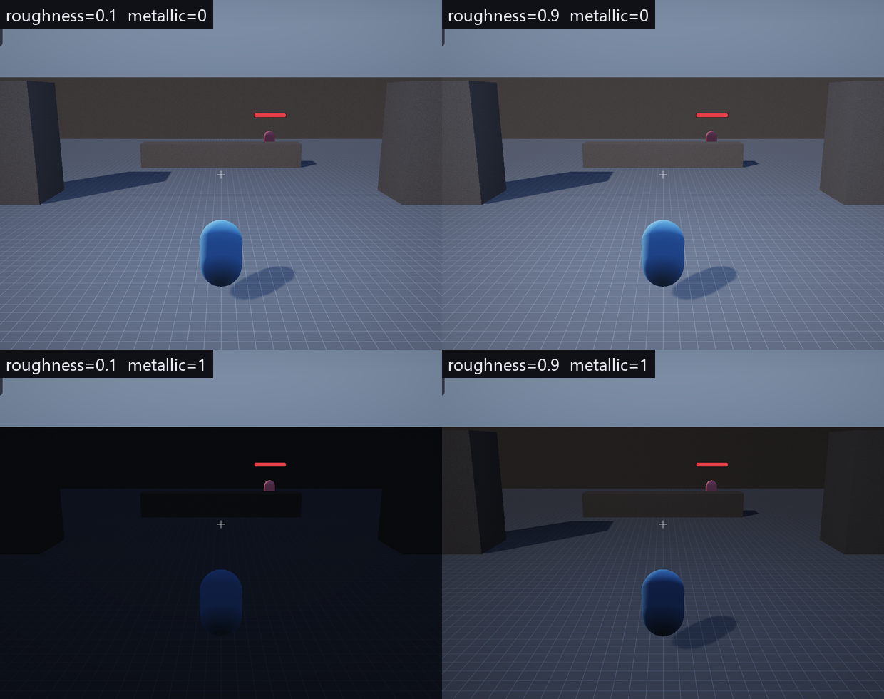

# 第 5 讲：光照、BRDF 与能量守恒

> 对应 GAMES104 第 5 讲（光照、材质与着色器）。
> 代码：`engine/shaders/PBR.hlsl`、`engine/src/scene/Components.h`（材质字段）、`engine/src/renderer/Renderer.cpp`（实例数据与常量缓冲）。
> 目标：先写出一个能亮的 Lambert 漫反射，再让它分别在金属、粗糙度、掠射角上失败，最后用微表面 BRDF 逐项修好，并把每个公式对到代码里的函数。

---
## 0. 先看两个球

同一盏太阳、同一个球，只换材质，画面会差很多：金属球正对光的面很亮、背光面几乎全黑，换个角度看亮斑的位置和形状都会变；磨砂塑料球有一条很宽的明暗过渡，暗部虽然暗但不是纯黑；把塑料的粗糙度从 0.1 调到 0.9，高光从“小亮点”摊成“大片柔光”，但亮部总亮度不该凭空调高或调低。这三个现象分别问的是：**高光在哪里、暗部的能量从哪来、粗糙度改变了什么**。

本讲按这个顺序走：先写最省的 Lambert，再看它在四个具体地方露馅，最后引入 BRDF 与微表面模型。状态统一标注为 **已实现** / **部分实现** / **尚未实现的设计**；没有在 Windows 上实际跑过的实验会写“本次未实际运行”。

---
## 1. 最省的版本：只算 N·L

物体表面越正对太阳，单位面积接收到的光越多：

**概念伪代码（不是本工程源码）**

```hlsl
float3 N = normalize(normal);          // 表面法线（世界空间）
float3 L = normalize(sunDirToSun);     // 从表面指向太阳
float  NdotL = saturate(dot(N, L));    // 背光面为 0
float3 color = albedo * sunColor * intensity * NdotL;
```

`N·L = 1` 表示正对太阳，`0.5` 表示斜对（接收能量减半），`≤ 0` 表示背光、直接光为 0。这已经能解释球体从亮到暗的过渡，但解释不了第 0 节的三件事：没有高光、背光面直接纯黑、金属和塑料算出来一模一样。

---
## 2. 让这个版本具体地失败

### 2.1 高光不存在，或出现在错误的位置

最省事的补法是“在正对光的地方加一个亮斑”，也就是把 `N·L` 直接当高光强度。问题不是不够亮，而是**位置不对**：`N·L` 最大在正对太阳的那个点，所以亮斑永远贴在“最亮的漫反射点”上；围着球转相机，亮斑不动。真实高光应该跟着视线走。

**概念伪代码（Blinn-Phong，不是本工程源码）**

```hlsl
// 错误做法：亮斑只跟光有关，不跟视角有关
float wrong = pow(NdotL, 32.0);

// 正确方向：引入半程向量 H
float3 H = normalize(L + V);           // V = 从表面指向眼睛
float  spec = pow(saturate(dot(N, H)), shininess);
color = albedo * sunColor * intensity * NdotL + spec * sunColor * intensity;
```

`H` 是入射方向和视线方向的角平分线；只有微表面法线恰好等于 `H`，光才能从 `L` 镜面反射进 `V`。这一步修好“高光不随视角移动”，但下面三个问题还在。

### 2.2 能量不守恒

Blinn-Phong 把漫反射和高光直接相加，没有任何总量约束：`albedo=0.8` 的表面已经反射 80% 能量，再叠一个 0.4 的高光，总反射就变成 1.2 > 1。更隐蔽的是 `pow(NdotH, shininess)` 峰值恒为 1、宽度随指数变小，**总能量随指数乱变**——美术把“光泽度”从 10 拖到 100，看到的是“又亮又窄”，亮度也一起变了。

### 2.3 金属没有漫反射

金属的可见颜色主要来自反射，而不是“进去再散射出来”的漫反射。用 Lambert 算金属会得到“带颜色的粉笔球”：有漫反射、没有清晰反射、颜色也不随视角变。物理上金属的另一个特征是正对时的反射率 `F0` 可以很高且**带颜色**（金的 F0 偏黄）；绝缘体的 `F0` 只有约 4%，基本不带颜色。

### 2.4 粗糙度看不出正确变化

`shininess` 只能改高光宽度，改不了峰值能量和掠射行为。真实表面是：越粗糙高光越宽、峰值越低（能量摊开）但总能量不该凭空消失；视线越接近掠射角反射越强（菲涅尔效应，Fresnel），所以水面、车漆边缘更亮；所有材质在掠射角都会变“镜面”。Blinn-Phong 没有这一项。

### 2.5 背光面为什么不是纯黑

因为还有**环境光**：太阳没照到的地方仍会接收到天空、地面、其他物体反射过来的光。塑料球暗部不是纯黑就是这部分能量。本讲先给最便宜的半球环境光近似，完整的全局光照留到第 21 讲。

---
## 3. 辐射度量：只保留三个量

| 量 | 符号 | 单位 | 一句话 | 本讲用在哪 |
|---|---|---|---|---|
| 辐照度（Irradiance） | `E` | W/m² | 单位面积**接收**到的功率 | 表面收到多少光 |
| 辐亮度（Radiance） | `L` | W/(m²·sr) | 单位面积、单位立体角、沿某方向**发出/到达**的功率 | 眼睛看到多亮、太阳多亮 |
| 立体角（Solid Angle） | `ω` | sr（球面度） | 一个方向在单位球面上占的“面积” | 把各方向的光加起来时的权重 |

对一束方向光，入射辐照度 `E = L_i·cosθ = L_i·(N·L)`。`cosθ = N·L` 不是经验公式，而是“斜着的面积在垂直方向上投影变小”的直接结果，这也解释了 Lambert 里为什么必须乘 `N·L`。

> 本工程的 `sunIntensity = 3.4`（`World.h` 默认值）不是严格的 W/(m²·sr)，而是教学用的亮度刻度。本讲只保证公式结构正确，不保证物理单位可换算。

---

## 4. BRDF 与渲染方程

**BRDF（Bidirectional Reflectance Distribution Function，双向反射分布函数）**回答一个局部问题：从方向 `ω_i` 入射的一点点能量，有多少会沿方向 `ω_o` 反射出去？记作 `f_r(ω_i, ω_o)`，单位 `1/sr`。把所有入射方向加起来就得到出射辐亮度：

```
L_o(p, ω_o) = ∫_Ω f_r(p, ω_i, ω_o) · L_i(p, ω_i) · (N·ω_i) dω_i
```

这个积分就是“把半球上每个方向的入射光，按 BRDF 和 `N·ω_i` 加权后相加”。本讲只需要两种情形：**一个方向光**时退化成一项 `L_o = f_r·L_i·(N·L)`；**环境光**时把 `L_i` 近似成常数或两段常数，积分可以手算（第 5.2 节与第 21 讲）。所以“光照计算”剩下的事就是：给定材质，算出 `f_r`。

---

## 5. 漫反射：为什么除以 π

Lambert 假设不管从哪个方向看，出射辐亮度都一样：`L_o = f_d·L_i·(N·L)`。`albedo` 是反照率（0~1，入射能量中被反射的比例），能量守恒要求“反射出去的总功率 = `albedo × 入射总功率`”。出射总功率要在整个出射半球上按 `cosθ_o` 积起来：

```
∫_Ω L_o · cosθ_o dω_o = albedo · E_i
```

左边 `L_o` 是常数可提出，剩下 `∫ cosθ_o dω_o = π`。代入 `E_i = L_i(N·L)`：

```
f_d · L_i · (N·L) · π = albedo · L_i · (N·L)   =>   f_d = albedo / π
```

**源码节选（`engine/shaders/PBR.hlsl`，`ShadePoint` 的返回行）**

```hlsl
float3 kd = (1.0 - F) * (1.0 - metallic);
return (kd * albedo / PI + specular) * radiance * NdotL;
```

`π` 不是随便除的，而是半球上 `cosθ` 积分的结果；代码里 `/π` 和 `*NdotL` 同时存在，缺一不可。

### 5.1 代入一组数

`albedo = 0.8`、白光 `intensity = 3`、`N·L = 0.5`，只算漫反射：`f_d = 0.8/π = 0.25465`，`L_o = 0.25465 × 3 × 0.5 = 0.38197`。如果忘了 `/π`：`0.8 × 3 × 0.5 = 1.2`，比正确值亮 3.14 倍，写进 8 位缓冲就整片过曝。

### 5.2 背光面的环境项

**源码节选（`engine/shaders/PBR.hlsl` 末尾）**

```hlsl
float hemi = N.y * 0.5 + 0.5;       // 法线朝上=1，朝下=0
float3 ambient = lerp(gAmbientDownExposure.rgb, gAmbientUpCount.rgb, hemi) * gMisc.y;
color += ambient * baseColor * (1.0 - metallic * 0.7);
```

用 `World.h` 默认值 `ambientUp=(0.30,0.38,0.52)`、`ambientDown=(0.10,0.09,0.08)`、`ambientIntensity=0.9`，当 `N.y=0`：`hemi=0.5`，`ambient=(0.20,0.235,0.30)×0.9=(0.18,0.2115,0.27)`，乘 `albedo=0.8` 后环境贡献约 `(0.144,0.169,0.216)`。所以背光面不是 0，而是约 0.14~0.22 的线性亮度。`(1.0 - metallic*0.7)` 是“金属少拿一点环境漫反射”的人为近似，不是物理公式，也替代不了金属真正需要的环境镜面反射。

---

## 6. 微表面模型：把高光拆成 D、G、F

把表面看成无数朝向不同的微小镜面（微表面，Microfacet）。眼睛看到的高光，是“恰好把光反射进眼睛”的那批微表面贡献的总和。Cook-Torrance 把它拆成三个因子：

```
f_s = D(h) · G(l, v) · F(v, h) / (4 · (N·L) · (N·V))
```

其中 `h = normalize(l + v)`。分母的 `4` 来自“从入射方向换元到半程向量”的雅可比，不是经验常数。

| 因子 | 回答的问题 | 本工程函数 |
|---|---|---|
| `D` 法线分布 | 有多少微表面的法线正好朝向 `h`？ | `DistributionGGX` |
| `G` 几何项 | 这些微表面有多少被别的微表面挡住？ | `GeometrySchlick` |
| `F` 菲涅尔 | 这个角度下表面反射多少、折射进去多少？ | `FresnelSchlick` |

### 6.1 三个函数

```
α = roughness²
D(h) = α² / (π · ((N·H)²(α² - 1) + 1)²)          // GGX

k = (roughness + 1)² / 8
G1(x) = (N·x) / ((N·x)(1 - k) + k)
G = G1(L) · G1(V)                                 // Smith + Schlick 近似

F = F0 + (1 - F0) · (1 - V·H)^5
F0 = lerp(0.04, albedo, metallic)                 // Schlick 菲涅尔
```

- `N·H=1` 时 `D` 最大；`roughness→0` 时 `α→0`，`D` 趋近 δ 函数（镜面）；用 `α = roughness²` 是为了让美术拖滑块时高光宽度的变化更接近线性感知；代码用 `max(...,1e-6)` 防止 `α=0` 时分母为 0。
- `G1` 是“从某个方向看，微表面没被挡住的比例”。掠射时 `N·x` 小、`G1` 变小，所以高光不会在轮廓边缘炸开。这里的 `k` 是**直接光**常用拟合 `(r+1)²/8`；IBL 里常见的是 `k=r²/2`，两者不能混用。
- `F` 在 `V·H→0`（掠射）时趋近 1：所有材质边缘都会变亮，这就是菲涅尔效应。绝缘体 `F0≈0.04`，金属用 `albedo` 当 `F0`，可以带颜色。

### 6.2 能量守恒：kd 的来历

金属没有漫反射；绝缘体的镜面反射也会“抢走”一部分本该进入漫反射的能量。代码用 `kd = (1 - F)·(1 - metallic)`：`metallic=1` 时 `kd=0`，只剩镜面项；`metallic=0` 时 `kd≈1-F`，掠射角下 `F→1`，漫反射被压到 0，能量让给镜面反射。这是**单次散射近似**：它没有补偿微表面互相遮挡后多次反弹的能量，所以粗糙金属会偏暗；本工程没有做这项补偿，属于**部分实现**。

---

## 7. 回到源码：公式与函数的对应

**源码节选（`engine/shaders/PBR.hlsl`，`ShadePoint`）**

```hlsl
float3 H = normalize(V + L);
float NdotL = saturate(dot(N, L));
if (NdotL <= 0.0) return 0.0;

float3 F0 = lerp(float3(0.04, 0.04, 0.04), albedo, metallic);
float NdotV = saturate(dot(N, V)) + 1e-4;
float NdotH = saturate(dot(N, H));
float VdotH = saturate(dot(V, H));

float  D = DistributionGGX(NdotH, roughness);
float  G = GeometrySchlick(NdotV, roughness) * GeometrySchlick(NdotL, roughness);
float3 F = FresnelSchlick(VdotH, F0);

float3 specular = (D * G * F) / (4.0 * NdotV * NdotL + 1e-4);
float3 kd = (1.0 - F) * (1.0 - metallic);
return (kd * albedo / PI + specular) * radiance * NdotL;
```

| 公式 | 代码符号 | 备注 |
|---|---|---|
| `f_d = albedo/π` | `kd * albedo / PI` | `kd` 已含 `(1-F)(1-metallic)` |
| GGX `D` | `DistributionGGX(NdotH, roughness)` | 内部 `a=roughness²`，分母有 `max(...,1e-6)` |
| Smith `G` | `GeometrySchlick(NdotV,r) * GeometrySchlick(NdotL,r)` | `k=(r+1)²/8` |
| Schlick `F` | `FresnelSchlick(VdotH, F0)` | `F0=lerp(0.04, albedo, metallic)` |
| 镜面分母 | `4.0 * NdotV * NdotL + 1e-4` | `+1e-4` 防除零；`NdotL≤0` 已提前返回 |
| 最终乘 `N·L` | `... * radiance * NdotL` | 镜面项不在括号内单独乘，统一在最后乘一次 |

容易看漏的实现细节：`roughness` 进入计算前被 `clamp(..., 0.04, 1.0)`，`metallic` 被 `saturate` 到 `[0,1]`；`NdotV` 的 `+1e-4` 可能让它略大于 1，这是为了防除零，不是物理量；直接光结果会再乘 `shadow`，点光源**不乘**阴影；`albedo` 来自实例数据，编辑器里选的是线性色，贴图以 `_SRGB` 格式采样、硬件已解码成线性，shader 不能再做一次 gamma；返回的 `float4(color,1.0)` 是**线性 HDR（High Dynamic Range，高动态范围）**值，可以大于 1，真正压到 `[0,1]` 是第 7 讲。

### 7.1 点光源与衰减

**源码节选（`engine/shaders/PBR.hlsl`，点光源循环）**

```hlsl
int count = (int)gAmbientUpCount.w;
for (int i = 0; i < count; ++i)
{
    float3 toLight = gLightPosRange[i].xyz - input.worldPos;
    float dist = length(toLight);
    float range = max(gLightPosRange[i].w, 1e-3);
    if (dist > range) continue;
    float3 L = toLight / max(dist, 1e-4);
    float atten = saturate(1.0 - dist / range);
    atten *= atten;
    float3 radiance = gLightColorIntensity[i].rgb * gLightColorIntensity[i].w * atten;
    color += ShadePoint(N, V, L, radiance, baseColor, roughness, metallic);
}
```

衰减是 `atten = saturate(1 - dist/range)²`，**不是**物理上的 `1/d²`。它在 `d=r` 处值为 0、导数也为 0（C¹ 连续），近处不会像 `1/d²` 那样爆到无穷，而且可以打包进一个 `range`；代价是亮度随距离的曲线与真实灯不同，不能拿真实单位换算。另外两条实现约束：点光源最多 8 个（CPU 侧 `std::min(size, 8)`），`gAmbientUpCount.w` 这一个分量被复用为“点光数量”。

---

## 8. 完整走一遍数值

取一个具体像素：`N=(0,0,1)`、`V=(0,0,1)`（正对相机）、`L=(0.866,0,0.5)`（与 N 夹角 60°，`N·L=0.5`）、`albedo=0.8`、`roughness=0.5`、`metallic=0`、白色太阳 `intensity=3`。

先算 `H = normalize(V+L) = (0.5,0,0.866)`，于是 `N·H=0.866`、`V·H=0.866`、`N·V=1`。逐项代入：

| 步骤 | 计算 | 结果 |
|---|---|---|
| `α`、`α²` | `0.5²=0.25`，`0.25²=0.0625` | — |
| `D` | `d=0.75×(0.0625−1)+1=0.296875`；`0.0625/(π×0.296875²)` | `0.2257` |
| `k` | `(0.5+1)²/8` | `0.28125` |
| `G` | `G1(V)=1`；`G1(L)=0.5/(0.5×0.71875+0.28125)=0.7805` | `0.7805` |
| `F` | `0.04+0.96×(1−0.866)^5` | `0.04004` |
| 镜面 | `0.2257×0.7805×0.04004/(4×1×0.5)` | `0.003527` |
| `kd` / 漫反射 | `(1−0.04004)×(1−0)=0.95996`；`0.95996×0.8/π` | `0.24445` |
| `f_r` 总和 | `0.24445+0.003527` | `0.24798` |
| 出射辐亮度 | `0.24798×3×0.5` | **`0.37197`** |

这个 0.372 是线性值；加上第 5.2 节的环境光后约 `0.516`（红通道），最后由第 7 讲的 ACES + gamma 压到显示范围。

再换成金属（`metallic=1`，其余不变）：`F0=albedo=0.8`，`F=0.8+0.2×(1−0.866)^5≈0.80001`，`kd=(1−F)×0=0`（没有漫反射），镜面 `=0.2257×0.7805×0.80001/2=0.07047`，`L_o=0.07047×3×0.5=0.1057`。金属在同一角度下反而比塑料暗（0.106 对 0.372），因为它没有漫反射，而环境镜面反射在本工程里没有实现——这正好解释了实验图里金属球发黑。

---

## 9. 进阶：这一讲没展开的积分

- **环境镜面（Image Based Lighting，IBL）**：把 `f_r` 对整个环境积分，工程上拆成“预过滤环境图 + BRDF 查找表”（split-sum）。本工程**尚未实现**，所以金属只剩太阳高光。
- **多散射补偿**：单次散射 GGX 在粗糙度高时损失能量，常见修法是乘一个 `1+F0(1/r−1)` 类的补偿项或使用多散射微表面模型。本工程**尚未实现**，粗糙金属会偏暗。
- **重要性采样**：路径追踪里 `∫ f_r L_i (N·L) dω` 用蒙特卡洛估计，按 `f_r` 分布采样可降方差。本工程是前向单光源，用不到。
- **互易性**：物理正确的 BRDF 应满足 `f_r(ω_i,ω_o)=f_r(ω_o,ω_i)`。Cook-Torrance 的 D/G/F 形式在单次散射近似下基本满足；Schlick 菲涅尔是近似，不严格互易。
- **能量守恒的严格形式**：`kd=(1-F)` 是逐像素近似；严格做法是对出射半球积分镜面项，再让漫反射补足剩余能量。

---

## 10. 实现状态

| 能力 | 状态 | 依据 |
|---|---|---|
| Lambert 漫反射（含 `/π` 与 `N·L`） | **已实现** | `PBR.hlsl` `ShadePoint` |
| GGX `D` / Smith-Schlick `G` / Schlick `F` | **已实现** | `DistributionGGX`、`GeometrySchlick`、`FresnelSchlick` |
| `kd=(1-F)(1-metallic)` 能量分配 | **部分实现** | 单次散射近似，无多散射补偿 |
| 方向光 + 8 个点光 + `saturate(1-d/r)²` 衰减 | **已实现** | `PSMain` 点光循环 |
| 半球环境光 | **已实现** | `PBR.hlsl` 末尾；参数来自 `World.h` |
| 环境镜面 / IBL | **尚未实现的设计** | shader 里没有环境贴图采样 |
| 法线贴图、环境光遮蔽（AO）贴图、多散射 GGX | **尚未实现的设计** | 材质只有 albedo/roughness/metallic/emissive |

---

## 11. 实验（本次未实际运行）

以下操作在 Windows + D3D11 上执行；本环境是 Linux，**没有运行 exe，也没有生成截图或帧数**。

```bat
build\bin\ErMao.exe --level thirdperson --play --noeditor --frames 120 --screenshot mat-default.png
build\bin\ErMao.exe --level thirdperson --play --noeditor --frames 120 --roughness 0.1 --metallic 0 --screenshot mat-r01-m0.png
build\bin\ErMao.exe --level thirdperson --play --noeditor --frames 120 --roughness 0.9 --metallic 1 --screenshot mat-r09-m1.png
```

`--roughness` / `--metallic` 会在关卡构建后**覆盖所有 `MeshRenderer`**（`Engine::Init` 里的循环），不是只改选中的一个物体；想单物体对比，在编辑器检视器里改材质字段更直接。

预期观察（条件性，未实测）：固定视角把 `roughness` 从 0.1 拖到 0.9，高光斑变宽、峰值下降，但亮部不该整体暗一个数量级；把 `metallic` 从 0 拖到 1，漫反射消失、球变暗，因为本工程没有 IBL，金属暗部会明显发黑；把 `ambientIntensity` 调到 0，背光面变成纯黑，可以直接看到直接光只剩 `N·L` 的形状；把 `ambientDown` 调到和 `ambientUp` 一样，环境光变成“常数”，球的下半部分失去方向感。

仓库里已有材质对比图（本次未重新生成）：



图是同一场景的四宫格：上排 `metallic=0`，下排 `metallic=1`；左列 `roughness=0.1`，右列 `0.9`。可以确认的是两张金属图明显更暗，说明“没有环境反射时金属会发黑”；roughness 改变的是高光宽窄，而不是把整颗球调亮调暗。

不符合预期时的排查入口：整颗球全黑，先看 `gSunDirIntensity.w`（太阳强度）是否为 0，再看 `N` 是否归一化、法线矩阵是否传错；高光不随视角动，检查 `V` 是否用相机位置减世界坐标、`H` 是否归一化；金属和高光正常但暗部死黑，先确认 `ambientIntensity` 和环境光颜色，而不是先怀疑 BRDF；颜色发灰或过饱和，确认 albedo 贴图是 `_SRGB` 采样、编辑器颜色是线性值，只有后处理做一次 gamma。

---

## 12. 常见错误

| 错误 | 后果 |
|---|---|
| 忘记 `/π` | 漫反射整体亮约 3.14 倍，容易整片过曝 |
| 忘记 `N·L` | 背光面也亮，球看起来像贴纸 |
| 镜面项单独乘一次 `N·L`，最后又乘一次 | 高光在斜面上被压两次，亮斑位置对但强度偏暗 |
| 用 `N·L` 代替 `N·H` | 高光不随视角移动 |
| `roughness=0` 不 clamp、分母不保护 | GGX 分母为 0，出现 NaN 或纯白像素 |
| 金属仍保留 `albedo` 漫反射 | 金属看起来像带颜色的塑料 |
| 贴图已 `_SRGB` 解码，shader 又 `pow(2.2)` | 颜色变暗、发灰（双重编码） |
| 点光用 `1/d²` 且不夹范围 | 近处爆白、远处噪点 |

---

## 13. 自测题

1. 用半球积分证明 Lambert 的 `f_d = albedo/π`。**答**：见第 5 节，关键是 `∫_Ω cosθ dω = π`。
2. `roughness=0` 时 GGX 的极限是什么？代码为什么 clamp 到 0.04？**答**：`α→0` 时 `D` 趋近 δ 函数（完美镜面）；clamp 到 0.04 是为了避免 `α²=0` 导致除零/数值爆炸，同时给高光一个最小可见宽度。
3. `metallic=1` 时 `kd` 是多少？为什么？**答**：`kd=(1-F)×(1-1)=0`；金属没有漫反射，颜色来自带 `F0=albedo` 的镜面反射。
4. `N·L=0.5`、`albedo=0.8`、白光强度 3，漫反射出射辐亮度是多少？不除 π 呢？**答**：`0.8/π×3×0.5≈0.382`；不除 π 是 `1.2`，亮 3.14 倍。
5. 法线矩阵为什么不能直接用模型矩阵变换法线？举一个 2D 反例。**答**：非均匀缩放会破坏法线与表面的垂直关系。2D 中把 `x` 方向放大 2 倍，表面线从 45° 变平，法线应转向另一侧；直接乘模型矩阵会得到错误方向。正确做法是逆转置 `(M⁻¹)ᵀ`，代码在 `Renderer::BuildBatches` 里生成 `normalMatrix`。

---

## 14. 练习（故意改坏）

1. 把 `baseColor / PI` 的 `/PI` 删掉：**预期**漫反射整体亮约 3.14 倍，亮部过曝；第 7 讲的 ACES 会把高光压回来一些，所以不要用“有没有纯白”判断对错，要看中间调。
2. 把 `kd = (1-F)*(1-metallic)` 改成 `kd = 1`：**预期**金属也有漫反射，金属球变亮、失去“金属感”，能量不守恒。
3. 把 `DistributionGGX` 的 `a = roughness*roughness` 改成 `a = roughness`：**预期**同一 `roughness` 下高光更窄更尖，粗糙度滑块的感知响应改变；对照仓库里的四宫格看形状变化。

---

## 15. 数学依据与参考资料

> 目的：不要求背下推导，但要知道这一讲**用的是什么数学工具**、去哪里查。

| 用到的原理 | 数学形式 / 名称 | 参考 |
|---|---|---|
| 辐照度与辐亮度、`N·L` 的来历 | `E=L_i·(N·L)`；`L_o=∫f_r L_i (N·ω)dω` | [PBRT]；[RTR4] |
| Lambert 漫反射与 `/π` | `f_d=albedo/π`，由 `∫cosθ dω=π` 得到 | [PBRT]；[GAMES101] |
| Cook-Torrance 微表面 BRDF | `f_s=D·G·F/(4(N·L)(N·V))` | [COOK]；[PBRT] |
| GGX / Trowbridge-Reitz 法线分布 | `D=α²/(π((N·H)²(α²−1)+1)²)` | [KARIS]；[RTR4] |
| Smith 几何项 + Schlick 菲涅尔 | `G1(x)=N·x/((N·x)(1−k)+k)`；`F=F0+(1−F0)(1−V·H)^5` | [SMITH]；[SCHLICK] |
| 能量守恒与 `kd` | `kd=(1−F)(1−metallic)`；单次散射近似 | [KARIS]；[PBRT] |
