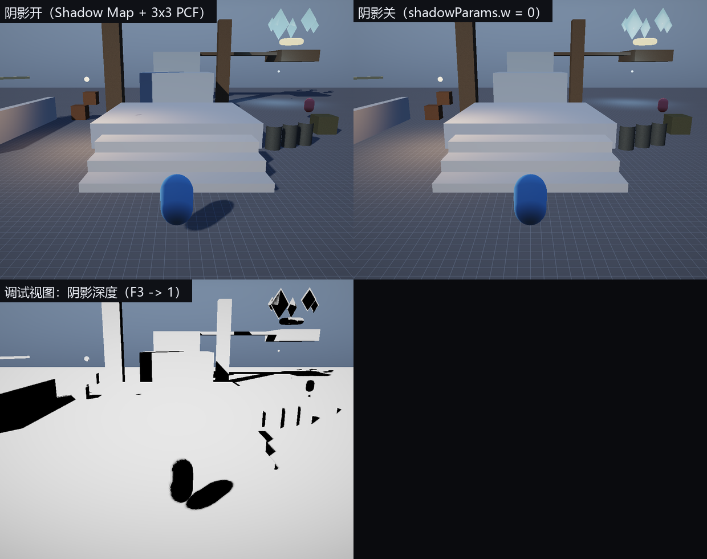

# 第 6 讲：阴影映射与程序化天空

> 对应 GAMES104 第 6 讲（自然景观渲染）。
> 代码：`engine/shaders/Shadow.hlsl`、`engine/shaders/Sky.hlsl`、`engine/shaders/PBR.hlsl` 的 `SampleShadow`、`engine/src/renderer/Renderer.cpp` 的 `ShadowPass/ComputeLightMatrix/SnapShadowFocus`。
> 目标：把“阴影为什么会糊、会抖、会漏光”讲成采样与矩阵的问题，再把天空讲成“按视线方向算颜色”的全屏 Pass。
> 实现状态：**已实现** = 平行光阴影贴图、bias/法线偏移、3×3 PCF、texel 对齐、程序化天空；
> **部分实现** = 蒙皮角色只接收不投射阴影、调试视图 5 的深度贴图未绑定；**未做** = CSM/PCSS/点光阴影。

---
## 0. 角色站在地上，却没有影子

在 `skinning` 关卡里让角色站到地面上，脚下没有影子。按“影子从哪来”排查，通常只有三类原因：阴影功能没开（`m_shadowsEnabled=false`，或 `gShadowParams.w=0`）；角色根本没进阴影 Pass；角色进了，但比较深度时被 bias 推掉了。

第 2 条在本工程里是**真的**：`ShadowPass` 只调用 `DrawBatches`，而 `RenderScene::skinned` 走 `SkinnedPass`。蒙皮角色能**接收**静态物体的阴影（`Skinned.hlsl` 也调用 `SampleShadow`），但**不会投射**自己的影子。本讲先把“投射”从头讲清楚，最后再回到这个现状。

---
## 1. 最简阴影映射（Shadow Map）：从太阳的角度拍深度照片

要判断点 `p` 能不能看到太阳，最直接的办法是：从太阳方向看过去，`p` 前面有没有东西挡住。于是把场景画两遍：

```
Pass 1（光源视角）                      Pass 2（相机视角）
场景 ──光源矩阵──▶ 只写深度 D(u,v)      场景 ──相机矩阵──▶ 像素 p
                                            ├─ p 变换到光源裁剪空间，得到 depth_L
                                            └─ 比较 depth_L 与 D(uv) → shadow
```

Pass 1 的像素着色器可以是空的（`Shadow.hlsl` 的 `PSMain` 就是空函数），深度由光栅化写入。Pass 2 把着色点的世界坐标乘上光源 `ViewProj`，再比较：

```
shadow = (depth_L - bias <= D(uv)) ? 1 : 0
```

`depth_L` 是着色点相对光源的深度，`D(uv)` 是光源视角下最近遮挡物的深度；前者更大说明被挡住。三个容易踩的细节：D3D 的 NDC 深度是 `[0,1]`；纹理 `v` 轴向下，所以 `y` 要取反；`ndc.z` 落在 `[0,1]` 外时不能采样，直接当作“不在阴影里”。

**概念伪代码（不是本工程源码）**

```hlsl
float4 lightClip = mul(gLightViewProj, float4(worldPos + N * normalOffset, 1.0));
float3 ndc = lightClip.xyz / lightClip.w;
float2 uv  = float2(ndc.x * 0.5 + 0.5, -ndc.y * 0.5 + 0.5);
float  d   = shadowMap.SampleLevel(pointSampler, uv, 0).r;
float  lit = (ndc.z - bias <= d) ? 1.0 : 0.0;
```

**源码节选（`engine/shaders/Shadow.hlsl`）**

```hlsl
float4x4 W = float4x4(input.col0, input.col1, input.col2, input.col3);
float4 worldPos = mul(float4(input.position, 1.0), W);
o.clip = mul(gLightViewProj, worldPos);
// PSMain 为空：只写深度
```

---
## 2. 平行光的光源矩阵：为什么用正交投影

太阳没有“位置”，只有方向 `L`（`gSunDirIntensity.xyz` 是**指向太阳**的方向）。为了拍深度图，临时造一个光源相机：

```
eye = focus + L * (2R)
view = LookAt(eye, focus, up)
proj = Orthographic(-R, R, -R, R, near=0.1, far=4R)
lightVP = proj * view
```

`focus` 是阴影覆盖区域中心，`R` 是覆盖半径。用**正交投影**而不是透视：平行光的光线彼此平行，正交投影才能保证“同样大小的物体在阴影图里同样大”；用透视会让远处阴影被放大、扭曲。`up` 要避开与 `L` 平行：代码里 `|L.y| > 0.95` 时用 `(0,0,1)`，否则用 `(0,1,0)`，否则 `LookAt` 的叉乘会退化成零向量。

**源码节选（`engine/src/renderer/Renderer.cpp`，`ComputeLightMatrix`）**

```cpp
const Vec3 up = std::fabs(sunDirToSun.y) > 0.95f ? Vec3(0, 0, 1) : Vec3(0, 1, 0);
const Vec3 eye = focus + sunDirToSun * (radius * 2.0f);
const Mat4 view = Mat4::LookAt(eye, focus, up);
const Mat4 proj = Mat4::Orthographic(-radius, radius, -radius, radius, 0.1f, radius * 4.0f);
return proj * view;
```

`World::BuildRenderScene` 把 `focus` 设成 `camera.position + camera.Forward() * 12.0f`，`radius` 固定为 `22.0f`；实际覆盖的是相机前方 12 米、半边长 22 米的正交盒子，边长 44 米。

---
## 3. 四个具体现象，以及它们各自的原因

### 3.1 阴影条纹（shadow acne）：表面在“自己遮自己”

深度图是离散的：一个 texel（纹理像素）覆盖地面上一小块区域，存的是最近的那个深度。斜着对光的表面，同一 texel 内不同点的真实深度差可能大于深度精度，于是**表面自己**被判定成“被挡住”，出现一条条黑纹。修法是比较时减偏置：

```
lit = (depth_L - bias <= D(uv))
```

工业界常叠加三种偏置：**常数偏置**，简单但对斜面和深度范围敏感；**斜率偏置**，按 `tanθ` 放大，本工程在光栅化状态里设了 `SlopeScaledDepthBias = 1.5f` 和 `DepthBias = 1000`（`m_shadowRaster`），在写深度时就先把深度推远；**法线偏移**，把采样点沿法线推 `N*offset`，本工程 `gShadowParams.y = 0.035f`（世界空间米）。

**源码节选（`engine/shaders/PBR.hlsl`，`SampleShadow` 前半段）**

```hlsl
if (gShadowParams.w < 0.5) return 1.0;               // 阴影开关
float4 lightClip = mul(gLightViewProj, float4(worldPos + N * gShadowParams.y, 1.0));
float3 ndc = lightClip.xyz / lightClip.w;
if (ndc.z <= 0.0 || ndc.z >= 1.0) return 1.0;
float2 uv = float2(ndc.x * 0.5 + 0.5, -ndc.y * 0.5 + 0.5);
if (uv.x < 0.0 || uv.x > 1.0 || uv.y < 0.0 || uv.y > 1.0) return 1.0;
float bias = gShadowParams.x;
```

`gShadowParams` 在 CPU 侧是 `Vec4(0.0025f, 0.035f, 1.0f, enabled)`：`x` 深度偏置，`y` 法线偏移（米），`z` 标称“PCF 半径”，`w` 开关。**`z` 目前没有被 shader 使用**：`SampleShadow` 写死了 `const int radius = 1;`。

### 3.2 阴影脱离物体（peter-panning）：偏置的“世界尺寸”比你想的大

`bias` 是在 NDC 深度上减的，而正交投影的 NDC 深度与世界距离是**线性**的：

```
ndc.z = (d_light - near) / (far - near)
Δndc.z = Δd_light / (far - near)
```

本工程 `near=0.1`、`far=4R=88`，深度范围 `87.9` 米，所以 `bias=0.0025` 相当于：

```
0.0025 × 87.9 ≈ 0.2198 米
```

这个“看起来很小”的 0.0025，实际把比较点往太阳方向推了约 **22 厘米**；法线偏移 `0.035` 米只相当于 `0.035/87.9 ≈ 0.0004` 的 NDC 深度。于是 10 厘米高的小物件投不出影子：地面接收点 `d=44.0` → `ndc=(44.0-0.1)/87.9=0.49943`；脚底遮挡物 `d=43.9` → `ndc=0.49829`；比较 `0.49943-0.0025=0.49693 <= 0.49829`，判定为“照亮”。要保住 1 厘米接触阴影，偏置量级应在 `0.01/87.9≈0.000114`，但太小又会把 3.1 的 acne 放回来。上面的数字是**按代码参数推算**，本次没有在 Windows 上实际观察阴影分离距离。

### 3.3 边缘锯齿：一次比较只有“亮/暗”两种结果

单个 texel 的比较是二值的，阴影边缘沿 texel 网格出现硬锯齿。**PCF（Percentage Closer Filtering，百分比靠近过滤）**对周围多个 texel 各比较一次，再对结果取平均：

**源码节选（`engine/shaders/PBR.hlsl`，`SampleShadow` 后半段）**

```hlsl
float lit = 0.0;
const int radius = 1;
[unroll]
for (int y = -radius; y <= radius; ++y)
    for (int x = -radius; x <= radius; ++x)
    {
        float d = gShadowMap.SampleLevel(gShadowSamp, uv + float2(x, y) * texel, 0).r;
        lit += (ndc.z - bias <= d) ? 1.0 : 0.0;
    }
return lit / 9.0;
```

`texel = gSunColorTexel.w = 1/2048`，来自 CPU 的 `frame.sunColorTexel = Vec4(scene.sunColor, 1.0f / m_shadowSize)`。实现细节：`OpaquePass` 给 `s0` 绑的是 `D3D11_FILTER_MIN_MAG_MIP_POINT`，所以 9 次都是**点采样**，每次取最近 texel，不会在硬件层插值。PCF 结果只有 `0,1/9,…,1` 十档，边缘会柔和一点，但**不会**产生真正的半影宽度。

### 3.4 阴影游动：focus 跟着相机连续移动

`focus = camera.position + forward*12` 连续变化，光源相机每帧微微平移，阴影图每个 texel 对应的世界区域也在连续滑动；相机慢慢走时阴影边缘会“爬行”或闪烁。修法是把 `focus` 量化到 texel 网格：

```
texelWorld = 2R / shadowMapSize = 44 / 2048 ≈ 0.0215 米
```

**源码节选（`engine/src/renderer/Renderer.cpp`，`SnapShadowFocus`）**

```cpp
const Vec3 right = Normalize(Cross(up, sunDir));
const Vec3 lightUp = Cross(sunDir, right);
const float texel = (2.0f * radius) / static_cast<float>(m_shadowSize);
float x = Dot(focus, right), y = Dot(focus, lightUp);
const float z = Dot(focus, sunDir);
x = std::floor(x / texel) * texel;
y = std::floor(y / texel) * texel;
return right * x + lightUp * y + sunDir * z;
```

量化必须在这个“光源平面坐标系”里做，不能直接对世界坐标的 `x/z` 取整：`right/lightUp` 不一定与世界轴对齐，直接量化世界坐标并不能让 texel 对齐。`World` 每个关卡都把 `shadowRadius` 写成 `22.0f`，所以实际 texel 世界尺寸是 `44/2048 ≈ 2.15 厘米`。

---
## 4. 源码里的完整数据流

**源码节选（`Renderer::RenderInternal` 的每帧常量）**

```cpp
const Vec3 sunDir = Normalize(scene.sunDirection);
const Vec3 snappedFocus = SnapShadowFocus(scene.shadowFocus, sunDir, scene.shadowRadius);
frame.lightViewProj = ComputeLightMatrix(sunDir, snappedFocus, scene.shadowRadius);
frame.sunColorTexel = Vec4(scene.sunColor, 1.0f / static_cast<float>(m_shadowSize));
frame.shadowParams = Vec4(0.0025f, 0.035f, 1.0f, m_shadowsEnabled ? 1.0f : 0.0f);
```

**源码节选（`Renderer::ShadowPass`）**

```cpp
if (!m_shadowsEnabled || m_batches.empty()) return;
SetViewport(m_shadowSize, m_shadowSize);
m_shadowMap.BindAndClear(ctx);
RenderStates::SetOpaque(ctx);
ctx->RSSetState(m_shadowRaster);
m_shadowShader.Bind(ctx);
DrawBatches(ctx);
ctx->OMSetRenderTargets(0, nullptr, nullptr);
```

`m_shadowMap` 是 2048² 的 `DepthTarget`：纹理 `R32_TYPELESS`，DSV 用 `D32_FLOAT`，SRV 用 `R32_FLOAT`（`RenderTarget.cpp`）。`BindAndClear` 只绑深度、清成 1.0；`SetOpaque` 是 `DepthFunc=LESS`、`DepthWriteMask=ALL`；`m_shadowRaster` 是 `CULL_NONE` + `DepthBias=1000` + `SlopeScaledDepthBias=1.5f`。像素着色器为空，所以颜色不写、只写深度。

`DrawBatches` 画的是 `m_batches`，而 `m_batches` 在 `BuildBatches` 里已按**相机视锥**剔除。这意味着**视锥外、但阴影会落进画面的物体不会出现在阴影图里**，这是当前实现的限制。主 Pass 里 `OpaquePass` 把阴影图绑到 `t0`、点采样器绑到 `s0`，静态物体和蒙皮物体都会比较；但 `ShadowPass` 不画 `scene.skinned`，所以蒙皮角色只接收、不投射。

---
## 5. 把一帧的阴影算一遍

设 `focus` 在相机前方 12 米，`R=22`，阴影图 2048²：

一个 texel 的世界尺寸是 `44/2048=0.02148 米`；光源相机在 `focus+sunDir×44`，正交深度范围 `[0.1,88]`、总长 87.9；地面接收点距光源 44 米，`(44−0.1)/87.9=0.49943`；高 10 厘米的脚底距光源 43.9 米，`(43.9−0.1)/87.9=0.49829`；接收点减 `bias=0.0025` 后为 `0.49693`，小于 `0.49829`，判定“没被挡”，脚下没有影子。

换成 30 厘米高的台阶：`(43.7−0.1)/87.9 = 0.49602`，仍小于 `0.49693`，也投不出影子；大约要高过 22 厘米才开始出现阴影。这个结论来自“常数深度偏置 + 正交深度线性”的推算，实际还会被斜率偏置和法线偏移影响，不能当成精确阈值。

---
## 6. 天空：背景为什么是渐变色

抬头看天，天顶偏蓝、地平线偏白偏亮。物理原因是视线穿过的大气厚度不同：靠近地平线时视线在大气里走得更长，散射光更多、颜色被“洗白”；天顶方向空气少，剩下的散射光偏蓝。真实大气散射需要积分，本工程用**美术近似**：把天顶和地平线两种颜色按视线仰角插值。最简版本可以只是清屏色，或者：

**概念伪代码（不是本工程源码）**

```hlsl
float up = saturate(dir.y * 0.5 + 0.5);          // 朝上=1，朝下=0
float3 col = lerp(horizonColor, zenithColor, pow(up, 0.65));
```

`pow(up, 0.65)` 让地平线附近过渡更缓慢，看起来更像大气；它没有物理含义，只是曲线形状的调节。

### 6.1 本工程的程序化天空

**源码节选（`engine/shaders/Sky.hlsl`，`SkyColor` 与 `PSMain`）**

```hlsl
float up = saturate(dir.y * 0.5 + 0.5);
float3 zenith  = gAmbientUpCount.rgb * 0.55;
float3 horizon = float3(0.55, 0.62, 0.72) * 0.55;
float3 col = lerp(horizon, zenith, pow(up, 0.65));
float cosAngle = dot(dir, sunDir);
float sunDisk = smoothstep(0.9995, 0.99985, cosAngle);
float glow = pow(saturate(cosAngle), 64.0) * 0.6 + pow(saturate(cosAngle), 8.0) * 0.12;
col += gSunColorTexel.rgb * (sunDisk * 18.0 + glow) * saturate(gSunDirIntensity.w);
col *= lerp(0.35, 1.0, saturate(dir.y * 3.0 + 0.5));
// PSMain：用逆 VP 从 NDC 重建方向
float4 world = mul(gInvViewProj, float4(input.ndc, 1.0, 1.0));
world.xyz /= world.w;
float3 dir = normalize(world.xyz - gCameraPosTime.xyz);
return float4(SkyColor(dir, normalize(gSunDirIntensity.xyz)), 1.0);
```

- 天顶色取 `gAmbientUpCount.rgb`（环境光的“天光”颜色）乘 0.55，地平线硬编码 `(0.55,0.62,0.72)×0.55`；所以**改环境光颜色会同时改天空颜色**，两者耦合；
- 太阳盘 `smoothstep(0.9995,0.99985,cos)` 对应半角约 1.8°→1.0°，比真实太阳（约 0.27°）大很多，是可见的“美术太阳”；
- 太阳盘乘 18、光晕项最高约 0.72，结果会**超过 1**，依赖第 7 讲的 HDR 场景缓冲；直接写 8 位后备缓冲会变成一块死白；
- 地平线以下乘 `lerp(0.35,1.0,saturate(dir.y*3+0.5))`，压暗地面方向，避免“天穿地”。

### 6.2 天空怎么画：全屏三角形 + 逆 VP 重建方向

**源码节选（`engine/shaders/Sky.hlsl` 的顶点阶段）**

```hlsl
float2 uv = float2((vertexId << 1) & 2, vertexId & 2);
o.clip = float4(uv * float2(2.0, -2.0) + float2(-1.0, 1.0), 1.0, 1.0);
o.ndc = o.clip.xy;
```

`vertexId=0,1,2` 生成 `(0,0)、(2,0)、(0,2)` 三个 UV，裁剪空间坐标分别是 `(-1,1)、(3,1)、(-1,-3)`，覆盖整个屏幕。像素阶段拿 NDC 的 `(x,y)` 和 `z=1` 乘 `gInvViewProj`，除以 `w` 得到远平面上的世界点，再减相机位置、归一化，就是视线方向。

**源码节选（`Renderer::SkyPass`）**

```cpp
RenderStates::SetDepthNone(ctx);
ID3D11ShaderResourceView* nullSrv[2] = {nullptr, nullptr};
ctx->PSSetShaderResources(0, 2, nullSrv);      // 天空不采样阴影/贴图
m_skyShader.Bind(ctx);
ctx->IASetInputLayout(nullptr);
ctx->IASetPrimitiveTopology(D3D11_PRIMITIVE_TOPOLOGY_TRIANGLELIST);
ctx->Draw(3, 0);
```

`RenderInternal` 的顺序是：`m_sceneTarget.Clear(kClearColor)` → `SkyPass` → `OpaquePass` → … → `PostPass`。所以：**颜色清屏仍然执行了**（`kClearColor={0.02,0.025,0.035,1}`），天空随后覆盖它，说“画天空省了一次 clear”不成立；深度测试/写入被 `SetDepthNone` **完全关闭**，不是“把深度设成最远”，因此天空既不遮挡后面的不透明物体，也不写深度，不透明物体靠深度测试正常覆盖天空。先画天空的好处是逻辑简单、只用一个 draw；代价是全屏 overdraw（被物体挡住的天空像素也算了）。

---
## 7. 现状：哪些是已实现，哪些是设计

| 能力 | 状态 | 说明 |
|---|---|---|
| 单张平行光阴影图（2048²，正交） | **已实现** | `ShadowPass` + `SampleShadow` |
| 常数深度偏置 + 光栅化斜率偏置 + 法线偏移 | **已实现** | `gShadowParams`、`m_shadowRaster` |
| 3×3 PCF（点采样） | **已实现** | `SampleShadow` |
| focus 的 texel 对齐 | **已实现** | `SnapShadowFocus` |
| 蒙皮角色投射阴影 | **尚未实现的设计** | `ShadowPass` 不画 `scene.skinned` |
| `MeshRenderer::castShadow` 生效 | **尚未实现的设计** | 字段会序列化/显示，但 `DrawBatches` 不按它过滤 |
| 级联阴影（Cascade Shadow Map，CSM）、PCSS（软阴影）、点光源阴影 | **尚未实现的设计** | 只有一张覆盖 44 米的正交图，PCF 核固定 3×3 |
| 真实大气散射 | **尚未实现的设计** | 天空是两色插值 + 太阳盘/光晕 |
| 阴影深度调试视图（5） | **部分实现** | `Post.hlsl` 采样 `gShadowTex`(t1)，但 `PostPass` 没有把阴影图绑到 `t1` |

没有 CSM 的直接后果：44 米覆盖范围与 2048² 分辨率绑定，texel 约 2.15 厘米；想让近处接触阴影更细，只能缩小 `shadowRadius`，但远处就没阴影了。级联阴影正是为了同时要“近处细”和“远处有”，本工程没有实现，不要把它写成已有功能。

---
## 8. 实验（本次未实际运行）
本环境是 Linux，**没有运行 exe**；以下命令和现象是条件性预期。

```bat
build\bin\ErMao.exe --level thirdperson --play --noeditor --frames 120 --screenshot shadow-on.png
build\bin\ErMao.exe --level thirdperson --play --noeditor --frames 120 --noshadows --screenshot shadow-off.png
build\bin\ErMao.exe --level skinning --play --noeditor --frames 120 --screenshot skin-no-shadow.png
build\bin\ErMao.exe --level thirdperson --play --noeditor --frames 120 --debugview 1 --screenshot shadow-factor.png
build\bin\ErMao.exe --level thirdperson --play --noeditor --frames 120 --debugview 5 --screenshot shadow-map.png
```

`--noshadows` 把 `m_shadowsEnabled` 置 false，`gShadowParams.w=0`，`SampleShadow` 返回 1：物体失去投影，直接光照不变；`--debugview 1` 输出 `shadow` 系数（0/1/…/9 档），`--debugview 2` 输出世界法线；`--debugview 5` 的 shader 意图是显示阴影贴图深度，但 `PostPass` 只把场景颜色绑到 `t0`，没有把 `m_shadowMap` 绑到 `gShadowTex` 的 `t1`，所以当前这条视图取不到阴影深度（待修复的实现缺口），不要拿它当深度参考。

相机左右平移时，静态物体的阴影边缘应基本“钉”在世界坐标上，而不是随相机爬行，这是 `SnapShadowFocus` 的预期效果；`skinning` 关卡里角色脚下没有自己的影子，但地面仍可能有静态物体的影子，按代码路径这是预期结果（角色不在 ShadowPass），不是“阴影坏了”。另外，菜单项写着“线框 F2”“阴影 F4”，但当前代码只处理 `F5/F11/F12`，**没有 F2/F4/F3 的按键处理**；请用菜单“渲染 → 阴影/调试视图”或命令行开关，不要按 F3。

仓库里已有阴影对比图（本次未重新生成）：



左上阴影开，右上阴影关，左下是 `shadow` 系数的调试视图。图里左下角写着“F3 -> 1”，那是旧版标注；当前没有 F3 绑定，调试视图请从菜单或 `--debugview` 进入。

---
## 9. 常见错误

| 错误 | 现象 |
|---|---|
| 平行光用透视投影 | 远处阴影被放大/扭曲，同一物体在不同位置阴影大小不同 |
| `focus` 不量化 | 相机移动时阴影边缘“爬行” |
| 只调大 `bias` 治 acne | 条纹没了，但阴影脱离物体（peter-panning） |
| 只调小 `bias` 治脱离 | 接触处出现条纹或漏光 |
| 阴影图分辨率低 / 覆盖半径太大 | 边缘块状；本工程 2048²、半径 22 米 |
| 天空写深度或开深度测试 | 天空遮挡后面的不透明物体 |

---
## 10. 自测题

1. 平行光为什么用正交投影？用透视会怎样？**答**：平行光光线平行，正交投影保证同样大小的物体在阴影图里同样大；透视会引入近大远小，阴影随距离缩放、方向也会偏。
2. 推导 `texelWorld = 2R/size`，并说明为什么量化要在光源空间做。**答**：正交盒在光源平面上的边长是 `2R`，铺满 `size` 个 texel，所以一个 texel 覆盖 `2R/size`；`right/lightUp` 不一定与世界轴对齐，必须先把 focus 投影到这两个轴上再取整，才能和阴影图的 texel 网格对齐。
3. PCF 的 3×3 平均等价于什么滤波器？能让半影变宽吗？**答**：等价于对 9 个二值比较结果做盒式平均（box filter），输出 10 档；它只把边缘“抹”开约 ±1 个 texel（约 2 个 texel 宽），不能像 PCSS 那样按遮挡距离产生真正的半影宽度。
4. 法线偏移为什么比纯常数偏移更不容易出现 peter-panning？**答**：法线偏移把采样点沿表面法线推离表面，方向与表面朝向相关，能在需要的地方（斜面上）提供更大的有效偏移，而不必把整个场景的常数 bias 调得很大；它仍然是一种偏置，推得太多同样会脱离。

---
## 11. 练习（故意改坏）

1. 把 `SnapShadowFocus` 里的 `floor` 去掉、直接返回 `focus`：**预期**相机移动时阴影边缘爬行/闪烁。
2. 把 `bias` 从 `0.0025` 改成 `0.02`：**预期**阴影与物体明显分离（按 87.9 米深度范围，相当于约 1.76 米的深度偏移），小物体可能完全失去影子。
3. 把 `SampleShadow` 的 3×3 改成 1 次采样：**预期**阴影边缘变成硬锯齿，`shadow` 只剩 0/1 两档。
4. 把 `m_shadowsEnabled` 设为 false：**预期** `gShadowParams.w=0`，`SampleShadow` 返回 1，所有物体失去投影。

---
## 12. 数学依据与参考资料
> 目的：不要求背下推导，但要知道这一讲**用什么数学工具**、去哪里查。

| 用到的原理 | 数学形式 / 名称 | 参考 |
|---|---|---|
| 阴影贴图：光源视角深度比较 | `shadow = (d_light - bias <= D(uv))` | [SHADOW]；[RTR4] |
| 正交投影与光源矩阵 | `lightVP = Ortho(-R,R,-R,R,n,f) · LookAt(eye,focus,up)` | [RTR4]；[GAMES104] |
| 深度偏置与自阴影 | `bias`、`slope-scaled bias`、`N·offset` | [RTR4] |
| PCF 软阴影 | 对 3×3 邻域做二值比较后取平均 | [PCF]；[RTR4] |
| texel 对齐 | `texelWorld=2R/size`，在光源平面量化 focus | [RTR4] |
| 程序化天空 | 按视线仰角插值天顶/地平线色 + 太阳盘 | [RTR4]；[GAMES104] |
