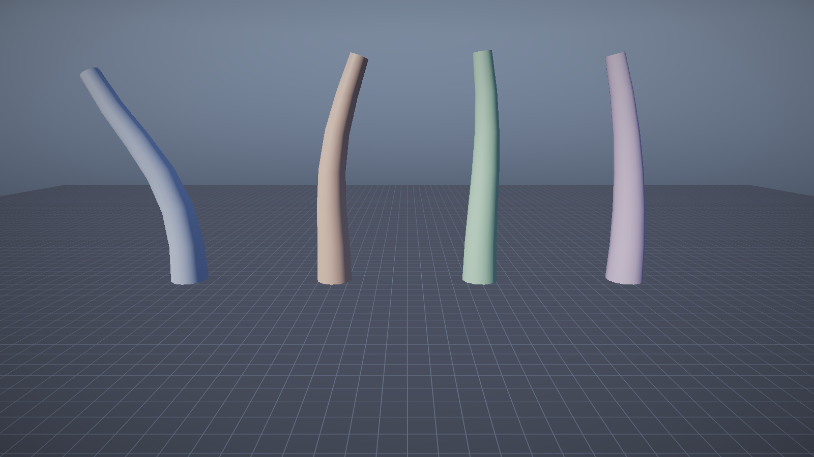

# 第 8 讲：骨骼、绑定姿势与线性混合蒙皮【进阶】

> 对应 GAMES104 第 8 讲（动画基础）。
> 代码：`animation/Skeleton.h/.cpp`、`renderer/SkinnedMesh.*`、`renderer/SkinnedMeshData.*`、`Renderer::SkinnedPass`、
> `shaders/Skinned.hlsl`、`game/SkinnedCharacter.cpp`、`game/SkinningDemo.cpp`。
> 目标：从“手臂弯曲时顶点为什么跟着弯”推出 `S_i = P_i·B_i^{-1}`，并把每个矩阵的坐标空间说准。
> 实现状态：**已实现** = CPU 每帧采样/混合/算骨骼矩阵，GPU 顶点阶段做 LBS；
> **尚未实现的设计** = DQS、IK、GPU 骨骼纹理、一次 draw 画多个蒙皮角色。

---

## 0. 概念卡

| 项 | 内容 |
|---|---|
| 问题 | 网格怎么跟着骨骼弯曲，而不是整体刚性移动？ |
| 一句话直觉 | 每个顶点被几根骨头“拉扯”，按权重取平均。 |
| 数学 | `S_i = P_i·B_i^{-1}`，`p' = Σ w_i S_i p`，`Σ w_i = 1`；`p_world = gWorld·p'`。 |
| 坐标空间 | `p`、`B_i`、`P_i`、`S_i` 全在**模型空间**；`gWorld` 才把结果送到世界空间。 |
| 代码 | `Skeleton::FinalizeBindPose` / `ComputeWorld` / `ComputeSkinning`；`Skinned.hlsl` 的 `VSMain`。 |
| 实验 | `--level skinning --play`，4 个角色不同 `blend` 的弯折。 |
| 差距 | 无 DQS、无 IK、无 GPU 骨骼纹理；每角色一次 draw。 |

## 1. 现象与最简实现：一根骨头带一个点

角色网格在建模软件里是一个整体；只给它一个变换，它只能整体刚性移动，抬手就变成整个人转。
但玩家看到的是上臂几乎不动、前臂绕肘关节转，肘部表面连续地弯过去，而不是两段刚体裂开。先只问：**一根骨头和一个顶点，怎么让顶点跟着骨头动？**

需要两份数据：建模时骨头在哪、朝哪（绑定姿势）；当前帧骨头在哪、朝哪（当前姿势）。

```cpp
// 概念伪代码：一根骨骼带一个顶点
Vec3 p_in_bone = bind_i.Inverse() * p; // p 在模型空间；先搬进骨骼 i 的局部空间
Vec3 p_posed   = pose_i * p_in_bone;   // 再按当前骨骼变换搬回模型空间
```

`bind_i.Inverse()` 只跟建模时有关，加载时算一次；`pose_i` 每帧变。但只有一根骨头时整个网格
是刚体：肘部两侧的顶点分别属于上臂骨和前臂骨，弯到 90° 时关节处会裂开或重叠。

## 2. 第二版：一个顶点被两根骨头各拉一半

美术会给关节附近的顶点同时分配两根骨头，各 50%：

```cpp
// 概念伪代码：两根骨骼、权重各一半
Vec3 a = pose_a * (bind_a.Inverse() * p);
Vec3 b = pose_b * (bind_b.Inverse() * p);
Vec3 p_posed = 0.5f * a + 0.5f * b;
```

两侧“拉力”连续变化，表面被拉成圆角。把 0.5 换成 `w` 与 `1-w`，再推广到最多四根，就是
**线性混合蒙皮（Linear Blend Skinning，LBS）**：`p' = Σ_j w_j·S_j·p`（`Σw_j = 1`）。
下面定义 `S_j`。

## 3. 先把坐标空间钉死

本讲最容易错的地方。先给结论：

> **本工程里 `B_i`、`P_i`、`S_i` 都在模型空间；`gWorld` 在最后一步才把蒙皮后的顶点变到世界空间。**

证据在调用链里：`SkinVertex::position` 是建模坐标，原点在角色脚下（模型空间）；
`FinalizeBindPose()` 只沿 `parent` 链累乘 `bindLocal`，**没有**乘 GameObject 的 `gWorld`；
`ComputeWorld()` 也只累乘当前 `local`，输出数组虽叫 `m_worldMatrices`，但相对的是**骨架根**；
`FillDraw()` 把 `object->WorldMatrix()` 单独放进 `SkinnedDraw::world`；`Skinned.hlsl` 先算 `skin`
再乘 `gWorld`。本工程没有独立的骨架资产根变换：根骨骼的 `bindLocal` 直接写在模型空间里，所以**骨架空间与模型空间重合**。

| 量 | 所在空间 / 作用 | 产生位置 |
|---|---|---|
| `p` | 模型空间顶点 | `SkinVertex::position` |
| `B_i` | 骨骼局部 → 模型空间（绑定姿势） | `FinalizeBindPose` 沿父链累乘 |
| `B_i^{-1}` | 模型空间 → 骨骼局部（绑定姿势） | 同上，求逆存进 `Bone::inverseBind` |
| `P_i` | 骨骼局部 → 模型空间（当前姿势） | `ComputeWorld` 沿父链累乘 |
| `S_i` | 模型空间 → 模型空间 | `ComputeSkinning` |
| `gWorld` | 模型空间 → 世界空间 | `GameObject::WorldMatrix()`，经 `FillDraw` 传入 |

完整路径（列向量、左乘，最右边的先作用）：

```
p_clip = gViewProj · gWorld · ( Σ_j w_j · P_j · B_j^{-1} ) · p
         世界→裁剪   模型→世界        模型→模型（蒙皮）
```

注意：变量名和注释里的 “world” 是历史叫法，`ComputeWorld` 的“world”指的是相对骨架根/模型空间，
不是世界原点。读代码要以调用链为准，不能只看变量名。
由此有两个直接错误：忘乘 `gWorld` → 角色叠在模型原点；把 `P_i` 当世界矩阵再乘 `gWorld`
→ 角色被平移/旋转两次。

## 4. 正式定义：绑定姿势、逆绑定矩阵、蒙皮矩阵

### 4.1 绑定姿势 `B_i` 与当前姿势 `P_i`

建模时每根骨骼有相对父骨骼的局部 TRS `L_i^bind`，沿父链累乘：

```
B_i = B_parent(i) · L_i^bind          （根骨骼：B_root = L_root^bind）
```

`B_i` 把“骨骼 i 局部空间里的点”变到模型空间。它不含角色自己的 `gWorld`。
本工程只把 `B_i^{-1}` 存进 `Bone::inverseBind`，`bindLocal` 保留，用于片段缺轨道时回退。

动画采样得到当前局部 TRS `L_i(t)`，同样累乘：

```
P_i = P_parent(i) · L_i(t)
```

这一步要求**父骨骼下标小于子骨骼**，否则 `world[parent]` 还没算出来。本工程按 `AddBone`
顺序生成骨骼，天然满足；外部资产要先拓扑排序或递归计算。

### 4.2 蒙皮矩阵 `S_i`

顶点 `p` 在绑定姿势下位于骨骼 `i` 局部空间的位置是 `p_local_i = B_i^{-1}·p`；
当前姿势把它摆到 `p' = P_i·p_local_i = (P_i·B_i^{-1})·p`。定义：

```
S_i = P_i · B_i^{-1}
```

`B_i^{-1}` 把顶点“退回”绑定时的骨骼局部坐标，`P_i` 再按当前姿势放回模型空间。
绑定姿势下 `P_i = B_i`，所以 `S_i = I`，网格保持建模样子——这是检查实现是否正确的最快方法。

### 4.3 权重归一化

`p' = Σ_j w_j·S_j·p` 要求 `Σ_j w_j = 1`。若 `Σw = 1.2`，顶点相对模型原点被放大 1.2 倍；
若权重全 0，顶点被乘成零向量，塌到模型原点。本工程在 shader 里除以 `weightSum`，
把美术导出的误差吃掉；但**骨骼索引没有越界检查**，`gBones[input.boneIndices.x]` 直接下标，
索引 ≥ 64 时越界读常量缓冲，属于资产侧责任。

### 4.4 法线

`Skinned.hlsl` 的写法是：

```hlsl
float3 skinnedNrm = mul((float3x3)skin, input.normal);
// 顶点着色器里（像素着色器还会再 normalize 一次）：
o.normal = normalize(mul((float3x3)gWorld, skinnedNrm));
```

它用的是**混合后蒙皮矩阵的 3×3 部分**，既不是逐骨骼的逆转置，也不是 `S_j` 的逆转置。
骨骼只有旋转/统一缩放时，旋转矩阵直接乘法线是对的（长度最后由 `normalize` 拉回 1）；
但两根骨骼混合出的 `skin` 已不是旋转矩阵（见第 5 节，行列式 0.52），法线方向会有偏差。
非统一缩放时更明显：`PBR.hlsl` 对普通网格用了逆转置，蒙皮路径没有，这是教学实现的简化。

### 4.5 LBS 的两个缺陷

1. **关节体积丢失**：肘/膝弯曲时，关节附近顶点是两条刚体结果的线性平均，平均点落在弦上而非弧上，
   于是向关节内侧塌。弯曲角越大越明显。
2. **糖纸效应（candy wrapper）**：骨骼绕**自身长轴**扭转时，被两根骨骼同时影响的顶点，
   其蒙皮矩阵是 `w_1R(0) + w_2R(θ)`。它不是旋转矩阵，而是“带缩放的旋转”，半径乘一个小于 1 的系数；
   θ 接近 180°、权重接近 50/50 时系数接近 0，整圈顶点被拧到轴线上。
   **成立条件是“绕同一根轴的大角度相对扭转 + 顶点同时受两根骨骼影响”**，不是任何弯曲都会出现。

工业替代是**对偶四元数蒙皮（Dual Quaternion Skinning，DQS）**：把骨骼的旋转和平移编码成对偶四元数，
按权重混合后再归一化，结果仍是刚体变换。代价是符号/最短路径处理更复杂，也可能产生“鼓包”。
本工程**尚未实现** DQS；IK（用目标位置反推骨骼旋转）同样**尚未实现**。

## 5. 可验算的小例子：0.6 / 0.4 与“先算 36° 再转”

取模型空间顶点 `p=(1,0,0)`，两根骨骼权重 `w_A=0.6`、`w_B=0.4`。只看混合本身，设
`S_A = I`、`S_B = R_z(90°)`。**LBS 结果**：

```
p' = 0.6·(1,0,0) + 0.4·(0,1,0) = (0.6, 0.4, 0)
|p'| = sqrt(0.6² + 0.4²) = sqrt(0.52) ≈ 0.7211
```

顶点离原点近了约 27.9%——不是骨骼把它拉回去，而是矩阵加权本身产生了缩放。

**若按“加权角度”当刚体转**：`0.6·0° + 0.4·90° = 36°`，

```
R_z(36°)·p ≈ (0.8090, 0.5878, 0)，长度仍为 1
Δ = (0.2090, 0.1878, 0)，|Δ| ≈ 0.2810
```

即 LBS 与“先算 36° 再转”差约 0.281 个模型单位，长度短 27.9%。

**为什么不是角度平均**：加权矩阵

```
M = 0.6·I + 0.4·R_z(90°) = | 0.6  -0.4 |
                            | 0.4   0.6 |
det(M) = 0.6² + 0.4² = 0.52，两列长度都是 sqrt(0.52) ≈ 0.7211。
```

它等于“缩放 0.7211 倍，再转 `atan2(0.4, 0.6) ≈ 33.69°`”，不是转 36°。
两根骨骼绕同一轴、夹角 θ 时，缩放系数 `r = sqrt(w_A² + w_B² + 2w_Aw_B cosθ)`；
`w_A=w_B=0.5`、`θ=180°` 时 `r=0`，就是糖纸效应。所以“LBS 会缩水”不是实现 bug，
而是线性平均旋转矩阵的固有结果。

## 6. 回到本仓库：数据与调用链

### 6.1 数据结构

`Bone` 只有 `{name, parent, inverseBind(B_i^{-1}), bindLocal}` 四个字段；`SkinVertex` 是
`position/normal/uv + boneIndices[4] + boneWeights[4]`。`BoneTransform::ToMatrix()` 是 `T·R·S`
（列向量：先缩放、再旋转、最后平移）。`SkinVertex` 的 stride = 12+12+8+16+16 = 64 字节，
与 `Renderer::CreateShaders` 里的 `kSkinnedLayout` 一一对应。

### 6.2 生成逆绑定矩阵

```cpp
// 源码节选：Skeleton::FinalizeBindPose
std::vector<Mat4> world(bones.size(), Mat4::Identity());
for (size_t i = 0; i < bones.size(); ++i) {
    const int parent = bones[i].parent;
    const Mat4 local = bones[i].bindLocal.ToMatrix();
    world[i] = (parent >= 0) ? world[parent] * local : local;
}
for (size_t i = 0; i < bones.size(); ++i) bones[i].inverseBind = world[i].Inverse();
```

这是**模型空间**的累乘，不是世界空间。`Mat4::Inverse()` 遇到奇异矩阵会静默返回单位阵
（`core/Math.h` 的实现），零缩放骨骼不会报错，而是让 `inverseBind` 变成单位阵——现象是模型错位。

### 6.3 每帧流程

```cpp
// 源码节选：SkinnedCharacterComponent::OnUpdate
clipA.Sample(m_timeA + phase, skeleton, m_poseA);      // 关键帧 -> 局部 TRS
clipB.Sample(m_timeB + phase, skeleton, m_poseB);
BlendPoses(m_poseA, m_poseB, Clamp01(blend), m_pose);  // 先在 TRS 上混合
skeleton.ComputeWorld(m_pose, m_worldMatrices);        // 局部 TRS -> 模型空间 P_i
skeleton.ComputeSkinning(m_worldMatrices, m_bones);    // S_i = P_i * B_i^{-1}
```

```cpp
// 源码节选：Skeleton::ComputeWorld
world[i] = (parent >= 0 && static_cast<size_t>(parent) < world.size())
               ? world[parent] * localMatrix : localMatrix;
// 源码节选：Skeleton::ComputeSkinning
outSkinning[i] = (i < world.size() ? world[i] : Mat4::Identity()) * bones[i].inverseBind;
```

顺序是：**采样（TRS）→ 混合（TRS）→ 累积（模型空间矩阵）→ 蒙皮矩阵**。
混合为什么在矩阵之前，见第 9 讲；本讲只需记住 `S_i` 的输入输出都在模型空间。

### 6.4 GPU 顶点阶段做 LBS

```hlsl
// 源码节选：shaders/Skinned.hlsl，VSMain
float weightSum = input.boneWeights.x + input.boneWeights.y
                + input.boneWeights.z + input.boneWeights.w;
if (weightSum < 1e-5) weightSum = 1.0;
float4x4 skin = (float4x4)0;
skin += gBones[input.boneIndices.x] * (input.boneWeights.x / weightSum);
skin += gBones[input.boneIndices.y] * (input.boneWeights.y / weightSum);
skin += gBones[input.boneIndices.z] * (input.boneWeights.z / weightSum);
skin += gBones[input.boneIndices.w] * (input.boneWeights.w / weightSum);
float4 skinnedPos = mul(skin, float4(input.position, 1.0));
float3 skinnedNrm = mul((float3x3)skin, input.normal);
float4 worldPos   = mul(gWorld, float4(skinnedPos.xyz, 1.0));
o.normal = normalize(mul((float3x3)gWorld, skinnedNrm));
o.clip   = mul(gViewProj, worldPos);
```

**核对结论**：本工程不是“没有 GPU 蒙皮”。准确说法是：

> **CPU 每帧算骨骼矩阵（采样、混合、`P_i`、`S_i`），GPU 顶点着色器执行 4 骨骼 LBS。**
> 没有做的是：GPU 骨骼纹理/`StructuredBuffer`、一次 draw 画多个角色、GPU compute 预蒙皮
> （GPU 驱动蒙皮）、每角色骨骼矩阵的 instancing。不要笼统写“未做 GPU 蒙皮”。

`gBones` 是 b2 的 `float4x4 gBones[64]`（64×64 = 4096 字节），每角色一份；b3 的
`SkinnedObject` 放 `gWorld` 和材质。`Renderer::SkinnedPass` 对每个 `SkinnedDraw` 更新 b2/b3
再 `DrawIndexed`，所以是**每角色一次 draw**。

### 6.5 演示网格与权重

`SkinningDemo.cpp` 程序化生成 6 根骨骼的链（每段 0.5）和 7 圈 × 12 边的管子：
84 个顶点、144 个三角形。权重按顶点高度分配：

```cpp
// 源码节选：SkinningDemo.cpp，AssignWeights
const float f = y / kSegmentLength;
int b = static_cast<int>(std::floor(f));
b = (std::max)(0, (std::min)(b, kSegments - 1));
const float t = Clamp(f - static_cast<float>(b), 0.0f, 1.0f);
int other = b; float w = 0.0f;
if (t < 0.5f) { other = (std::max)(b - 1, 0);         w = 0.5f * (1.0f - t / 0.5f); }
else          { other = (std::min)(b + 1, kSegments-1); w = 0.5f * ((t - 0.5f) / 0.5f); }
outIndices[0] = b;     outWeights[0] = 1.0f - w;
outIndices[1] = other; outWeights[1] = w;
```

在 `y=1.0`（第 2 个关节）处 `f=2, t=0`，骨骼 2 与骨骼 1 各 0.5；相邻环之间线性过渡。
这样弯折时关节两侧被两根骨骼“各拉一半”，表面才连续。硬分配给单根骨骼会退化成两段刚体，出现裂缝。

## 7. 实验（本次未实际运行）

本环境是 Linux，不能运行 Windows exe；以下是按源码推导的预期，不是实测日志。

```bat
build\bin\ErMao.exe --level skinning --play --noeditor --frames 120 --screenshot skinning.png
```


仓库已有这张截图，本次没有重新生成。预期：4 个角色从左到右 `blend` 为 0、0.35、0.7、1.0；
A 几乎纯 `wave`（各骨骼绕 Z 小角度摆），D 几乎纯 `sway`（根骨骼绕 X 摆），中间两个是过渡态；
`phase` 分别为 0、0.7、1.4、2.1，姿态不同步。拖动 `blend` 应连续变化；若把 `BlendPoses`
改成对 `m_bones` 线性插值，过渡中间应出现“变细/塌陷”，这是第 5 节缩放的直接后果。
排查入口：启动日志的“蒙皮演示关卡构建完成”；角色不显示查 `SkinnedPass`、`scene.skinned`；
角色在原点是忘乘 `gWorld`；位置翻倍是重复变换；关节裂开查 `AssignWeights` 是否退化成单骨骼。

## 8. 复杂度与工程取舍

- 每顶点：4 次“矩阵 × 标量”加权（4×16 次乘加），再一次矩阵 × 向量，外加 3×3 法线变换；
- 每角色每帧：`骨骼数 × (采样 + 累积 + 蒙皮矩阵)`，6 根骨骼时可忽略；主要成本是更新常量缓冲 + 一次 draw；
- 本工程**没有**视锥剔除蒙皮角色：`SkinnedPass` 直接遍历 `scene.skinned` 全部提交；也**没有**让蒙皮角色写入阴影贴图：`ShadowPass` 只画 `m_batches`，所以角色能接收阴影、自己不投影，属于**部分实现**；
- 角色数/骨骼数增长时，每角色一次 draw、每帧复制一份 `std::vector<Mat4> bones` 会成为瓶颈。工业做法是骨骼矩阵进 `StructuredBuffer`/骨骼纹理、按实例 ID 索引、一个 draw 画一批角色，甚至 compute 预蒙皮——这些在本工程都是**尚未实现的设计**。

## 9. 常见错误

| 错误 | 现象 | 原因 |
|---|---|---|
| 把 `P_i` 当世界矩阵，再乘 `gWorld` | 角色位置/朝向翻倍 | `P_i` 只到模型空间 |
| 忘了乘 `gWorld` | 所有角色叠在原点 | 蒙皮结果还停在模型空间 |
| 逆绑定用了 `bindLocal` 而非累乘的 `B_i` | 模型炸开/关节错位 | 逆绑定必须是完整父链 |
| 权重不归一化 | 模型相对原点放大/缩小 | `Σw≠1` 时线性组合带缩放 |
| 骨骼顺序不是拓扑序 | 父骨骼矩阵还没算 | `ComputeWorld` 只按数组顺序一遍 |

## 10. 自测题

1. 推导 `S_i=P_i·B_i^{-1}`，说明两个矩阵的定义域和值域。**答案**：见 4.1–4.2；两者都是“骨骼局部→模型空间”，所以 `B_i^{-1}` 反方向，复合后 `S_i` 是“模型空间→模型空间”。
2. `p=(1,0,0)`、权重 0.6/0.4、`S_A=I`、`S_B=R_z(90°)`，LBS 后在哪？和“先算 36° 再转”差多少？**答案**：`(0.6,0.4,0)`，长度 `sqrt(0.52)≈0.7211`；刚体结果 `(0.8090,0.5878,0)`，差约 0.281，长度短 27.9%。见第 5 节。
3. 为什么关节处要 50/50，而不是 100% 给父骨骼？**答案**：100% 会让关节两侧变成两段刚体，弯曲时裂缝/重叠；50/50 让表面连续，但也是体积丢失最明显的地方，见 4.5。
4. 本工程哪部分是 CPU、哪部分是 GPU？哪些“没有做”？**答案**：CPU 做采样、混合、`P_i`、`S_i`；GPU 顶点阶段做 4 骨骼 LBS 和 `gWorld`；没做的是 GPU 骨骼纹理、一次 draw 多角色、compute 预蒙皮、DQS、IK。见 6.4。
5. 法线为什么可以直接乘 `skin` 的 3×3？什么情况下不对？**答案**：骨骼只有旋转/统一缩放时，3×3 是旋转或缩放×旋转，乘完归一化即可；混合后的 `skin` 不是正交矩阵，非统一缩放时也不对，严格做法是逆转置。见 4.4。

## 11. 练习（故意改坏）

1. 删掉 `weightSum` 归一化，并把某顶点权重改成 `(1.2,0,0,0)`：**预期**该顶点相对模型原点放大 1.2 倍。
2. 把 `bones[b].inverseBind` 换成单位矩阵：**预期**每根骨骼把自己的绑定平移又加一遍，越往上偏移越大，模型被拉长/错位（不是整体平移）。
3. 把 `AssignWeights` 改成“每个顶点 100% 归属当前骨骼”：**预期**关节处出现明显裂缝。
4. 在 `Skinned.hlsl` 里去掉 `gWorld`：**预期**4 个角色全部叠在模型原点。
5. 把 `ComputeWorld` 的父链累乘改成直接用 `local[i]`：**预期**整条链塌到各自原点。

---

## 数学依据与参考资料

> 目的：不要求背下推导，但要知道这一讲**用的是什么数学工具**、去哪里查。

| 用到的原理 | 数学形式 / 名称 | 参考 |
|---|---|---|
| 蒙皮矩阵 | `S_i = P_i·B_i^{-1}`；`p' = Σ w_i S_i p` | [LBS]；[RTR4] |
| 权重归一化 | `Σw_i = 1`，否则线性组合带缩放 | [LBS] |
| 坐标空间链 | 模型空间 →（`gWorld`）→ 世界空间 →（`gViewProj`）→ 裁剪空间 | [RTR4] |
| 法线变换 | 旋转/统一缩放下可直接乘 3×3；一般用逆转置 | [RTR4] |
| LBS 缺陷 | candy-wrapper / 体积丢失 → 对偶四元数 | [SKIN] |
| 骨骼动画基础 | 关键帧、绑定姿势、蒙皮管线 | [GAMES104] |
