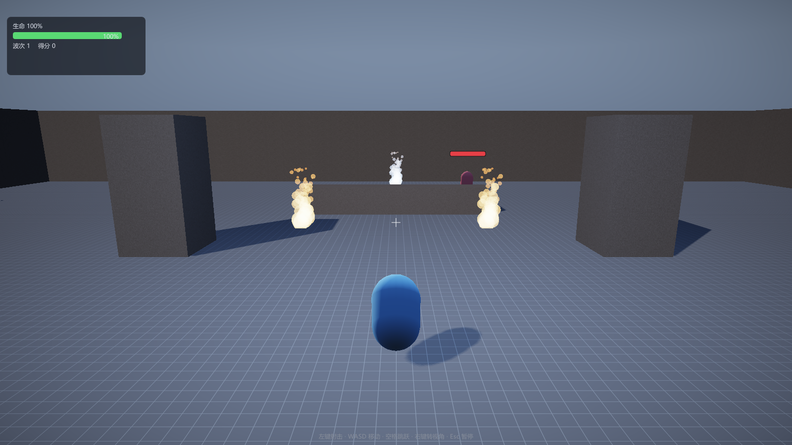

# 第 12 讲：粒子系统【进阶】

> 对应 GAMES104 第 12 讲（特效系统）。
> 代码：`game/ParticleEmitter.h/.cpp`、`renderer/Renderer.cpp` 的 `ParticlePass`、
> `renderer/RenderScene.h` 的 `ParticleRender`、`shaders/Particle.hlsl`。
> 目标：从“火把的火星怎么出现、上升、消失”出发，依次解决发射率、生命周期、对象管理、
> billboard 与混合，并核对本工程真实实现。
> 实现状态：**已实现** = CPU 模拟 + 固定容量数组 + swap-remove + CPU 展开 billboard；
> **部分实现** = 贴图/程序化圆点两套像素与混合，未排序、无软粒子；
> **尚未实现的设计** = GPU 模拟、按深度排序/OIT、曲线资产、子发射器、光照。



---

## 0. 概念卡

| 项 | 内容 |
|---|---|
| 问题 | 火把的火星怎样出现、上升、消失，且不随帧率变密变稀？ |
| 一句话直觉 | 按“每秒发射率”攒够一个才生成；每个粒子自己积分、到期回收；最后画成面向相机的四边形。 |
| 数学 | `acc += rate·dt`，`n=floor(acc)`；`v+=g·dt`，`v*=1-drag·dt`，`p+=v·dt`；`t=1-life/maxLife`。 |
| 代码 | `ParticleEmitterComponent::OnUpdate`、`Collect`、`CollectParticles`、`Renderer::ParticlePass`。 |
| 实验 | `--level arena --play`，两处火把 + 一个传送门。 |
| 差距 | 无排序、无软粒子、无 GPU 模拟、无曲线/子发射器。 |

## 1. 现象与最简实现：每帧生成一个

火把看起来是“火星不断冒出来，向上飘，变小，最后消失”。拆成三个动作：

1. **发射**：什么时候产生新粒子、产生多少；
2. **模拟**：每个粒子怎么动、什么时候死；
3. **渲染**：很多小光点怎么高效画出来。

最直接的做法是每帧生成一个粒子，放进容器，更新，死了就删，渲染时每个粒子画一个四边形：

```cpp
// 概念伪代码：最朴素的粒子
struct Particle { Vec3 pos, vel; float life; };
std::vector<Particle*> particles;

void Update(float dt) {
    particles.push_back(new Particle{origin, randomVel(), 1.5f}); // 每帧一个
    for (auto* p : particles) { p->pos += p->vel * dt; p->life -= dt; }
    for (auto it = particles.begin(); it != particles.end(); ) {
        if ((*it)->life <= 0) { delete *it; it = particles.erase(it); }
        else ++it;
    }
}
// 渲染：for (auto* p : particles) DrawQuad(p->pos);
```

这段代码能跑，但会在三个地方具体地失败。

## 2. 朴素实现为什么会坏

### 2.1 生成数量随帧率变化

“每帧一个”意味着发射率 = 帧率。假设粒子寿命 2 秒：

| 帧率 | 每秒生成 | 稳态存活（约） |
|---|---|---|
| 30 fps | 30 | 60 |
| 60 fps | 60 | 120 |
| 144 fps | 144 | 288 |

同样是“每帧一个”，144fps 下的火星密度是 30fps 的 4.8 倍。玩家换机器、开垂直同步、
掉帧，火把的浓度都会变。这是**算术推导**，不是实测数据；但它说明“每帧固定数量”不是
“每秒固定数量”。

### 2.2 分配/删除与每粒子一次 draw

`new Particle` / `delete` 每帧都可能发生：分配器要维护空闲链表，长时间运行会产生碎片；
`vector::erase` 还要把后面的元素整体前移，删除 `k` 个元素最坏是 `O(n·k)`。粒子数量不大时
看不出，几千个时 CPU 时间会花在和渲染无关的地方。`DrawQuad` 每粒子一次 draw call，意味着
1000 个粒子约 1000 次 draw，外加每次数十次状态设置；GPU 画 6 个顶点很快，CPU 提交 draw 很慢。
正确方向是**批量**：所有粒子展开成一个大顶点缓冲，按材质分组，一次画一大批。

下面按“发射 → 对象管理/生命周期 → 渲染”给出正式方案。

## 3. 发射：累加器

把“每秒 `rate` 个”换成“每帧攒 `rate·dt` 个，攒够整数才生成”：

```
acc += rate · dt
n = floor(acc)          // 本帧生成 n 个
acc -= n                // 保留小数余量
```

本工程实现（`ParticleEmitterComponent::OnUpdate`）：

```cpp
// 源码节选：ParticleEmitter.cpp
m_accumulator += rate * dt;
const int spawnCount = static_cast<int>(m_accumulator);
if (spawnCount > 0) {
    m_accumulator -= static_cast<float>(spawnCount);
    Spawn(static_cast<u32>(spawnCount));
}
```

- 60fps、`rate=55` 时，每帧 `acc += 0.9167`：第 1 帧生成 0 个，第 2 帧生成 1 个（余 0.8333），
  第 3 帧生成 1 个（余 0.75）……长期平均是 55 个/秒；60 帧累计 55 个；
- 30fps 时每帧 `acc += 1.8333`，平均仍是 55 个/秒；
- 误差来自“本帧末尾还没攒够的那部分”，任意时刻未消费的余量 `<1`，所以一段时间内的生成数
  与 `rate·Δt` 最多差 1 个（不考虑容量上限）；
- `dt` 很大（卡顿）时会一次生成很多个，视觉上是“爆发”而不是均匀发射；这是累加器的固有限制，
  需要平滑的话得把大 `dt` 拆成子步，本工程没做。

注意：它不是严格的泊松过程。泊松过程的到达间隔服从指数分布；累加器只是把固定速率离散化，
长期平均正确，但到达时刻是规则的。因此不要把它叫“泊松过程的离散化”。

## 4. 对象管理：固定容量 + SoA + swap-remove

工业上常把这类结构叫“对象池”；本工程没有通用 `Pool` 类，具体做法是**固定容量 + 四个并行数组（SoA）+ swap-remove**：

```cpp
// 源码节选：ParticleEmitter.h
std::vector<Vec3>  m_positions;
std::vector<Vec3>  m_velocities;
std::vector<float> m_life;
std::vector<float> m_maxLife;
float              m_accumulator = 0.0f;
```

`OnStart` 里 `reserve(kMaxParticles)`（384）避免运行中扩容；`Spawn` 每个粒子先检查
`m_positions.size() >= kMaxParticles`，到上限就停止。删除用 swap-remove：

```cpp
// 源码节选：ParticleEmitter.cpp
for (size_t i = 0; i < m_positions.size();) {
    if (m_life[i] > 0.0f) { ++i; continue; }
    const size_t last = m_positions.size() - 1;
    m_positions[i] = m_positions[last];
    m_velocities[i] = m_velocities[last];
    m_life[i] = m_life[last];
    m_maxLife[i] = m_maxLife[last];
    m_positions.pop_back();
    m_velocities.pop_back();
    m_life.pop_back();
    m_maxLife.pop_back();
}
```

删除是 `O(1)`，代价是**粒子顺序会变**。对粒子渲染通常无所谓（顺序本来就不稳定），
但对“按深度排序”或“按出生时间排序”就有影响。`i == last` 时是把元素赋给自己再 `pop_back`，
也正确；交换后不 `++i`，下一轮继续检查换到 `i` 的那个粒子，所以连续的死亡也能处理。

容量上限带来一个行为：`Spawn` 到 384 就返回，但累加器已经按请求数量扣过了，
被拒绝的粒子不会补发。这是“丢弃”而不是“排队”，在极端参数下会让实际发射率低于 `rate`。

## 5. 模拟与生命周期

```cpp
// 源码节选：ParticleEmitter.cpp（OnUpdate 的模拟段）
const float damping = (std::max)(0.0f, 1.0f - drag * dt);
for (size_t i = 0; i < m_positions.size(); ++i) {
    m_life[i] -= dt;
    if (m_life[i] <= 0.0f) continue;
    m_velocities[i] += gravity * dt;
    m_velocities[i] *= damping;
    m_positions[i] += m_velocities[i] * dt;
}
```

这是**半隐式欧拉**：先更新速度，再用新速度更新位置。对重力这种常量加速度，半隐式比显式
欧拉稳；但它不是无条件稳定，`dt` 太大时仍有误差。阻力写成 `max(0, 1-drag·dt)`：

- `drag·dt < 1` 时是一阶近似，`dt` 越大误差越大；
- `drag·dt ≥ 1` 时阻尼被夹到 0，该帧速度直接归零（不会反向）；
- 更精确的写法是 `v *= exp(-drag·dt)`，本工程没用。

生命周期与外观在 `Collect` 里转成渲染数据：

```cpp
// 源码节选：ParticleEmitter.cpp，Collect
const float t = 1.0f - Clamp01(m_life[i] / m_maxLife[i]); // 0=刚出生，1=死亡
particle.position = origin + m_positions[i];
particle.size    = Lerp(sizeStart, sizeEnd, t);
particle.color   = Lerp(colorStart, colorEnd, t);
particle.texture = texture;
```

`t=0` 时用 `sizeStart/colorStart`，`t=1` 时用 `sizeEnd/colorEnd`；默认 `colorEnd.a=0`，
所以alpha 淡出。`origin` 只是发射器所在对象的 `WorldPosition()`，**没有应用对象的旋转/缩放**，
所以发射器挂在旋转物体上时，粒子偏移不会跟着转。

### 5.1 一个可验算的外观例子

默认组件参数：`sizeStart=0.16`、`sizeEnd=0.03`、`colorStart=(1,0.72,0.28,1)`、
`colorEnd=(0.55,0.10,0.05,0)`，某粒子 `life=0.5`、`maxLife=1.3`：

```
t = 1 - 0.5/1.3 ≈ 0.6154
size  = 0.16 + 0.6154·(0.03-0.16) ≈ 0.0800
color = (1,0.72,0.28,1) + 0.6154·((-0.45,-0.62,-0.23,-1))
      ≈ (0.7231, 0.3384, 0.1385, 0.3846)
```

粒子确实在变小、变暗、变透明。

## 6. 渲染：billboard 与批量

粒子总面向相机。取相机右/上向量 `R,U`，粒子中心 `c`、半尺寸 `s`：

```
p0 = c - R·s - U·s     uv(0,0)
p1 = c + R·s - U·s     uv(1,0)
p2 = c + R·s + U·s     uv(1,1)
p3 = c - R·s + U·s     uv(0,1)
```

两个三角形 `(p0,p1,p2)`、`(p0,p2,p3)`，6 个顶点。本工程在 **CPU** 的 `Renderer::ParticlePass`
里展开：

```cpp
// 源码节选：Renderer.cpp，ParticlePass
const Vec3 right = m_currentCamera->Right();
const Vec3 up    = m_currentCamera->Up();
const Vec3 r = right * p.size;
const Vec3 u = up * p.size;
const Vec3 c = p.position;
const Vec3 p0 = c - r - u, p1 = c + r - u, p2 = c + r + u, p3 = c - r + u;
m_particleVertices.push_back({p0, p.color, Vec2(0, 0)});
m_particleVertices.push_back({p1, p.color, Vec2(1, 0)});
m_particleVertices.push_back({p2, p.color, Vec2(1, 1)});
m_particleVertices.push_back({p0, p.color, Vec2(0, 0)});
m_particleVertices.push_back({p2, p.color, Vec2(1, 1)});
m_particleVertices.push_back({p3, p.color, Vec2(0, 1)});
```

**核对结论**：`shaders/Particle.hlsl` 里**没有** billboard 展开。它的顶点着色器除了把 color/uv 传下去，
位置部分只有 `o.clip = mul(gViewProj, float4(input.position,1.0))`，拿到的是已经展开好的世界空间顶点。
“billboard 在 shader 里做”是错的；本工程是 CPU 展开、GPU 只做变换和像素着色。

注意 `size` 是**半尺寸**：`±r ±u` 让 quad 的总宽高是 `2·size`。默认 `sizeStart=0.16`
意味着初始 quad 约 0.32 世界单位宽。

提交时按**连续相同贴图**分组（`runs`）：同一段的粒子在同一个顶点缓冲区间，换纹理才换 draw。
所以 draw 次数是“连续相同贴图的段数”，不是粒子数；粒子数 N 时顶点数是 `6N`、三角形 `2N`。

## 7. 像素与混合

`Particle.hlsl` 的像素着色器有两条路径：

```hlsl
// 源码节选：Particle.hlsl，PSMain
if (gParams.x > 0.5) {
    float4 tex = gParticleTex.Sample(gParticleSamp, input.uv);
    float3 rgb = tex.rgb * input.color.rgb * max(tex.a, 0.0);
    return float4(rgb, 1.0);          // 配合加法混合
}
float2 d = input.uv * 2.0 - 1.0;
float  r2 = dot(d, d);
if (r2 > 1.0) discard;
float alpha = input.color.a * pow(saturate(1.0 - r2), 1.5);
return float4(input.color.rgb, alpha); // 配合 alpha 混合
```

- **有贴图**（火焰/火花/烟）：黑底素材，`rgb` 当亮度、`a` 当遮罩；PS 已经把 `rgb` 乘过
  `tex.a`，混合状态是 `ONE/ONE`（加法），最终是 `dst = dst + src.rgb`；参考资料里曾写成
  `dst = dst + src·α` 不准确，alpha 是在 PS 里乘的，不是混合因子再乘一次；
- **无贴图**：程序化圆点，`r²>1` 丢弃圆外，`(1-r²)^1.5` 做径向衰减，alpha 混合（`SRC_ALPHA/INV_SRC_ALPHA`）；
- 深度**测试开、写关**（`SetDepthTestNoWrite`）：粒子会被墙挡住，但粒子之间不写深度；不剔除
  （`SetCullNone`），因为 billboard 的绕序取决于相机方向；画在 `OpaquePass` 之后、`DebugPass`
  之前，目标是 HDR 场景缓冲，最后统一后处理/色调映射。

**已知取舍**：没有按深度排序。加法混合与顺序无关，所以贴图火焰没问题；程序化圆点用 alpha
混合，重叠时顺序会影响颜色，可能出现“前后颠倒”的观感。工业做法是按深度排序或 OIT；
本工程没做，属于**部分实现**。

## 8. 代码链路与容量

1. `ParticleEmitterComponent::OnStart()`：`m_accumulator=0`，四个数组 `reserve(384)`；
2. `OnUpdate(dt)`：累加器发射 → 半隐式积分 → swap-remove；
3. `CollectParticles(world, scene)`：`scene.particles.clear()`，遍历所有对象，把每个发射器的粒子追加到 `scene.particles`；
4. `Renderer::ParticlePass`：按相机右/上展开 6 顶点/粒子，上传动态顶点缓冲，按贴图分段 draw。

分层是清楚的：玩法层只填 `ParticleRender{position,size,color,texture}`，渲染层不认识 `GameObject` 和 `ParticleEmitterComponent`；新增“爆炸/烟雾”只要换参数和贴图，不用改渲染器。

两个容量上限要注意：

- 每个发射器最多 384 个粒子（`kMaxParticles`）；渲染器的粒子顶点缓冲是 `4096 * sizeof(ParticleVertex)`，
  即最多 4096 个顶点 ≈ 682 个粒子/帧（所有发射器合计）。`GpuBuffer::Update` 只拷贝 `min(size, capacity)`
  字节，但 `Draw` 仍按收集到的 `run.count` 提交；如果一帧真的超过 682 个粒子，超出部分不会被写入，
  绘制范围却更大，可能出现截断/旧数据。默认关卡远低于这个上限，所以没暴露；这是一个**未加保护的上限**。

按默认参数估算（不是实测）：竞技场 3 个发射器，`rate=55`、`lifetime=1.1`，稳态存活约
`55×1.1≈60.5` 个/发射器，合计约 181 个粒子、约 1086 个顶点，低于 4096 顶点的渲染上限。
每个发射器可持续的最大发射率约 `384/1.1≈349` 个/秒，超过就会开始丢粒子。
幸存者 3D 的火把是 `rate=10`、`lifetime=0.55`，约 5.5 个/发射器。

## 9. 实验（本次未实际运行）

本环境是 Linux，不能运行 Windows exe；以下是按源码推导的预期，不是实测日志。

```bat
build\bin\ErMao.exe --level arena --play --noeditor --frames 150 --screenshot particles.png
```

仓库已有截图（见本讲开头），本次没有重新生成。预期：

1. `火把_A`、`火把_B` 是橙色火焰，`传送门粒子` 是蓝色；它们都使用 `particles/flame_01.png`，走加法混合；
2. 检视器里能改的字段只有 `rate`、`lifetime`、`spread`、`drag`、`sizeStart`、`colorStart`、`colorEnd`、`texture`（见 `Describe`）。`gravity`、`initialVelocity`、`sizeEnd`、`lifetimeJitter` 没有暴露，想改要改关卡代码；不要以为可以在编辑器里直接改 `gravity`；
3. 把 `rate` 调大，单位时间粒子变多；把 `lifetime` 调大，存活数约按 `rate×lifetime` 增长，但到 384/发射器就不再增加；
4. 把 `drag` 调到 `1/dt` 以上，粒子速度会被夹到 0，看起来“突然停住”，而不是反向。

排查入口：没有粒子先看 `CollectParticles` 是否被调用、`scene.particles` 是否为空、贴图路径是否加载成功；粒子是硬边方块看是否把 alpha 改成 1/不透明（`discard` 只裁圆外，不决定方块）；粒子透过墙看深度状态；颜色不对看走了加法还是 alpha 混合。

## 10. 与工业引擎的差距

| 项 | 本工程 | 工业 |
|---|---|---|
| 模拟位置 | CPU，单线程 | GPU compute / 向量化，百万级 |
| 排序 | 无 | 按深度排序 / OIT |
| 曲线 | 线性插值 `Lerp` | 颜色/大小随时间的曲线资产 |
| 子发射器 | 无 | 死亡/命中触发子特效 |
| 光照/软粒子 | 无 | 受光、自发光、按深度淡出 |

## 11. 自测题

1. 为什么“每帧生成固定数量”会让发射率随帧率变？累加器又怎样做到与帧率无关？**答案**：前者发射率=数量×帧率，30/60/144fps 分别是 30/60/144 个/秒；后者 `acc+=rate·dt`、`n=floor(acc)`、`acc-=n`，未消费余量 <1，所以一段时间内与 `rate·Δt` 最多差 1 个（不计容量）。见 2.1、第 3 节。
2. swap-remove 为什么是 O(1)？代价是什么？**答案**：把最后一个元素搬到空位再 `pop_back`，不用前移；代价是顺序改变，见第 4 节。
3. billboard 的 6 个顶点怎样由相机右/上向量得到？**答案**：`c±R·s±U·s`，两个三角形，见第 6 节；展开在 CPU 的 `ParticlePass`，不在 HLSL。
4. 有贴图和无贴图分别用什么混合？为什么？**答案**：有贴图加法（黑底素材，PS 已乘 `tex.a`）；无贴图 alpha，圆外 `discard`，见第 7 节。
5. 默认参数下一个火把稳态大约多少粒子？**答案**：`rate×lifetime≈55×1.1≈60.5`，是算术估算，不是实测，见第 8 节。

## 12. 练习（故意改坏）

1. 把 `floor` 改成 `ceil`：**预期**每帧至少生成 1 个，平均发射率约增加“一帧的量”，且累加器可能变负，长期不稳定。
2. 把 swap-remove 改成 `erase`：**预期**画面基本不变，但粒子多时 CPU 时间上升（最坏 `O(n²)`）。
3. 删掉 `if (r2 > 1.0) discard`：**预期**圆外像素的 alpha 已被 `saturate(1-r2)` 压成 0，alpha 混合下仍然看不见，只是多做光栅化/混合；要看到方块还得把 alpha 改成 1 或换混合。
4. 把深度状态从“测试开/写关”改成“测试关”：**预期**粒子会透过墙显示。
5. 把 `kMaxParticles` 改成 4096：**预期**单个发射器可能超过渲染器 4096 顶点的总容量，出现截断/旧数据；这验证的是容量上限，不是性能。

---

## 数学依据与参考资料

> 目的：不要求背下推导，但要知道这一讲**用的是什么数学工具**、去哪里查。

| 用到的原理 | 数学形式 / 名称 | 参考 |
|---|---|---|
| 粒子系统 | 发射率 λ、寿命 τ、状态积分 | [PART] |
| 半隐式欧拉 | `v+=g·dt`，`p+=v·dt`；`drag` 的一阶近似 | [SEMI] |
| Billboard 展开 | `p=c±right·s±up·s` | [RTR4] |
| 加法混合 | `dst=dst+src.rgb`（源色在 PS 里预乘贴图遮罩） | [RTR4] |
| 引擎中的特效组织 | 发射器、生命周期、批处理 | [GAMES104] |
