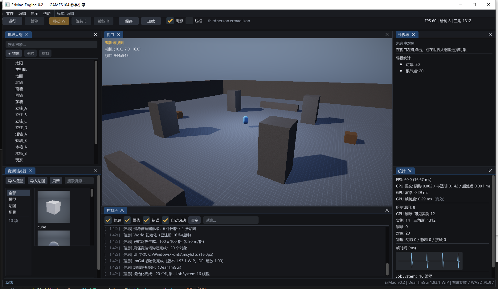

# 第 13 讲：编辑器与工具链——即时模式 UI、拾取与 Gizmo【选读】

> 对应 GAMES104 第 13 讲（工具链）。
> 代码：`editor/ImGuiLayer.*`、`editor/EditorUI.*`、`renderer/Renderer.cpp`（离屏视口、缩略图）、`renderer/Camera.cpp`（屏幕射线）、`scene/WorldQuery.cpp`（射线拾取）。
> 目标：从"在视口里点一下鼠标，怎样选中物体；拖动 gizmo 怎样改 transform"出发，把编辑器怎样和渲染器共存、屏幕坐标怎样变成世界射线讲清楚。
> 状态：**已实现**（即时模式 UI、Dock 布局、离屏视口、AABB 拾取、位移/旋转/缩放 gizmo、网格缩略图、PIE）；**部分实现**（拾取只到 AABB、gizmo 对子物体/旋转父级有坐标系偏差、无框选/吸附）；**尚未实现的设计**（撤销/重做、多选、节点编辑器、第二视口、运行时行为树调试面板）。

---



## 1. 现象：点一下，拖一下

编辑器开着，视口里有一个立方体。你做两件事：

1. 鼠标左键点立方体：世界大纲里它被高亮，检视器列出它的组件和字段；
2. 按住 gizmo 的红色 X 轴往右拖：立方体的 `position.x` 跟着变大。

这里藏着四个问题：

- 鼠标点在屏幕像素上，怎样知道点中了哪个 3D 物体？
- 视口只是 Dock 里的一个面板，像素坐标怎样换算到"视口内部"？
- 拖动 gizmo 时，"鼠标移动了多少像素"怎样变成"世界空间移动多少米"？
- 编辑器每帧都在重画，选中状态存在哪？

---

## 2. 最简实现：每帧遍历物体 + 射线-AABB

**概念伪代码**（不是本仓库代码）：

```cpp
// 每帧：先画 UI，再处理点击
void DrawEditor(World& world, Camera& cam) {
    if (ImGui::Button("运行")) playing = true;
    ImGui::SliderFloat("粗糙度", &material.roughness, 0.04f, 1.0f);

    ImGui::Image(viewportTexture, viewportSize);
    if (ImGui::IsItemHovered() && ImGui::IsMouseClicked(0)) {
        Ray ray = ScreenToRay(mouse - viewportMin, viewportSize);
        float best = 1e30f;
        for (GameObject* object : allObjects) {
            float t;
            if (IntersectRayAABB(ray, object->WorldAABB(), t) && t < best) {
                best = t;
                selected = object;
            }
        }
    }
}
```

它已经能工作。下面看它在本仓库规模下具体会在哪里出问题。

---

## 3. 它具体在哪里失败

**UI 直接读写数据，但"选中"是跨帧状态。** 即时模式 UI 每帧重新声明整棵界面，控件状态不在控件对象里，而在**你自己的变量**里。这消掉了"控件显示旧值"的同步问题，但把问题换成另一种：`selected` 是裸 `GameObject*`，对象被删除、PIE 回滚、`FromJson` 重建世界之后就悬垂，必须每帧检查它还有效。

**坐标换算错一步，点击就整体偏移。** `ImGui::Image` 画在面板里，鼠标坐标是**窗口坐标**；拾取需要**视口内坐标**（`mouse - imageMin`），再除以**视口尺寸**（不是窗口尺寸）做 NDC。面板一 Dock、一拖分隔条，任何一个用了错的尺寸，点击就会偏。NDC 的 Y 还要翻转（屏幕 Y 向下，NDC Y 向上）。

**gizmo 的轴选择不是"点到线"。** 三条轴在屏幕上是线段，鼠标离哪条最近、距离小于几个像素才算选中。两个退化情况：相机几乎沿某条轴看时，轴只剩几个像素，方向和长度都不可靠；轴长不随相机距离缩放的话，远看只有几个像素，根本点不中。

**缩略图如果每帧重渲染，资源面板会拖垮帧率。** 资源浏览器是网格布局，每格一张预览图。每帧对每个网格都跑一次完整 PBR 渲染到 128×128，几十个资源就是几十次额外 draw；而且这些渲染会改写渲染统计，让"统计"面板显示缩略图的数字。

**没有撤销，操作不可逆。** 拖错 gizmo、误删对象只能手动改回来。本工程**没有撤销/重做栈**，也没有多选、框选、吸附；这些是"编辑器"在工业里默认有、但本工程尚未实现的部分。

---

## 4. 正式方案

### 4.1 即时模式 UI 与 Dock

保留模式（Win32/Qt）里控件是对象，改状态 → 重绘；即时模式（Dear ImGui）里**每帧重新声明整棵 UI**（**示意**）：

```cpp
if (ImGui::Button("运行")) EnterPlayMode(world);
ImGui::SliderFloat("粗糙度", &material.roughness, 0.04f, 1.0f);
```

代价是每帧重建（顶点数只与控件数量成正比，本工程面板规模下不是瓶颈，未实测）；收益是没有 UI 与数据的同步问题——UI 直接读写你的变量。

Dock 布局在 `EditorUI.cpp` 的 `BuildDefaultLayout` 里按比例切分：左 20%、右 26%、底部 26%，左侧再上下 45/55 分成"世界大纲/资源浏览器"，右侧分成"检视器/统计"。布局存 exe 同目录的 `imgui.ini`。自动运行（`--frames`/`--screenshot`）时 `ImGuiLayer::Init(..., useIniFile=false)` 直接不读不写 ini，并调 `ForceDefaultLayout`，避免上次把视口拖成 0 尺寸导致截图空白（修复记录 P2-22）。

### 4.2 离屏视口

编辑器不直接画窗口，而是：

```text
场景 ──▶ Renderer::RenderToViewport(camera, scene, time, w, h)
              │
              ▼
        RGBA8 RenderTarget（宽高 = 面板可用区域）
              │  ViewportTexture() 返回 SRV
              ▼
        ImGui::Image(SRV, avail) ──▶ 视口面板
```

- RT 尺寸 = 面板内容区尺寸，`EnsureViewportTarget` 发现宽高变化才重建（`m_viewportTarget.Shutdown()` + `Create`）；
- 相机是**拷贝**：`Engine::RenderViewportScene` 里 `Camera viewCamera = camera; viewCamera.aspect = w/h;`，所以拖面板不会让画面变形，也不会污染编辑器相机；
- 视口可以被别的面板遮挡，也可以将来多开（多一个 RT 即可，本工程目前只有一个）。

### 4.3 屏幕坐标 → 世界射线（反投影）

鼠标在视口内的像素坐标 `(x, y)`、视口尺寸 `(w, h)`：

```text
ndc.x =  2x/w - 1
ndc.y =  1 - 2y/h        // 屏幕 Y 向下，NDC Y 向上
ndc.z =  0（近平面） 或 1（远平面）   // D3D：z ∈ [0,1]
```

用 `invViewProj` 把两个 NDC 点变回世界空间，除以 `w`：

```text
p_near = invViewProj · (ndc.x, ndc.y, 0, 1) / w
p_far  = invViewProj · (ndc.x, ndc.y, 1, 1) / w
ray.origin = p_near
ray.dir    = normalize(p_far - p_near)
```

本仓库对应 `Camera::ScreenToRay`（`renderer/Camera.cpp`）。注意 `ray.origin` 是**近平面上的点**，不是相机位置；对透视相机两者在同一条射线上，只差一个常数距离；对正交相机则必须从近平面点出发（每个像素的射线方向相同、起点不同），否则拾取会全部偏到画面中心——代码注释专门写了这一点。

### 4.4 射线 vs AABB（slab 法）

对每一维求射线进入/离开该维"板"（slab）的参数区间：

```text
t1 = (min.x - o.x) / d.x
t2 = (max.x - o.x) / d.x
tmin = max(tmin, min(t1,t2))
tmax = min(tmax, max(t1,t2))
```

三维都做；若 `tmin <= tmax` 且 `tmax >= 0` 则命中，`tmin` 是入射距离。`Math.h` 的 `IntersectRayAABB` 额外做了两件事：

- `|d| < kEpsilon` 时不做除法，直接检查原点是否落在该维板内（平行射线）；
- 记录入射轴与方向，输出命中法线（`hitAxis`、`hitSign`），给后续高亮/放置用。

`World::Raycast` 对每个**激活的**对象构建世界 AABB：有 `MeshRenderer` 时把网格局部 AABB 的 8 个角变换到世界再取包围盒，没有时用 `SpriteRendererComponent` 的 `size`/`offset`/`rotation` 构造薄 AABB；然后做 slab 测试，取 `t` 最小者。复杂度是 O(物体数)，没有 BVH/空间索引——教学规模够用。

### 4.5 拾取

`Editor::PickObject` 只是把上面两步接起来：

**源码节选：`Editor::PickObject`**

```cpp
const Ray ray = camera.ScreenToRay(Vec2(viewportPos.x, viewportPos.y),
                                   Vec2(viewportSize.x, viewportSize.y));
World::RaycastHit hit;
if (world.Raycast(ray, 500.0f, hit)) Select(hit.object);
else                                 Select(nullptr);
```

`viewportPos` 是 `mouse - imageMin`。点击空白处会清空选择。注意它和 gizmo 的先后：`DrawGizmo` 先执行，正在拖轴时 `m_gizmoAxis >= 0`，拾取被跳过，避免拖轴时改选中。

### 4.6 Gizmo：把屏幕位移投影到世界轴

三种模式共用"物体原点 + 三条世界轴"的绘制，但拖拽换算不同。

**轴长自适应**：`axisLength = clamp(distance × 0.16, 0.35, 6.0)`（`distance` 是相机到物体原点的距离）。

**轴命中**：把 `O` 和 `O + axis × axisLength` 投影到屏幕，得到线段 `o→e`；鼠标到线段的距离小于阈值（10 px）才算命中，取最近的一条。

**位移与缩放**：

```text
dir = normalize(e - o)                 // 轴在屏幕上的方向
len = |e - o|                          // 轴的像素长度（< 2 px 则放弃拖拽）
worldPerPixel = axisLength / len
along = (mouse - startMouse) · dir     // 沿轴的像素位移
position = startPosition + axis × (along × worldPerPixel)
```

缩放把 `along` 换成因子：`factor = clamp(1 + along × 0.01, 0.05, 10)`，再乘到起始缩放的对应分量上。

**旋转**：三个环分别跟随物体的局部 X/Y/Z（经父级世界矩阵变换到世界方向）。每个环采样 48 个点，只用朝向相机的前半环做命中（后半环画淡色）；拖动时用鼠标在环切线方向上的位移除以环的屏幕半径，得到每帧角度增量（限制在 ±0.35 rad），再乘到起始旋转上（**源码节选**）：

```cpp
rotation = (m_gizmoStartRotation * Quat::FromAxisAngle(unitAxes[axis], m_rotateAccum)).Normalized();
```

**F 聚焦**：用物体世界 AABB 的中心 `C` 和半径 `R`，透视相机放在 `C - forward × (R / tan(fovY/2) × 1.7)`；正交相机则设 `orthoHeight = R × 2.6` 并沿视线后退。

### 4.7 资源缩略图

`Renderer::GetMeshThumbnail(mesh)`：

1. 先查 `m_thumbnails`（key 是 `mesh->Id()`），命中直接返回 SRV；没命中才创建 128×128 的 RGBA8 RT（带深度）。
2. 用网格包围球半径 `R` 定相机：距离 `R × 3`、fov 38°、看向中心；把网格平移到 `-center`，相当于把中心放到原点。
3. 组一个只有该网格的 `RenderScene`，固定太阳方向和中性材质，调 `RenderInternal` 走完整 PBR 管线（天空、阴影也会跑）。
4. **保存 `m_stats`，渲染完恢复**，否则缩略图的 draw call/时间会污染统计面板；最后把 RT 存进缓存。

贴图缩略图更简单：`GetTextureThumbnail` 直接返回纹理的 SRV，不渲染。资源浏览器每帧对每个资源 tile 调一次 `GetMeshThumbnail`，因为有缓存，实际只渲染一次。

---

## 5. 源码核对：谁调用谁

| 文件 / 符号 | 作用 | 状态 |
|---|---|---|
| `ImGuiLayer::Init` | 建 ImGui 上下文、DPI 字体、ini 路径（exe 目录） | 已实现 |
| `Editor::DrawDockspace` | 主 Dock 宿主、菜单栏、工具栏、默认布局 | 已实现 |
| `Editor::DrawViewport` | 算可用尺寸、调 `renderViewport`、`ImGui::Image`、相机操作、gizmo、拾取 | 已实现 |
| `Editor::PickObject` | `Camera::ScreenToRay` + `World::Raycast` + `Select` | 已实现 |
| `Editor::DrawGizmo` | 三轴/三环绘制、命中、拖拽换算 | 已实现 |
| `Editor::FocusSelected` | F 聚焦 | 已实现 |
| `Editor::DrawInspector` / `DrawComponents` / `DrawField` | 按 `TypeInfo.fields` 自动生成控件 | 已实现（字段类型见第 14 讲） |
| `Renderer::RenderToViewport` / `EnsureViewportTarget` | 离屏 RT 与按需重建 | 已实现 |
| `Renderer::GetMeshThumbnail` | 128² 缩略图 + 缓存 + 统计保护 | 已实现 |
| `Camera::ScreenToRay` / `WorldToScreen` | 反投影 / 投影 | 已实现 |
| `World::Raycast` / `CollectMeshAABBs` | 全量 AABB 射线查询 | 已实现（无加速结构） |
| 撤销/重做、多选、节点编辑器 | — | 尚未实现 |

真实调用链：

```text
Engine::Run 每帧
 └─ Editor::Draw
     ├─ DrawDockspace → BuildDefaultLayout（首次/强制）
     ├─ DrawViewport
     │   ├─ renderViewport → Engine::RenderViewportScene
     │   │     ├─ viewCamera.aspect = w/h
     │   │     └─ renderer.RenderToViewport → EnsureViewportTarget
     │   ├─ ImGui::Image(renderer.ViewportTexture())
     │   ├─ DrawGizmo（选中 + hover + 非播放）
     │   └─ PickObject（未拖轴 + 左键点击）
     ├─ DrawOutliner / DrawInspector / DrawAssets / DrawConsole / DrawStats
     └─ HandleShortcuts（Ctrl+S/O/N/D、Delete、F、F5）
```

---

## 6. 手算一个点击和一个拖拽

### 6.1 点击

视口 `1280×720`，点击像素 `(960, 180)`：

```text
ndc.x = 2×960/1280 - 1 = 0.5
ndc.y = 1 - 2×180/720 = 0.5
```

设相机在原点、朝 `-Z`、fov 60°、aspect 16:9、near 0.1、far 500：

```text
tan(30°) = 0.57735
p_near = (0.5×0.1×0.57735×1.7778, 0.5×0.1×0.57735, -0.1) = (0.0513, 0.0289, -0.1)
p_far  = (0.5×500×0.57735×1.7778, 0.5×500×0.57735, -500) = (256.6, 144.34, -500)
dir    = normalize(p_far - p_near) ≈ (0.4422, 0.2488, -0.8617)
```

对一个中心 `(2, 1, -4)`、半尺寸 `0.5` 的立方体，AABB 是 `min=(1.5,0.5,-4.5)`、`max=(2.5,1.5,-3.5)`。为手算方便把射线起点取在相机原点（代码取近平面点，命中点相同，`t` 差约 0.116）：

```text
x 板：t ∈ [1.5/0.4422, 2.5/0.4422] = [3.392, 5.653]
y 板：t ∈ [0.5/0.2488, 1.5/0.2488] = [2.010, 6.030]
z 板：t ∈ [(-4.5)/(-0.8617), (-3.5)/(-0.8617)] = [5.222, 4.062] → [4.062, 5.222]

tmin = max(3.392, 2.010, 4.062) = 4.062
tmax = min(5.653, 6.030, 5.222) = 5.222
tmin <= tmax，命中；入射面是 z 板（物体正面 z = -3.5）
命中点 = (0.4422, 0.2488, -0.8617) × 4.062 = (1.796, 1.010, -3.500)
```

于是 `World::Raycast` 把 `hit.object` 指向这个立方体（若没有更近的 AABB），`Select` 更新大纲和检视器。


### 6.2 拖 gizmo

相机到物体 10 m，`axisLength = 10 × 0.16 = 1.6 m`。X 轴投影到屏幕上长 120 px：

```text
worldPerPixel = 1.6 / 120 = 0.01333 m/px
沿 X 轴拖 30 px：位移 = 30 × 0.01333 = 0.4 m
```

所以 `position.x` 增加 0.4。如果相机离得远，`axisLength` 变大、轴在屏幕上反而不会缩得太小，换算仍然成立；如果轴在屏幕上短于 2 px（几乎沿轴看），代码放弃这次拖拽（`m_gizmoAxis = -1`），避免除出巨大的 `worldPerPixel`。

---

## 7. 进阶与工程取舍

### 7.1 AABB 拾取的边界

`World::Raycast` 用的是物体的世界 AABB（网格局部 AABB 变换 8 角，或 2D 精灵的薄 AABB），它比真实几何**大**：
- 旋转物体的角附近，明明没点到模型也会选中；
- 两个物体 AABB 重叠时，选中的是 AABB 入射更近的那个，不一定是肉眼看到的表面；
- 网格对象和 2D 精灵可点中；空对象、纯逻辑对象没有可查询的包围盒，点不中。

精确做法是射线-三角形（Möller–Trumbore）或 BVH；本工程留在"教学级 AABB"，与第 11 讲一致。

### 7.2 gizmo 的坐标系混用与绘制层级（部分实现）

- 平移/缩放的**起点**取 `m_selected->Position()` / `Scale()`（局部值），拖拽方向却用**世界轴**。根节点、无旋转时 `Position == WorldPosition`，没问题；子物体或带旋转的父级，沿世界 X 拖会写进局部 X，方向会偏。
- 旋转环的显示方向经过父级世界矩阵，组合 `startRotation * FromAxisAngle(localAxis, Δ)` 数学上是对的（局部轴旋转），受父级影响较小。
- 没有"世界/局部"模式切换、吸附（Ctrl 步进）或轴心切换。
- gizmo 画在 `ImGui::GetForegroundDrawList()` 上，**没有按视口面板裁剪**：轴伸出视口时会画到别的面板；拾取只在 `m_viewportHovered` 时发生，所以只是视觉瑕疵。

### 7.3 没有撤销栈意味着什么

所有编辑直接改 `GameObject`/组件字段。要做撤销，需要"命令 + 旧值"或"整场景快照 diff"；PIE 快照（第 14 讲）证明"整场景 JSON 快照"可行，但撤销需要更细的粒度与合并规则，目前**尚未实现**。

### 7.4 工具链的其他部分

资源导入（`ImportModel`/`ImportTexture` + `AssetManager::Refresh`）、打包（`Packager::PackageWindows`/`PackageLinuxSource`）、自动化参数（`--frames`、`--screenshot`、`--editor-view`、`--editor-select`、`--test-serialize`）都是工程配套，不是编辑器原理，了解入口即可。

---

## 8. 实验与自测

### 8.1 实验（本次未实际运行）

1. 拖动 Dock 分隔条，关掉程序再开：布局保留（exe 同目录的 `imgui.ini`）。
2. 删掉 `imgui.ini`，运行 `build\bin\ErMao.exe --frames 30 --screenshot out.png`：自动运行会禁用 ini 并强制默认布局，视口应完整；若仍空白，检查 `m_showViewport` 和面板尺寸是否小于 32 px（`DrawViewport` 会显示"视口太小"）。
3. 视口里左键点物体：大纲高亮、检视器显示字段；点空白清空选择。按 `W/E/R` 切换位移/旋转/缩放，拖 X 轴看数值同步；按 `F` 聚焦；右键拖动环视（此时 W/E/R 不切 gizmo）。
4. 在资源浏览器看网格缩略图：每个网格只应渲染一次；打开"统计"面板，缩略图渲染不应改掉 draw call 数字（`m_stats` 有保存/恢复）。

### 8.2 自测题（答案在对应小节）

1. 为什么 `ScreenToRay` 需要 `invViewProj`，而不是 `viewProj`？（§4.3）
2. NDC 的 Y 为什么要翻转？不翻转会看到什么？（§4.3、§6.1）
3. slab 法中 `d ≈ 0` 时为什么不能直接除？代码怎么处理？（§4.4）
4. `worldPerPixel = axisLength / 像素长度` 的几何含义是什么？轴几乎沿视线时为什么要放弃？（§4.6、§6.2）
5. 为什么拾取用 AABB 而不是三角形？代价是什么？（§7.1）

### 8.3 练习（故意改坏，预期为推演，未实机验证）

1. 删掉 `ScreenToRay` 的 NDC Y 翻转：**预期**点击位置上下颠倒，点上半屏选中下半屏的物体。
2. 把 gizmo 的 `worldPerPixel` 乘 2：**预期**同样拖 30 px，物体移动 0.8 m 而不是 0.4 m。
3. 把 `PickObject` 的视口尺寸换成窗口尺寸：**预期**视口没铺满窗口时，点击位置整体偏移（Dock 布局下尤其明显）。

---

## 数学依据与参考资料

> 目的：不要求背下推导，但要知道这一讲用的是什么数学工具、去哪里查。

| 用到的原理 | 数学形式 / 名称 | 参考 |
|---|---|---|
| 屏幕坐标反投影 | NDC → 世界：`invViewProj · (x,y,z,1)`，再除 `w` | [GAMES101] |
| 射线-AABB | slab 法：三维参数区间求交，平行轴特判 | [RTR4] |
| gizmo 拖拽 | 屏幕位移投影到世界轴：`Δw = (Δs · dir) × (L / len)` | [GAMES101] |
| 即时模式 UI | 每帧重建 UI 顶点缓冲，状态存调用方 | [IMGUI] |
| 缩略图缓存 | 以资源 id 为 key 的渲染结果复用 | [IMGUI] |

注意：本工程的拾取路径用的是 **AABB slab 法**，不是 Möller–Trumbore 射线-三角形；要支持三角网精确拾取，需要额外的三角形求交与网格数据遍历。
