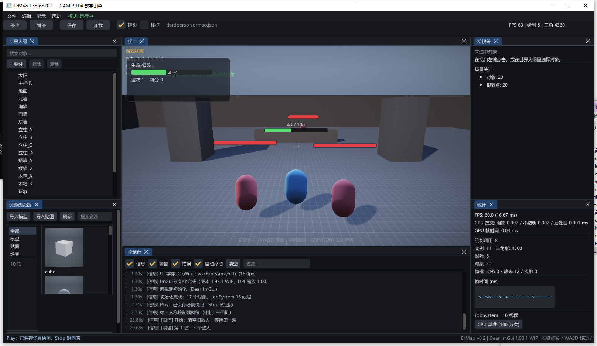

# 第 15 讲：Gameplay 框架——组件、固定步长与第三人称控制【必读】

> 对应 GAMES104 第 15 讲（Gameplay 的积木）。
> 代码：`game/ThirdPersonController.*`、`game/ThirdPersonLevel.cpp`、`scene/World.cpp` 的 `FixedUpdate/Update`、
> `runtime/Engine.cpp` 的固定步长循环、`scene/Components.h`。
> 目标：把"按 W 能走、撞墙会停、跳跃后落地、相机不穿墙"拆成可推导的几何与数值问题，并分清物理步与视觉更新。
> 实现状态：**已实现**（组件、相机相对移动、运动学控制器、地面检测、固定步长）；关闭碰撞的简化见正文。
## 1. 三个能观察到的动作
按住 W，角色沿相机朝向走；撞到矮墙停住；按空格跳起再落地。看起来是"角色逻辑"，拆开是三个问题：

- **方向**：W 是"屏幕上的前"，怎样变成世界空间的方向？相机转了 90° 之后，W 还沿原来的世界 -Z 吗？
- **位移**：这一帧走多远？为什么同一个角色在 30 fps 和 144 fps 下跳跃高度会不一样？
- **约束**：撞墙、落地时，位置和速度分别怎么改？为什么有时贴着墙抖，有时直接穿过去？

本讲先写一个"按键 → 位置 += 方向 × 速度 × dt"的最小版本，再让它在这三件事上逐个失败。
## 2. 最简实现：输入直接加位置
**概念伪代码**（不是仓库实现）：
```cpp
void Update(Player& p, float dt) {
    Vec3 wish{0, 0, 0};
    if (Input::IsKeyDown('W')) wish.z -= 1.0f; // 世界 -Z 当作"前"
    if (Input::IsKeyDown('S')) wish.z += 1.0f;
    if (Input::IsKeyDown('D')) wish.x += 1.0f;
    if (Input::IsKeyDown('A')) wish.x -= 1.0f;

    p.pos += wish * moveSpeed * dt;  // 水平位移
    p.vy += gravity * dt;            // 竖直速度
    p.pos.y += p.vy * dt;            // 竖直位移
}
```
它已经能"动"，但没有相机方向、没有归一化、没有碰撞、没有地面。下面按玩家能看到的顺序让它失败。
## 3. 让它具体地失败
### 3.1 斜着走更快
`W` 和 `D` 同时按，`wish = (1, 0, -1)`，长度是 `√2 ≈ 1.414`，不是 1。代码直接乘 `moveSpeed = 4.6`：

| 输入 | `wish` | 长度 | 实际速度 | 1/60 步位移 |
|---|---|---|---|---|
| 只按 W | `(0, 0, -1)` | 1.000 | 4.60 m/s | 0.0767 m |
| W + D（未归一化） | `(1, 0, -1)` | 1.414 | 6.51 m/s | 0.1085 m |
| W + D（归一化） | `(0.707, 0, -0.707)` | 1.000 | 4.60 m/s | 0.0767 m |

斜向快了 **41%**（`1.414 - 1`）。玩家很快会发现"斜着走能追上怪"，这不是设计，是漏了归一化。跑步速度 7.8 时同理：斜向 11.03 m/s。
### 3.2 相机转了，W 还沿世界 -Z
最简实现把"前"写死成 `(0, 0, -1)`。相机绕 Y 转 90° 后，画面前方是世界 `-X`，但按 W 角色仍往 `-Z` 走——**角色横着走**。此时相机的 `forward` 是：
```
yaw = 0°：  forward = (0, 0, -1)       right = (1, 0, 0)
yaw = 90°： forward = (-1, 0, 0)       right = (0, 0, -1)
```
如果角色仍用固定的 `(0,0,-1)`，误差正好是 90°。更糟的是斜向组合：相机转后，W+D 的"右"也错了，角色会往画面外走。
### 3.3 跳跃高度随帧率变
最简实现把跳跃放在 `Update(dt)` 里，`v0 = 7 m/s`、`g = -22 m/s²`。连续解的最高点是

```
h = v0² / (2|g|) = 49 / 44 = 1.114 m
```
但半隐式欧拉在离散步长下的最高点会偏小，偏多少取决于 `h`：

| 步长 `h` | 到最高点的步数 | 最高点（相对起跳点） |
|---|---|---|
| 1/60 | 19 | 1.056 m |
| 1/30 | 9 | 1.000 m |
| 1/15 | 4 | 0.889 m |

同一套 `jumpSpeed`/`gravity`，只把步长从 1/60 改成 1/15，跳跃高度就少了约 0.17 m（16%）。如果 `dt` 随帧率变，玩家在低帧率机器上跳不上同一个台阶。
### 3.4 撞墙：先移动，再推回
最简实现没有碰撞，角色直接穿墙。加上"移动后检查 AABB、把人推出去"之后，又会遇到两个问题：

- 每一步先 `position += velocity*dt` 进入墙里，再被推回表面；如果推回量不够（例如用三维距离算、却只做 XZ 推出），角色会每帧陷进去一点，表现为贴墙抖动。
- 推回只改位置，不改速度，下一帧仍用原速度往墙里撞；如果只改速度，位置又已经陷进去了。正确做法是**位置修正 + 速度沿法线投影**，并且两者要在同一步里完成。

正常参数下 `runSpeed = 7.8`、`dt = 1/60`，一步约 0.13 m，小于矮墙 0.5 m 的厚度；但把 `runSpeed` 调到 Inspector 上限 30，一步就是 0.5 m，已经可能跨过薄墙。没有连续碰撞检测（CCD），速度再高就会穿。
### 3.5 相机穿墙
第三人称相机在角色背后。角色背靠墙时，相机的位置会落到墙里，画面出现墙的内部或全黑。最简实现没有"从角色向相机打一条射线"的逻辑，所以一定穿。
## 4. 逐步引入正式方案
### 4.1 相机相对移动 + 归一化
只取相机的**偏航**（yaw），不取俯仰（pitch）。这样抬头看天时按 W 仍在地面走，而不是往天上飞。绕 Y 旋转 `yaw` 后：
```
cameraForward = R_y(yaw)·(0,0,-1) = (-sin yaw, 0, -cos yaw)
cameraRight   = R_y(yaw)·(1,0,0)  = ( cos yaw, 0, -sin yaw)
wish = W·forward - S·forward + D·right - A·right
if (|wish| > 0) wish = wish / |wish|
```
**源码节选**（`ThirdPersonController.cpp:85-110`）：
```cpp
const Quat yawRotation = Quat::FromEuler(ToRadians(yawDegrees), 0.0f, 0.0f);
const Vec3 cameraForward = yawRotation.RotateVector(Vec3(0, 0, -1));
const Vec3 cameraRight = yawRotation.RotateVector(Vec3(1, 0, 0));

Vec3 wish{0, 0, 0};
if (Input::IsKeyDown('W')) wish += cameraForward;
if (Input::IsKeyDown('S')) wish -= cameraForward;
if (Input::IsKeyDown('D')) wish += cameraRight;
if (Input::IsKeyDown('A')) wish -= cameraRight;
if (LengthSq(wish) > 0.0f) wish = Normalize(wish);

const float speed = running ? runSpeed : moveSpeed;
velocity.x = wish.x * speed;
velocity.z = wish.z * speed;
```
这里用四元数而不是手写 `sin/cos`，结果等价：`Quat::FromEuler(yaw,0,0)` 就是绕 Y 的旋转，`RotateVector` 把本地方向转到世界。归一化保证了斜向不会加速。
### 4.2 固定步长：位移只在这里发生
角色位移、重力、碰撞、转身都在 `OnFixedUpdate(h)` 里，`h` 由 `Engine::UpdateGameplay` 固定成 `1/60`：

**源码节选**（`Engine.cpp:497-512`）：
```cpp
m_accumulator += dt;
int steps = 0;
while (m_accumulator >= kFixedDt && steps < kMaxSubSteps) {
    m_world.FixedUpdate(kFixedDt);
    m_accumulator -= kFixedDt;
    ++steps;
}
if (steps == kMaxSubSteps) m_accumulator = 0.0f;
m_world.Update(dt);
```
`World::FixedUpdate` 的顺序是**先物理，再组件**（`World.cpp:223-230`）：
```cpp
if (m_physics) m_physics->Step(*this, dt);
for (GameObject* root : roots) root->ForEach([dt](GameObject* o) { o->FixedUpdate(dt); });
```
第三人称关卡里的"玩家"只有 `MeshRenderer` 和 `ThirdPersonController`，**没有 `RigidBodyComponent`**（`ThirdPersonLevel.cpp:172-185`）。所以 `PhysicsWorld::Step` 不会动它，角色是纯运动学控制器；如果给它加刚体，同一帧会被物理和控制器各积分一次，位置会重复累加。
### 4.3 重力、跳跃与边沿输入
**源码节选**（`ThirdPersonController.cpp:113-123`）：
```cpp
if (grounded && jumpPressed) {
    m_verticalVelocity = jumpSpeed;
    grounded = false;
}
m_verticalVelocity += gravity * dt;
if (m_verticalVelocity < -30.0f) m_verticalVelocity = -30.0f;

Vec3 position = m_owner->Position();
position += Vec3(velocity.x * dt, m_verticalVelocity * dt, velocity.z * dt);
m_owner->SetPosition(position);
```
顺序和物理课一致：先让速度吃到重力，再用新速度更新位置（半隐式欧拉）。`jumpPressed` 用的是 `Input::IsKeyPressed`（本帧刚按下），不是 `IsKeyDown`，否则按住空格会每帧满足条件，落地后立刻再跳。

三个容易忽略的点：

- **重力的两套值**：控制器默认 `gravity = -22`，`PhysicsWorld` 默认 `-9.81`。它们互不影响，改物理重力滑条不会改变跳跃。
- **下落速度夹到 -30**：防止长时间下落把速度积到很大，落地时一步穿过地面。
- **边沿输入在固定步里采样**：`Input::BeginFrame` 每渲染帧清一次 `s_pressed`，而 `OnFixedUpdate` 一帧可能跑 0 次（高帧率）或多次。跑 0 次时，这一帧按下的空格会被清掉，跳跃丢失。更稳的做法是在 `OnUpdate` 里把跳跃"锁存"成 `jumpQueued`，在固定步里消费。
### 4.4 地面检测：向下射线
**源码节选**（`ThirdPersonController.cpp:127-149`）：
```cpp
Ray groundRay;
groundRay.origin = position + Vec3(0, 0.15f, 0);
groundRay.direction = Vec3(0, -1, 0);
World::RaycastHit hit;
const float groundProbe = height * 0.5f + 0.35f;   // 1.9/2 + 0.35 = 1.30
if (world->Raycast(groundRay, groundProbe, hit) && hit.object != m_owner) {
    const float targetY = hit.point.y + height * 0.5f;
    if (position.y <= targetY + 0.05f) {
        position.y = targetY;
        m_verticalVelocity = 0.0f;
        grounded = true;
        m_owner->SetPosition(position);
    }
} else if (position.y - height * 0.5f <= 0.0f) {
    position.y = height * 0.5f;
    m_verticalVelocity = 0.0f;
    grounded = true;
    m_owner->SetPosition(position);
} else {
    grounded = false;
}
```
它想做的是：从身体中心稍上方往下打 1.3 m，命中地面/平台顶面就把中心放到"命中点 + 半身高"，并把竖直速度清零。`else if` 是兜底：没有命中任何网格时，至少保证脚不穿 `y=0` 的平地。

但按当前代码静态推演，这个射线有个大问题：**起点在角色自己的 AABB 里**。玩家的网格是 `capsule`（局部半高约 0.6，缩放 0.95 后约 0.57），身体中心在 `y≈0.95`，射线起点是 `y≈1.10`，仍在自己的 AABB 内。`IntersectRayAABB` 对"起点在盒内"返回 `t=0`，`World::Raycast` 取最近命中，于是最先命中的是玩家自己；`hit.object != m_owner` 为假，整个 `if` 不成立，又掉到 `else if` 的平地兜底。

后果：

- 在 `y=0` 的平地上，兜底分支仍能把人放在 `0.95`，看起来正常；
- 站上 `平台A`/台阶时，`position.y - height*0.5` 大于 0，兜底不成立，`grounded=false`，人就站不住平台；
- 代码没有给 `Raycast` 传 ignore 列表，`hit.object != m_owner` 只是"事后否决"，不会"跳过自己继续找后面的地面"。

本次没有运行 exe 验证，但分支条件在源码里是确定的。修法是给 `Raycast` 加 ignore 参数，或从脚底附近起射并显式过滤自己；修完后还要注意：起跳第一帧的上升量是 `(7 - 22/60)/60 ≈ 0.111 m`，大于 `0.05` 的吸附阈值，所以跳跃不会被立即吸回去；如果 `jumpSpeed` 小于约 `3.37`，第一帧就会被吸附，跳不起来。

另外，`stepHeight = 0.45` 这个字段只在头文件里声明，`.cpp` 里从未使用：**本工程没有真正的"迈台阶"逻辑**，台阶靠地面射线吸附，而不是靠碰撞形状抬升。
### 4.5 水平碰撞：圆 vs AABB，不是完整胶囊
**源码节选**（`ThirdPersonController.cpp:174-200`）：
```cpp
const AABB& box = entry.second;
const Vec3 closest{Clamp(center.x, box.min.x, box.max.x),
                   Clamp(center.y - height * 0.1f, box.min.y, box.max.y),
                   Clamp(center.z, box.min.z, box.max.z)};
Vec3 delta = Vec3(center.x, center.y - height * 0.1f, center.z) - closest;
const float distance = Length(delta);

if (center.y - height * 0.5f >= box.max.y - 0.05f) continue;
if (distance < radius && distance > 1e-4f) {
    delta.y = 0.0f;
    const Vec3 normal = Normalize(delta);
    position += normal * (radius - distance);
    const float vn = Dot(Vec3(velocity.x, 0, velocity.z), normal);
    if (vn < 0.0f) {
        velocity.x -= normal.x * vn;
        velocity.z -= normal.z * vn;
    }
}
```
它把角色近似成半径 `radius = 0.42` 的**竖直圆柱**（只在 XZ 推），不是完整的胶囊 vs AABB：

- `closest` 的 y 用的是 `center.y - height*0.1`（身体中心偏下 0.19 m），不是脚底；
- `distance` 是**三维长度**，包含了 y 分量；
- 推离时把 `delta.y` 清零、只沿 XZ 推，但推出的量是 `radius - distance`，不是 `radius - 水平距离`。

当 `delta.y ≠ 0` 时，`distance` 比水平距离大，推离量偏小，角色会略微陷进盒子。注释写"只在 XZ 上做推离"，但距离判定并不是纯 XZ。`WaveGame.cpp` 的 `MoveWithSlide` 反而是纯 XZ 的干净版本，可以对照。
### 4.6 速度投影只保一步
推离后的速度投影：
```
v_n = v · n
if (v_n < 0) v -= n·v_n
```
它把"往墙里"的法向分量去掉，只留下切向，所以沿墙滑得动。但 `velocity.x/z` 在**下一个固定步开头**会被 `velocity.x = wish.x * speed` 重新赋值，投影的效果不会跨步保留。真正让角色沿墙滑的是"位置先按输入走、再被法线推回"这个几何过程；速度投影只影响当前步剩余的逻辑。这个区别在调"贴墙手感"时很重要。
### 4.7 相机：弹簧臂
相机不是角色的子节点，而是每帧由控制器摆放。**源码节选**（`ThirdPersonController.cpp:203-225`）：
```cpp
const Quat rotation = Quat::FromEuler(ToRadians(yawDegrees), ToRadians(pitchDegrees), 0.0f);
const Vec3 forward = rotation.RotateVector(Vec3(0, 0, -1));
const Vec3 head = m_owner->Position() + Vec3(0, cameraHeight, 0);

float distance = cameraDistance;
Ray armRay; armRay.origin = head; armRay.direction = -forward;
World::RaycastHit hit;
if (world->Raycast(armRay, distance + 0.3f, hit) && hit.object != m_owner) {
    distance = (std::max)(cameraMinDistance, hit.distance - 0.35f);
}
const Vec3 desired = head - forward * distance;
m_cameraObject->SetPosition(desired);
m_cameraObject->SetRotation(rotation);
```
- `head` 是身体中心上方 `cameraHeight = 1.35 m`；
- 从 `head` 沿 `-forward`（相机方向的反方向）打一条最长 `distance + 0.3` 的射线，撞到东西就把相机拉近到 `hit.distance - 0.35`，留 35 cm 余量；
- `cameraDistance` 在滚轮缩放时被夹在 `[cameraMinDistance, cameraMaxDistance] = [2, 9]`；弹簧臂只在命中时把它拉近，并保证不小于 2。

三个实际限制：

- **没有平滑**：`distance` 每帧直接取射线结果，贴墙时相机是"瞬移"到新距离，没有弹簧插值；本工程只有"射线拉近"，不是弹簧臂。
- **最小距离可能大于命中距离**：如果 `hit.distance - 0.35 < 2`，`max` 会把距离抬回 2 m，相机仍可能落在墙里。
- **射线打的是 AABB**：柱子、薄墙的 AABB 比真实几何粗，相机会提前拉近，或者在该拉近时没反应。

相机俯仰由 `pitchDegrees` 控制，`OnUpdate` 里夹在 `[minPitch, maxPitch] = [-55°, +35°]`（`ThirdPersonController.h:35-36`）。Inspector 上 `pitchDegrees` 的滑条范围是 `[-80, 80]`，那只是 UI 范围，不是运行时夹紧值。
## 5. 回到源码：谁调用谁

| 函数 / 文件 | 位置 | 做什么 |
|---|---|---|
| `Engine::UpdateGameplay` | `Engine.cpp:497` | 累加 `dt`，按 `1/60` 调 `World::FixedUpdate`，再 `World::Update(dt)` |
| `World::FixedUpdate` | `World.cpp:223` | 先 `PhysicsWorld::Step`，再遍历组件 `OnFixedUpdate` |
| `World::Update` | `World.cpp:200` | 遍历组件 `OnUpdate(dt)`，再同步相机组件 |
| `ThirdPersonController::OnStart` | `ThirdPersonController.cpp:39` | 按名字找相机；找不到就找第一个 `primary` 相机 |
| `OnUpdate` | `:58` | 右键拖拽转视角、滚轮缩放、夹 pitch、调用 `UpdateCamera` |
| `OnFixedUpdate` | `:79` | 读输入、算 `wish`、归一化、跳跃、重力、位移、碰撞、地面、转身 |
| `ResolveCollisions` | `:164` | `CollectMeshAABBs` + 圆-AABB 推离 + 速度投影 |
| `UpdateCamera` | `:203` | 弹簧臂射线、摆放相机 |
| `Input::IsKeyPressed` | `platform/Input.cpp:52` | 本帧边沿；在固定步里采样有丢失风险 |
| `SetSimulatedInput` | `ThirdPersonController.cpp:30` | 冒烟测试用的脚本化输入，绕过键盘 |

组件模型不是继承式 `GameObject`：`GameObject` 持有名字、层级 Transform 和 `vector<Scope<Component>>`，`AddComponent` 用 `dynamic_cast` 查找同一类型，`ER_COMPONENT` 注册的 `TypeInfo` 同时驱动 Inspector 和 JSON。`World::Update/FixedUpdate` 用 `ForEach` 遍历根节点并调用每个组件的对应回调，所以新增玩法是"新增组件 + 注册反射"，不用改引擎循环。

`OnStart` 的相机查找顺序值得注意：先按 `cameraName = "主相机"` 找，找不到才遍历所有物体找第一个 `primary` 相机。如果关卡里改了相机名字，控制器仍然能用，但会退到"第一个主相机"。
## 6. 数值走查
### 6.1 斜向输入归一化前后
以下为手算，不是引擎日志。`moveSpeed = 4.6`，固定步 `1/60`，只按 W + D：

| 版本 | `wish` | 速度 | 每步位移 | 1 秒位移 |
|---|---|---|---|---|
| 未归一化 | `(1, 0, -1)` | 6.51 m/s | 0.1085 m | 6.51 m |
| 归一化 | `(0.707, 0, -0.707)` | 4.60 m/s | 0.0767 m | 4.60 m |

归一化后，斜向和直线的速度一样，只是方向不同。把 `moveSpeed` 改成 4.6、`dt` 改成 `1/60`，读者可以自己乘一遍验证。
### 6.2 跳跃高度
`jumpSpeed = 7`、`gravity = -22`、`h = 1/60`，半隐式欧拉：
```
第 n 步速度：v_n = 7 - 22·n/60
最高点发生在 v_n 刚变负：n = 19
y_19 = Σ_{k=1..19} v_k·h = 1.056 m
```
连续解是 `49/44 = 1.114 m`，离散解少约 5.2%。从起跳到落回同一高度约 38 步 = 0.633 秒；连续解是 `2×7/22 = 0.636 秒`，很接近。这个例子说明：**固定步长下跳跃高度是可复现的**；一旦把这段搬进 `Update(dt)`，`h` 随帧率变，表 3.3 的高度就会变。
### 6.3 撞墙的每步位移
`runSpeed = 7.8`、`h = 1/60`：每步 `7.8/60 = 0.13 m`。矮墙厚度 0.5 m，角色半径 0.42 m，正常不会一步跨过。把 `runSpeed` 调到 30：每步 `0.5 m`，与墙厚相同，已经开始危险；这也解释了为什么"固定步长 + 合理速度"是碰撞检测能工作的前提。
## 7. 固定步长与视觉更新：别把 `Update(dt)` 说成物理

| 事情 | 在哪 | 用的时间 | 说明 |
|---|---|---|---|
| 位移、重力、跳跃、碰撞、转身 | `OnFixedUpdate` | 固定 `1/60` | 可复现；不随渲染帧率变 |
| 鼠标视角、滚轮、pitch 夹紧 | `OnUpdate` | 渲染帧 `dt`（实际只用鼠标增量） | 鼠标增量是"每帧"的量，放固定步会一帧转多次 |
| 相机位置/朝向 | `OnUpdate` → `UpdateCamera` | 渲染帧 | 从角色当前位置重算，不是物理积分 |
| 相机组件同步 | `World::Update` | 渲染帧 | `CameraComponent::SyncFromTransform` |

这和第 1 讲的结论一致：`FixedUpdate` 负责"世界怎么变"，`Update(dt)` 负责"这一帧怎么表现"。相机每帧跟随，但**没有插值**：固定步 60 Hz、渲染 144 Hz 时，相机看到的是最近一次固定步的位置，可能出现轻微阶梯感（第 1 讲 §4.6 的取舍）。准确说法是"相机每帧重算位置，但没有物理状态插值"。

`OnUpdate` 里的 `(void)dt` 也说明它没有用 `dt` 做积分；真正的位移全部在固定步里。


## 8. 实验
> 本环境是 Linux，不能运行 Windows 的 `ErMao.exe`；下面是**本次未实际运行**的条件性预期。

```bat
:: 脚本化输入：第 30~119 帧向前走，第 60~65 帧按住跳跃
build\bin\ErMao.exe --smoke --frames 200 --level thirdperson

:: 手动玩：W 走、W+D 斜走、空格跳、撞矮墙、把相机贴到柱子后面
build\bin\ErMao.exe --level thirdperson --play --frames 180
```
`--smoke` 的日志只在帧 30、60、120、180 打印玩家位置（`Engine.cpp:593`），不是每帧都打。旧日志里的三行坐标是**未经本次运行核对的示例**，不要当作实测数据；按当前地面射线的自身命中问题，帧 120 的位置很可能与旧示例不同。

1. **斜向速度**：按住 W+D 直走 1 秒，和只按 W 对比。预期未归一化时斜向快 41%；如果速度一样，说明归一化生效。想量化就在 `OnFixedUpdate` 里临时打印 `Length(velocity.xz)`。
2. **跳跃高度**：按空格，记录最高点。预期脚底升高约 1.06 m、滞空约 0.63 秒（固定 1/60）。如果明显更高/更低，检查 `jumpSpeed`、`gravity` 是否被 Inspector 改过；注意这里的 `gravity` 不是物理面板的 `-9.81`。
3. **帧率无关**：把 `--frames` 和窗口刷新率改一改，位移/跳跃应不变（固定步长的作用）。如果变了，检查是不是把代码搬进了 `OnUpdate`。
4. **相机弹簧臂**：把角色背靠立柱/矮墙，转动视角。预期相机被拉近；没有平滑、可能突然跳变。把 `cameraMinDistance` 调大，预期贴墙时仍会穿模（4.7 的最小距离问题）。
5. **验证地面射线打中自己**：在 `OnFixedUpdate` 的地面检测前临时打印 `hit.object` 的名字。按本讲分析，站在平地上也应先命中"玩家"；如果日志如此，说明 `hit.object != m_owner` 没有起到"跳过自己"的作用。
6. **撞墙穿透**：把 `runSpeed` 调到 30，撞矮墙。预期在一步 0.5 m 的情况下可能跨过薄墙；调回 7.8 应恢复正常。
7. **改重力**：把控制器 `gravity` 从 -22 改成 -9.81，预期跳跃更高、滞空更久（连续解 `49/19.62 ≈ 2.50 m`，离散值略低）；物理面板的重力不会影响这个值。

如果角色完全不动：检查 `ThirdPersonController::SetInputEnabled` 是否为 true（编辑器只有视口获得焦点才把输入交给角色）、是否处于暂停、`--smoke` 的模拟输入是否覆盖了键盘。
## 9. 常见错误

| 错误 | 现象 | 正确做法 |
|---|---|---|
| 不归一化 | 斜向快 41% | `Normalize(wish)` |
| 跳跃用 `IsKeyDown` | 按住空格连跳 | 用边沿 `IsKeyPressed`，或锁存后消费 |
| 位移放在 `Update(dt)` | 高低帧率跳跃高度/速度不同 | 放 `OnFixedUpdate`（4.2） |
| 地面射线不过滤自己 | 平台/台阶上 `grounded=false` | 给 `Raycast` 加 ignore，或过滤后继续找 |
| 水平推离用三维距离 | 贴墙略微陷入、抖动 | 纯 XZ 距离（参考 `MoveWithSlide`） |
| 把相机每帧更新叫"物理" | 误以为它受固定步长保护 | 相机是视觉更新，没有插值（第 7 节） |
## 10. 自测题
1. 写出 `yaw` 对应的 `cameraForward/cameraRight`，并验证 `yaw=90°` 时 W 应该往哪走。**答案**：见 3.2/4.1；`forward=(-1,0,0)`，W 往世界 `-X`。
2. 为什么 W+D 未归一化会快 41%？**答案**：见 3.1；`|(1,0,-1)|=√2`。
3. 跳跃高度在 `h=1/60`、`1/30`、`1/15` 下分别是多少？**答案**：见 3.3；约 1.056 / 1.000 / 0.889 m。
4. 地面射线为什么会先命中玩家自己？**答案**：见 4.4；起点在自身 AABB 内，`IntersectRayAABB` 返回 `t=0`，`Raycast` 取最近命中。
5. 为什么水平推离的 `distance` 是三维的，但只做 XZ 推出会出问题？**答案**：见 4.5；`distance` 包含 y，推离量 `radius-distance` 偏小，角色会陷入。
6. 哪些更新在 `OnFixedUpdate`，哪些在 `OnUpdate`？**答案**：见第 7 节；位移/重力/碰撞/转身在固定步，鼠标/相机在渲染帧。
## 练习（故意改坏）
1. 把 `yawDegrees -= delta.x * mouseSensitivity` 改成 `+=`：**预期**鼠标右移视角左转（3.2 的符号问题）。
2. 删掉 `if (LengthSq(wish) > 0.0f) wish = Normalize(wish);`：**预期** W+D 斜向速度变成 6.51 m/s（3.1）。
3. 把跳跃的 `IsKeyPressed` 改成 `IsKeyDown`：**预期**按住空格连续起跳。
4. 把 `ResolveCollisions` 里的 `distance` 改成纯 XZ 的 `Length(Vec2(delta.x, delta.z))`，并保留 `delta.y = 0`：**预期**贴墙推离量变得正确，陷入减少。
5. 把地面射线的 `origin` 从 `position + (0,0.15,0)` 改成 `position - (0,height*0.5,0)`（脚底）：**预期**射线起点离开自身 AABB，可能开始命中平台；但仍要处理"脚底在盒内"的情况。
## 数学依据与参考资料
> 目的：不要求背下推导，但要知道这一讲**用的是什么数学工具**、去哪里查。

| 用到的原理 | 数学形式 / 名称 | 参考 |
|---|---|---|
| 固定步长与累加器 | `acc += dt`；`while (acc >= h)`；子步上限/丢弃积压 | [FIXED] |
| 半隐式欧拉（跳跃/重力） | `v += a·h; x += v·h`；离散最高点 | [SEMI] |
| 偏航旋转与四元数 | `q = R_y(yaw)`；`v' = q·v·q*`；`forward=(-sin yaw,0,-cos yaw)` | [QUAT] |
| 圆/AABB 最近点与推出 | `closest = clamp(c, min, max)`；`n = normalize(c-closest)` | [RTR4] |
| 运动学控制器与组件 | 输入 → 期望速度 → 位移 → 约束修正 | [GAMES104] |
