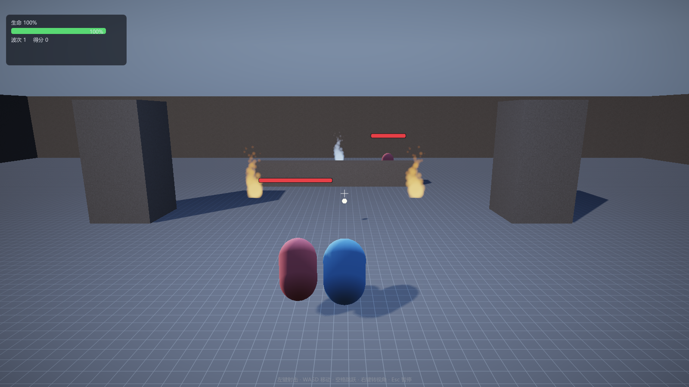

# 第 17 讲：行为树【进阶】

> 对应 GAMES104 第 17 讲（进阶 AI）。
> 代码：`ai/BehaviorTree.h/.cpp`；`game/WaveGame.cpp` 的 `EnemyComponent::BuildTree/OnUpdate/MoveToward/CanSeePlayer`；默认参数在 `game/WaveGame.h`。
> 目标：从"敌人什么时候巡逻、追击、逃跑"出发，先写嵌套 `if/else`，看它加第三种行为后怎样失控；再引入三态与**两种组合节点语义**（带记忆 / 每帧重新评估），核对本工程用了哪一种、真实的树每帧走哪条路。
> 状态：**已实现**（三态、`Sequence`/`Selector`、`Cooldown`、`Condition`/`Action`、刷怪 Demo 的敌人树）；**已实现但未使用**（`Inverter`/`SetBool`/`RepeatUntilFail`）；**尚未实现的设计**（可视化树编辑、类型化黑板、并行节点、运行时节点高亮）。

---

## 1. 现象：敌人什么时候做什么

刷怪 Demo 的敌人，设计上有三条行为：

1. 平时随机走动（**巡逻**）；
2. 看见玩家就靠近（**追击**），近身以后每 0.9 秒打一下（**攻击**）；
3. 自己血量低于 30% 时跑 2 秒（**逃跑**），跑完有 6 秒冷却。

麻烦的不是"写三个函数"，而是：**优先级**（三个条件可能同时成立）、**跨帧**（逃跑 2 秒、追击到身边都不是一帧能做完的）、**可修改**（以后加"呼叫支援"改哪里）。下面先给能跑的版本。

---

## 2. 最简实现：一个函数里的嵌套 if/else

**概念伪代码**（不是本仓库代码）：

```cpp
void TickEnemy(Enemy& e, const Player& p, float dt) {
    e.attackTimer -= dt;
    e.fleeCooldown -= dt;
    if (e.health < 0.3f * e.maxHealth) {            // 低血
        if (e.fleeCooldown <= 0.0f) {                // 不在冷却
            e.fleeTimer = 2.0f;
            MoveAway(e, p, dt);
            e.fleeCooldown = 8.0f;                   // 2 秒逃跑 + 6 秒冷却
            return;
        }
    }
    if (CanSee(e, p)) {                              // 看得见
        if (Distance(e, p) <= e.attackRange) {
            if (e.attackTimer <= 0.0f) {
                Damage(p, e.attackDamage);
                e.attackTimer = e.attackInterval;
            }
            return;
        }
        MoveToward(e, p, dt);                        // 追击
        return;
    }
    Patrol(e, dt);                                   // 默认
}
```

20 行，确实能工作：低血先逃、否则能打就打、否则追、否则巡逻。问题从"加第四种行为"开始。

---

## 3. 它具体在哪里坏掉

**优先级是书写顺序，不是可检查的数据。** 上面优先级来自 `return` 的先后。把低血判断挪到 `CanSee` 后面，低血且看得见玩家时就永远不逃——没有语法错误，只是行为变了；想回答"为什么它不逃"只能读控制流。

**加一个行为要改所有分支。** 加"看见队友死了就呼叫支援"：要决定逃跑时喊不喊、`CanSee` 分支插一次、`Patrol` 分支也插一次，每个 `return` 前都要想新行为是否该执行。改动点是"所有可能经过的路径"，不是 1 个。

**"做到一半"只能靠散落的 timer。** `fleeTimer`/`attackTimer`/`fleeCooldown` 都挂在敌人身上，和条件混在一个函数里。再加"蓄力 1.5 秒后重击""丢失目标 2 秒回巡逻"，就是一堆互相影响的计时器；没有统一推进点，漏减一次就卡住。

**无法复用、无法调试。** "巡逻"被 `return` 钉死在最后，不能和"边退边打"组合；想知道"这一帧执行了哪几个行为"，只能每个分支打日志。写成显式状态机则是 n 个状态最多 n² 条转移，"低血"这种全局条件还要在每条转移上重复判断。

---

## 4. 正式方案：三态 + 组合节点

### 4.1 三态（`BTStatus`）

| 状态 | 含义 | 父节点怎么处理 |
|---|---|---|
| `Success` | 这一帧做完了，成功 | 交给父节点决定下一步 |
| `Failure` | 这一帧失败 | 交给父节点决定下一步 |
| `Running` | 还没做完，**下一帧还要继续** | 父节点需要知道"继续谁" |

`Running` 不是错误，也不是"成功了一半"；它只表示这个行为有跨帧的内部状态。

### 4.2 组合节点，以及两种完全不同的语义

`Sequence`（与）和 `Selector`（或）逐个 tick 子节点。但"子节点返回 `Running` 后，下一帧从哪里开始"有两种常见做法（下面两段都是**概念伪代码**）：

```cpp
// 语义 A：带记忆。记住上次停在哪个子节点（以 Sequence 为例）
for (size_t i = m_runningChild; i < n; ++i) {
    status = children[i]->Tick(ctx);
    if (status == Running) { m_runningChild = i; return Running; }
    if (status == Failure) { m_runningChild = 0; return Failure; }
}
m_runningChild = 0;
return Success;
```

```cpp
// 语义 B：每帧重新评估。永远从第一个子节点开始（以 Sequence 为例）
for (size_t i = 0; i < n; ++i) {
    status = children[i]->Tick(ctx);
    if (status == Running) return Running;   // 不记录 i
    if (status == Failure) return Failure;
}
return Success;
```

子节点全是即时判断（`Condition`）时两者结果一样；差别只在跨帧行为：

- A 适合"连续动作不能被打断"：`Sequence[走到门前, 开门, 进门]`，走到一半下一帧必须继续"走"；
- B 适合"优先级每帧重新检查"：`Selector[看见敌人就攻击, 巡逻]`，巡逻中看见敌人下一帧就切攻击；
- A 的代价：**优先级更高的兄弟会被挡住**。当前子节点还在 `Running`，组合节点就不回头 tick 它前面的兄弟；
- B 的代价：**副作用可能重复**，一个"播 2 秒动画"的 `Action` 会每帧重新播。

**没有哪一种是"行为树的正确规则"**：工业实现里两种都有，甚至可按节点配置。本工程选 A（见 §5.2），后面的行为结论都建立在这个选择上。

### 4.3 `Running` 与副作用

`Action` 返回 `Running`，下一帧会被再次 `Tick`，所以进度必须存在自己或组件里。本工程的 `Chase` 每帧往玩家方向移动一点、返回 `Running`，不保存起点。反过来，"播音效/生成粒子"这种一次性副作用如果每帧重复，就会爆炸。写 `Action` 先问：**下一帧再进来一次，安全吗？**

### 4.4 冷却（`Cooldown`）装饰器

```cpp
// 概念伪代码
if (ctx.time < m_nextAllowed) return Failure;
status = child->Tick(ctx);
if (status != Running) m_nextAllowed = ctx.time + m_interval;
return status;
```

两个易错点：冷却期间返回 `Failure`（父 `Sequence` 立刻失败、`Selector` 去看下一个兄弟）；`nextAllowed` 只在子节点**结束**时更新，若子节点连续 `Running` 2 秒，冷却是从这 2 秒**结束后**才开始算。`BTContext` 里的 `time` 由 `BehaviorTree::Tick` 用 `m_time += ctx.dt` 累计，所以每个敌人有自己的树时钟，不依赖帧率或全局时间。

---

## 5. 回到本仓库：这棵树到底怎么走

### 5.1 节点接口（源码节选）

```cpp
struct BTContext {
    void* user = nullptr; // 例如 EnemyComponent*
    float dt = 0.0f;
    float time = 0.0f;    // 累计时间（Cooldown 用）
};
class BTNode {
public:
    virtual ~BTNode() = default;
    virtual BTStatus Tick(BTContext& ctx) = 0;
    virtual const char* Name() const = 0;
};
using BTNodePtr = std::unique_ptr<BTNode>;
```

`Name()` 只留给将来做可视化/日志，当前运行时不读。`NodeList(...)` 是可变参数辅助函数：`std::initializer_list` 的元素是 `const`，不能移动 `unique_ptr`，所以不能直接写 `Selector({std::move(a), ...})`。

### 5.2 组合节点：本工程是"带记忆"

`BehaviorTree.cpp` 的 `CompositeNode` 有这个成员：`size_t m_runningChild = 0;`。`SequenceNode` 与 `SelectorNode` 都从它开始循环（**源码节选**）：

```cpp
BTStatus Tick(BTContext& ctx) override {
    for (size_t i = m_runningChild; i < m_children.size(); ++i) {
        const BTStatus status = m_children[i]->Tick(ctx);
        if (status == BTStatus::Running) {
            m_runningChild = i;          // 下次从同一个子节点继续
            return BTStatus::Running;
        }
        if (status == BTStatus::Failure) {
            m_runningChild = 0;          // 复位：下一次从 0 开始
            return BTStatus::Failure;
        }
    }
    m_runningChild = 0;
    return BTStatus::Success;
}
```

`SelectorNode` 只是把 `Failure` 换成 `Success` 做对偶。实际规则：子节点 `Running` → 记住下标，**下一帧从该下标开始**，不重新 tick 前面的兄弟；子节点 `Success`（Selector）/`Failure`（Sequence）→ 立即返回并复位 0；全部走完 → 复位 0，返回 `Success`（Sequence）/`Failure`（Selector）。文件头注释也写着"父节点会停在同一个子节点上继续 tick"，但"每次从根重新 tick 整棵树"的说法**不准确**：只有根被 tick，根以下的组合节点各自保留自己的 `m_runningChild`。

### 5.3 冷却（源码节选）

```cpp
if (ctx.time < m_nextAllowed) return BTStatus::Failure;
const BTStatus status = m_child->Tick(ctx);
if (status != BTStatus::Running) m_nextAllowed = ctx.time + m_interval;
return status;
```

`Cooldown` 是装饰器（一个子节点），不是组合节点；本工程只在一处用了它：低血逃跑。

### 5.4 本工程真实的树（`EnemyComponent::BuildTree`）

```text
Selector "Root"
├─ Sequence "FleeWhenLow"
│  ├─ Condition "LowHealth"                health / maxHealth < 0.3
│  └─ Cooldown "FleeCooldown"  6.0 秒
│     └─ Action "Flee"                     持续 2.0 秒，速度 moveSpeed × 1.2
├─ Sequence "CombatSequence"
│  ├─ Condition "CanSeePlayer"             距离 ≤ 22 m 且 Nav.HasLineOfSight
│  └─ Selector "AttackOrChase"
│     ├─ Sequence "AttackSequence"
│     │  ├─ Condition "InAttackRange"      水平距离 ≤ attackRange（默认 1.6 m）
│     │  └─ Action "Attack"                m_attackTimer 冷却 0.9 秒，造成 attackDamage
│     └─ Action "Chase"                    MoveToward(玩家位置, moveSpeed)，Running
└─ Action "Patrol"                          随机目标，半径 2~7 m，3 秒换点，速度 moveSpeed × 0.45
```

参数的真实来源：低血阈值 `0.3`（`LowHealth`）；逃跑冷却 `6.0f`（`Cooldown(..., 6.0f, ...)`）；逃跑持续 `2.0f`、速度 `moveSpeed × 1.2`（`Flee`）；感知距离 `22.0f`（`CanSeePlayer`）；攻击距离 `attackRange = 1.6f`、间隔 `attackInterval = 0.9f`、伤害 `attackDamage = 9.0f`（`WaveGame.h` 默认值，刷怪时按波次覆盖）；移动速度 `moveSpeed = 3.2f`；巡逻速度 `moveSpeed × 0.45`。

两个容易混淆的数字：**0.9 秒不是 `Cooldown` 节点**，是 `Attack` 内部的 `m_attackTimer`（`OnUpdate` 每帧减）；**6.0 秒才是 `Cooldown` 装饰器**。别在图上把两者都画成装饰器。

另外，`CanSeePlayer` 只做 22 m 距离 + 导航视线，**没有视野角**；这与第 16 讲 `NavAgentComponent` 的 75° 半角视野不同——刷怪敌人是 360° 感知，只要距离够近且没被挡。

### 5.5 每帧入口（源码节选）

```cpp
if (!m_tree.IsValid()) BuildTree();              // 第一次更新时建树
m_attackTimer = (std::max)(0.0f, m_attackTimer - dt);
BTContext ctx;
ctx.user = this;
ctx.dt = dt;
m_tree.Tick(ctx);
```

`OnUpdate` 会先检查 `health <= 0` 直接返回（死敌人不再 tick 树）。`BuildTree()` 只调一次；`m_treeBuilt` 被赋 `true` 后没有任何代码读它（**死字段**）。

### 5.6 状态标注

- **已实现**：三态、两种组合节点、`Cooldown`、`Condition`/`Action`、`SetBool`/`Inverter`/`RepeatUntilFail`；
- **已实现但未使用**：`Inverter`、`SetBool`、`RepeatUntilFail`（全仓库无调用点）；
- **部分实现**：`BTContext.user` 被赋值，但叶子都用 lambda 捕获 `this`，不读 `ctx.user`；
- **尚未实现的设计**：黑板（只有 `void*`）、并行节点、可视化树、运行时高亮、从资产加载树。

---

## 6. 一帧一帧走：带记忆到底意味着什么

### 6.1 通用三子节点例子

设 `Sequence[A, B, C]`，A、C 即时，B 跨帧。带记忆时：第 1 帧从 A 开始，A `Success` → B `Running`，`m_runningChild=1`；第 2 帧从 B 开始，B `Success` → C `Running`，`m_runningChild=2`；第 3 帧从 C 开始，C `Success` → 复位 0 并返回 `Success`；第 4 帧重新从 A 开始。换成每帧重新评估：第 2 帧会从 A 重新 tick，A 的副作用再做一次。**区别不在返回值，而在"谁被重复执行、谁被跳过"。**

### 6.2 在本工程的树上推演（本次未实机运行）

以下结论来自代码和常量，不是运行日志；请对照 `BehaviorTree.cpp` 读。

**后果 1：`Patrol` 一旦 `Running`，根节点不再检查低血和视野。** `Patrol` 最后一行是 `return status == BTStatus::Success ? BTStatus::Running : status;`：到点时把 `Success` 改写成 `Running`，只有世界/对象为空才返回 `Failure`。所以正常游戏中 `Patrol` 永远返回 `Running`。根 `Selector` 把 `m_runningChild` 设为 2，下一帧从下标 2 开始——`FleeWhenLow` 和 `CombatSequence` 都不再被 tick。**按这个结构，敌人一开始巡逻，就不会再"看见"玩家。**

**后果 2：追击一旦 `Running`，不再检查"还看不看得见"。** `CombatSequence` 是 `Sequence[CanSeePlayer, AttackOrChase]`。第一次看见玩家时，条件 `Success`、`Chase` 返回 `Running`，`CombatSequence.m_runningChild` 变成 1。下一帧从 1 开始，**`CanSeePlayer` 不会被调用**；`AttackOrChase.m_runningChild` 也停在 `Chase`。结果：敌人朝玩家**当前所在位置**一直追（`Chase` 每帧重新 `FindByName("玩家")`），不管中间有没有墙、玩家是否躲起来。

**后果 3：第一次接近时，攻击条件可能永远等不到。** `Chase` 的 `MoveToward` 只在水平距离 `LengthSq < 0.05`（约 **0.22 m**）时返回 `Success`；而 `MoveWithSlide` 会把敌人推到玩家包围盒外：玩家胶囊网格半径 0.4 m、缩放 0.9，水平半宽约 0.36 m；敌人推离半径 0.42 m。沿轴接近时平衡距离约 **0.78 m**；即使沿对角，中心到包围盒表面也不小于 0.42 m。两种都大于 0.22 m，所以 `Chase` 一直 `Running`，`AttackOrChase` 永远不回头 tick 下标 0 的 `AttackSequence`。

```text
Chase 到达阈值          : sqrt(0.05) ≈ 0.2236 m
MoveWithSlide 的平衡距离 : 0.42（敌人半径）+ 0.36（玩家胶囊半宽）≈ 0.78 m（沿轴）
0.78 > 0.2236  ⇒ Chase 一直 Running
⇒ AttackSequence 不再被 tick（Selector 带记忆）
⇒ 只有"第一次进入战斗时玩家已在 1.6 m 内"才可能立刻攻击
```

**后果 4：低血逃跑不能打断追击。** 根 `m_runningChild = 1` 时，`FleeWhenLow`（下标 0）不会被 tick。把敌人打到 30% 以下，它不会立刻逃；要等 `CombatSequence` 返回非 `Running`、根节点复位后，低血条件才有机会被检查。`Cooldown` 的 6 秒从**逃跑结束**开始算，所以两次逃跑之间至少约 2 + 6 = 8 秒。

> 这些是"带记忆"语义的直接后果，不一定是实现者的本意。是否在实机中表现为"只追不打/一直巡逻"，需要运行确认；如果确实如此，优先检查后果 1/3，而不是先怀疑感知。

### 6.3 如果想改成"每帧重新评估"

最小改动是把 `SequenceNode`/`SelectorNode` 的循环改成从 0 开始、不保存 `m_runningChild`。预期变化（未实机验证）：巡逻中每帧重新检查低血和视野，能正常发现玩家；追击中每帧重新检查视线，躲墙后能甩掉；`AttackSequence` 每帧重试，进入 1.6 m 就挨打；代价是每帧多 tick 若干条件节点，"走到一半"的动作必须自己保证可重复调用。反过来，若想保留"走/攻击不能被打断"、又想让高优先级条件能中断，需要"响应式选择器 + 带记忆序列"的混合语义，或把条件提到更上层每帧检查。这是设计选择，不是 bug 修复。

---

## 7. 进阶：复杂度与工程取舍

一次 tick 最多访问 O(节点数) 个节点，`Running` 提前返回，实际更少。比"每帧一次状态切换"的状态机贵，但节点数通常只有几十，和渲染/物理比可以忽略（本工程未做性能测量，不要引用具体数字）。

把 `Running` 看成"前缀未完成"，纯响应式语义下：`Sequence` 任一 `Failure` → `Failure`，否则任一 `Running` → `Running`，否则 `Success`；`Selector` 对偶。把 `Success`/`Failure` 互换，`Selector` 就变成 `Sequence`——实现后最容易写单元测试验证的性质。带记忆的版本不再是纯函数：结果还取决于 `m_runningChild`，同一组子节点在不同历史下会 tick 不同子集。

`Cooldown` 的 `m_nextAllowed` 是节点自己的状态，而 `m_attackTimer`/`m_fleeTimer`/`m_patrolTimer` 是 `EnemyComponent` 的状态。**"行为树无状态"是假的**：状态要么在节点里，要么在组件里。写树前先决定状态放哪，否则会出现"两个敌人共享一个冷却"（误用 `static`）或"树重建成新节点后冷却丢失"（本工程树只建一次，没暴露）。

| 项 | 本工程 | 工业常见做法 |
|---|---|---|
| 树的来源 | C++ `BuildTree()` | 资产/编辑器，可热重载 |
| 数据共享 | `BTContext.user`（`void*`） | 类型化黑板 + 作用域 |
| 组合语义 | 固定带记忆 | 记忆/响应式可选，或并行节点 |
| 调试 | `Name()` 预留，无面板 | 运行时高亮当前节点、断点、日志 |
| 随机性 | `rand()` | 可复现随机源（回放/联机需要） |

---

## 8. 实验与自测

### 8.1 实验（本次未实际运行）

```bat
build\bin\ErMao.exe --level arena --play
```

按 `Enter` 开始第一波。



观察入口：敌人出生后是巡逻还是直接追击（对应 §6.2 后果 1）；贴近玩家后玩家血量是否下降（只贴不打对应后果 3，检查 `Chase` 到达阈值与 `MoveWithSlide` 推离距离）；把敌人打到 30% 以下是否立刻逃（没有的话看它是不是正在追击，后果 4）。控制台没有行为树日志；要确认节点走向，只能在 `SequenceNode::Tick`/`SelectorNode::Tick` 里临时加 `LogInfo("%s -> %zu", Name(), i)`。不符合预期时先确认 `BuildTree()` 真被调用，再确认 `m_runningChild` 停在哪一层，最后才怀疑条件函数。

### 8.2 自测题（答案在对应小节）

1. `Sequence` 第 2 个子节点返回 `Running`，下一帧从第几个开始？改成每帧从 0 开始，最大差别是什么？（§4.2、§6.1）
2. 本工程 `Selector` 是带记忆还是每帧重新评估？证据是哪个成员/哪一行循环？（§5.2）
3. 为什么"低血逃跑"在追击中不触发？是 `Condition` 写错了吗？（§6.2 后果 4）
4. `Cooldown` 在子节点 `Running` 时会更新 `nextAllowed` 吗？6 秒从何时算？（§4.4、§6.2 后果 4）
5. `Attack` 的 0.9 秒冷却和 `Cooldown` 装饰器有什么区别？（§5.4）
6. 如果 `Patrol` 返回 `Success` 而不是 `Running`，根 `Selector` 会怎么变？（提示：Selector 在 `Success` 时复位并返回）

### 8.3 练习（故意改坏，预期均为推演，未实机验证）

1. 把 `SequenceNode`/`SelectorNode` 改成每帧从 0 开始：**预期**敌人能重新发现玩家、能在 1.6 m 攻击、低血能在追击中触发；每帧 tick 的节点变多。
2. 把 `Cooldown` 的 `m_nextAllowed` 更新删掉：**预期**低血敌人逃完 2 秒后立刻再逃，不再攻击（只要低血条件仍成立）。
3. 把根 `Selector` 子节点顺序反过来（`Patrol` 最前）：**预期**敌人只巡逻，因为 `Patrol` 永远 `Running`，后面的兄弟永远不被 tick。
4. 把 `Chase` 的 `MoveToward` 成功阈值从 `0.05` 改成 `2.56`（即 1.6 m）：**预期** `Chase` 在 1.6 m 返回 `Success`，根复位，`AttackSequence` 有机会被 tick（修后果 3 的最小改法之一）。

---

## 数学依据与参考资料

> 目的：本章的"数学"主要是离散状态机与树遍历，不是连续公式。下表只列与行为树/状态机/Game AI 直接相关的条目。

| 用到的原理 | 数学形式 / 名称 | 参考 |
|---|---|---|
| 三态组合 | `Sequence` = 与、`Selector` = 或，`Running` 作为未完成前缀 | [BT]；[BTBOOK] |
| 每帧遍历复杂度 | 最坏 O(节点数)，`Running` 提前返回 | [BTBOOK]；[AI] |
| 冷却计时 | `nextAllowed = t_end + interval`，`t` 由 `dt` 累计 | [BTBOOK] |
| 朝向计算 | 由方向向量求 yaw：`atan2(-dx, -dz)`，再转四元数 | [QUAT] |
| 状态机 vs 行为树 | 状态数 n 的转移规模与组合复用 | [BT]；[AI] |
