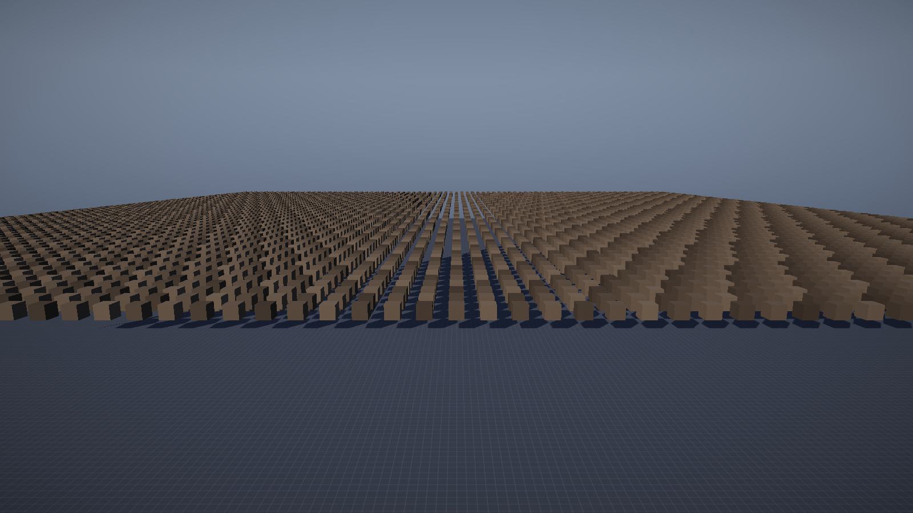

# 第 22 讲：GPU Driven 与间接绘制【进阶·已实现】

> 对应 GAMES104 第 22 讲（GPU Driven / Nanite）。
> 代码：`engine/shaders/Cull.hlsl`、`Renderer::CreateGpuCullResources` /
> `Renderer::GpuCulledDraw` / `Renderer::ReadbackGpuCullStats`、
> `game/CullTestLevel.cpp`。
> 状态：**已实现最小闭环**——compute 视锥剔除 + 间接绘制，压测关卡 6400 个立方体。
> 本讲只讲这条链路上**真实存在**的部分；Hi-Z 遮挡、LOD、meshlet、GPU 骨骼/材质都没有做。



## 0. 本讲地图

| 项 | 内容 |
|---|---|
| 现象 | 6400 个立方体，CPU 逐个视锥剔除 + 每物体一次 draw，主线程提交不过来 |
| 最简实现 | CPU 遍历、变换 AABB、测 6 个平面、逐个 `DrawIndexed` |
| 它怎样坏 | CPU 做几万次浮点运算，GPU 在等命令；draw call 数量随物体数线性涨 |
| 正式方案 | compute shader 剔除 → 压缩可见实例 → GPU 写间接参数 → 一次间接 draw |
| 源码 | `Cull.hlsl`、`CreateGpuCullResources`、`GpuCulledDraw`、`ReadbackGpuCullStats` |
| 边界 | 只做视锥剔除；阴影 pass 仍走 CPU 批处理；没有遮挡/LOD/GPU 材质 |

## 1. 现象：6400 个立方体卡在主线程

`game/CullTestLevel.cpp` 摆了 `80 × 80 = 6400` 个立方体，全部共用 `cube` 网格和
`noise` 纹理；另有地面（`plane` + `grid`）和太阳、相机。渲染器看到的实例是
**6401 个**（6400 个立方体 + 1 个地面）。

CPU 路径每帧要为每个实例做：

```text
// 概念伪代码：CPU 视锥剔除 + 逐物体提交（最简版本）
for each item in scene.items:
    worldAABB = transform(item.mesh.localAABB, item.world)   // 8 个角点
    if not frustum.intersects(worldAABB): continue
    uploadInstance(item)                                     // 144 B
    drawIndexed(item.mesh.indexCount)                        // 每个物体一次
```

6400 个物体就是 6400 次 AABB 变换、6400 次 6 平面测试、最多 6400 次 draw。
主线程在做这些事时，GPU 可能已经画完上一帧在等命令——**CPU 提交成了瓶颈**。

> 本工程实际实现比上面的伪代码好：`BuildBatches` 先按 `(mesh, texture)` 分组，
> 同组用 `DrawIndexedInstanced` 一次画完。所以“每物体一次 draw”是最简版本的失败点，
> 不是本仓库的现状。但即使分了组，CPU 仍要逐实例做剔除、算世界 AABB、计算法线矩阵、
> 填 144 B 实例数据并上传；这些工作没有消失。

## 2. 让 CPU 路径具体地失败

### 2.1 CPU 在算，GPU 在等

```text
CPU: [更新] [剔除 6401 个] [填实例 6401×144B] [上传] [提交 draw] [后处理] ...
GPU:                                                      [等] [画] [等]
```

剔除和填实例是串行的（`BuildBatches` 的 `ParallelFor` 只在 CPU 剔除模式下启用，
GPU 剔除开启时 `cull=false`，见第 20 讲）。CPU 没提交完，GPU 就没有活干。

### 2.2 数据量不大，贵在“逐个处理”

6401 个实例 × 144 B = **921,744 B ≈ 900 KiB**，60 FPS 下约 55 MB/s，对现代 GPU
很小；真正贵的是 CPU 对每个实例的控制流和浮点运算，以及“每个实例都要经过 CPU 的手”。

如果每个物体一次 draw，6400 次提交里包含 6400 次参数设置；批处理能把 draw 数降下来，
但“哪些物体可见”仍要 CPU 先算。GPU Driven 的思路：**把“判断谁可见”也搬到 GPU**，
CPU 只上传实例数据和相机参数，GPU 用几千个线程并行剔除，并直接写间接绘制参数。

## 3. 最小闭环的数据流

```text
 CPU                                        GPU
 ┌──────────────────────┐
 │ m_instances (144B/个)│──UpdateSubresource──▶ StructuredBuffer (SRV, t0)
 └──────────────────────┘                          │
                                                   ▼
                                    ┌──────────────────────────────┐
                                    │ Cull.hlsl：每线程一个实例     │
                                    │ 1) 8 角点 × world → 世界 AABB │
                                    │ 2) 6 个平面做 p-vertex 测试   │
                                    │ 3) 可见：写压缩缓冲 (UAV u0)  │
                                    │    InterlockedAdd(args+4, 1)  │
                                    └──────────────┬───────────────┘
                                                   │
                              ┌────────────────────┴───────────────────┐
                              ▼                                        ▼
                     压缩实例缓冲 (UAV)                        间接参数 (UAV, 5×u32)
                              │                                        │
                              └──────────────┬─────────────────────────┘
                                             ▼
                            DrawIndexedInstancedIndirect(args, 0)
```

CPU 侧只剩：上传实例 → 设置常量 → 每批 dispatch → 每批一次间接 draw。
“可见多少个”由 GPU 写在 `args[1]`（`InstanceCount`）里，CPU 不参与。

## 4. 数学：视锥平面与 p-vertex 测试

### 4.1 平面方程

视锥的 6 个平面由 `viewProj` 提取（Gribb-Hartmann；本工程在
`core/Math.h` 的 `Frustum::FromViewProj`）：平面 `dot(n, p) + d = 0`，内侧满足
`dot(n, p) + d >= 0`。`n` 是已归一化的法线，`p` 是世界空间点，`d` 是常数项。
`FromViewProj` 用 `viewProj` 的 4 个行向量组合出 left/right/bottom/top/near/far
并归一化；`Cull.hlsl` 的 `gPlanes[6]` 就是这 6 个 `(n, d)`。

### 4.2 AABB 的 p-vertex 测试

对每个平面，取 AABB 上“沿法线最远”的角点（p-vertex）：

```text
p = (n.x >= 0 ? max.x : min.x,
     n.y >= 0 ? max.y : min.y,
     n.z >= 0 ? max.z : min.z)

若 dot(n, p) + d < 0 → 整个盒子在平面外侧 → 剔除
```

**数值例子**：平面 `n = (1,0,0)`、`d = 0`（`x = 0`，内侧 `x >= 0`）。

- 盒子 A：`min=(-2,-1,-1)`、`max=(-1,1,1)`。p-vertex 的 x 取 `max.x=-1`，
  `dot=-1<0` → 整个盒子在 `x<=-1`，剔除。
- 盒子 B：`min=(-1,-1,-1)`、`max=(2,1,1)`。p-vertex 的 x 取 `2`，`dot=2>=0` → 保留。

这是**保守**测试：盒子 B 大部分在平面外侧，但只要有角点在内侧就保留。
它可能漏剔除（多画），但绝不会错误剔除（不会把可见物体删掉）；
代价是额外绘制，收益是测试便宜、不会闪。

### 4.3 为什么先变换 8 个角点

物体有旋转/缩放时，世界 AABB 不能只变换 `min/max` 两个点，必须把 8 个角点都变换后
重新求包围盒（与 CPU 的 `BuildBatches` 一致）。GPU 上每实例 8 次
`mul(float4(corner,1), world)`；6400 个实例约 5 万次矩阵乘，对 GPU 是小量，
但这是每实例的固定成本。

## 5. 源码：资源、shader、绘制、回读

### 5.1 资源创建（`CreateGpuCullResources`）

```cpp
// 源码节选：Renderer.cpp（只保留关键字段）
// 源实例 SRV：容量 16384，跨度 144 B
srcDesc.BindFlags = D3D11_BIND_SHADER_RESOURCE;
srcDesc.MiscFlags = D3D11_RESOURCE_MISC_BUFFER_STRUCTURED;
srcDesc.StructureByteStride = sizeof(InstanceVertex);      // 144

// 压缩实例：先尝试 UAV|VB，失败再回退 UAV-only + 复制到普通 VB
compactDesc.BindFlags = D3D11_BIND_UNORDERED_ACCESS | D3D11_BIND_VERTEX_BUFFER;
HRESULT compactHr = dev->CreateBuffer(&compactDesc, nullptr, &m_gpuCompact);
if (FAILED(compactHr)) {
    compactDesc.BindFlags = D3D11_BIND_UNORDERED_ACCESS;
    ...
    m_gpuCompactIsUavOnly = true;   // 绘制前 CopySubresourceRegion 到 m_gpuCompactVB
}

// 间接参数（UAV + DRAWINDIRECT_ARGS）：5 个 UINT
argsDesc.ByteWidth = sizeof(UINT) * 5;
argsDesc.MiscFlags = D3D11_RESOURCE_MISC_DRAWINDIRECT_ARGS;
```

关键事实：

- 源缓冲容量 `m_maxInstances = 16384`（`Renderer::Init` 的 `CreateInstanceBuffer(16384)`），
  16384 × 144 B = **2.25 MiB**；`InstanceVertex` = 9 个 `Vec4` = 144 B
  （世界矩阵 4 列 + 法线矩阵 3 列 + albedo + 参数）；
- 压缩缓冲先尝试 `UAV | VERTEX_BUFFER`；**创建失败**才回退到 UAV-only，
  再用 `CopySubresourceRegion` 拷到普通 VB。注意：不要写成“D3D11 绝对不允许 UAV 与 VB
  同 buffer”；代码写了两条路径；
- 间接参数 5 个 `UINT`：`{IndexCount, InstanceCount, StartIndex, BaseVertex, StartInstance}`；
- `kMaxCullBatches = 32`，每批独立的 args 缓冲/UAV；回读 staging 大小
  `5 × 4 × 32 = 640 B`。非空批次超过 32 时整帧回退 `DrawBatches` 并告警，
  不再静默丢弃第 33 个及以后的批次。

### 5.2 compute shader（`Cull.hlsl`）

```hlsl
// 源码节选：shaders/Cull.hlsl（省略 TestCorner 的 8 次调用）
[numthreads(64, 1, 1)]
void CSMain(uint3 id : SV_DispatchThreadID)
{
    if (id.x >= gInstanceCount) return;
    const Instance inst = gSource[gSourceOffset + id.x];
    const float4x4 world = float4x4(inst.c0, inst.c1, inst.c2, inst.c3);
    float3 mn = 1e30, mx = -1e30;
    // 变换 8 个角点，得到世界 AABB
    [unroll] for (int i = 0; i < 6; ++i) {
        const float3 n = gPlanes[i].xyz;
        const float3 p = float3(n.x >= 0 ? mx.x : mn.x, ...);   // p-vertex
        if (dot(n, p) + gPlanes[i].w < 0.0) return;
    }
    uint slot = 0;
    gArgs.InterlockedAdd(4, 1, slot);   // 字节偏移 4 = InstanceCount
    gCompact[slot] = inst;              // 整块 144 B 追加
}
```

- 线程组 64 个线程，`Dispatch((batch.count + 63) / 64, 1, 1)`；
- **矩阵约定**：实例的 `c0..c3` 按“列拼成行向量”使用，必须
  `mul(float4(corner,1), world)`（行向量左乘），不是 `mul(world, v)`。写反会让
  世界 AABB 完全错误；
- `InterlockedAdd(4, 1, slot)` 的 `4` 是**字节偏移**，落在 `InstanceCount`；
  返回旧值作为压缩槽位，每个可见实例拿到唯一 `slot`；
- 压缩缓冲与源缓冲布局一致，顶点着色器不用改，直接把它当 instance data 绑定。

### 5.3 绘制（`GpuCulledDraw`）

```cpp
// 源码节选：Renderer.cpp（省略部分参数设置）
ctx->UpdateSubresource(m_gpuInstanceSource.Get(), 0, nullptr, m_instances.data(), 0, 0);
for (const Batch& batch : m_batches) {
    params.sourceOffset = batch.firstInstance;
    params.instanceCount = batch.count;
    params.localMin = Vec4(batch.mesh->Bounds().min, 0);
    params.localMax = Vec4(batch.mesh->Bounds().max, 0);
    m_cullParams.Update(ctx, params);

    const UINT args[5] = {batch.mesh->IndexCount(), 0, 0, 0, 0};  // 每批重置
    ctx->UpdateSubresource(m_gpuArgs[slot].Get(), 0, nullptr, args, 0, 0);

    ctx->CSSetShader(m_cullShader.CS(), nullptr, 0);
    ctx->CSSetConstantBuffers(0, 1, &cbuf);
    ctx->CSSetShaderResources(0, 1, &srv);
    ctx->CSSetUnorderedAccessViews(0, 2, uavs, nullptr);   // u0=compact, u1=args
    ctx->Dispatch((batch.count + 63) / 64, 1, 1);

    ctx->CSSetUnorderedAccessViews(0, 2, nullUav, nullptr); // 解绑后才能当 VB
    ctx->CSSetShaderResources(0, 1, nullSrv);
    ctx->IASetVertexBuffers(0, 2, buffers, strides, offsets);
    ctx->DrawIndexedInstancedIndirect(m_gpuArgs[slot].Get(), 0);
}
```

**每批重置 args 是必须的**。`InstanceCount` 由 GPU 从 0 开始累加；如果沿用上一帧的
值，draw 会画多（读到压缩缓冲里未初始化的槽位），表现为花屏或物体错位。

### 5.4 同步点与数据流

```text
CPU: UpdateSubresource(实例 900 KiB)  →  dispatch  →  DrawIndirect
GPU: 读 SRV + 常量 → 写 compact/args → 读 args 决定画多少 → 读 compact 当实例数据
```

- `UpdateSubresource` 是 CPU 到 GPU 的拷贝；D3D11 运行时会处理“上一帧还在读”的
  情况（可能阻塞 CPU 或内部复制），教学规模下不是瓶颈；
- compute 写 `gCompact`/`gArgs`，随后同一命令流里 `DrawIndexedInstancedIndirect`
  读它们。代码在 draw 前**解绑 UAV 和 SRV**，这是 D3D11 的要求（同一资源不能同时
  绑为 UAV 和 VB/IB）；驱动会在 UAV 写和 VB 读之间插入必要的同步；
- `ReadbackGpuCullStats` 每 30 帧把 5 个 `UINT` 拷到 staging，再 `Map(READ)`。
  `Map` 会等待 GPU 完成拷贝，是**CPU/GPU 同步点**；所以不能每帧做。
- 统计面板的“GPU 剔除: 可见实例 N”有最多 30 帧延迟；日志里的 `GPU可见` 也是回读值。

## 6. 小例子：3 个实例、2 个平面

设一批 3 个实例，局部 AABB 都是单位立方体；简化成只测两个平面：

- 平面 0：`n=(1,0,0)`、`d=0`（内侧 `x >= 0`）
- 平面 1：`n=(-1,0,0)`、`d=10`（内侧 `x <= 10`）

| 实例 | 世界位置 x | 世界 AABB | 平面 0 | 平面 1 | 结果 |
|---|---|---|---|---|---|
| 0 | -5 | x ∈ [-5.5,-4.5] | 剔除 | — | 不可见 |
| 1 | 2 | x ∈ [1.5,2.5] | 通过 | 通过 | 可见，slot 0 |
| 2 | 12 | x ∈ [11.5,12.5] | 通过 | 剔除 | 不可见 |

裁剪前 args（`Cull.hlsl` 的布局），以及实例 1 执行 `InterlockedAdd(4,1,slot)`
（返回旧值 0）之后的状态：

```text
裁剪前: [IndexCount=36, InstanceCount=0, StartIndex=0, BaseVertex=0, StartInstance=0]
dispatch 后: [36, 1, 0, 0, 0]；compact[0] = 实例 1 的 144 B
```

`DrawIndexedInstancedIndirect` 读到的 `InstanceCount=1`，只画实例 1。
实例 0、2 从未写入 compact，也不占绘制数量。

## 7. 实验（历史记录，本次未实际运行）

本环境是 Linux，不能运行 Windows exe。下面的命令和数字来自仓库历史记录，
**没有在本机复跑**，只能作为“应该看到什么”的参考：

```bat
:: GPU 剔除（默认开启）
build\bin\ErMao.exe --level cull --play --noeditor --frames 90
:: 记录：实例 6401 | GPU可见 5683

:: 关闭 GPU 剔除（走 CPU 视锥剔除）
build\bin\ErMao.exe --level cull --play --noeditor --no-gpu-cull --frames 90
:: 记录：实例 5683
```

两条路径的**可见实例数**应一致（历史记录都是 5683）：GPU 剔除开启时，CPU 上传全部
6401 个实例，GPU 只画 5683 个；关闭时，CPU 先剔除，只上传/绘制 5683 个。这是最重要的
正确性验证——如果差很多，优先查矩阵约定、平面方向、批次的 `sourceOffset`。

统计面板的“绘制调用 7”包含阴影、天空、主不透明、后处理等所有 pass，不是
“7 次间接绘制”；主不透明实际是每批一次间接 draw（立方体 + 地面 = 2 批）。
把相机转向天空，可见实例会掉到个位数，说明剔除在工作。

## 8. 这条链路做到了什么、没做什么

| 项 | 本工程 | 工业引擎 |
|---|---|---|
| 剔除内容 | 视锥 6 平面 | 视锥 + Hi-Z 遮挡 + LOD 选择 |
| 绘制 | 每批一次 `DrawIndexedInstancedIndirect` | 单次 multidraw / meshlet / 虚拟几何 |
| 材质 | 每批绑纹理 + PBR shader | bindless 纹理 + 材质表 |
| 骨骼 | 独立 `SkinnedPass`，CPU 算骨骼矩阵 | GPU 骨骼纹理 / GPU skinning |
| 阴影 | `ShadowPass` 仍用 `DrawBatches` 画全部实例 | 阴影也 GPU 剔除/缓存 |

**明确没有做的**：Hi-Z 遮挡剔除、LOD、meshlet/虚拟几何、GPU 骨骼、GPU 材质、
多 Pass 全 GPU 驱动。这条链路只把“视锥测试 + 间接参数”搬到了 GPU；
实例上传、法线矩阵求逆、批次排序、阴影提交仍在 CPU。方向是对的，但别把它当成
“完整 GPU Driven”。

## 9. 练习（故意改坏）

1. 把 `gPlanes[i]` 的法线取反：**预期**可见性整体反过来（黑屏或全部保留），
   取决于测试方向。
2. 把 `InterlockedAdd(4, 1, slot)` 的偏移改成 0：**预期** `IndexCount` 被当成计数器，
   draw 的索引数错乱，画面破碎。
3. 不重置每批的 args：**预期** `InstanceCount` 跨帧/跨批累加，画到未初始化槽位，
   出现花屏或随机实例。
4. 把 `mul(float4(corner,1), world)` 写成 `mul(world, float4(corner,1))`：
   **预期**世界 AABB 错位，GPU 剔除结果与 CPU 不一致。
5. 把 `gSourceOffset` 恒设为 0：**预期**每个批次都从源缓冲开头读，后一批画到前一批的
   实例，物体重复/错位。

## 10. 自测题（含答案）

1. **p-vertex 测试为什么是保守的？**
   它只检查“沿法线最远”的角点；该点在平面内侧时，盒子仍可能整体在平面外。
   所以会漏剔除，但不会错删可见物体。

2. **`InterlockedAdd` 在 args 的偏移 4 上自增，对应哪个字段？**
   `InstanceCount`（5 个 `UINT` 的第 2 个，字节偏移 4）。

3. **为什么 GPU 剔除开启后 CPU 仍然很忙？**
   `BuildBatches` 仍要串行压缩/排序/填 144 B 实例、计算法线矩阵并上传 900 KiB；
   GPU 只接管了视锥测试。阴影 pass 也仍用 CPU `DrawBatches`。

## 数学依据与参考资料

> 目的：不要求背下推导，但要知道这一讲**用的是什么数学工具**、去哪里查。

| 用到的原理 | 数学形式 / 名称 | 参考 |
|---|---|---|
| 视锥平面提取 | Gribb-Hartmann，`dot(n,p)+d >= 0` | [RTR4]；[GAMES101] |
| AABB 剔除 | 6 平面 p-vertex 测试（保守） | [RTR4]；[CULL] |
| GPU 间接绘制 | `DrawIndexedInstancedIndirect` + 参数缓冲 | [CULL] |
| 并行压缩 | `InterlockedAdd` 原子追加到压缩列表 | [CULL] |
