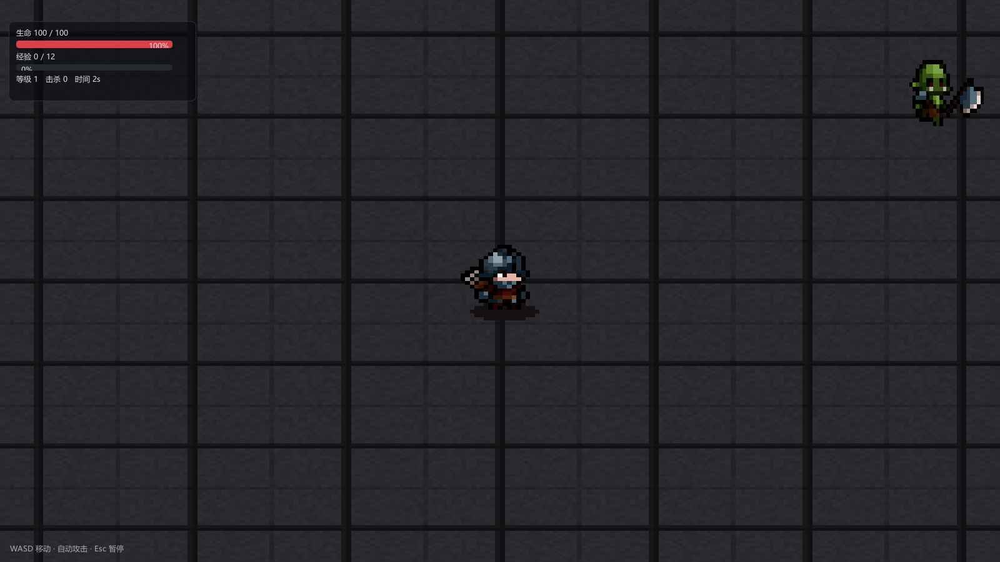

# 第 23 讲：2D 渲染与像素风游戏【进阶·已实现】

> 对应 GAMES104 第 4/7 讲的 2D 变体，外加一个可玩的 2D Demo。
> 代码：`engine/shaders/Sprite.hlsl`、`Renderer::SpritePass`、`renderer/Camera.h`（`Camera2D`）、
> `scene/Components.h`（`SpriteRendererComponent` / `SpriteAnimatorComponent`）、
> `game/Survivors.*`、`scene/World.cpp`（`BuildRenderScene`）。2D 素材：`soldier_*`/`orc_*`/`arrow.png`
> 来自用户提供的 Tiny RPG Character Asset Pack 01（包内未附许可，商用前需确认）；`kenney_tilemap.png` 为 CC0 且当前未使用。
> 状态：**已实现**——`--demo2d` 一键演示；编辑器里选「关卡 · 2D 幸存者 Demo」也能玩。术语见 [术语表](术语表.md)。
> 本环境是 Linux，只能读代码；第 9 节实验**未实际运行**，只写条件性预期。



## 0. 先看屏幕上的三件事

截图是 1600×900 的一帧：中间一个拿剑的像素小人，右上角一只兽人，背景是深色石砖地面；
左上角 HUD 是生命 / 经验 / 等级 / 击杀 / 时间。

1. **小人怎样出现？** 它是一张 PNG，为什么只显示其中一帧、能翻转、被击中会变红？
2. **按 D 为什么往右？** 没有刚体、没有速度积分，位置怎么变？
3. **攻击时发生什么？** 代码里没有挥剑：角色停在原地，`attackInterval`（默认 0.75 s）到点后
   朝最近的敌人**射箭**；`soldier_attack.png` 素材存在，但当前玩法没有使用。

> 底部提示写「Esc 暂停」，可 `SurvivorsDirector::State::Paused` 在源码里**没有任何赋值点**。
> 编辑器外按 Esc 不会暂停；编辑器里暂停的是编辑器本身。第 7 节再对代码。

## 1. 概念卡

| 项 | 内容 |
|---|---|
| 问题 | 2D 游戏怎样在 3D 引擎里画？和 3D 管线差在哪？ |
| 一句话直觉 | 相机换成正交投影，网格换成带纹理的矩形，深度换成绘制顺序。 |
| 数学 | 正交投影；世界 XY → NDC；UV 子矩形取序列帧；按相邻同纹理合批。 |
| 代码 | `Camera2D`、`SpritePass`、`SpriteRendererComponent`、`SpriteAnimatorComponent`、`Survivors`。 |
| 实验 / 差距 | `--demo2d`、`ErMaoSurvivors.exe`；无 Tilemap 编辑器、2D 骨骼、2D 光照、Box2D。 |

## 2. 最简实现：一个 quad + 正交投影 + 一张贴图

先缩到最小：屏幕上只有一个小人，贴图就是它本身，没有动画、跟随和 UI。

**概念伪代码（不是仓库实现）**

```cpp
struct Sprite { Vec2 center; Vec2 size; Texture* tex; };
for (const Sprite& s : sprites) {
    float x0 = s.center.x - s.size.x * 0.5f, x1 = s.center.x + s.size.x * 0.5f;
    float y0 = s.center.y - s.size.y * 0.5f, y1 = s.center.y + s.size.y * 0.5f;
    Vertex v[6] = {                                  // 注意 v：世界底部用 v=1
        {{x0,y0},{0,1}}, {{x1,y0},{1,1}}, {{x1,y1},{1,0}},
        {{x0,y0},{0,1}}, {{x1,y1},{1,0}}, {{x0,y1},{0,0}} };
    Draw(v, 6, s.tex);                               // 一个精灵一次 draw
}
// 上面用到的正交矩阵（每帧一次）：Orthographic(cx-hw, cx+hw, cy-hh, cy+hh, -1, 1)
```

四步：算正交矩阵、按中心/尺寸摊开四角、给每个角配 UV、画两个三角形。**为什么正交（Orthographic Projection）**：
透视投影「近大远小」，2D 要「远近一样大」，矩阵里不出现 `1/z`。`Camera2D` 的 `Mat4::Orthographic`
把 `[l,r]×[b,t]` 线性映射到 `[-1,1]²`：

```
x_ndc = 2(x - l)/(r - l) - 1
y_ndc = 2(y - b)/(t - b) - 1
h = halfHeight / zoom，w = h * aspect
```

**数值例子**：1600×900，`halfHeight = 6.4`（`Engine::RenderViewportScene` 的 2D 路径写死），
`aspect = 1.7778`，`w = 11.378`。世界 `(0,0)` → NDC `(0,0)` → 屏幕中心；`(11.378,6.4)` → 右上角。
一个世界单位 = `900/12.8 = 70.3` 像素。**为什么 v 反过来**：D3D 纹理坐标原点在左上（v=0 在上、向下增大），
世界 y 朝上，所以精灵底边配 `v=1`；写反的典型现象是角色倒立。

## 3. 最简实现在哪里坏掉

**3.1 一张图里有多帧。** `soldier_idle.png` 是 600×100（6 帧 100×100 横排），`soldier_walk.png` 是
800×100（8 帧）。UV 若永远取 0..1，整张 600 像素被压进 1.8 单位的 quad，屏幕上就是**六个小人并排**。

**3.2 每个精灵一次 draw。** 假想地面按 1×1 铺满 56×30，就是 1680 个精灵、1680 次 draw，每次都切纹理、
设状态，CPU 开销随精灵数线性涨。（仓库没有真的铺 1680 块，见 §4.3。）

**3.3 像素被糊。** 900p 下 1 单位 = 70.3 像素，玩家 quad 1.8 单位 = 126.6 像素，而每帧贴图只有 100 像素，
放大 **1.266 倍**。线性过滤会把硬边插成灰边；开 mipmap 后缩小时又会选到更糊的级别。

**3.4 相机与 UI。** 不跟随会走出屏幕；直接跟随又要处理边界，且血条/飘字必须用同一台相机
做世界→屏幕投影，否则和精灵错位。

## 4. 正式方案

### 4.1 精灵是什么数据

**源码节选：`scene/Components.h`**

```cpp
class SpriteRendererComponent : public Component {
public:
    std::string texture = "sprites/soldier_idle.png"; // assets/ 下的相对路径
    Vec4        uv{0.0f, 0.0f, 1.0f, 1.0f};          // u0, v0, u1, v1
    Vec2        size{1.2f, 1.2f};                     // 世界单位
    Vec2        offset{0.0f, 0.0f};
    Vec4        color{1.0f, 1.0f, 1.0f, 1.0f};
    bool        flipX = false;
    int         layer = 0;                            // 越小越先画
    float       rotation = 0.0f;                      // 绕中心旋转（弧度）
};
```

它只说「用哪张图、取哪块 UV、在世界哪里、多大、什么颜色、第几层」，不认识顶点、矩阵和 D3D11。
`World::BuildRenderScene` 把它翻译成扁平 `SpriteDraw`（`texture`/`dest`/`uv`/`color`/`flipX`/`rotation`），
`dest` 来自 `WorldPosition()+offset`，`rotation` 叠加 Transform 的 Z 旋转。这就是 2D 与 3D 的共同点：
**场景层只产出数据，渲染层不认识 GameObject**。

### 4.2 子矩形 UV（Sub-rect UV）与序列帧

序列帧（Sprite Sheet）第 `i` 帧的 u 区间是 `[i/N, (i+1)/N]`；素材每帧的 100×100 里角色只占中间一块，
所以单帧内部还要再乘一次 `[frameMin, frameMax]`。**源码节选：`scene/Components.cpp` `SpriteAnimatorComponent::OnUpdate`**

```cpp
columns = texture && texture->Height() > 0
              ? static_cast<int>(texture->Width() / texture->Height()) : 1;
...
const float width = 1.0f / static_cast<float>(columns);
const float u0 = width * static_cast<float>(m_frame) + width * frameMin.x;
const float u1 = width * static_cast<float>(m_frame) + width * frameMax.x;
sprite->uv = Vec4(u0, frameMin.y, u1, frameMax.y);
```

`columns` 默认**按贴图宽高比推断**（只对正方形帧成立：600/100=6，800/100=8），也可用
`columnsOverride` 指定。玩家的 `frameMin=(0.410,0.380)`、`frameMax=(0.580,0.600)`。
**数值例子**：`soldier_idle.png` 6 列，`frameWidth=1/6≈0.1667`。第 3 帧（从 0 数）：
u0 = `0.1667×3 + 0.1667×0.410 = 0.5683`，u1 = `0.5 + 0.1667×0.580 = 0.5967`，v0=0.380，v1=0.600。
换算成像素：u 宽 `0.0284×600 = 17 px`，v 高 `0.220×100 = 22 px`，角色只占单帧的 **3.74% 面积**；
不裁就只剩一个「小点站在大块透明里」。

### 4.3 精灵批处理（Sprite Batching）：连续的同纹理精灵合成一段

**源码节选：`renderer/Renderer.cpp` `SpritePass`**

```cpp
struct Run { const Texture* texture = nullptr; u32 first = 0; u32 count = 0; };
for (const SpriteDraw& sprite : scene.sprites) {
    if (!sprite.texture) continue;
    if (runs.empty() || runs.back().texture != sprite.texture)
        runs.push_back({sprite.texture, static_cast<u32>(m_spriteVertices.size()), 0});
    // ... 生成 6 个顶点，flipX 交换 u0/u1，rotation 绕中心旋转 ...
    runs.back().count += 6;
}
for (const Run& run : runs) { run.texture->BindPS(ctx, 0); ctx->Draw(run.count, run.first); }
```

三个要点：

1. **只合并相邻的相同纹理**。`BuildRenderScene` 只按 `layer` 做 `stable_sort`，**没有**在层内按纹理
   排序；同层 A、B、A 交替会产生 3 段。当前关卡每层一种纹理，才刚好「一层一段」。
2. **顺序就是深度**。`SpritePass` 开头 `SetDepthNone`（不测试也不写深度），后画覆盖先画；
   `layer` 是 2D 的 z：地面 -10、敌人 1、箭 2、宝石 3、玩家 5。
3. **当前关卡最多 5 段**：地面 `floor_big`、敌人 `orc_walk.png`、箭 `arrow.png`、宝石 `gem_proc`、
   玩家 `soldier_idle/walk.png` 各一段。这是从对象和纹理推出来的，不是实测 draw 数。

### 4.4 像素风采样

**源码节选：`renderer/Renderer.cpp` `SpritePass`**

```cpp
RenderStates::SetDepthNone(ctx);
RenderStates::SetAlphaBlend(ctx);
RenderStates::SetCullNone(ctx);
Texture::BindSampler(ctx, 0, D3D11_FILTER_MIN_MAG_MIP_POINT, D3D11_TEXTURE_ADDRESS_CLAMP);
```

- `MIN_MAG_MIP_POINT`（最近邻采样）：放大/缩小都取最近 texel，硬边保留；`CLAMP` 防止图集边缘串色。
- **容易写错**：常见说法是「纹理创建时 mipmap 关闭」，但 `GetTextureAsset` 调的是
  `CreateFromFile(device, path, true)`，第三个参数是 **sRGB**；`CreateFromFile` 内部固定
  `CreateFromRGBA(..., srgb, true)`，**mip 链仍会生成**。不糊是因为采样器对 mip 也用 POINT；
  `Sprite.hlsl` 顶部注释也写「纹理关闭 mipmap」，同样与实现不符。
- **像素完美还没做到**：`126.6/100 = 1.266` 不是整数倍，一部分像素占 1 个屏幕像素、一部分占 2 个；真要完美，得让世界单位与屏幕像素整数对齐，或渲染到低分辨率 RT 再整数放大。

### 4.5 2D 相机与跟随

`Camera2D::ViewProjection` 里 `h = halfHeight / zoom`、`w = h * aspect`，近/远平面取
`-1` 和 `1`，精灵统一 `z=0`。`zoom` 字段存在，但**2D 游玩路径从不设置它**，恒为 1；
编辑器 2D 视图用的是 `camera.orthoHeight * 0.5`。

`Engine::RenderViewportScene` 里 2D 相机**硬跟随**玩家：`halfHeight = 6.4f`，位置取
`Clamp(player.x, -20, 20)` 和 `Clamp(player.y, -8, 8)`，没有插值、没有 look-ahead。「为了像素稳定没做插值」这句话是对的，
但代码里本来也没有平滑代码。

边界夹取是经验常数，不是按地图算的：地面 56×30（半宽 28、半高 15），相机夹在 x∈[-20,20]、y∈[-8,8]。
1600×900 时 `halfWidth=11.378`，`x=20` 时右边缘到 `31.378`，已超出地面半宽 28，**能看到地面外的清屏色**。
要做对，上限应是 `28 - 11.378 = 16.62`。

### 4.6 2D 与 3D 管线的区别

| 环节 | 3D | 2D |
|---|---|---|
| 投影 | 透视 `Perspective`（近大远小） | 正交 `Orthographic`（远近同大） |
| 几何 | 网格 + 索引 + 实例化 | 每精灵 6 顶点，同纹理合成一段 |
| 深度 | 深度缓冲（Depth Buffer）+ 深度测试 | **无深度**，按 `layer` 顺序绘制 |
| 光照 | PBR + 阴影 + 点光 | 无（贴图 / 染色 / 顶点色） |
| 采样/后处理 | 各向异性 + mipmap + HDR | POINT；**跳过**后处理，直画视口 |

2D 路径在 `Renderer::RenderInternal` 里**提前 return**：清屏、设视口、`SpritePass`，
不跑阴影/天空/不透明/后处理。所以 2D 颜色就是贴图颜色，没有色调映射。

## 5. 回到仓库：谁调用谁

```
Engine::RenderViewportScene
  ├─ World::BuildRenderScene(scene, viewCamera)   // 收集 SpriteDraw，按 layer stable_sort
  │    └─ AssetManager::GetTextureAsset(...)      // 懒加载 + 缓存
  ├─ (2D) scene.is2D = true; scene.camera2D = camera2D
  └─ Renderer::RenderToViewport → RenderInternal
       └─ if (scene.is2D) { Clear; SpritePass(ctx, scene, aspect); return; }
```

| 功能 | 位置 |
|---|---|
| 正交相机 / 数据收集 | `renderer/Camera.h` `Camera2D::ViewProjection`；`scene/World.cpp` `BuildRenderScene` |
| 精灵绘制 / 合批 | `renderer/Renderer.cpp` `SpritePass`；`engine/shaders/Sprite.hlsl` |
| 精灵组件 / 动画 | `scene/Components.h/.cpp` `SpriteRendererComponent` / `SpriteAnimatorComponent` |
| 2D 入口 / 玩法 | `Renderer::RenderInternal` 的 `scene.is2D` 分支；`game/Survivors.cpp` |

**地面其实只有一个精灵。** `BuildSurvivorsLevel` 先生成 32×32 石砖，重复成 512×512（16×16 块），
注册成 `floor_big`，再用 `SpawnSprite(world, "地面", "floor_big", Vec2(0,0), Vec2(56,30), -10)` 一个精灵铺满地图。
所以地面是 1 段，不是 1680 段。顺带一个可验证的细节：512×512 的 16×16 块铺到 56×30 上，每块在世界上
是 3.5 宽、1.875 高，**砖块被横向拉宽**（约 1.87:1）——这是「预重复贴图省 draw」的代价。

**输入、移动与碰撞**（`SurvivorsPlayerComponent::OnUpdate`）：WASD 用 `Input::IsKeyDown` 改 `move`，
`SafeDir` 归一化（斜向不会更快），`position += direction * speed * dt`（speed=4.6），再 `Clamp` 到
`arenaHalf=(27,14.5)`。没有加速度、摩擦、刚体，所以帧率无关但也没有惯性。碰撞全是**圆-圆距离**：
箭命中 `<0.55`、敌人咬到玩家 `<=0.85`、宝石拾取 `<0.45`、吸附 `<4.5`；这些半径和精灵尺寸
（玩家 1.8、兽人 1.7）只是大致对应。移动时换 `soldier_walk.png` 并 `Play(12)`，停下换回
`soldier_idle.png` 并 `Play(6)`；`flipX = direction.x < 0`，`SpritePass` 交换 `u0/u1` 实现翻转。

**HUD 与战斗反馈**：`SurvivorsDirector::DrawUI` 用 ImGui 画 HUD/菜单/结算；
`DrawCombatFeedback` 用 `ImGui::GetForegroundDrawList()` 画头顶血条和伤害数字。
它没有用 `Camera2D::ScreenToWorld`，而是自己反推正交投影（源码节选 `DrawCombatFeedback`）：

```cpp
const float halfH = camera.halfHeight / zoom;
const float halfW = halfH * (viewportWidth / viewportHeight);
auto project = [&](const Vec2& position) {
    return ImVec2(viewportX + (position.x - (camera.position.x - halfW)) / (2.0f * halfW) * viewportWidth,
                  viewportY + ((camera.position.y + halfH) - position.y) / (2.0f * halfH) * viewportHeight);
};
```

这是 §2 公式的逆运算：先平移到 `[0,2halfW]`，再除以宽度乘视口宽；y 反过来因为屏幕 y 向下。
**血条和精灵必须用同一台相机**，否则移动时对不上。

## 6. 一个精灵的完整演算

设 1600×900、手工把相机固定在 `(0,0)`、`halfHeight=6.4`，玩家在 `(3.2,-1.4)`，静止（`soldier_idle.png`）。

```
x_ndc = 3.2 / 11.378 = 0.2813      y_ndc = -1.4 / 6.4 = -0.21875
px = (0.2813*0.5 + 0.5) * 1600 = 1025.0
py = (0.5 - (-0.21875)*0.5) * 900 = 548.4
```

quad 宽 1.8 → NDC 宽 `2*1.8/22.756 = 0.1582` → 屏幕 `0.1582*0.5*1600 = 126.6` 像素，与 §3.3 一致。
x 从 `2.3` 到 `4.1`，y 从 `-2.3` 到 `-0.5`；左下 `(2.3,-2.3)` 配 `(u0,v1)`、右上 `(4.1,-0.5)` 配
`(u1,v0)`，其中 `u0=0.5683, u1=0.5967, v0=0.380, v1=0.600`（§4.2 第 3 帧）。
绘制顺序（layer 排序后）：地面(-10, `floor_big`) → 兽人(1, `orc_walk.png`) → 箭(2, `arrow.png`) →
宝石(3, `gem_proc`) → 玩家(5, `soldier_idle.png`)。每层一种纹理 → 5 段；玩家最后画，永远盖在最上面。

## 7. 玩法：从按键到伤害数字

`game/Survivors.cpp` 没有独立 GameMode，玩法就是几个组件 + 一个导演：

| 角色 | 组件 | 关键数值（默认） |
|---|---|---|
| 玩家 | `SurvivorsPlayerComponent` | 速度 4.6、生命 100、攻击 12、间隔 0.75 s、射程 9、箭速 14 |
| 敌人 | `SurvivorsEnemyComponent` | 速度 1.9、生命 18、伤害 8、间隔 0.8 s、经验 3 |
| 箭 / 宝石 | `SurvivorsProjectileComponent` / `SurvivorsGemComponent` | 箭寿命 1.6 s、命中 0.55；宝石吸附 4.5、拾取 0.45 |
| 导演 | `SurvivorsDirector` | 波次、菜单、HUD、结算 |

**升级**（`AddXp`）：等级 +1、`attackDamage += 4`、`xpNext *= 1.35`、`m_levelIntervalScale *= 0.9`
（下限 0.25）、`maxHp += 8`；攻击间隔 = `Clamp(0.75 × levelScale × killScale, 0.07, 0.75)`。
**击杀加成**（`ApplyKillCount`）：`killScale = 1/(1+0.03×kills)`，10 杀时 `1/1.3=0.769`，间隔 0.577 s。
**波次**（`SpawnWave`）：`count = 2 + floor(t/15)`，半径 13~17 的圆环上刷，间隔 `max(0.9, 2.4-0.01t)`，
敌人上限 120，生命/速度随时间线性放大。

状态机（与源码一致）：

```
Menu --开始--> Playing --hp<=0--> GameOver --重新开始--> Playing
  ^                                  |
  +-----------返回主菜单--------------+
```

`State::Paused` 有 UI 分支但没有赋值点，所以不在图里。编辑器里的「暂停」是 `Editor::Pause()`，
它让 `UpdateGameplay` 直接 return（World 组件不再更新），且主循环也不再 tick 三个玩法导演，
但 `m_state` 仍是 `Playing`、`DrawUI` 照常画 HUD，
所以那个带音量滑条的暂停菜单**仍然进不去**。

## 8. 失败模式与排查

| 现象 | 原因 | 排查入口 |
|---|---|---|
| 角色倒立 | quad 的 v 配反 | 看 `SpritePass` 里 `p00` 是不是 `v1` |
| 角色被压成几个小人 | UV 还是 0..1，没取单帧 | 看 animator 的 `columns` 与 `uv` |
| 角色只有很小一点 | 没裁 `frameMin/frameMax` | 打印当前 `sprite->uv`，对照 17×22 |
| 像素边缘发糊 | 采样器不是 POINT | `SpritePass` 的 `BindSampler` |
| 精灵顺序错 | 同 layer 依赖插入顺序 | `BuildRenderScene` 是 `stable_sort` |
| 一片黑 | `scene.is2D` 没设 / 相机错 / 纹理加载失败 | 看 `RenderViewportScene` 与 `GetTextureAsset` 日志 |
| 地图边缘看到底色 / Esc 不暂停 | 夹取范围大于「地面半宽−视口半宽」；`State::Paused` 无赋值点 | `Clamp(x,-20,20)` 与 56×30；搜 `m_state = State::Paused` |
| 2D 没光照/阴影 | 2D 分支提前 return，属设计 | `Renderer::RenderInternal` |

## 9. 实验（本次未实际运行）

本环境是 Linux，仓库只支持 Windows/D3D11，以下命令**没有在本机执行**，只给条件性预期与排查入口。
```bat
build\bin\ErMao.exe --demo2d --frames 600 --screenshot survivors.png
build\bin\ErMao.exe --level survivors
dist\ErMaoSurvivors-Windows\ErMaoSurvivors.exe
```

1. **确认投影尺寸**：1600×900 静止，截图量玩家 quad 宽，预期约 126 像素（1.8×70.3）。
2. **UV 改回整张图**：`frameMin/frameMax` 改 0/1，预期 6 个小人并排压进同一个 quad。
3. **换采样器**：POINT → LINEAR，预期像素边缘变灰、细节发糊。
4. **数 draw**：清场后地面 + 玩家预期 2 段，敌人/箭/宝石出现后最多 5 段；看
   `Renderer::Stats().drawCalls`，别用帧率判断合批。

## 10. 练习与自测

**练习（先猜再改）**：① 删掉 `flipX` 交换 `u0/u1`——预期向左走仍朝右；② `layer` 全改 0——预期顺序
退化为创建顺序，角色会被后创建的敌人/箭盖住；③ 忽略 `rotation`——预期箭永远水平飞；④ 去掉相机 `Clamp`——预期地图外
看到清屏色。

**自测题（答案在小节）**：① 2D 的「深度」是什么，为什么可以不写深度缓冲？→ §4.3；② 800×100 序列图
几帧、u 区间怎么算？→ §4.2；③ 为什么 POINT 就够、mip 却不是「关掉」的？→ §4.4；④ 相机夹在 x=20，
1600×900 下为什么还能看到地面外？→ §4.5（`20+11.378 > 28`）；⑤ 血条为什么不能直接用世界坐标画？
→ §5（同一台相机投影 + y 翻转）。

## 11. 与工业 2D 引擎的差距

| 项 | 本工程 | 工业（Unity/Godot） |
|---|---|---|
| 地图 | 代码铺一张预重复贴图 | Tilemap 编辑器 + 自动图集 |
| 动画 | 序列帧 + 帧内裁切 | Spine/DragonBones 骨骼动画、状态机 |
| 光照 / 物理 / 相机 | 无 2D 光照；手写圆-圆距离；硬跟随 + 常数夹取 | 2D 法线贴图光照；Box2D；平滑跟随、边界约束 |
| 像素完美 / 合批 | 未做整数对齐；相邻同纹理分段 | 像素完美相机 + 低分辨率 RT；图集 + SRP Batcher |

## 数学依据与参考资料

> 目的：不要求背下推导，但要知道这一讲**用的是什么数学工具**、去哪里查。

| 用到的原理 | 数学形式 / 名称 | 参考 |
|---|---|---|
| 正交投影 | `x_ndc = 2(x−l)/(r−l) − 1`；`y_ndc = 2(y−b)/(t−b) − 1` | [RTR4] §2.6；[GAMES101] 变换 |
| 世界 ↔ 屏幕 | `px = (x_ndc·0.5+0.5)·W`，`py = (0.5−y_ndc·0.5)·H` | [RTR4] |
| 序列帧 UV | `u ∈ [i/N, (i+1)/N]`，再乘帧内 `[frameMin, frameMax]` | [RTR4] 纹理坐标 |
| 精灵批处理 | 按相邻同纹理分组，减少状态切换与 draw | [SPRITE] |
| 纹素密度 | 屏幕像素/世界单位 = `H / (2·halfHeight)` | [RTR4] 采样与走样 |
