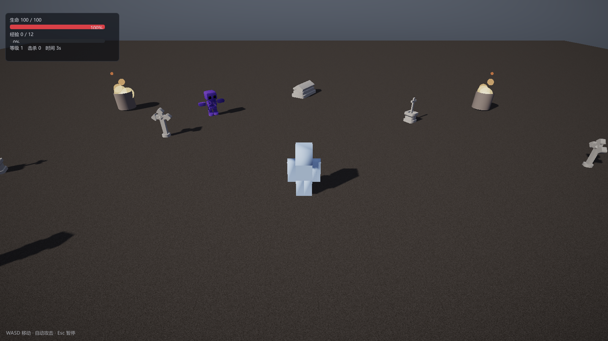

# 第 24 讲：3D 幸存者——外部模型、材质与特效【进阶·已实现】

> 对应 GAMES104 第 3/4/12 讲的综合实践：把"程序化几何"换成**下载来的 OBJ 模型**，
> 并给 2D 幸存者做一个 3D 版本。
> 代码：`game/Survivors3D.*`、`asset/ObjLoader.cpp`、`AssetManager::GetMeshAsset`、
> `shaders/Particle.hlsl`、`Renderer::ParticlePass`。
> 运行：`--demo3d`，或 `dist/ErMaoSurvivors3D-Windows/ErMaoSurvivors3D.exe`。



---

## 0. 概念卡

| 项 | 内容 |
|---|---|
| 问题 | 怎样让引擎吃外部美术资源，并做一个 3D 刷子游戏？ |
| 一句话直觉 | 2D 的"精灵"换成 OBJ 网格；"绘制顺序"换回深度缓冲；相机从正交换成跟随的透视。 |
| 数学 | 透视投影、look-at 的 yaw/pitch 反解、OBJ 索引去重、加法混合。 |
| 代码 | `LoadObjMesh`、`GetMeshAsset`、`MeshRenderer`、`ParticlePass`。 |
| 实验 | `--demo3d`；打包后的 `ErMaoSurvivors3D.exe`。 |
| 差距 | 外部模型**没有骨骼动画**（OBJ 不带动画），角色是静态模型 + 旋转/位移。 |

---

## 1. 2D 版与 3D 版对照

| 环节 | 2D（L23） | 3D（本讲） |
|---|---|---|
| 世界平面 | XY，z=0 | XZ，y 向上 |
| 相机 | 正交 `Camera2D` | 透视 `Camera`，跟随玩家 |
| 角色 | 序列帧 PNG | OBJ 静态网格 |
| 深度 | layer 排序 | 深度缓冲 + 阴影 |
| 光照 | 无 | PBR + 平行光 + 环境光 |
| 特效 | —— | 粒子 billboard + 加法混合 |
| 敌人 | 兽人贴图 | Kenney 骷髅/僵尸/吸血鬼 |

---

## 2. 外部素材（全部免登录、可商用）

| 素材 | 来源 | 许可 | 用途 |
|---|---|---|---|
| `character-a..f.obj` | https://kenney.nl/assets/blocky-characters | CC0 | 玩家 |
| `character-skeleton/zombie/vampire.obj` | https://kenney.nl/assets/graveyard-kit | CC0 | 敌人 |
| `cross/cross-wood/column-large/crypt-a/coffin/altar-stone.obj` | 同上 | CC0 | 场景 |
| `colormap.png` | 同上 | CC0 | 敌人/道具调色板贴图 |
| `flame_*.png` / `spark_01.png` / `star_01.png` | https://kenney.nl/assets/particle-pack | CC0 | 火焰、命中、拾取特效 |

下载方式：Kenney 站点 → `Download` → `Continue without donating` → 签名链接（无需登录）。
仓库内的许可文件与登记表见 `文档/版本文档/发布与工程.md（素材来源与许可）`。

---

## 3. OBJ 加载

### 3.1 文件里有什么

```
v  x y z            # 顶点
vt u v              # UV
vn x y z            # 法线
f  v/vt/vn ...      # 面（三角形或四边形）
```

面里的索引是 **1-based**，且可以是负数（相对当前顶点数）。

### 3.2 为什么必须"去重"

OBJ 的索引是三个独立数组（v / vt / vn），同一个位置在不同面里可能有不同 UV。
GPU 顶点是"属性打包"的，所以要把 `(v, vt, vn)` 三元组哈希成一个唯一顶点：

```
key = v * 73856093 ^ vt * 19349663 ^ vn * 83492791
```

代码：`ObjLoader.cpp` 的 `Key` + `lookup`。

### 3.3 法线缺失

Kenney 的部分 OBJ 不带 `vn`（或带顶点色 `v x y z r g b`）。
本工程的做法：**没有法线就按面法线补**（每个三角形一条），保证 PBR 有 `N` 可用。
顶点色的第 4~6 个浮点数会被忽略——这是 OBJ 的非标准扩展，我们靠材质 albedo 上色。

### 3.4 懒加载

```cpp
Mesh* AssetManager::GetMeshAsset("models/kenney/character-a.obj");
```

第一次调用时解析 + 上传 GPU + 注册到资源浏览器；之后走缓存。
`World::BuildRenderScene` 里对 `mesh` 字段做判断：含 `/` 走 `GetMeshAsset`，否则走内置名（cube/sphere/…）。

---

## 4. 材质与贴图

`MeshRenderer` 的参数直接映射到 PBR：

```cpp
renderer->albedo    = Vec4(0.35f, 0.52f, 0.95f, 1.0f); // 基色
renderer->roughness = 0.75f;
renderer->metallic  = 0.0f;
renderer->emissive  = 0.0f;   // 宝石用 1.6 做自发光
renderer->texture   = "textures/kenney/colormap.png";
renderer->uvScale   = 0.0f;   // 0 = 用模型自带 UV
```

Kenney 的 Graveyard Kit 把所有道具画在一张 `colormap.png` 上，靠 UV 取色。
所以敌人/道具只要挂上这张图，颜色就对了；方块角色则用 albedo 染色。

> 教训：给 `cross.obj` 也挂 colormap 时，十字架会落在调色板的深色区域，看起来是黑的。
> 最后把墓碑改成石灰色 albedo、不挂贴图——**"有贴图"不等于"贴图放对了"**。

---

## 5. 跟随相机（yaw / pitch 反解）

给定相机位置 `E` 与目标 `T`：

```
d = normalize(T - E)
yaw   = atan2(-d.x, -d.z)
pitch = asin(clamp(d.y, -1, 1))
```

为什么是 `-d.x, -d.z`？本工程相机前向是 `Quat(yaw,pitch) · (0,0,-1)`（右手系、-Z 前向）：

```
forward = (sin(-yaw)·cos(pitch)? ...)
```

代入 `yaw = -90°` 得 `forward = (1,0,0)`，与 `atan2(-1,0) = -90°` 一致。
如果写反，表现为"相机永远看向原点"或"上下颠倒"。

跟随目标：

```cpp
camera.position = player.position + Vec3(0, 6.4f, 8.8f);
camera.pitch    = asin(...);  // 俯视约 33°
```

---

## 6. 特效：带贴图的粒子

### 6.1 billboard

粒子是面向相机的四边形：用相机右/上向量展开

```
p0 = c - right·s - up·s
p1 = c + right·s - up·s
p2 = c + right·s + up·s
p3 = c - right·s + up·s
```

### 6.2 加法混合

Kenney 粒子贴图是**黑底**的，用 `ONE / ONE` 加法混合：

```
final = dst + src.rgb · color · tex.a
```

好处：火焰叠加会越来越亮，天然像火；坏处：粒子堆太多会"白爆"。
所以火把的发射率从 32/s 降到 7/s、尺寸 0.12，避免堆成白色圆球。

### 6.3 双路径

`ParticlePass` 里按贴图分组：

- 有贴图 → 绑定 SRV + 加法混合；
- 无贴图 → 走程序化圆点（原逻辑，`discard` 出圆形）。

---

## 7. 玩法

与 2D 版同构，只是坐标从 XY 换成 XZ：

- WASD 移动（W 是 -Z），角色模型朝移动方向转（`yaw = atan2(dir.x, dir.z)`）；
- 自动朝最近的亡灵发射**自发光小球**；
- 命中/死亡/拾取都生成**短命粒子对象**（`Survivors3DEffectComponent` 到点销毁）；
- 敌人死亡掉经验宝石，靠近吸附；
- 波次随时间变强，HUD/菜单与 2D 版一致。

---

## 8. 代码地图

| 功能 | 位置 |
|---|---|
| OBJ 解析 | `asset/ObjLoader.cpp` `LoadObjMesh` |
| 模型懒加载 | `asset/AssetManager.cpp` `GetMeshAsset` |
| 材质路径判断 | `scene/World.cpp` `BuildRenderScene` |
| 3D 玩法 | `game/Survivors3D.cpp`（玩家/敌人/投射物/宝石/导演/关卡） |
| 带贴图粒子 | `shaders/Particle.hlsl` + `Renderer::ParticlePass` |
| 相机跟随 | `runtime/Engine.cpp`（`survivors3d` 分支） |

---

## 9. 实验

```bat
:: 3D 幸存者
build\bin\ErMao.exe --demo3d --frames 600 --screenshot shot.png

:: 编辑器里看 3D 场景
build\bin\ErMao.exe --level survivors3d

:: 打包后的游戏
dist\ErMaoSurvivors3D-Windows\ErMaoSurvivors3D.exe
```

---

## 10. 失败模式

| 现象 | 原因 | 排查 |
|---|---|---|
| 模型全黑 | 法线缺失/反向，或贴图没绑定 | 检查 `vn` 与 `renderer->texture` |
| 模型巨大/看不见 | OBJ 单位不是米 | 看包围盒，调 `SetScale` |
| 角色背对移动方向 | 模型默认朝向不是 +Z | 在 yaw 上加 `π` |
| 相机看向原点 | yaw/pitch 反解符号错 | 用 `-d.x,-d.z` |
| 火焰白成球 | 加法混合 + 发射率太高 | 降 rate/size，调暗 color |
| 贴图糊/错位 | UV 在调色板外 | 用模型自带 UV（`uvScale=0`） |

---

## 11. 练习（故意改坏）

1. 把 `GetMeshAsset` 的缓存去掉：**预期**每帧重新解析 OBJ，帧率骤降。
2. 把 `renderer->texture` 从僵尸身上去掉：**预期**僵尸变成纯白/染色模型。
3. 把 `camera.pitch` 的符号取反：**预期**相机从上方看变成从下方看。
4. 把火焰的加法混合改成 alpha 混合：**预期**黑底矩形出现，火焰像贴纸。

---

## 12. 与工业管线的差距

| 项 | 本工程 | 工业 |
|---|---|---|
| 模型格式 | OBJ（静态） | glTF/FBX（骨骼/动画/材质图） |
| 材质 | albedo + 贴图 | PBR 贴图集（albedo/normal/roughness/metallic/AO） |
| 动画 | 静态 + 程序化旋转 | 骨骼动画 + 状态机 + 混合 |
| 特效 | CPU 粒子 + billboard | GPU 粒子 + 曲线/模块化 |
| 场景 | 代码摆放 | 编辑器摆放 + 预制体 |

## 数学依据与参考资料

> 目的：不要求背下推导，但要知道这一讲**用的是什么数学工具**、去哪里查。

| 用到的原理 | 数学形式 / 名称 | 参考 |
|---|---|---|
| OBJ 索引去重 | 哈希 (v, vt, vn) | [OBJ] |
| 相机朝向反解 | yaw = atan2(−d.x, −d.z)，pitch = asin(d.y) | [RTR4] |
| 带贴图粒子的加法混合 | dst += src·α | [PART] |
| 透视投影与深度 | z_ndc = (f+n)/(f−n) − 2fn/((f−n)z) | [RTR4] |
