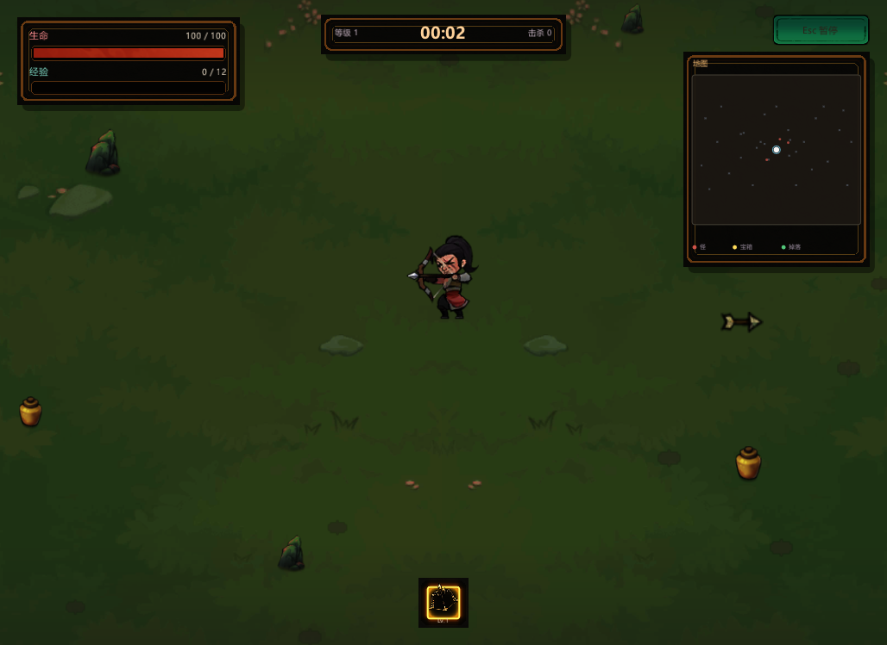
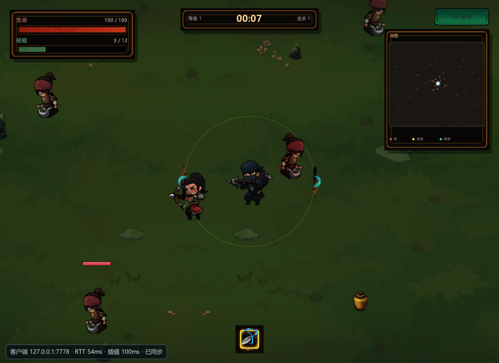

# 网络同步（引擎级）

> 状态：**已实现**。网络层不属于 2D 幸存者，放在 `engine/src/net/`，2D/3D 幸存者只是第一批接入方。
> 这一篇讲“怎么用、怎么接新玩法、现在能做什么、还差什么”；原理推导见
> [L18-网络基础](../教学文档/讲义/L18-网络基础.md)。

## 1. 一条命令联机

```bat
:: 主机（默认 2D 幸存者；加 --demo3d 可开 3D 幸存者）
run.bat dev --net-host 7777

:: 客户端（同一个局域网/本机）
run.bat dev --net-join 127.0.0.1:7777

:: 引擎级自检：同进程回环主机 + 客户端，不弹玩法
build\bin\ErMao.exe --net-test --noeditor
```

- `--net-host [port]`：启动主机，自动开局；默认端口 `7777`。
- `--net-join host[:port]`：连接主机；客户端本地预生成的玩家/敌人会被清掉，世界由主机快照驱动。从暂停菜单返回主菜单会主动断开主机并清理快照实体，之后的新局按单机玩法推进。
- `--net-port N`：只改主机监听端口。
- `--net-test`：无头自检，退出码 0/1；CI 已接入。
- 3D 联机：`run.bat dev --net-host --demo3d` / `--net-join 127.0.0.1:7777 --demo3d`。

当前版本是**主机权威（listen server）**：主机既是玩家也是服务器，客户端只上传输入；
敌人、伤害、掉落、升级全部在主机结算，客户端按快照重建画面。没有专用服务器、NAT 穿透和账号系统。

## 2. 为什么选 ENet

| 候选 | 口碑/成熟度 | 接入成本 | 结论 |
|---|---|---|---|
| **ENet 1.3.18** | 2002 年至今，Sauerbraten 等大量项目使用，MIT | 9 个 C 文件，无第三方依赖 | **采用**：`third_party/enet` |
| GameNetworkingSockets（Valve） | 很高（CS:GO/Dota 2 同源） | 需要 protobuf/OpenSSL/abseil，构建链重 | 不选：和“一条命令构建”冲突 |
| yojimbo（Glenn Fiedler） | 高，但更新停滞 | 自带序列化/加密，C++ 接口要适配 | 不选：ENet 更通用 |
| netcode.io | 面向专用服务器 + 客户端令牌 | 需要额外鉴权后端 | 不选：本工程是 listen server |

ENet 提供 UDP 上的可靠/有序/无序通道、ACK、重传、分片和连接管理。当前快照与输入都走
**可靠有序通道**：先保证正确性和可调试性；后续要做“旧快照直接丢”的不可靠快照，
只需把 `NetTransport::Send(..., reliable=false)` 换成通道 1，并给快照加基线/重传策略。

## 3. 代码分层

```text
engine/src/net/
  NetCommon.h        线上类型（NetInput/NetTransform）、带边界检查的字节读写、时间
  NetTransport.h/cpp ENet 封装：监听/连接/Poll/Send/RTT，不碰游戏逻辑
  NetReplication.h/cpp
                     World 快照复制：NetworkIdentity 标记、反射字段增量、客户端重建/插值
  NetRuntime.h/cpp   引擎主循环入口：PreFrame（收包/输入/预测）+ PostFrame（20Hz 快照）
  NetSelfTest.h/cpp  --net-test 同进程回环自检
  ...
engine/src/runtime/Engine.cpp  命令行、主循环接线、2D/3D 玩法钩子
engine/src/game/Survivors*.cpp/3D
                     只提供“哪些对象要同步 + 输入怎么驱动玩家 + 客户端进副本模式”
```

关键设计：

1. **通用复制**：服务端按反射 `TypeInfo` 把组件字段编码成增量快照。新增组件只要实现
   `Describe()` 并注册，不需要写网络代码；2D 和 3D 共用同一套。
2. **玩法只提供谓词**：`NetGameHooks::isReplicated(GameObject&)` 决定哪些对象参与同步。
   2D 幸存者用“带 Survivors 系列组件”，3D 用“带 Survivors3D 系列组件”，没有在
   `SpawnEnemy` / `FireArrow` 等生成点散落网络标记。
3. **服务端权威 + 客户端预测 + 快照插值**：
   - 服务端 20Hz 发快照，输入 60Hz 上行；
   - 客户端非本地实体按“服务端时间 − 100ms”插值，超出最新快照时最多外推 250ms；
   - 本地玩家立即用同一套移动函数预测，快照位置误差超过 1.5m 时直接拉回；
   - 当前没有回滚重放和延迟补偿，属于“轻量预测校正”，不是 rollback netcode。
4. **反射字段增量**：每个实体记录上一次的字段字节，只发变化的字段；Transform 单独按
   `位置 + 四元数 + 缩放` 比较。第一次连接/强制全量时发完整实体（名字、组件、字段）。
5. **客户端副本模式**：客户端不跑 `World::Update`，只跑 `World::UpdateVisuals`（序列帧、
   粒子、自转）。因此敌人 AI/伤害/掉落不会在客户端重复结算。

## 4. 协议

消息首字节是类型，之后是字节对齐的字段：

| 类型 | 方向 | 内容 |
|---|---|---|
| `1 ClientHello` | C→S | 协议版本、客户端名 |
| `2 Welcome` | S→C | 协议版本、快照/输入频率 |
| `3 TypeTable` | S→C | 按名字排序的可复制组件类型表 |
| `4 Input` | C→S | 序号、moveX/moveY、yaw、buttons |
| `5 Snapshot` | S→C | tick、ack、服务端时间、删除实体、实体增量 |
| `6 OwnEntity` | S→C | 客户端控制的实体 netId |

`TypeTable` 在每次连接时重新发，客户端按名字解析本地 `TypeInfo`；两端版本不一致时未知
组件会被跳过/整帧丢弃并写日志。协议版本不一致直接不进入同步状态。

## 5. 接入新玩法

以 3D 幸存者为例（`engine/src/runtime/Engine.cpp` 的 `SetupNetworkHooks`）：

```cpp
m_netHooks.isReplicated = [](GameObject& o) {
    return o.GetComponent<MyPlayerComponent>() || o.GetComponent<MyEnemyComponent>();
};
m_netHooks.onPeerConnected = [](PeerId peer) {
    GameObject* p = SpawnSecondPlayer(world);             // 生成第二个玩家
    p->AddComponent<net::NetworkIdentityComponent>()->ownerPeer = peer;
};
m_netHooks.applyServerInput = [](GameObject& p, const net::NetInput& in, float) {
    p.GetComponent<MyPlayerComponent>()->SetNetworkInput(Vec2(in.moveX, in.moveY));
};
m_netHooks.predictLocal = [](GameObject& p, const net::NetInput& in, float dt) {
    p.GetComponent<MyPlayerComponent>()->ApplyNetworkMove(Vec2(in.moveX, in.moveY), dt);
};
m_netHooks.prepareClientWorld = [](World& w) { RemovePrebuiltGameplayObjects(w); };
m_netHooks.onLocalEntity = [](GameObject* p) { SetLocalPlayerOverride(p); };
m_netHooks.onSnapshotApplied = [](World& w) { RebuildGameplayCaches(w); };
```

引擎已经处理：连接/断开、类型表、实体创建/销毁、Transform 插值、字段增量、网络状态文本。
玩法侧只需要“输入怎么变成移动”和“本地玩家是谁”。

## 6. 验证

```bat
build\bin\ErMao.exe --net-test --noeditor        :: 同进程回环，CI 必跑
build\bin\ErMao.exe --demo2d --frames 600 --noeditor
```

`--net-test` 覆盖：

- 协议字节读写边界；
- ENet 本机回环握手；
- 类型表与首帧全量快照；
- 客户端按快照重建实体；
- 客户端 60Hz 输入上行、服务端权威移动；
- 客户端本地预测与权威位置收敛（误差 < 0.8m）；
- 断开后客户端快照实体清理。

手动联机检查：两台机器同版本，主机 `--net-host`，客户端 `--net-join <主机IP>`；HUD
左下角会显示 `主机 :7777 · 客户端 N · 同步实体 M · 20Hz` 或 `客户端 ... · RTT ...`。

### 6.1 视觉验证（同一构建、同一 2D 场景、1028×749）

基线：没有 `--net-host` 的单机 2D 幸存者（第 120 帧）。



改动后：同一场景加 `--net-host`，唯一可见变化是左下角网络状态条。


联机客户端：`--net-join` 后看到主机玩家（左侧弓箭手）、自己的角色（中间）和同步过来的敌人/血条，
左下角显示 RTT 与插值延迟。



## 7. 已知限制（诚实清单）

- **不是回滚网络**：没有逐帧状态历史和输入重放；高延迟/丢包下本地预测会被 1.5m 阈值拉回。
- **没有延迟补偿**：射击命中以服务端当前时间为准；对高速移动目标会有“打中了没掉血”。
- **快照走可靠通道**：丢包靠 ENet 重传，延迟抖动时可能出现旧快照晚到；后续可改不可靠快照 + 基线。
- **客户端表现层不完整**：技能特效（雷霆/霜环/火球等）和漂浮伤害数字目前仍是主机本地 ImGui 表现，
  客户端只看到实体与血条；开箱抽奖动画也不会在客户端播放。
- **没有专用服务器、NAT 穿透、加密、账号/权限**；`--net-host` 是 listen server，主机退出即结束。
- **带宽未优化**：字段按原始字节发送，未做量化/优先级/视野裁剪；当前适合局域网/教学演示。
- **客户端不能暂停主机**；Esc 只暂停本地画面。结算/暂停等 UI 状态仍以本机为准，主机进入结算不会自动切到客户端结算页；主机退出后客户端停在最后画面。
- 目前只有 ENet 传输层是第三方库，网络同步/预测/插值代码都是本工程实现，方便教学逐行读。
